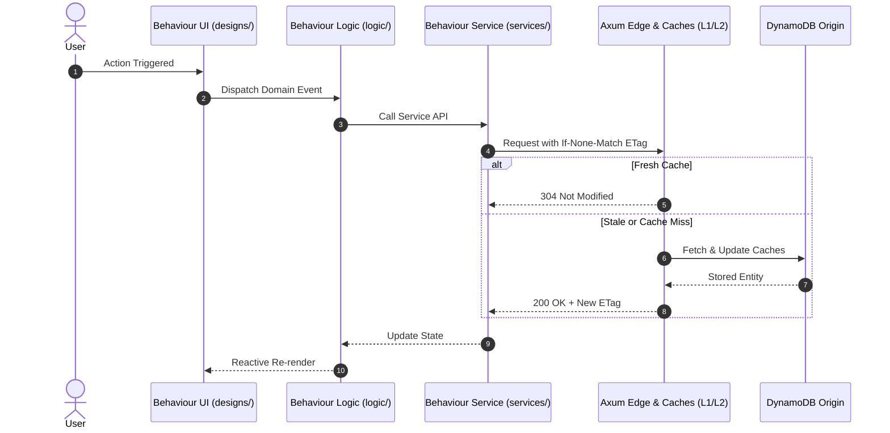

# Plan Template: [Feature / Story Name]

## 1. Architectural Placement & Folder Blueprint
```
features/<feature-name>/modules/<module-name>/behaviours/<behaviour-name>/
├── services/        # API clients, network handlers, query/mutation hooks
├── designs/         # UI screens, SDUI blocks, component styling
├── logic/           # Domain state machines, custom hooks, business rules
├── types/           # Interfaces, DTOs, schemas
└── constants/       # Action types, config parameters, route paths
```

### 1.1 Colocation & Promotion Analysis
| Layer | Scope | Assets / Responsibilities |
| :--- | :--- | :--- |
| **Behaviour-Local** | `behaviours/<behaviour-name>/` | All private services, designs, logic, types, constants |
| **Module-Shared** | `modules/<module-name>/_shared/` | Shared contracts across behaviours in this module |
| **Feature-Shared** | `features/<feature-name>/_shared/` | Shared domain primitives across modules in this feature |
| **Global-Shared** | `shared/` | Cross-cutting infrastructure, base kernel traits, HTTP envelopes |

## 2. Technical Contracts & Invariants
- **Data Model**: [DynamoDB PK/SK, GSI mappings, WatermelonDB tables]
- **State Transitions**: [Allowed state transitions and guard conditions]
- **RFC 9110 ETag / Freshness**: [ETag generation and 304 revalidation strategy]

## 3. Sequence & Flow Diagram

