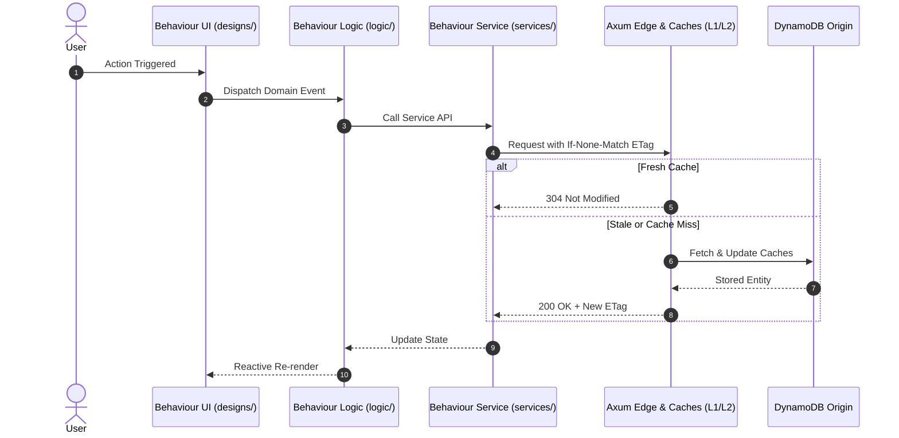

# Plan Template: [Feature / Story Name]

## 0. Company-plan lineage and story record

- Authorized CTO charter / PM spec references and revisions:
- Approved master implementation plan ID/revision/digest and parent role/workstream node:
- Canonical story record: `docs/validation/story-records/US-<id>.md`:
- Assignment type: planning-only (bounded draft outputs) or implementation/review (approved G0/SG0 inputs):
- Role subplans, incoming contracts/dependencies, expected child outputs and independent reviewers:
- Collection/integration owner, exact candidate acceptance and upward PM/CTO return conditions:

Use `.specify/templates/company-plan-template.md` for leadership planning and division of work. Draft plans cannot unblock implementation. Every action/decision and handoff is recorded through the canonical story record.

## 1. Architectural Placement & Folder Blueprint
```
features/<feature-name>/modules/<module-name>/behaviours/<behaviour-name>/
├── services/        # API clients, network handlers, query/mutation hooks
├── designs/         # UI screens, SDUI blocks, component styling
├── logic/           # Domain state machines, custom hooks, business rules
├── types/           # Interfaces, DTOs, schemas
└── constants/       # Action types, config parameters, route paths
```

### 1.1 Colocation & Promotion Analysis
| Layer | Scope | Assets / Responsibilities |
| :--- | :--- | :--- |
| **Behaviour-Local** | `behaviours/<behaviour-name>/` | All private services, designs, logic, types, constants |
| **Module-Shared** | `modules/<module-name>/_shared/` | Shared contracts across behaviours in this module |
| **Feature-Shared** | `features/<feature-name>/_shared/` | Shared domain primitives across modules in this feature |
| **Global-Shared** | `shared/` | Cross-cutting infrastructure, base kernel traits, HTTP envelopes |

## 2. Technical Contracts & Invariants
- **Data Model**: [DynamoDB PK/SK, GSI mappings, WatermelonDB tables]
- **State Transitions**: [Allowed state transitions and guard conditions]
- **RFC 9110 ETag / Freshness**: [ETag generation and 304 revalidation strategy]

### 2.1 Sprint closeout test design

Map affected AC/TC/task IDs and source paths to end-of-sprint benchmarks, integration flows, fuzz oracles/corpora and applicable Rust Loom models. Record baseline/workload/thresholds, real component/provider environments, fuzz resources and model instrumentation/exploration bounds. Assign test authors and independent reviewers. Missing applicable harnesses block acceptance; E4 N/A requires architecture + QA approval of scope and alternative concurrency evidence. Follow `docs/SPRINT_TESTING.md`.

## 3. Sequence & Flow Diagram

