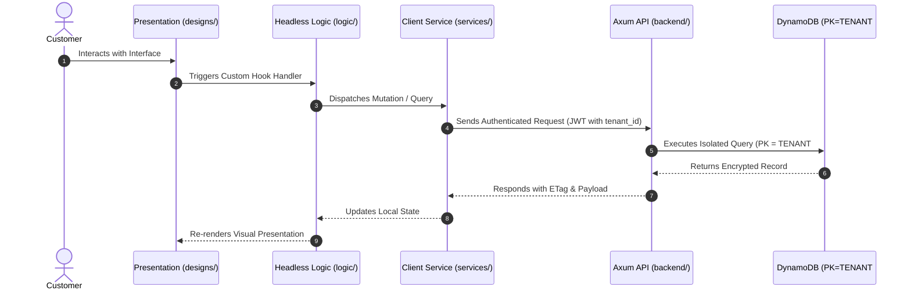

# US-[X.Y.Z]: [Story Title]

> **Spec Kit Specification**: [Specification Lifecycle Active (.specify/)](../../../.specify/memory/constitution.md)  
> **Behavior Blueprint**: `features/<feature>/modules/<module>/behaviours/<behaviour>/`  
> **Security Gateway**: `security-audit` Level 2 Enforced  
> **Quality Gates**: `(G0–G4 + G-Review + G-Borrow + G-UI + G-Law)`  

---

## 1. Spec Kit Specification

### 1.1 User Story Narrative
**As a** [Persona / Role],  
**I want to** [Action / Capability],  
**So that** [Business Value / Benefit].

#### 1.1.1 Preconditions
- [Precondition 1]
- [Precondition 2]

#### 1.1.2 Postconditions
- [Postcondition 1]
- [Postcondition 2]

### 1.2 Acceptance Criteria (Gherkin Scenarios)

```gherkin
Feature: [Feature Name]

  Scenario: [AC-US-X.Y.Z-01] [Happy path scenario title]
    Given [Initial context]
    When [Action occurred]
    Then [Expected outcome]

  Scenario: [AC-US-X.Y.Z-02] [Edge case or failure scenario title]
    Given [Edge condition]
    When [Action triggered]
    Then [Error response or recovery action]

  Scenario: [AC-US-X.Y.Z-LAW] Global e-commerce legal compliance and statutory regulations
    Given a customer interacting across global jurisdictions (EU, US, KSA, UK)
    When [statutory interaction occurs: checkout, pricing, privacy consent, withdrawal, or tax invoice]
    Then the system enforces applicable statutory regulations (GDPR/CCPA privacy, EU Omnibus pricing transparency, 14-day statutory withdrawal, PSD2/PCI-DSS payment rules, ZATCA e-invoicing, DSA platform rules, and EAA/ADA accessibility) without exception.
```

### 1.3 Test Cases & Traceability Matrix

| Test Case ID | Target Criterion | Test Type | Execution Level | Verification Assertion & Pass Criteria |
| :--- | :--- | :--- | :--- | :--- |
| `TC-X.Y.Z-01` | `AC-US-X.Y.Z-01` | Functional | Unit / Contract | Verify success payload and state mutation |
| `TC-X.Y.Z-02` | `AC-US-X.Y.Z-02` | Failure / Boundary | Integration | Verify input rejection and error code |
| `TC-X.Y.Z-LAW` | `AC-US-X.Y.Z-LAW` | Legal / Statutory | Integration / Static | Assert statutory compliance with international e-commerce legal directives |

---

## 2. Behavior-Centric Architecture & Folder Blueprint

### 2.1 Colocated Behaviour Directory Tree

```
features/<feature-name>/modules/<module-name>/behaviours/<behaviour-name>/
├── services/        # API fetchers, TanStack Query mutations, WatermelonDB SQLite sync
├── designs/         # Platform-adaptive presentation (@expo/ui Mobile, Tailwind Web) [Owned by ui-ux-designer]
├── logic/           # Headless custom hooks, state machines, validation math [Owned by client-engineer]
├── types/           # Strongly typed DTO interfaces, schemas, domain identifiers
└── constants/       # Route paths, cache keys, error codes, timeouts
```

### 2.2 Scoping & Promotion Blueprint
- **Tier 1 (Behaviour-Local)**: Assets private to `<behaviour-name>`.
- **Tier 2 (Module-Shared)**: Promoted to `modules/<module-name>/_shared/` when shared by $\ge 2$ behaviours.
- **Tier 3 (Feature-Shared)**: Promoted to `features/<feature-name>/_shared/` when shared by $\ge 2$ modules.
- **Tier 4 (Global-Shared)**: Promoted to framework `shared/` when universally required across features.

---

## 3. Technical Implementation Plan

### 3.1 Domain Invariants & Storage Schema
- **Tenant Isolation**: Mandatory `PK = TENANT#<tenant_id>` partition key filtering on all database operations.
- **Storage Contract**: DynamoDB single-table entity definition with explicit `PK`, `SK`, `GSI1PK`, `GSI1SK`.
- **Rust Memory Law**: Strict borrowing (`&T`, `&mut T`), lifetimes (`'a`), zero-copy buffers (`bytes::Bytes`), zero deep `.clone()` calls (Arc::clone/Rc::clone pointer increments only).
- **Presentation Separation**: UI presentation (`designs/`) is strictly separated from headless hooks (`logic/`).

### 3.2 Activity & Interaction Diagram



---

## 4. Granular Implementation Tasks

### Phase 1: Core Domain Logic, Types & Constants
- [ ] **Task 1.1 (Types)**: Define strongly typed DTO interfaces and models in `types/`.
- [ ] **Task 1.2 (Constants)**: Define endpoint paths, error codes, and configuration keys in `constants/`.
- [ ] **Task 1.3 (Logic)**: Implement pure domain logic, state machines, and headless custom hooks in `logic/`.
- [ ] **Task 1.4 (Unit Tests)**: Write unit and property-based tests verifying domain invariants and zero deep `.clone()`.

### Phase 2: Services & Infrastructure Adapters
- [ ] **Task 2.1 (API / Gateway)**: Implement client adapters and backend handlers in `services/`.
- [ ] **Task 2.2 (ETag & Cache)**: Integrate RFC 9110 ETag headers and caching layers.
- [ ] **Task 2.3 (Storage & Sync)**: Implement DynamoDB storage operations and WatermelonDB delta sync.
- [ ] **Task 2.4 (Integration Tests)**: Verify service contract tests and database writes.

### Phase 3: Platform-Adaptive Designs & UI
- [ ] **Task 3.1 (UI Presentation)**: Build platform-adaptive screens and components in `designs/` (@expo/ui Mobile, Tailwind Web).
- [ ] **Task 3.2 (Headless Hooks)**: Bind headless domain hooks from `logic/` into presentational components in `designs/`.
- [ ] **Task 3.3 (i18n & RTL)**: Implement bidirectional Arabic RTL/LTR layout mirroring and localized font switching.
- [ ] **Task 3.4 (Component Tests)**: Test empty, loading, offline, and error states across platforms.

### Phase 4: Security Gateway Verification & Release Readiness
- [ ] **Task 4.1 (Abuse Testing)**: Execute automated adversarial penetration tests against the threat matrix.
- [ ] **Task 4.2 (Zero-Trust Audit)**: Verify strict tenant isolation (`PK = TENANT#<id>`) and IDOR prevention.
- [ ] **Task 4.3 (SAST & Audit)**: Run static analysis, dependency audit, and secret scanning.
- [ ] **Task 4.4 (Gate Sign-Off)**: Obtain independent security sign-off for the G2 Security Gateway.

---

## 5. Security Gateway (Powered by security-audit)

### 5.1 Trust Boundaries & Security Actors
- **Trust Boundaries**:
  - `Untrusted Zone`: Mobile client app, public web browser, and external network callers.
  - `Gateway Edge`: AWS CloudFront, API Gateway, and Cognito JWT authentication guard.
  - `Secure Application Boundary`: Axum Tower route extractors enforcing tenant and RBAC/ABAC isolation.
  - `Encrypted Storage & Secret Vault`: Amazon DynamoDB KMS-encrypted tables and AWS KMS vault.
- **Authorized Principals**:
  - Identified Actors: `AuthenticatedCustomer`, `B2bBuyer`, `Vendor`, `StoreAdmin`, or `AnonymousShopper` (read-only).
  - Multi-Tenancy Invariant: Every request must extract `tenant_id` from verified JWT claims. Injections via query params or payload body are rejected with `403 Forbidden`.

### 5.2 Threat Modeling & Abuse Matrix (STRIDE / ASVS)

| Threat Vector | Severity | Vulnerability Mechanism | Mitigating Control & Security Invariant |
| :--- | :--- | :--- | :--- |
| **Spoofing & Impersonation** | Critical | Forged `sub` or `tenant_id` identity claims | Server-side RS256 JWKS signature verification; strict claims extraction in Axum. |
| **Tampering & Invariant Bypass** | High | Manipulating payload parameters or prices | Authoritative server recalculation; strict schema validation; BLAKE3 ETag integrity checks. |
| **Information Disclosure (IDOR)** | Critical | Cross-tenant or cross-user data scraping | Explicit `PK = TENANT#<id>` partition filtering on every database and cache operation. |
| **Denial of Service / Abuse** | High | Request flooding, brute force, parameter tampering | Token-bucket rate limiting per IP and account; strict input length validation. |
| **Elevation of Privilege** | Critical | Bypassing role-based permission checks | Tower extractors (`RequireStoreAdmin`, `RequireVendor`) guard sensitive endpoints. |

### 5.3 Cryptographic & Data Protection Controls
- **Encryption in Transit**: TLS 1.3 enforced on all external and internal endpoints; HSTS active.
- **Encryption at Rest**: DynamoDB AWS KMS customer-managed keys; AES-256-GCM for sensitive client tokens in `expo-secure-store`.
- **PII & Secret Redaction**: Passwords, OTPs, auth tokens, and financial data stripped from logs via `tracing` redaction filters.

### 5.4 Automated Security Verification Checklist
- [ ] **SAST Analysis**: Clean report from static code analyzers; 0 high or critical vulnerabilities.
- [ ] **Dependency Audit**: `cargo deny` and `bun audit` pass with 0 unreviewed security advisories.
- [ ] **Abuse & IDOR Fuzzing**: Test suite confirms that requests with modified `tenant_id` or `user_id` fail with `401 Unauthorized` or `403 Forbidden`.
- [ ] **Secret Scanning**: Gitleaks scanner confirms zero hardcoded credentials, API keys, or private keys.

### 5.5 Security Gateway (G2) Sign-Off Checklist
- [ ] Threat boundary and entry points verified against OWASP ASVS Level 2 requirements.
- [ ] Multi-tenant isolation verified with automated cross-tenant penetration test.
- [ ] Anti-abuse and rate limiting confirmed active on all public interfaces.
- [ ] Audit log redaction verified — zero plaintext secrets in output logs.
- [ ] Independent reviewer sign-off obtained; zero open Critical or High findings.

---

## 6. Validation Gates & Acceptance Sign-Off

**Status: Pending — specification only; no implementation evidence.** All [G0–G4 quality gates + G-Review + G-Borrow + G-UI + G-Law](../../QUALITY_GATES.md) apply to this story. The following checks add to its acceptance criteria and test cases; they do not replace them.

### G1 — Test coverage
- [ ] **US-X.Y.Z-G1:** Automated test suite maps 100% of acceptance criteria and test cases with >=90% line and >=85% branch coverage in affected packages.

### G2 — Security audit
- [ ] **US-X.Y.Z-G2:** Verify zero-trust tenant isolation, object-level authorization (IDOR), and defense against spoofing, tampering, and elevation of privilege. No unresolved critical or high findings.

### G3 — Architecture and maintainability
- [ ] **US-X.Y.Z-G3:** Strict compliance with framework colocation (`apps/storefront/src/features/` or `backend/src/features/`), zero-clone borrowing discipline in Rust, and clean domain boundaries.

### G-Review — Code review
- [ ] **US-X.Y.Z-G-Review:** Independent senior code review signed off by the Code Reviewer; verification across Correctness, Security, Maintainability, Performance, and Testing using the Agency-Agents code review standard; zero open Blocker or unresolved Suggestion findings.

### G-Borrow — Rust zero-clone borrowing validation
- [ ] **US-X.Y.Z-G-Borrow:** Backend code relies strictly on borrowing (&T, &mut T), explicit lifetimes, zero-copy byte buffers (bytes::Bytes), and zero unauthorized deep .clone() calls on domain entities and models (Arc::clone and Rc::clone pointer copies permitted only); certified by systems reviewer.

### G-UI — UI/UX validation
- [ ] **US-X.Y.Z-G-UI:** Pure separation of presentation (designs/, owned by ui-ux-designer) and headless hooks (logic/, owned by client-engineer); mobile components use @expo/ui primitives and native modules; web components use semantic HTML5 styled with Tailwind CSS; WCAG 2.1 AA and Arabic RTL layout parity verified; certified by UI/UX designer.

### G-Law — Law validation
- [ ] **US-X.Y.Z-G-Law:** Independent verification against global e-commerce legal and statutory requirements: GDPR/CCPA privacy, EU Omnibus pricing, 14-day statutory withdrawal, PCI-DSS/PSD2 payment rules, ZATCA/VAT fiscal invoicing, DSA/P2B platform rules, and EAA/ADA accessibility; certified by compliance reviewer (`agency-legal-compliance-checker`).

### G4 — Integrated acceptance
- [ ] **US-X.Y.Z-G4:** End-to-end user journey validation across supported platforms (Web, iOS, Android) and verified sandbox integration.
