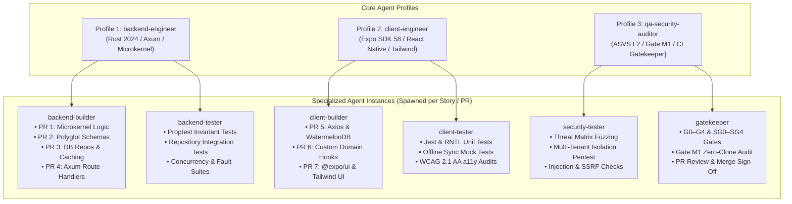
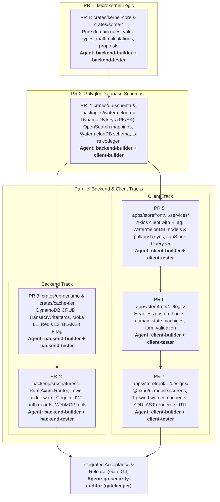

# Multi-Agent Orchestration Framework & 3 Core Agent Profiles

## 1. Executive Summary

`some-commerce` employs a scalable multi-agent engineering framework designed to deliver high-velocity, conflict-free parallel implementation across all 12 sprints.

The framework is founded on **3 Core Agent Profiles**:
1. **`backend-engineer`**: Systems, Microkernel & Axum API Engineer
2. **`client-engineer`**: Universal Expo SDK 58, React Native & Web UI Engineer
3. **`qa-security-auditor`**: OWASP ASVS Security, Invariant Verification & Gatekeeper Lead

Within any sprint, **multiple agent instances** can be spawned from these 3 profiles to operate in parallel on the same user story or across multiple user stories. Conflict-free operation is guaranteed through **physical directory isolation**, **strict write-boundary whitelisting**, and the standardized **7-PR Vertical Slicing Pipeline**.

Every agent instance operates inside its own dedicated **Sprint-Level Working Directory (`workdir`)** with tailored context files and isolated Git worktrees.

---

## 2. The 3 Core Agent Profiles



### 2.1 Profile 1: `backend-engineer`
* **Primary Scope**: Rust 2024 microkernel packages, polyglot database schemas, repository caching handlers, and pure Axum HTTP routers.
* **Governing Rules**:
  * **Rust Zero-Clone Law**: Strict prohibition of `.clone()` on domain structs, payloads, and strings. Code must rely on borrowing (`&T`, `&mut T`), lifetimes (`'a`), and zero-copy byte buffers (`bytes::Bytes`). Reference counting is restricted exclusively to `Arc::clone(&handle)` for thread-safe state pointers.
  * **Microkernel Logic Purity (Gate M1)**: Zero cloud vendor SDKs (`aws-sdk-*`, `azure_*`, `google-cloud-*`), zero direct database drivers, and zero network runtimes inside `crates/some-*`.
  * **Axum Decoupling Law**: Axum router functions in `backend/src/features/` must be pure Tower services and must NEVER import `lambda_http`.
* **Allowed Paths**:
  * `crates/**`
  * `backend/src/features/<feature>/modules/<module>/behaviours/<behaviour>/[services, logic, types, constants]`
  * `backend/bins/**`
* **Specialized Instances**:
  * `backend-builder`: Writes domain math, state machines, schemas, repositories, and Axum handlers.
  * `backend-tester`: Writes unit tests, property tests (`proptest`), and repository integration tests without modifying production code.

### 2.2 Profile 2: `client-engineer`
* **Primary Scope**: Universal Expo SDK 58 React Native mobile app and Tailwind-styled Web app located under `apps/storefront/src/features/`.
* **Governing Rules**:
  * **Locality of Behavior (LoB)**: Code must strictly adhere to the 4-tier folder hierarchy (`features -> modules -> behaviours -> [services, designs, logic, types, constants]`).
  * **Offline-First Resilience**: All read and mutation paths must integrate with WatermelonDB local SQLite/IndexedDB and TanStack Query v5 cache.
  * **Platform Adaptation**: Use `@expo/ui` native components for iOS/Android, Tailwind CSS for Web, and SDUI AST renderers.
  * **Accessibility & Localization**: Mandatory support for Arabic (`ar-EG`, RTL) and English (`en-US`, LTR), meeting WCAG 2.1 AA standards.
* **Allowed Paths**:
  * `apps/storefront/src/features/<feature>/modules/<module>/behaviours/<behaviour>/[services, designs, logic, types, constants]`
  * `apps/storefront/src/shared/**`
  * `packages/api-client/**`, `packages/watermelon-db/**`, `packages/query-client/**`
* **Specialized Instances**:
  * `client-builder`: Writes API client services, WatermelonDB actions, custom hooks, and UI screens.
  * `client-tester`: Writes Jest component tests, React Native Testing Library suites, and offline sync mock tests.

### 2.3 Profile 3: `qa-security-auditor`
* **Primary Scope**: Security Gateways, OWASP ASVS verification, Gate M1 microkernel audits, and sprint quality gate sign-off.
* **Governing Rules**:
  * **Zero Critical/High Vulnerabilities**: Every PR must pass SAST, dependency scans, and secret audits with zero critical/high findings.
  * **Zero-Trust Multi-Tenancy**: All queries, cache keys, and data mutations must be partitioned by `TenantId`.
  * **Strict ASVS L2 Conformance**: Enforce authorization checks on every operation, preventing IDOR, injection, and privilege escalation.
  * **Gatekeeper Review**: Enforces G0–G4 and SG0–SG4 sign-offs before any branch or PR is merged.
* **Allowed Paths**:
  * `docs/validation/**`
  * `scripts/ci/**`
  * Security scanning configs (`deny.toml`, `.audit.json`)
* **Specialized Instances**:
  * `security-tester`: Executes adversarial penetration testing, injection attacks, IDOR checks, and rate-limiting fuzzing.
  * `gatekeeper`: Reviews test coverage ($\ge 90\%$ line / $\ge 85\%$ branch), verifies Gate M1, and executes PR merge certifications.

---

## 3. Conflict-Free Orchestration: The 7-PR Slicing Pipeline

To eliminate merge conflicts and allow multiple agents from the same profile to work simultaneously on the same user story, work is partitioned into **7 ordered, discrete Pull Requests**:



### 3.1 Non-Conflicting Parallelism Rules

1. **Independent Workdirs**: Each agent runs in its own isolated sprint workdir:
   `.agents/workspaces/<sprint-id>/<agent-name>/`
   backed by an isolated Git branch (`agent/<sprint-id>/<agent-name>`).
2. **File Whitelisting & Non-Overlapping Targets**:
   - `backend-builder` edits `crates/` and `backend/src/features/...`
   - `backend-tester` edits `backend/tests/` and test modules
   - `client-builder` edits `apps/storefront/src/features/.../[services, logic, designs]`
   - `client-tester` edits `apps/storefront/__tests__/`
   - `qa-security-auditor` reviews code, executes scans, and signs off gates.
3. **Contract-First Concurrency**: Once PR 2 merges schema definitions and runs `ts-rs` codegen, the **Backend Track (PR 3 & 4)** and **Client Track (PR 5, 6 & 7)** execute completely in parallel without blocking each other.

---

## 4. Sprint-Level Agent Workdir Architecture

Each agent generated at the sprint level receives a fully populated, self-contained workspace:

```
.agents/workspaces/<sprint-id>/<agent-name>/
├── agent.yaml           # Agent metadata, profile, role, and path whitelists/blacklists
├── context.md           # Tailored story specifications, PR requirements, schemas & laws
├── tasks.md             # Granular, ordered execution checklist for this specific PR
└── workspace/           # (Optional) Dedicated Git worktree checkout on branch agent/<sprint>/<name>
```

### 4.1 `agent.yaml` Specification
```yaml
name: s11-us111-be-builder
profile: backend-engineer
role: builder
sprint: sprint-1.1
story: us-1.1.1
pr: 1
workdir: .agents/workspaces/sprint-1.1/s11-us111-be-builder
allowed_paths:
  - crates/kernel-core/**
  - crates/some-auth/**
forbidden_paths:
  - apps/storefront/**
  - backend/bins/lambda-serverless/**
rules:
  - zero_clone_borrowing_enforced: true
  - microkernel_purity_enforced: true
  - axum_lambda_decoupling_enforced: true
```

### 4.2 `context.md` Specification
Contains the exact subset of information required by that agent:
- Target User Story narrative and Gherkin Acceptance Criteria `[AC-US-X.Y.Z-NN]`
- Detailed PR deliverables for their assigned layer
- Colocated behaviour directory tree
- Security Gateway invariants (Trust boundaries, STRIDE threats, KMS keys)
- Concrete verification commands (`cargo test`, `proptest`, `validate_microkernel.py`)

---

## 5. Tooling: Automated Antigravity CLI Agent Scripts & Profiles

### 5.1 The Agent Profiles Catalog (`.agents/profiles/`)
All software company positions and agent profiles are codified inside the `.agents/profiles/` directory:
- `backend-engineer`, `junior-backend-engineer`, `senior-backend-engineer`
- `client-engineer`, `junior-client-engineer`, `senior-client-engineer`
- `testing-qa-engineer`, `junior-testing-qa-engineer`, `senior-security-qa-auditor`
- `product-manager`, `tech-lead`, `system-architect`, `ui-ux-designer`
- `security-engineer`, `devops-engineer`, `release-gatekeeper`, `chief-technology-officer`

Each profile directory contains:
- `profile.yaml`: Metadata, allowed write paths, forbidden paths, governing invariants, tools, and recommended Gemini model & effort.
- `system_prompt.md`: Comprehensive system instructions enforcing the 6-Layer Validation Ladder, Zero-Clone borrowing, LoB, and ASVS L2.
- `env.template`: Default environment configuration template.

Every profile is also registered for native discovery in `.agents/agents/<profile>/agent.md`, enabling immediate recognition via:
```bash
agy agents
```

---

### 5.2 Antigravity CLI Agent Maker Shell Script (`scripts/make_agy_agent.sh`)
Generates an individual Antigravity CLI agent with customized profile, role, story, PR, native CLI registration, and isolated workdir:

```bash
./scripts/make_agy_agent.sh \
  -n s11-us111-be-builder \
  -p backend-engineer \
  -s junior \
  -r builder \
  --sprint sprint-1.1 \
  --story us-1.1.1 \
  --pr 1 \
  --create-git-worktree
```

This single command provisions:
1. Native Antigravity CLI agent: `.agents/agents/s11-us111-be-builder/agent.md`
2. Isolated agent profile home & credentials: `.agent_profiles/s11-us111-be-builder/`
3. Sprint workdir artifacts: `.agents/workspaces/sprint-1.1/s11-us111-be-builder/` (`agent.yaml`, `context.md`, `tasks.md`, `run.sh`)
4. Isolated Git worktree: `workspace/` on branch `agent/sprint-1.1/s11-us111-be-builder`

---

### 5.3 Antigravity CLI Agent Launcher (`scripts/agy_agent.sh`)
Launches any registered agent or base profile in an isolated `$HOME` environment with configured models, reasoning effort, and target directories:

```bash
# Launch interactive Antigravity CLI session for an agent:
./scripts/agy_agent.sh s11-us111-be-builder

# Run a non-interactive single prompt:
./scripts/agy_agent.sh s11-us111-be-builder -p "Implement PR 1 domain logic for US-1.1.1"

# List all available registered agents:
./scripts/agy_agent.sh --list
```

---

### 5.4 Agent Profile Load Balancer (`scripts/agent_load_balancer.py`)
Balances sprint workload across Junior Implementers and Senior Reviewers, enforcing DAG dependency gating and directory isolation:

```bash
# View balanced workload matrix:
python3 scripts/agent_load_balancer.py --sprint sprint-1.1 --balance

# Spawn all isolated agent workspaces for a sprint:
python3 scripts/agent_load_balancer.py --sprint sprint-1.1 --spawn
```
