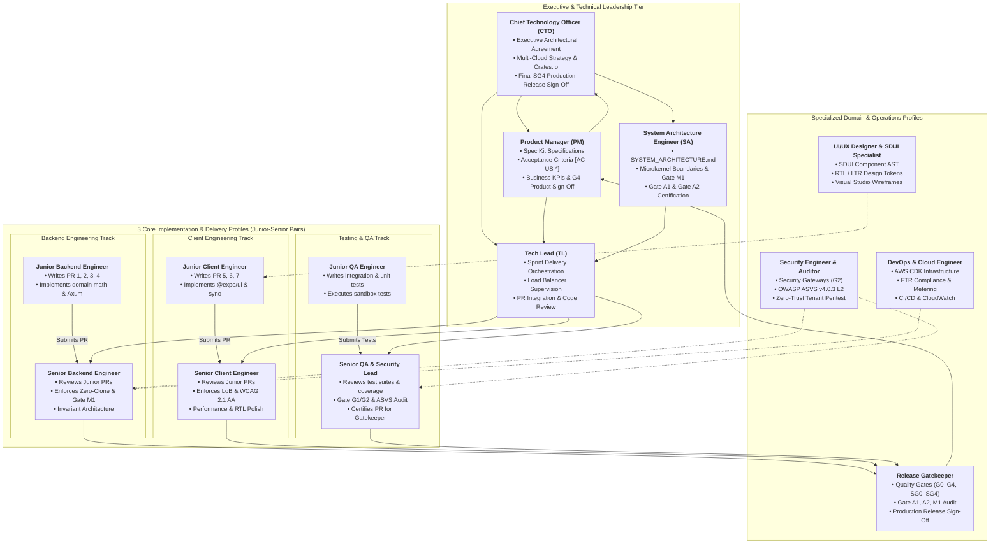
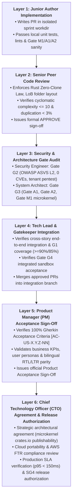
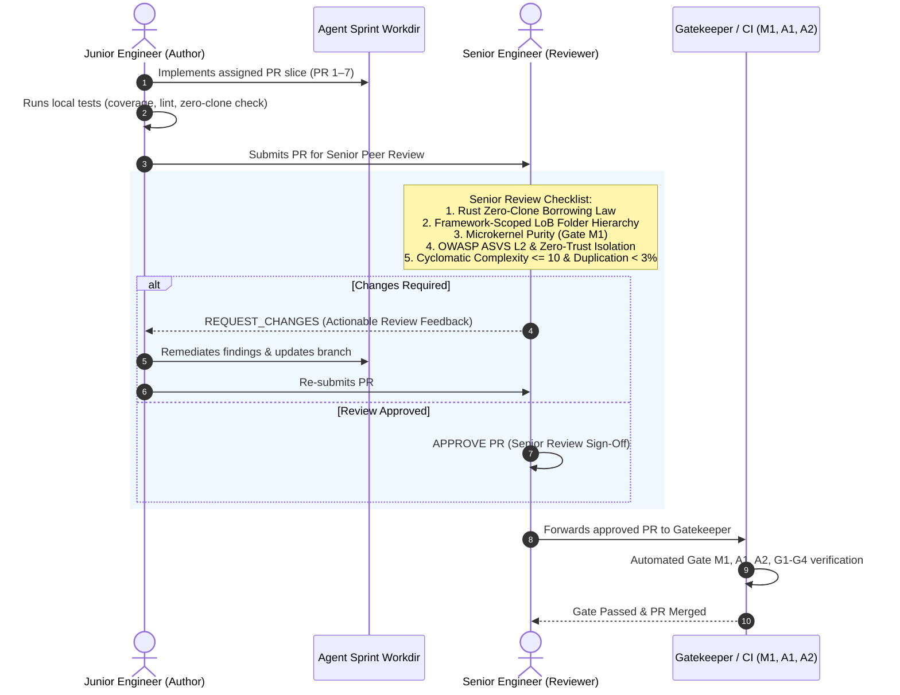
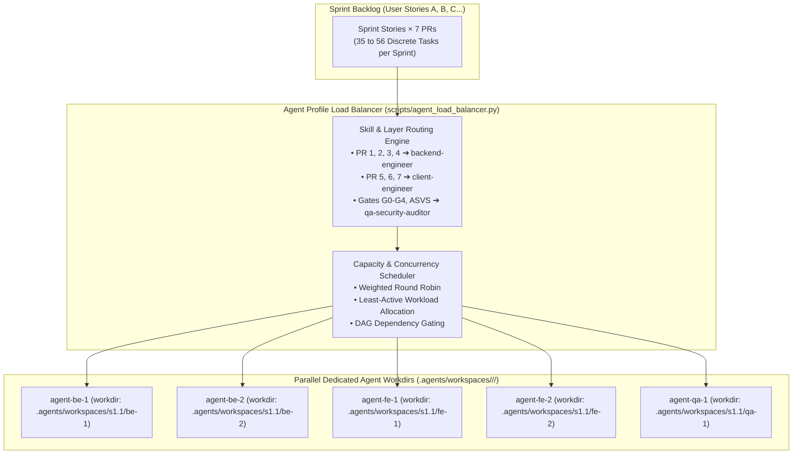

# Software Company Roles, Agent Profiles & Multi-Agent Orchestration

## 1. Executive Overview

`some-commerce` structures its autonomous engineering organization around the full spectrum of software company positions. Every role operates as a specialized agent profile with explicit responsibilities, bounded write-permissions, and non-overlapping working directories (`workdir`).

To achieve high-concurrency delivery across the **12 Sprints**, sprint execution is coordinated through an **Agent Profile Load Balancer** that maps user stories and the **7-PR Vertical Slicing Pipeline** to available agent pools.

---

## 2. Master Company Role Catalog & Agent Profiles

---

## 3. The 6-Layer Validation Hierarchy: From Junior Author to CTO Agreement

Every user story and pull request in `some-commerce` passes through a strict **6-Layer Governance Ladder** before production deployment:

### 3.1 Layer 1: Junior Implementation & Self-Validation
- **Owner**: `junior-backend-engineer`, `junior-client-engineer`, `junior-qa-engineer`.
- **Exit Criteria**: PR compiles cleanly without warnings; local test suites pass; no syntax or lint errors; zero stray files.

### 3.2 Layer 2: Senior Peer Code Review
- **Owner**: `senior-backend-engineer`, `senior-client-engineer`, `senior-qa-engineer`.
- **Exit Criteria**:
  - **Backend**: Strict zero-clone borrowing verified; pure microkernel logic free of cloud SDKs; pure Axum router functions.
  - **Client**: 4-tier LoB directory placement verified; WatermelonDB offline sync correctly integrated; `@expo/ui` native components used.
  - **Testing**: Line coverage $\ge 90\%$, branch coverage $\ge 85\%$, mutation kill rate $\ge 90\%$.
  - Formal Senior Review Approval recorded in review comments.

### 3.3 Layer 3: Security & Architecture Gate Audit
- **Owner**: `security-engineer` & `system-architect`.
- **Exit Criteria**:
  - **Gate G2 (Security)**: Automated SAST, dependency vulnerability audit, secret scan, and adversarial multi-tenant fuzzing passed with 0 critical/high findings.
  - **Gate G3 / Gate A1 (System Architecture)**: 10-layer architectural contracts verified (`python3 scripts/validate_system_architecture.py`).
  - **Gate G3 / Gate A2 (Folder Architecture)**: Framework-scoped LoB verified (`python3 scripts/validate_folder_architecture.py`).
  - **Gate G3 / Gate M1 (Microkernel)**: Crate purity and zero-clone verified (`python3 scripts/validate_microkernel.py`).

### 3.4 Layer 4: Tech Lead & Gatekeeper Integration
- **Owner**: `tech-lead` & `release-gatekeeper`.
- **Exit Criteria**:
  - Cross-PR and cross-story integration tests pass in unified staging environment.
  - No coverage regression across monorepo packages.
  - PR merged to release candidate branch.

### 3.5 Layer 5: Product Manager (PM) Acceptance Sign-Off
- **Owner**: `product-manager`.
- **Exit Criteria**:
  - 100% of Gherkin Acceptance Criteria `[AC-US-X.Y.Z-NN]` verified in functional sandbox.
  - User persona journeys validated across Web and Native Mobile (iOS/Android).
  - Bilingual localization (`ar-EG` RTL and `en-US` LTR) verified.
  - Formal PM Acceptance Sign-off recorded on the story evidence record.

### 3.6 Layer 6: Chief Technology Officer (CTO) Agreement & Release Authorization
- **Owner**: `chief-technology-officer`.
- **Exit Criteria**:
  - Executive architectural agreement: Microkernel packages confirmed ready for [crates.io](https://crates.io) distribution.
  - Cloud portability confirmed (Axum router decoupled from Lambda runtime; runs on AWS, GCP, Azure, or Docker).
  - AWS Marketplace FTR compliance and metering verification verified.
  - Production SLA budgets confirmed (p95 latency $< 150\text{ms}$ on warm endpoints, $< 400\text{ms}$ cold start).
  - Rollback drill and disaster recovery plan verified.
  - Formal **CTO Agreement** granted for Sprint Release Gate **SG4**.

---

## 4. Junior Engineers & Senior Code Review Pairing Workflow

To maintain the highest caliber of code quality, zero-clone memory efficiency, and strict architectural compliance, all implementation in `some-commerce` follows an explicit **Junior Author / Senior Reviewer Pairing Protocol**:

### 3.1 Senior Review Invariants
1. **Rust Zero-Clone Verification**: Senior Backend Engineers MUST reject any junior PR that invokes `.clone()` on non-`Arc`/`Rc` types. Junior authors must use borrowing (`&T`, `&mut T`), lifetimes (`'a`), or zero-copy byte buffers.
2. **Framework-Scoped LoB Verification**: Senior Client Engineers MUST reject any junior PR that places components outside the 4-tier hierarchy or creates sibling cross-behaviour imports without promoting to `_shared/`.
3. **Coverage & Mutation Verification**: Senior QA Engineers MUST verify that changed code achieves $\ge 90\%$ line and $\ge 85\%$ branch coverage, with $\ge 90\%$ of mutations killed in pure domain rules.
4. **Independent Approval Required**: Under the Constitution, a junior engineer CANNOT self-approve their own PR. A documented senior review approval is a hard prerequisite for Gate G3 and Gatekeeper merge.

---

## 5. Detailed Position Specifications

### 5.1 Chief Technology Officer (`chief-technology-officer`)
* **Primary Scope**: Executive architectural strategy, multi-cloud governance, crates.io ecosystem vision, and final release agreement.
* **Core Deliverables**:
  * Final executive agreement on **Gate SG4 (Sprint Release Gate)**.
  * Approves additions of new abstract microkernel crates (`crates/some-*`) targeted for public distribution.
  * Authorizes cloud portability strategies (AWS vs GCP vs Azure vs bare-metal Docker).
  * Validates disaster recovery, RPO/RTO metrics, and AWS Marketplace FTR compliance.
* **Allowed Paths**: Global architectural documents, release manifests, and executive dashboards.

### 5.2 Product Manager (`product-manager`)
* **Primary Scope**: Defines *what* is built, who the user is, and why it matters.
* **Core Deliverables**:
  * Owns GitHub Spec Kit user story specifications (`docs/user-stories/**/us-*.md`).
  * Establishes stable Gherkin Acceptance Criteria (`[AC-US-X.Y.Z-NN]`).
  * Prioritizes sprint backlogs (P0/P1/P2) and tracks business value metrics.
  * Signs off on **Gate G0 (Ready)** and verifies **Gate G4 (Integrated Acceptance)** from the user perspective.
* **Allowed Paths**: `docs/user-stories/**`, `docs/sprints/**`.

### 5.3 Tech Lead / Engineering Manager (`tech-lead`)
* **Primary Scope**: Coordinates end-to-end sprint engineering, resolves blockers, and reviews code.
* **Core Deliverables**:
  * Deconstructs user stories into the standardized **7-PR Pipeline**.
  * Supervises the **Agent Profile Load Balancer** (`scripts/agent_load_balancer.py`) to balance workload.
  * Ensures non-conflicting directory isolation across parallel agents.
  * Facilitates PR merges and cross-team interface contracts.
* **Allowed Paths**: Workspace-wide read access; review access to PRs.

### 5.4 System Architecture Engineer (`system-architect`)
* **Primary Scope**: Owns platform architectural contracts, microkernel logic abstraction, and multi-cloud portability.
* **Core Deliverables**:
  * Owns [`docs/SYSTEM_ARCHITECTURE.md`](file:///Users/maheraladdin/Desktop/some-commerce/docs/SYSTEM_ARCHITECTURE.md), [`docs/FOLDER_ARCHITECTURE.md`](file:///Users/maheraladdin/Desktop/some-commerce/docs/FOLDER_ARCHITECTURE.md), and [`docs/MICROKERNEL_AND_CLOUD_PORTABILITY.md`](file:///Users/maheraladdin/Desktop/some-commerce/docs/MICROKERNEL_AND_CLOUD_PORTABILITY.md).
  * Enforces **Gate A1** (System Architecture Conformance) and **Gate A2** (Folder Architecture Conformance).
  * Enforces **Gate M1** (Microkernel Logic Abstraction & Cloud Decoupling).
  * Validates trait Ports (`BlobStoragePort`, `DocumentDbPort`, `MessagingPort`) and ensures pure domain packages remain 100% free of cloud SDKs.
* **Allowed Paths**: `docs/**`, `crates/**`, architecture validation scripts.

### 5.5 Backend & Systems Engineer (`backend-engineer`)
* **Primary Scope**: Microkernel crates, polyglot databases, caching, and pure Axum HTTP services.
* **Governing Rules**:
  * **Strict Rust Zero-Clone Law**: Zero `.clone()` calls on domain structs, strings, or payloads. Borrowing (`&T`, `&mut T`), lifetimes, and zero-copy references only.
  * **Axum Decoupling Law**: Feature route handlers must be pure Tower services and never import `lambda_http`.
* **Sub-Roles & Seniority**:
  * `junior-backend-engineer`: Authors PR 1 (Domain logic), PR 2 (Schemas), PR 3 (Repos/Caching), and PR 4 (Axum routes).
  * `senior-backend-engineer`: Reviews junior PRs, enforces zero-clone borrowing, approves Gate M1 microkernel purity.
  * `backend-tester`: Delivers exhaustive property-based tests (`proptest`), unit tests, and integration suites.
* **Allowed Paths**: `crates/**`, `backend/src/features/**`, `backend/bins/**`, `backend/tests/**`.

### 5.6 Client & Mobile Engineer (`client-engineer`)
* **Primary Scope**: Universal Expo SDK 58 application on mobile (iOS/Android) and Web.
* **Governing Rules**:
  * **Locality of Behavior (LoB)**: Files must reside strictly in `apps/storefront/src/features/<feature>/modules/<module>/behaviours/<behaviour>/[services, designs, logic, types, constants]`.
  * **Platform Adaptation**: `@expo/ui` native controls on mobile, Tailwind CSS on Web, and SDUI AST renderers.
  * **Offline-First & RTL**: WatermelonDB local cache first; bilingual Arabic (`ar-EG`, RTL) and English (`en-US`, LTR) layout.
* **Sub-Roles & Seniority**:
  * `junior-client-engineer`: Authors PR 5 (API clients & WatermelonDB sync), PR 6 (Custom hooks & logic), and PR 7 (Platform-adaptive UI).
  * `senior-client-engineer`: Reviews junior PRs, verifies LoB folder compliance, enforces WCAG 2.1 AA accessibility and RTL layout.
  * `client-tester`: Delivers Jest component tests, React Native Testing Library suites, and offline sync mock tests.
* **Allowed Paths**: `apps/storefront/src/features/**`, `apps/storefront/src/shared/**`, `packages/**`.

### 5.7 UI/UX Designer & SDUI Specialist (`ui-ux-designer`)
* **Primary Scope**: Visual design systems, Server-Driven UI (SDUI) widget specifications, and accessibility tokens.
* **Core Deliverables**:
  * SDUI widget AST models and JSON component schemas.
  * Visual SDUI Drag-and-Drop Studio layout specifications.
  * Design tokens (`tokens.md`), typography scales, and WCAG 2.1 AA color contrast compliance.
* **Allowed Paths**: `apps/storefront/src/shared/tokens/**`, `docs/SDUI_AND_LOCALIZATION.md`, UI design specs.

### 5.8 Testing & QA Engineer (`testing-qa-engineer`)
* **Primary Scope**: Cross-story integration testing, provider sandbox certification, and regression verification.
* **Sub-Roles & Seniority**:
  * `junior-qa-engineer`: Authors integration and unit tests, executes provider sandbox scenarios.
  * `senior-qa-engineer`: Audits coverage metrics, validates mutation kill rates, and signs off on Gate G1.
* **Allowed Paths**: `tests/**`, `backend/tests/**`, `apps/storefront/__tests__/**`.

### 5.9 Security Engineer & Auditor (`security-engineer`)
* **Primary Scope**: Security Gateways, OWASP ASVS v4.0.3 L2 compliance, and zero-trust multi-tenancy.
* **Core Deliverables**:
  * Enforces **Gate G2** sign-off on all user stories and PRs.
  * Synthetic penetration testing asserting 0 cross-tenant data leaks.
  * AWS KMS cryptographic envelope key management and zero-PII logging audits.
  * Dependency security scans (`cargo audit`, `npm audit`, `deny.toml`) with 0 critical/high findings.
* **Allowed Paths**: `docs/validation/**`, security scanners, audit evidence.

### 5.10 DevOps & Cloud Infrastructure Engineer (`devops-engineer`)
* **Primary Scope**: AWS CDK v2 infrastructure, CI/CD automation, and AWS Marketplace listing.
* **Core Deliverables**:
  * AWS CDK stacks (`infra/cdk/**`) for serverless Graviton4 Lambda and DynamoDB/ElastiCache/OpenSearch resources.
  * AWS Marketplace FTR compliance and SaaS metering integration.
  * Automated cloud deployment verification and rollback runbooks.
* **Allowed Paths**: `infra/**`, `scripts/ci/**`, `.github/workflows/**`.

### 5.11 Release Gatekeeper (`release-gatekeeper`)
* **Primary Scope**: Absolute enforcement of Quality Gates (G0–G4, SG0–SG4, Gate M1, Gate A1, Gate A2).
* **Core Deliverables**:
  * Reviews Gate G0 readiness before stories start.
  * Reviews Gate G1 (coverage), Gate G2 (security), Gate G3 (architecture) before PR merge.
  * Reviews Gate G4 (acceptance) before story completion.
  * Prepares Gate **SG4** package for final **CTO Agreement**.
* **Allowed Paths**: `docs/QUALITY_GATES.md`, `GATES.md`, `docs/validation/**`.

---

## 4. The 3 Core Execution Profiles & Load Balancing

For sprint implementation, all engineering execution is powered by **3 Core Execution Profiles**:
1. **`backend-engineer`** (Sub-roles: `backend-builder`, `backend-tester`)
2. **`client-engineer`** (Sub-roles: `client-builder`, `client-tester`)
3. **`qa-security-auditor`** (Sub-roles: `security-tester`, `gatekeeper`, `testing-qa-engineer`)

### 4.1 The Agent Profile Load Balancer
The **Agent Profile Load Balancer (`scripts/agent_load_balancer.py`)** dynamically distributes user story PR slices across these 3 profiles:

### 4.2 Non-Conflicting Concurrency Rules

1. **Physical Workdir Isolation**: Each agent runs in its own directory:
   `.agents/workspaces/<sprint-id>/<agent-name>/`
   backed by an independent Git branch (`agent/<sprint-id>/<agent-name>`).
2. **Write-Path Whitelisting**:
   * Backend agents may write **only** to `crates/` and `backend/`.
   * Client agents may write **only** to `apps/storefront/` and `packages/`.
   * QA/Security agents may write **only** to `tests/` and `docs/validation/`.
3. **Contract-Driven Parallelism**: Once PR 2 merges schema definitions and exports TypeScript types via `ts-rs`, the **Backend Track (PR 3 & 4)** and **Client Track (PR 5, 6 & 7)** execute concurrently without blocking each other.
