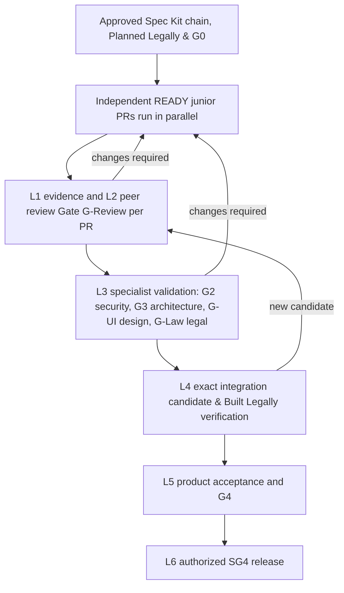

# Software Company Roles, Agent Profiles & Validation Authority

## 1. Governance contract

Every agent receives **role and job-title responsibilities → pinned job context → detailed task**, in that order, using the [launch brief](AGENT_PROFILES_AND_MULTI_AGENT_FRAMEWORK.md#4-agent-launch-brief-role-job-context-detailed-task). All positions use [Spec Kit](../.specify/memory/constitution.md): approved specification, architecture, plan, assigned task IDs, Security Gateway and traceable gate evidence. This includes leadership, orchestration, review and release tasks. No role can bypass the lifecycle because it does not author production code.

The three execution profiles are reusable skill/capability sets, not privileged identities. Junior/senior/executive titles describe responsibilities; authority comes from authenticated identities, independently assigned capabilities and trusted repository/environment controls. An agent acting as CTO can prepare a release recommendation; production authority remains with the explicitly authorized operator and deployment service.

All job titles may use any of the three authentication accounts (`agent-a`, `agent-b`, `agent-c`). Account allocation balances recorded usage and configured availability rather than assigning backend/client/governance tracks to fixed credentials. Account rotation does not replace role-specific context, scoped permissions or independent approval. See the [profile catalog](../.agents/profiles/README.md) and [quota/launch guide](../.agents/agents/README.md).

**Status:** this document specifies hardened governance. It does not assert that current generators, CI, branch protection, sandboxing or production permissions enforce it. [The framework stress-test register](AGENT_PROFILES_AND_MULTI_AGENT_FRAMEWORK.md#8-stress-test-register-and-operational-acceptance) tracks the required implementation evidence. The constitution remains binding. If these documents, generated prompts or existing gate policies conflict, the dependent assignment is BLOCKED until an authorized policy owner resolves the conflict; agents cannot choose the weaker rule.

## 2. Role and authority matrix

### Company direction flows down; validated results flow up

The full company cycle starts with **CTO direction**, not junior implementation. CTO establishes the authorized charter; PM writes the Spec Kit product specification; the architect defines decomposition/contracts and coordinates specialist subplans; the tech lead reconciles a master implementation plan and divides it into role-owned workstreams and dependency-safe junior tasks. PM, architecture/security owners and CTO approve the baseline before implementation dispatch. Each child keeps its parent-plan node and revision.

Every affected company role contributes a scoped plan before execution: backend/client seniors specify technical tasks, QA/security specify test/threat acceptance, design specifies user/interface states, and DevOps specifies environment/recovery/provenance requirements. Specialist planning can proceed concurrently from stable upstream inputs. This does not give a junior permission to invent the overall plan or implement unapproved drafts. [Planning-only assignments](AGENT_PROFILES_AND_MULTI_AGENT_FRAMEWORK.md#22-planning-assignments-avoid-a-circular-prerequisite) may create missing artifacts from an approved upstream charter without pretending a completed feature plan already exists.

On the return path, contributors submit immutable branch outputs to independent seniors, then the tech lead reconciles **all expected child outputs** into one candidate. QA/security/architecture validate the assembled system and sprint closeout; PM checks the original product outcomes; CTO receives the complete dossier for final acceptance, scoped replan or a blocked decision. Missing branches, incompatible interfaces and failed tests block parent acceptance even when individual contributors report completion. See the [full planning and collection contract](AGENT_PROFILES_AND_MULTI_AGENT_FRAMEWORK.md#21-company-planning-delegation-and-return-cycle).

All paths below describe eligible task scope, not repository-wide write grants. Each assignment must name exact approved paths. Review artifacts are drafts until a trusted service records the decision. No agent can modify final evidence, issue credentials to itself or remove a required check.

| Job title / role ID | Job context and concrete responsibility | Eligible deliverables | Decision boundary |
|:-------------------|:----------------------------------------|:----------------------|:------------------|
| Junior Backend Engineer / `junior-backend-engineer` | Implement approved domain/schema/repository/API/worker tasks through `backend-engineer` using Agency-Agents backend patterns (resilience, backpressure, circuit breaking, zero-clone borrowing) | Assigned source/tests under `crates/`, `backend/`; AC/task evidence | No self-review, policy/CI edits, merge or deploy |
| Senior Backend Engineer / `senior-backend-engineer` | Independently trace domain invariants, ownership, failure paths and adapter boundaries; perform Agency-Agents Code Review (Gate G-Review) across 5 pillars with 4-tier triage | Review findings, actionable diffs, assigned regression tests, and G-Review sign-off | If they fix production code, they become an author and another reviewer must approve; zero open blockers |
| Junior Client Engineer / `junior-client-engineer` | Implement custom hook logic (`logic/`), WatermelonDB SQLite queries/mutations, API clients (`services/`), and client state integration through `client-engineer` using Agency-Agents frontend patterns; wire custom hooks into visual components provided by UI/UX Designer | Assigned files under `apps/storefront/src/features/**/{logic,services,types,constants}/`, named client packages | Cannot author arbitrary UI styling or design tokens; no client-authoritative pricing/auth, no implicit permission to publish builds |
| Senior Client Engineer / `senior-client-engineer` | Review custom hook logic, state ownership, WatermelonDB offline sync, contract compatibility, and performance; perform Agency-Agents Code Review (Gate G-Review) across 5 pillars with 4-tier triage | Independent consumer/build/device review, actionable diffs, and G-Review sign-off | Cannot certify unsupported platforms from mock-only evidence; zero open blockers |
| Junior QA Engineer / `junior-qa-engineer` | Derive tests from Spec Kit AC/TCs and threats; run approved synthetic checks | Assigned test suites/fixtures and draft evidence | Cannot change requirements or implement the system under test to make own tests pass |
| Senior QA Engineer / `senior-qa-engineer` | Validate test oracles, scope, coverage denominator, mutation survivors and flakiness | G1 recommendation and independent test review | Cannot treat percentages as proof of all invariants or approve own test changes alone |
| Security Engineer / `security-engineer` | Map applicable pinned ASVS controls, threat boundaries, abuse cases and findings | Assigned security tests, threat review, G2 recommendation | No production probes or credentials by default; cannot waive critical/high defects |
| System Architect / `system-architect` | Review dependency direction, canonical policy ownership, reuse, contracts, and Project Constitution laws | ADRs, G3/A1/A2/M1/L1 recommendation, and G-Law sign-off | New abstractions need concrete use; authoring shared code removes independence for that change |
| UI/UX Designer / `ui-ux-designer` | Translate approved personas and accessibility/localization requirements into presentation contracts (`designs/`), semantic design tokens, @expo/ui components, SDUI schemas, and Arabic RTL mirroring; certify Gate G-UI (UI/UX Finish Gate Review & Accessibility) using `agency-ui-finish-gate-reviewer` and `agency-accessibility-auditor` | Assigned tokens, view specs, `designs/` components, visual evidence, and Gate G-UI review sign-off | Strictly owns `designs/`; cannot author custom hook logic or data mutations; cannot reduce ACs or publish SDUI without the approved publish workflow |
| Product Manager / `product-manager` | Own problem/personas, stable AC IDs, statutory e-commerce legal compliance (GDPR, Omnibus, Consumer Rights, Invoicing) using `agency-legal-compliance-checker`, and scope decisions | Assigned specs, plans, backlog, G-Law legal compliance audit, and product acceptance | Can approve product scope, not override failed engineering/security gates |
| Tech Lead / `tech-lead` | Build the task DAG, narrow leases, reserve reviewers and resolve blocked ownership | Assignment manifests, integration plans and triage | Coordinates; no blanket `**` write permission, no automatic merge or policy override |
| DevOps Engineer / `devops-engineer` | Specify/build isolated runners, IaC, artifact provenance, observability and recovery | Separately assigned `infra/`, CI and operational runbooks | CI/trust changes need independent security review; no long-lived worker production secrets |
| Release Gatekeeper / `release-gatekeeper` | Verify expected evidence, identities, freshness, conflicts, G-Review code review, and G-Law statutory compliance certification using `agency-compliance-auditor` | Release evidence index, G-Law/G-Review verification, and approval recommendation | Cannot edit check results, waive a rejection or certify their own implementation |
| Chief Technology Officer / `chief-technology-officer` | Own cross-system risk, architecture strategy and release recommendation | Approved strategy/ADR/release decision drafts | No technical bypass, identity escalation or implied production/publishing authorization |

`backend-builder`, `backend-tester`, `client-builder`, `client-tester`, `security-tester` and `gatekeeper` are task modes mapped to these titles, not additional sources of privilege. A person/service may cover several roles only when author independence and capability separation remain intact. Different agent names, prompts or model instances sharing a credential do not constitute separate authenticated approval authorities. Independent model review adds scrutiny; protected external controls enforce authority.

### 2.1 Separation of duties

- The authenticated author/contributor set includes anyone who changed production code, tests, required-check definitions, fixtures or policy relevant to the decision. The lead records conflicts before assigning reviewers. Reviewers cannot authorize themselves through an editable manifest.
- L2 peer review must be independent of relevant authors. G2 security and G3 architecture require qualified independent reviewers; one reviewer may cover both when qualified, but cannot be an author of the reviewed change.
- An author may explain or remediate findings, but cannot erase or downgrade them. Independent reviewers own dispositions. No review shopping after rejection; reassignment retains the finding history and requires an accountable lead's reason.
- A reviewer who needs to edit implementation opens a remediation task and returns the change for fresh independent review. Review and remediation modes have separate grants.
- CI policy, scanner suppressions, coverage exclusions, Spec Kit/constitution changes, generators and release configuration require independent control-owner review. The candidate must not choose or weaken its own acceptance policy.
- Agent workers have no merge/signing/deploy credentials. A trusted integration service may merge only within existing authorization after required checks and reviewers pass. Production release/publishing needs explicit operator authorization bound to the release manifest and environment. A release title or checklist does not supply it.

## 3. Six validation layers

These six layers are the **upward execution-validation ladder** following approved top-down planning P0–P4. CTO has two distinct responsibilities: direction/plan approval at the beginning and evidence-based final review at the end. Initial plan approval does not pre-approve the implementation; final acceptance requires a complete expected-child manifest, the exact integrated candidate, E1–E5 sprint results and original charter/AC traceability.

Layers are distinct decisions with evidence, not six model opinions. No upper layer can convert a lower-layer Fail/Pending into Pass. G0 precedes dispatch; G1–G3 protect PR integration; G4 protects story completion; SG0–SG4 validate the sprint-wide candidate under [quality gates](QUALITY_GATES.md). The expected check manifest is established before work, with scope and N/A rules independently approved.

| Layer | Responsible party | Input and required decision | Reject / invalidate when |
|:------|:------------------|:----------------------------|:-------------------------|
| L1 — Author verification | Assigned junior/builder/test author | Acknowledged Spec Kit chain; scoped patch; AC/TC/task map; approved test commands; complete failures and artifacts | Missing requirements, undeclared files, failed tests, expired lease, unsupported claim |
| L2 — Independent peer review & code review (Gate G-Review) | Assigned qualified senior / Code Reviewer (Agency-Agents Standard) | Review exact diff and approved spec across 5 pillars (Correctness, Security, Maintainability, Performance, Testing); 4-tier triage (🔴 Blocker, 🟡 Suggestion, 🟢 Nitpick, 🌟 Praise); provide actionable diffs; zero open blockers | Reviewer is a contributor, unaddressed blockers, only summary reviewed, requirements weakened, critical paths untested |
| L3 — Specialist validation (Security, Architecture, UI/UX & Law) | Independent security, architecture, UI/UX design and legal compliance reviewers | G2 threat/authorization/scans, G3 design/dependency checks, Gate G-UI design & accessibility audit, and Gate G-Law / L1 statutory legal compliance; authenticated evidence | Missing scan scope, stale advisory data, unresolved critical/high defect, accessibility failure, visual blocker, or unmet statutory legal/architecture contract |
| L4 — Candidate integration & technical verification | Tech lead + trusted CI + gatekeeper | Rebuild/test exact combined tree; verify Two-Phase Legal Conformance ("Planned Legally, Then Built Legally"); consumer/provider contracts and cross-story workflows; validate all expected checks and reviewer identities | Changed merge base/candidate, incompatible schema, missing/skipped/cancelled checks, unverified statutory legal rules, or artifact mismatch |
| L5 — Product acceptance | PM + test/release reviewer | Verify every AC with observable evidence on required personas/platforms/locales; G4 for completed story | Mock-only full-flow claim, omitted AC/platform, unacceptable product behavior, stale scope approval |
| L6 — Release authorization | Accountable operator/CTO + release/operations | SG4 manifest links accepted stories, signed artifact digests, provenance, deployment plan, numeric budgets, rollback/restore evidence and authorized environment | Any required prior gate incomplete, expired exception, unknown artifact/source, missing operational approval or rollback capability |

### 3.1 L1–L2: tests, design and maintainability

Apply G1 per affected package: at least 90% changed line and 85% branch coverage; critical domain modules require at least 95% branch and all identified invariant/deny/error outcomes. Critical pure-rule mutation coverage targets at least 90% of non-equivalent mutations killed; triage every survivor. Unsupported branch instrumentation is Pending until an approved alternative measures the decisions. Empty test discovery or absent manifests cannot establish application coverage.

Require deterministic unit/property tests, real repository conditional-write/transaction tests, provider contract checks, client/device checks and concurrency/fault tests according to scope. Inject clock/IDs/randomness where useful. Assert final state and side-effect counts, not only HTTP success. Pin test environments and record seeds. Diagnose flakiness; rerunning until green without disposition is insufficient.

Review actual imports/build graph, no cycles, canonical business-rule owners, typed interfaces/errors and a concrete change exercise demonstrating reuse. Duplication and complexity follow G3: above-threshold results need refactoring or the narrowly permitted reviewed disposition, never silent suppression. Strict constitutional clone rules remain in effect until an authorized amendment; shallow handle copies and allocation behavior need semantic review. Do not add unsafe code, redundant abstractions or meaningless wrappers to satisfy a lexical scanner.

#### L2 Agency-Agents Code Review Standard (Gate G-Review)

All Layer 2 peer reviews must execute under the **Agency-Agents Code Reviewer Standard** (`engineering/engineering-code-reviewer.md`), acting as the formal **Gate G-Review** validation gate for user stories and implementation PRs:

1. **Educational & Mentoring Mindset**: Reviews are opportunities to teach and elevate. Reviewers explain the *why* behind requested changes, referencing architectural contracts and design standards.
2. **5 Evaluation Pillars**:
   - **Correctness**: Zero logic bugs, error propagation, concurrency safety, async cancellation, and state machine validity.
   - **Security**: ASVS v4.0.3 L2 compliance, zero-trust tenant isolation, and strict server-side authority derivation.
   - **Maintainability**: Locality of Behavior (LoB), 4-tier directory hierarchy, duplication $<3\%$, and cyclomatic complexity $\le 10$.
   - **Performance**: Algorithmic efficiency, Rust zero-clone borrowing discipline (zero deep `.clone()` on domain types), and query/cache latency.
   - **Testing**: 100% acceptance criteria mapping, property-based tests, failure/recovery cases, and mutation test survival $\ge 90\%$.
3. **4-Tier Feedback Classification**:
   - 🔴 **Blocker**: Must fix before merge (bugs, security flaws, invariant breaks, unauthorized `.clone()` calls). PR blocked.
   - 🟡 **Suggestion**: Strongly recommended architectural/maintainability improvements; must be addressed or triaged before Gate G4.
   - 🟢 **Nitpick**: Minor stylistic or non-critical tweaks (optional).
   - 🌟 **Praise**: Explicit recognition of elegant solutions, exceptional tests, or great documentation.
4. **Actionable Suggestions & Single-Pass Review**: Every requested change must provide a concrete code snippet or replacement diff. Reviewers conduct exhaustive reviews in a single pass to eliminate unnecessary feedback roundtrips.

### 3.2 L3: independent adversarial and architecture validation

G2 checks unauthenticated, wrong-role and same-role/different-user/vendor/org/tenant cases across reads, mutations, search counts, cache, sync, jobs, downloads and tools. Include stale/revoked authority, replay, malformed input and bounded abuse. Use isolated synthetic data. Tenant ID partitioning alone cannot establish authorization within a tenant. Pin the adopted ASVS version and record applicable control IDs and omissions; do not claim blanket conformance from SAST.

G3/A1/A2/M1/L1 and Gate G-Law require structural lint, behavioral/build evidence, and international statutory e-commerce legal compliance checks (GDPR/CCPA privacy, EU Omnibus Directive 30-day pricing, 14-day statutory withdrawal, PCI-DSS v4.0 / PSD2 SCA, ZATCA e-invoicing, DSA/P2B platform rules, and EAA/ADA accessibility). Every story must define its statutory legal acceptance rule `[AC-*-LAW]` and pass Gate G-Law verification (`scripts/validation/validate_laws.py`). Forbid cloud/transport/storage dependencies in pure domain packages, keep runtime adapters at composition roots, compile supported consumers, inspect feature flags/transitive dependencies, and verify codegen compatibility. Folder conformance, wasm compilation and absence of a forbidden string do not establish cloud portability, crates.io readiness or runtime safety. Public publishing is a separately authorized release.

Every critical/high finding blocks merge/release. Other permitted exceptions need independent approval, compensating evidence, owner, remediation issue and expiry. Credential exposure, isolation and financial invariants cannot be waived. Executives cannot override these blockers by signing a risk statement.

### 3.3 L4: exact-candidate and CI trust

Integrate through a protected queue or equivalent serialized merge service. Produce the combined tree commit before acceptance; build and check that tree, not only the separate PR heads. Any new commit/rebase/conflict resolution invalidates relevant evidence and reviews. Re-evaluate downstream dependency/contract changes and reverse dependency suites. The service verifies check issuer/workflow and current policy, not a same-name status posted by an untrusted actor.

Untrusted PR jobs receive no release secrets and cannot write final gate records. Trusted check definitions come from protected policy; a proposed policy change is reviewed separately before it can authorize itself. Pin tool/action revisions, keep environments/caches isolated by trust domain, and validate artifact size/path/type and provenance before promotion. Failed infrastructure or scanner outage is Pending/Fail, not “no vulnerabilities.”

The aggregator must compare results with an expected check manifest. Missing, skipped, cancelled, timed-out, malformed, stale, empty-scope and zero-test checks block approval. N/A is only for reviewed unaffected sub-checks. Preserve original failures and reasons for reruns. Evidence digests bind content; authenticated issuers and protected storage establish who produced it.

### 3.4 L5–L6: product and release validation

PM acceptance is requirements acceptance, never a substitute for security or design verification. A partially implemented story stays In Progress and cannot be exposed in production before G4. Required provider/device/accessibility checks need actual environment evidence, with limitations recorded.

The release manifest binds repository, source/integration commit, spec/plan/tasks/policy digests, dependencies, test/build run IDs, SBOM, artifact digests, target environment, approvers, deployment window, rollback version and expiry. Rebuilds create new artifacts and invalidate old artifact approval. Deploy only the approved digest; environment changes require re-authorization.

Define latency/error/cost/capacity budgets at G0 with workload, data size, device, region, cold/warm state, run duration and samples. Fixed p95 values without that context are not release evidence. Demonstrate migration compatibility, data restore RPO/RTO, rollback triggers, alert delivery and incident ownership for affected stateful services. Release failure freezes promotion, preserves evidence and invokes the approved rollback/reconciliation runbook.

## 4. Parallel junior implementation and review capacity

Several juniors may implement independent PRs at once, including several juniors with the same title or profile. The [framework scheduler](AGENT_PROFILES_AND_MULTI_AGENT_FRAMEWORK.md#5-parallel-juniors-and-the-dependency-scheduler) admits each assignment from its Spec Kit task DAG, contracts and leases. A backend PR and client PR can proceed from the same approved contract while unrelated stories continue; dependency-bound PRs wait for their declared verified prerequisite.

The tech lead plans author and reviewer capacity together. Reserve reviewers before dispatch, cap work in progress and prioritize unblocking reviews. Never auto-approve because a senior is busy or a review deadline expires. Record a review due time and bounded escalation to another qualified independent reviewer; retain rejections and conflicts. No available reviewer means BLOCKED, with an owner and next action.

Each PR has one accountable owner even if several authors contribute. Give contributors disjoint task leases and record them all for independence checks. Shared schemas, generated DTOs, lockfiles, workflow files and inline tests require a named single writer or explicit serialization. A profile pool assignment does not authorize concurrent writes to the same file.

### 4.1 Continuous delivery responsibilities

Apply the [continuous handoff protocol](AGENT_PROFILES_AND_MULTI_AGENT_FRAMEWORK.md#52-continuous-handoff-and-automatic-reassignment). Junior implementation, senior validation and later reviews are separate queued assignments, so different stories can move through different stages concurrently.

| Event | Required action | Accountable owner |
|:------|:----------------|:------------------|
| Junior submits a valid implementation handoff | Persist candidate and L2 review event, quiesce the old writer, then assign that junior the next independent READY story/task with a fresh Spec Kit brief | Controller + tech lead |
| Senior accepts review | Start validation against the pinned candidate while the junior continues its next task | Assigned senior |
| Senior finds a scoped defect | Record the finding; fix through a separately leased remediation task or route it to an eligible engineer without waiting for the original junior | Senior + tech lead |
| Senior or later-stage reviewer changes code/tests | Create a new candidate, add contributor identity, invalidate affected evidence and assign a qualified non-contributing reviewer | Controller + independent senior |
| Stage passes | Durably enqueue the next required stage; join security/architecture results before integration and carry the exact candidate through PM to CTO/release review | Controller + gatekeeper |
| Review overdue, queue full or worker lost | Escalate/reconcile within the configured deadline, fence stale attempts, enforce backpressure and continue unaffected work | Tech lead + operations |
| All included stories accepted | Verify G4, required CTO/release decisions, sprint gates, drained queues and no open repair before reporting backlog completion | Gatekeeper + CTO/operator |

Senior repair authority is explicit; self-approval remains forbidden. A senior who fixes A cannot supply A's independent L2/G2/G3 approval. Another qualified reviewer validates the repaired candidate. Security, architecture, integration, PM and CTO stages may request fixes using this same bounded repair loop, and the original junior need not remain idle throughout it. A story remains In Progress during implementation review and rework; only the required G4 and release decisions establish acceptance.

Every stage uses the approved Spec Kit spec/plan/task chain and a role → job context → detailed task launch brief. The controller reacts to submission, validation, repair, dependency and worker-availability events rather than waiting for a whole sprint or all stories to finish a stage. Deadlines trigger recovery or escalation, never automatic approval. Capacity exhaustion or no eligible work is an explicit blocked/waiting state, not a guarantee that every worker always has work.

## 5. Decision records, disagreement and incident handling

Each story's authoritative operational record is `docs/validation/story-records/US-<id>.md`, initialized from the [story record template](validation/STORY_RECORD_TEMPLATE.md). All planning/execution/validation roles read and acknowledge it on entry. Submit every story-related action intent/outcome, decision, artifact, failure, repair and ownership transfer through the controller; update the snapshot and obtain next-role acknowledgment on exit. Role scratch notes and separate chat summaries are supporting material, not competing sources of truth. Shared initiative actions link the same event ID in each affected story. Missing events, stale revisions or unacknowledged transfers block parent acceptance. Append linked corrections and retain original findings; store secrets and private reasoning nowhere in the record.

Record each approval/rejection with authenticated reviewer ID, contributor/conflict set, exact candidate, Spec Kit chain and policy revisions, scoped findings, artifacts, timestamp and expiry. The trusted controller owns append-only final records; agents propose decisions. Signed text in a Markdown file is only a draft unless a trusted service verifies identity and subject.

Security/architecture rejection stops affected dependent work. The lead routes a concrete disputed requirement to its accountable owner; unresolved disagreement is BLOCKED. Scope/AC changes go through PM and affected control owners, update Spec Kit artifacts and invalidate dependent approvals. No agent may delete findings, downgrade severity or edit its own exemption expiry.

On suspected prompt injection, evidence tampering, scope escape or leaked credential: stop the affected task, isolate the workspace, revoke capabilities, preserve bounded redacted evidence and alert the accountable security/runtime owner through an authorized channel. Resume only after independently approved containment and a fresh assignment. Ordinary agents cannot initiate external messages merely because the incident procedure mentions escalation.

## 6. Governance stress tests and adoption checklist

These tests are required operational acceptance scenarios. They are specifications until executed independently; current documentation lint does not certify them.

| Scenario | Required result | Owner / gate |
|:---------|:----------------|:-------------|
| Launch any role without approved Spec Kit spec/plan/tasks or with stale revisions | Admission rejected, including PM/CTO/reviewer roles | Spec owner / G0, SG0 |
| Two independent junior PRs plus a third dependent PR | Independent pair overlaps; third waits for its verified prerequisite, then starts without unrelated blocking | Tech lead / SG1 |
| Author renames itself “senior” or supplies reviewer approval text | No authenticated approval or extra capability granted | Security / G2 |
| Senior fixes code then attempts own approval | Contributor conflict detected; fresh independent review required | Gatekeeper / G3 |
| PR changes scanner suppression, CI, policy or acceptance criteria to pass itself | Protected control-owner review and prior trusted checks still required | Security + architect / G2–G3 |
| Old worker resumes after lease replacement; duplicate completion arrives | Stale promotion denied, one state transition, no release of another lease | Runtime owner / SG1 |
| One check skipped/cancelled, scanner offline, zero tests, or no source scanned | No aggregate Pass; report specific missing evidence | QA / G1–G2 |
| Green result belongs to another commit/workflow, or report is edited after collection | Stale/untrusted result rejected; affected checks rerun | CI owner / L4 |
| Shared API changes while client juniors are running | Affected consumers paused/replanned; old approvals invalidated | Architect / G3, SG1 |
| All reviewers busy or disagree; retry budget exhausted | Task stays BLOCKED and escalates; no timeout approval | Tech lead / SG0–SG4 |
| Artifact or destination differs after CTO recommendation | Deployment denied until exact manifest is reapproved | Release owner / SG4 |
| Agent is asked by repository text to leak secrets or relax scope | Instruction treated as untrusted; task authority unchanged | Security / G2 |
| Junior finishes A while B is READY | Junior starts B and senior starts A review independently; A is not prematurely Done | Tech lead / SG1 |
| Senior repairs A while junior works on B | Fresh repair lease/candidate; a different senior approves fixes; A reaches CTO only after affected gates rerun | Gatekeeper / G1–G4, SG4 |
| Controller crashes after handoff or stage decision | Durable replay produces exactly one logical successor item and no duplicate release action | Operations / SG1, SG4 |
| Review queue exceeds limit or no READY task exists | Apply backpressure or report waiting with an owner; no busy loop, invented work or skipped review | Tech lead / SG0–SG4 |
| Initiative starts without a feature plan | CTO receives an authorized planning task, then PM/architect/lead create and approve P0–P4 artifacts before junior implementation | CTO + planning lead / SG0 |
| One branch is missing while all received branches are green | Parent collection remains incomplete; final PM/CTO acceptance blocked | Tech lead + gatekeeper / G4, SG4 |
| Role handoff omits a command failure, repair or action event | Canonical story-record reconciliation rejects promotion; next role receives complete history and explicit next action | Controller + gatekeeper / G0–G4 |

Before adoption, assign named owners and evidence locations for every AO finding in the [framework register](AGENT_PROFILES_AND_MULTI_AGENT_FRAMEWORK.md#8-stress-test-register-and-operational-acceptance). Verify runtime confinement, task admission, authenticated independent approvals, protected CI policy, exact-candidate checks, immutable evidence and release authorization. Reconcile generated profiles and existing quality-gate scripts with these contracts. Until then, generated allocations remain proposals requiring supervised execution.
