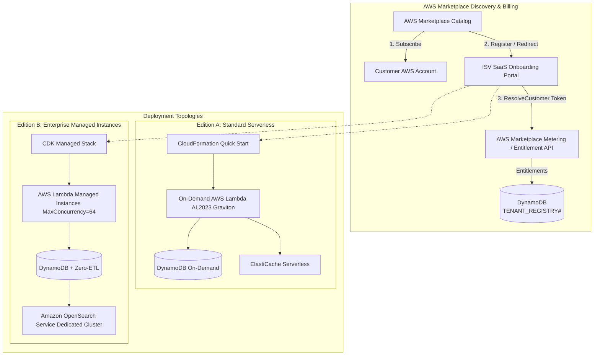
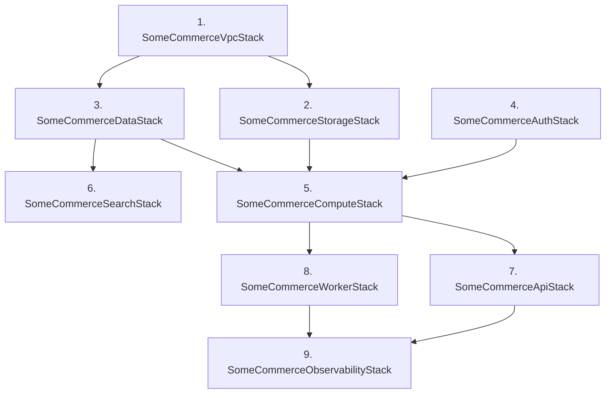
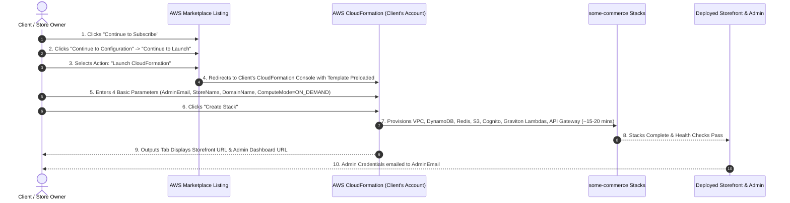
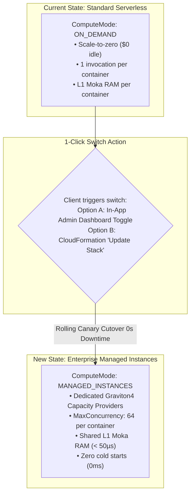
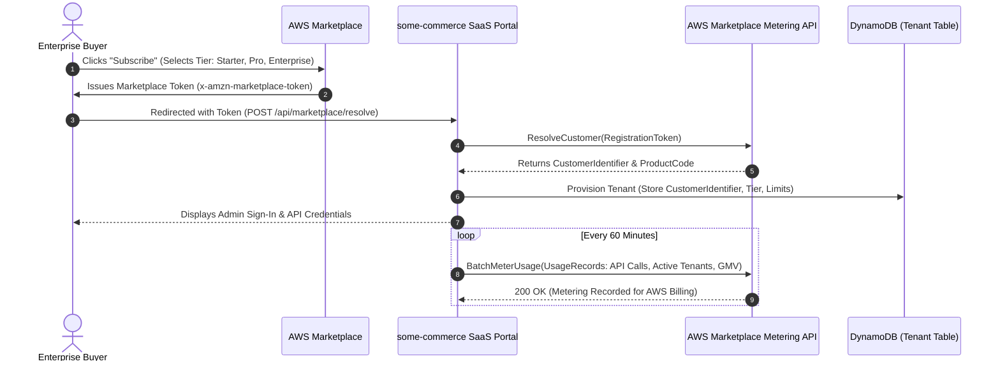

# some-commerce: Deployment Infrastructure & AWS Marketplace Master Guide

> **Specification status:** Planned design, not verified implementation. The [quality gates](QUALITY_GATES.md) define acceptance, and the [stress-test register](DOCS_STRESS_TEST.md) identifies unresolved contradictions and unverified platform/performance/compliance claims. Examples below require those decisions and evidence before production use.

> **Target Release**: v5.0 · **Slices**: v1.0–v6.0 · **Infrastructure as Code**: AWS CDK v2 (TypeScript) · **Cloud**: 100% AWS Native

---

## 1. Executive Overview & Commercial Topology

`some-commerce` is architected from the ground up as an enterprise-grade, cloud-native commerce engine designed for both open-source self-hosting and turnkey commercial distribution on the **[AWS Marketplace](https://aws.amazon.com/marketplace/)**.

To satisfy diverse enterprise procurement and operational requirements, the platform supports two deployment models:
1. **Buyer-Managed CloudFormation Quick Start**: Deploys dedicated single-tenant or multi-tenant infrastructure directly inside the subscriber's own AWS account using automated CDK CloudFormation stacks.
2. **SaaS Multi-Tenant Subscription**: Hosted by the ISV / Operator with AWS Marketplace Contract & Consumption Metering integration (`BatchMeterUsage`), allowing subscribers to pay through their consolidated AWS bill based on active tenants, API requests, and transaction volume.



---

## 2. Dual-Edition Architecture Comparison

| Architectural Vector | Standard Serverless Edition | Enterprise Managed Instances Edition |
|:---------------------|:----------------------------|:--------------------------------------|
| **Primary Workload** | Mid-market storefronts, bursty traffic, startups | High-volume retail, flash sales, B2B enterprise marketplaces |
| **Compute Engine** | AWS Lambda On-Demand (`aarch64` / Graviton3/4) | AWS Lambda Managed Instances with EC2 Graviton4 capacity providers |
| **Concurrency Model** | 1 request per concurrent Lambda execution environment | Up to 64 concurrent requests sharing execution environment RAM |
| **L1 Moka Cache** | Scoped to individual invocation lifetime / warm container | Shared across 64 concurrent Tokio async tasks in shared memory |
| **Search Engine** | DynamoDB General Filtration (`GSI1`/`GSI2`) + Serverless OpenSearch | Dedicated Amazon OpenSearch cluster with DynamoDB Zero-ETL |
| **L2 Caching** | Amazon ElastiCache Serverless for Redis | Amazon ElastiCache Serverless with multi-AZ read replicas |
| **Idle Cost** | **$0.00 / month** (scales completely to zero when idle) | Predictable baseline reserved capacity + auto-scaling bursts |
| **Marketplace Packaging** | 1-Click CloudFormation Template & SaaS Starter Tier | AWS Marketplace Enterprise Private Offers & SaaS Enterprise Tier |

---

## 3. Infrastructure as Code: AWS CDK v2 Stack Architecture

The entire cloud infrastructure is packaged as an idempotent, modular **AWS CDK v2 application** (`infra/cdk`) written in TypeScript. The stack hierarchy enforces strict separation of concerns, least-privilege IAM boundaries, and environment-driven parameterization.

### 3.1 Stack Dependency Graph



### 3.2 Stack Inventory & Responsibilities

#### 1. `SomeCommerceVpcStack`
* **VPC Topology**: 3 Availability Zones with Public, Private (egress via NAT Gateway), and Isolated subnets.
* **VPC Endpoints**: Gateway endpoints for Amazon S3 and Amazon DynamoDB ($0 data transfer cost); Interface endpoints for AWS KMS, Amazon SNS, and AWS Secrets Manager.
* **Security Groups**: Micro-segmented egress/ingress rules restricting Lambda communication strictly to ElastiCache and OpenSearch ports.

#### 2. `SomeCommerceStorageStack`
* **S3 Buckets**:
  * `sdui-assets-{tenant}-{env}`: Publicly cached via CloudFront for SDUI JSON templates, brand logos, and WebP product imagery.
  * `digital-vault-{tenant}-{env}`: Private S3 bucket with default KMS CMK encryption and blocked public access, serving encrypted e-books, firmware, and software binaries via 15-minute presigned URLs.
  * `fulfillment-labels-{tenant}-{env}`: Secure storage for PDF Air Waybills (AWBs) and commercial shipping invoices.
* **CloudFront Distribution**: Configured with Origin Access Control (OAC), modern TLS 1.3 policy (`TLSv1.2_2021`), and edge caching headers (`Cache-Control: public, max-age=31536000, immutable`).

#### 3. `SomeCommerceDataStack`
* **Amazon DynamoDB**: Single-table design (`SomeCommerceTable`) with On-Demand capacity mode, Point-In-Time Recovery (PITR) enabled, server-side encryption via customer-managed KMS key, and DynamoDB Streams enabled (`NEW_AND_OLD_IMAGES`).
  * `PK` & `SK` (String) primary partition keys
  * `GSI1`: Category & Brand taxonomy index (`GSI1PK`, `GSI1SK`)
  * `GSI2`: Multilingual SEO slug lookups (`GSI2PK`, `GSI2SK`)
  * `GSI3`: Customer & Order history reverse lookup (`GSI3PK`, `GSI3SK`)
  * `GSI4`: Vendor & B2B organization isolation index (`GSI4PK`, `GSI4SK`)
  * `GSI5`: Client-first WatermelonDB delta-sync cursor index (`GSI5PK`, `GSI5SK`)
* **Amazon ElastiCache Serverless for Redis**:
  * Multi-AZ high availability with automated horizontal scaling
  * In-transit TLS encryption and Redis Auth enabled
  * Key prefixing: `cache:{tenant}:{key}` and Pub/Sub invalidation topic `cache:evict:{tenant}`

#### 4. `SomeCommerceAuthStack`
* **Amazon Cognito User Pool**:
  * Custom attributes: `tenant_id`, `persona`, `pref_locale`, `b2b_org_id`, `vendor_id`
  * Passwordless phone OTP sign-in via SMS ([Amazon SNS](https://docs.aws.amazon.com/sns/latest/dg/welcome.html))
  * Passkeys (WebAuthn / FIDO2) and Social OIDC (Google, Apple) integration
  * Advanced Security Mode (ASM) enabled for credential stuffing and adaptive authentication
* **Cognito Lambda Triggers**:
  * **Pre-Token Generation Trigger**: Enriches JWT ID and Access tokens with tenant and persona claims without runtime database queries.
  * **Custom SMS Sender Trigger**: Dispatches localized Arabic and English SMS verification codes.

#### 5. `SomeCommerceComputeStack`
* **5 Axum / Tokio Rust Binaries** compiled for Amazon Linux 2023 (`al2023`) targeting ARM64 (`aarch64` Graviton3/4):
  1. `storefront-sdui-api`: Customer SDUI layout serving, faceted search, cart sync, and WebMCP shopping assistant.
  2. `checkout-webhooks-api`: Payment processing (Paymob, Stripe, BTCPay), split COD fee calculation, and carrier webhooks.
  3. `admin-vendor-api`: Multi-tenant merchant portal, taxonomy/property configuration, and Admin WebMCP copilot.
  4. `fulfillment-worker`: Event-driven DynamoDB Streams worker handling order dispatch, license key minting, and SQS queues.
  5. `durable-orchestrator`: Durable workflow state machine handling B2B RFQs, Net-30 invoice reminders, and multi-vendor escrow settlement.
* **Compute Configuration Options**:
  * `computeMode = "ON_DEMAND"`: Fast cold start (< 18ms via Rust native binary), scales to zero.
  * `computeMode = "MANAGED_INSTANCES"`: `MaxConcurrency: 64` per execution container with Graviton4 capacity provisioning and shared L1 Moka memory.

#### 6. `SomeCommerceSearchStack`
* **Standard Edition**: DynamoDB General Filtration provider using GSI1/GSI2 and native FilterExpressions.
* **Enterprise Edition**: Dedicated Amazon OpenSearch Service domain with:
  * Multi-AZ deployment (3 master nodes, 2+ data nodes)
  * Pre-configured Arabic, English, French, and German analyzers
  * DynamoDB Zero-ETL integration via OpenSearch Ingestion (OSIS) pipelines

#### 7. `SomeCommerceApiStack`
* **Amazon API Gateway HTTP API (v2)**:
  * Low latency HTTP routing (< 10ms gateway overhead)
  * Native JWT authorizer validating Cognito User Pool tokens
  * RFC 9110 HTTP `ETag` pass-through preserving `304 Not Modified` headers
  * Custom domain mapping with AWS Certificate Manager (ACM) SSL/TLS certificates

#### 8. `SomeCommerceObservabilityStack`
* **Amazon CloudWatch**:
  * Centralized structured JSON logging (`tracing-subscriber` JSON formatter)
  * P99 latency, 5xx error rate, and throttle alarms
* **AWS X-Ray**: Distributed tracing across API Gateway, Lambda, DynamoDB, ElastiCache, and outbound HTTP calls.
* **CloudWatch Synthetics Canary**: Continuous end-to-end health probe hitting `/v1/sdui/home` every 60 seconds with P99 < 150ms SLA monitoring.

---

## 4. AWS Marketplace Listing & Procurement Models

`some-commerce` supports two distinct distribution models on AWS Marketplace to accommodate both privacy-focused enterprise buyers (deploying in their own AWS accounts) and turnkey SaaS subscribers:

---

### 4.1 Model 1: Buyer-Hosted 1-Click CloudFormation Deployment (In Customer's Own Account)

In this model, the client discovers `some-commerce` on the AWS Marketplace and deploys a complete, dedicated copy of the platform directly inside **their own AWS account** with zero manual server configuration.



#### Step-by-Step Client Experience:
1. **1-Click Launch from Marketplace**:
   * The client clicks **"Launch CloudFormation"** on the AWS Marketplace product page.
   * AWS opens the **CloudFormation Quick-Create** wizard inside the client's own AWS account. The master CDK template URL is pre-populated in the S3 template field.
2. **Simple Form Inputs (Only 4 Fields)**:
   * `AdminEmail`: The store owner's email (receives the temporary Cognito root credentials).
   * `StoreName`: Friendly name for the marketplace (e.g. `AcmeRetail`).
   * `DomainName`: (Optional) Custom vanity domain (e.g. `shop.acme.com`). If left blank, AWS API Gateway and CloudFront default URLs are assigned.
   * `ComputeMode`: Defaults to **`ON_DEMAND`** (Standard Serverless Edition: scales to $0 when idle).
3. **Automated Provisioning**:
   * CloudFormation deploys the 9 nested stacks in strict topological order.
   * All resources (database tables, KMS keys, S3 buckets, Cognito User Pool, and Lambda functions) belong 100% to the client's AWS account.
4. **Instant Store Readiness**:
   * Once the root stack reaches `CREATE_COMPLETE`, the **Outputs** tab provides:
     * `StorefrontUrl`: `https://shop.acme.com` (Universal Expo Web + SDUI engine)
     * `AdminDashboardUrl`: `https://shop.acme.com/admin` (Store management & SDUI Studio)
     * `ApiEndpoint`: `https://api.shop.acme.com/v1`

---

### 4.2 The 1-Click Future Switch: Upgrading from On-Demand Lambda to Managed Instances

As the client's business grows from an initial launch to high-volume retail or flash sales, they can upgrade the compute engine from **Standard On-Demand Lambda** to **AWS Lambda Managed Instances** with **a single click**.

#### Why the Switch is 100% Safe and Zero-Downtime:
* **Stateless Rust Compute**: The 5 microservices (`storefront-sdui-api`, `checkout-webhooks-api`, `admin-vendor-api`, `fulfillment-worker`, `durable-orchestrator`) are pure stateless Axum binaries.
* **Untouched Data Layer**: DynamoDB Single-Table, S3 Asset Vaults, ElastiCache Serverless Redis, and Cognito User Pool remain completely active and untouched during the switch.
* **Zero Data Migration**: No database exports, re-indexing, or migrations are required.



#### Method 1: In-App 1-Click Toggle (Inside `some-commerce` Admin Dashboard)
1. Store owner navigates to `https://store.example.com/admin` $\rightarrow$ **Settings** $\rightarrow$ **Infrastructure**.
2. Under **Compute Engine**, a visual toggle card displays:
   ```text
   [x] Standard Serverless (Scale to $0)      [ ] Enterprise Managed Instances
   ```
3. Clicking **"Enterprise Managed Instances"** triggers `POST /v1/admin/infrastructure/compute-mode` with:
   ```json
   {
     "target_mode": "MANAGED_INSTANCES",
     "max_concurrency": 64
   }
   ```
4. An authorized backend Lambda invokes the AWS CloudFormation `UpdateStack` API using the deployment role, updating the `ComputeMode` parameter to `MANAGED_INSTANCES`.
5. AWS CodeDeploy shifts traffic smoothly to the Graviton4 instances using a rolling canary deployment (`Canary10Percent5Minutes`) with automated rollback if error rates increase.

#### Method 2: AWS Console 1-Click (Native CloudFormation)
1. In the AWS Console, the client opens **AWS CloudFormation** $\rightarrow$ selects `some-commerce-root-stack`.
2. Clicks **Update** $\rightarrow$ selects **Use current template**.
3. Under Parameters, changes:
   ```text
   ComputeMode: ON_DEMAND  ──►  MANAGED_INSTANCES
   ```
4. Clicks **Submit**. CloudFormation updates the compute stack in place.

---

### 4.3 Model 2: Seller-Hosted Multi-Tenant SaaS with Consumption Metering

For clients who do not wish to manage an AWS account, `some-commerce` also offers a turnkey SaaS subscription listed on AWS Marketplace with contract and consumption metering:



### 4.4 Supported SaaS Pricing Models

1. **Free Trial**: 14-day fully featured evaluation tier (up to 1,000 SKUs, 100 orders).
2. **Usage-Based SaaS (Pay-As-You-Go)**:
   * **Dimension 1**: `api_requests_block` ($0.50 per 100,000 requests)
   * **Dimension 2**: `active_merchants` ($49.00 per active vendor/storefront per month)
   * **Dimension 3**: `gmv_volume_usd` (0.5% of settled transaction volume)
3. **Contract with Flexible Consumption (Annual Commitments)**:
   * Upfront annual commitment with discounted usage rates and private pricing via **AWS Marketplace Private Offers**.

### 4.2 AWS Marketplace Metering API Integration

The `fulfillment-worker` cron scheduler aggregates platform metrics and dispatches hourly batches to AWS Marketplace using the official Rust AWS SDK:

```rust
use aws_sdk_marketplacemetering::{
    Client as MeteringClient,
    types::{UsageRecord, UsageRecordResultStatus},
};
use chrono::Utc;

pub async fn report_hourly_usage(
    client: &MeteringClient,
    product_code: &str,
    customer_id: &str,
    dimension: &str,
    quantity: i32,
) -> Result<(), Box<dyn std::error::Error>> {
    let record = UsageRecord::builder()
        .timestamp(aws_smithy_types::DateTime::from_secs(Utc::now().timestamp()))
        .customer_identifier(customer_id)
        .dimension(dimension)
        .quantity(quantity)
        .build()?;

    let response = client
        .batch_meter_usage()
        .product_code(product_code)
        .usage_records(record)
        .send()
        .await?;

    for res in response.results() {
        match res.status() {
            Some(UsageRecordResultStatus::Success) => {
                tracing::info!(customer_id, dimension, quantity, "Usage metered successfully");
            }
            Some(status) => {
                tracing::warn!(?status, "Marketplace metering partial failure; queuing for retry");
            }
            None => {}
        }
    }

    Ok(())
}
```

---

## 5. AWS Foundational Technical Review (FTR) Compliance Matrix

To achieve the **AWS Qualified Software** badge and list on the AWS Marketplace, `some-commerce` strictly complies with the AWS Well-Architected Framework and FTR criteria:

| Category | Requirement | Implementation in some-commerce | Status |
|:---------|:------------|:--------------------------------|:-------|
| **Security** | Encrypt data at rest | All DynamoDB tables, ElastiCache Redis, S3 buckets, and Secrets use AWS KMS Customer Managed Keys (CMK) | Pending evidence |
| **Security** | Encrypt data in transit | TLS 1.3 enforced on CloudFront, API Gateway, Redis connections, and all internal microservices | Pending evidence |
| **Security** | Least-privilege IAM | Zero wildcard (`*`) IAM resource actions in production; scoped ARNs for DynamoDB tables and KMS keys | Pending evidence |
| **Security** | Secrets management | Payment gateway keys (Stripe, Paymob, BTCPay) stored in AWS KMS Envelope Encryption Vault | Pending evidence |
| **Security** | Tenant data isolation | Strict logical tenant partitioning (`tenant_id` hash partition in DynamoDB + Cognito JWT validation) | Pending evidence |
| **Reliability** | Multi-AZ High Availability | DynamoDB, S3, ElastiCache Serverless, and Cognito operate across 3 Availability Zones natively | Pending evidence |
| **Reliability** | Backup & Disaster Recovery | DynamoDB Continuous Backups & Point-In-Time Recovery (PITR); S3 Cross-Region Replication (CRR) | Pending evidence |
| **Reliability** | Fault tolerance & retries | Rust Axum services use `tower` backoff policies, circuit breakers, and SQS Dead Letter Queues (DLQs) | Pending evidence |
| **Performance** | Infrastructure efficiency | Rust compiled to ARM64 Graviton; L1 Moka (< 50µs) + L2 Redis (< 2ms) two-tier caching architecture | Pending evidence |
| **Performance** | Edge optimization | RFC 9110 HTTP `ETag` conditional queries returning `304 Not Modified` with 0-byte payload | Pending evidence |
| **Cost** | Scale to zero | Standard edition utilizes serverless compute and on-demand databases with zero idle compute cost | Pending evidence |
| **Operations** | Audit logging | AWS CloudTrail enabled; CloudWatch structured JSON logs with tenant tracing and correlation IDs | Pending evidence |

---

## 6. Step-by-Step Operator Deployment Runbook

### 6.1 Prerequisites
* **AWS CLI v2** configured with Administrator permissions
* **Node.js 20+** and **Bun** or **npm** installed
* **Rust Toolchain (1.80+)** with `aarch64-unknown-linux-gnu` target
* **Cargo Lambda** (`cargo install cargo-lambda`)
* **AWS CDK CLI** (`npm install -g aws-cdk`)
* **Docker** running (required for building Lambda Graviton binaries and assets)

### 6.2 Step 1: Clone and Configure Environment

```bash
git clone https://github.com/maheraladdin/some-commerce.git
cd some-commerce/infra/cdk

# Copy environment configuration template
cp .env.example .env

# Edit required parameters
# CDK_DEFAULT_ACCOUNT=123456789012
# CDK_DEFAULT_REGION=eu-central-1
# DOMAIN_NAME=store.example.com
# COMPUTE_MODE=ON_DEMAND # or MANAGED_INSTANCES
```

### 6.3 Step 2: Compile Rust Microkernel Binaries

```bash
cd ../../
# Build all 5 Lambda binaries for AWS Graviton (aarch64) in release mode
cargo lambda build --release --arm64 --output-format zip
```

### 6.4 Step 3: CDK Bootstrap and Synthesis

```bash
cd infra/cdk
npm install

# Bootstrap AWS environment for CDK assets
cdk bootstrap aws://123456789012/eu-central-1

# Synthesize CloudFormation templates and verify resource graph
cdk synth --context computeMode=ON_DEMAND
```

### 6.5 Step 4: Full Infrastructure Deployment

```bash
# Deploy all stacks in dependency order
cdk deploy --all \
  --context computeMode=ON_DEMAND \
  --context environment=prod \
  --require-approval broadcasting
```

### 6.6 Step 5: Post-Deployment Smoke Test & Verification

Upon completion, CDK outputs the required connection endpoints:

```text
Outputs:
SomeCommerceApiStack.HttpApiEndpoint = https://api.store.example.com
SomeCommerceStorageStack.CloudFrontUrl = https://d111111abcdef8.cloudfront.net
SomeCommerceAuthStack.CognitoUserPoolId = eu-central-1_AbCdEf123
SomeCommerceAuthStack.CognitoAppClientId = 1234567890abcdefghijklmnop
```

Execute the automated smoke test script to verify all sub-systems:
```bash
./scripts/smoke_test.sh https://api.store.example.com
```

Expected output:
* `GET /v1/sdui/home` -> `HTTP 200 OK` (SDUI JSON rendered)
* `GET /v1/sdui/home` with `If-None-Match` -> `HTTP 304 Not Modified`
* `POST /v1/rates/calculate` -> `HTTP 200 OK` (Split COD math verified)
* `POST /v1/mcp/customer` -> `HTTP 200 OK` (WebMCP tool discovery responding)

---

## 7. Zero-Downtime Blue/Green Version Upgrade Guide

When releasing a new slice or platform update:
1. **Database Schema Migrations**: All DynamoDB Single-Table changes are strictly additive. New attributes or GSI access patterns are deployed prior to compute updates.
2. **Lambda Alias Traffic Shifting**:
   * The CDK stack deploys new Rust binaries under a green version tag.
   * AWS CodeDeploy executes a canary traffic shifting strategy (`LambdaDeploymentPreference.CANARY_10PERCENT_5MINUTES`).
   * CloudWatch alarms on P99 latency and 5xx errors automatically trigger rollbacks if regressions occur.
3. **ElastiCache Invalidation**:
   * Following successful green cutover, an automated hook publishes a global cache bust to `cache:evict:*` to refresh all L1 Moka caches across running instances.

---

## 8. Teardown & Clean-Room Decommissioning

To cleanly remove all deployed AWS resources and prevent unintended cloud expenditures:

```bash
# Destroy all compute, routing, and cache resources
cdk destroy --all --force

# Note: DynamoDB tables and S3 audit buckets configured with RETAIN policy
# will remain safe until explicitly deleted via AWS Console or CLI.
```
