# Microkernel Architecture & Cloud Portability Specification

## 1. Executive Overview

`some-commerce` is architectured as a **Microkernel System** engineered around two non-negotiable architectural invariants:

1. **Pure Domain Microkernel Packages (`crates/some-*`)**:
   - All core business logic, validation invariants, state machines, math engines, and security contracts are encapsulated in standalone, zero-I/O, zero-cloud Rust crates.
   - These packages are completely decoupled from runtime environments, storage engines, and transport frameworks.
   - They are engineered for distribution on [crates.io](https://crates.io) so developers globally can leverage them to build bespoke headless e-commerce, B2B marketplaces, POS terminals, and mobile applications.

2. **Cloud-Agnostic Transport & Axum Abstraction**:
   - HTTP application APIs are implemented as standard, pure `axum::Router` functions and Tower services.
   - Handlers and routes **NEVER** import or reference AWS Lambda runtimes (`lambda_http`, `aws_lambda_events`, `cargo-lambda`).
   - The application can be packaged into an **AWS Lambda Serverless Function**, a **standalone Tokio TCP server** (for Docker, Kubernetes, AWS ECS, GCP Cloud Run, Azure Container Apps), or native cloud function runtimes via thin transport adapters without modifying a single line of business or routing code.

---

## 2. Microkernel Architectural Blueprint

The architecture follows a strict Hexagonal / Ports-and-Adapters microkernel model:

```mermaid
flowchart TD
    subgraph "External Cloud Runtimes (Thin Entrypoint Binaries)"
        LAMBDA["AWS Lambda Binary<br/>(backend/bins/lambda-serverless)<br/>lambda_http::run(router)"]
        STANDALONE["Portable Standalone Binary<br/>(backend/bins/standalone-server)<br/>axum::serve(listener, router)<br/>Docker / K8s / GCP Run / Azure Apps"]
        AZURE_FUNC["Azure Function Adapter<br/>(backend/bins/azure-serverless)<br/>azure-functions runtime"]
    end

    subgraph "Pure Axum Routing Tier (backend/src/features/...)"
        AXUM_CORE["Axum 0.8 Router & Tower Middleware<br/>• Request/Response DTOs<br/>• Tenant Context Extraction<br/>• Zero-Clone Borrowing Handlers<br/>• Tower Service Composition"]
    end

    subgraph "Domain Ports (Abstract Traits & Interfaces)"
        PORT_STORAGE["BlobStoragePort"]
        PORT_DB["DocumentDbPort / RelationalDbPort"]
        PORT_EVENT["EventBusPort / MessagingPort"]
        PORT_KMS["KeyManagementPort"]
        PORT_AI["AiInferencePort"]
    end

    subgraph "Pure Microkernel Logic Packages (crates/some-*)"
        K_VAL["some-validation<br/>Datatype & payload validator"]
        K_AUTH["some-auth<br/>Zero-IO auth state machine & tokens"]
        K_SDUI["some-sdui<br/>Dynamic layout engine & parser"]
        K_CAS["some-cas<br/>Content-addressable asset engine"]
        K_SUPP["some-support<br/>Ticket state machine & CSAT validator"]
        K_LEDGER["some-ledger<br/>Double-entry financial math engine"]
        K_PRICE["some-pricing<br/>B2B volume, tiers & Split-COD"]
        K_LIC["some-licensing<br/>6-mode non-heartbeat Ed25519 engine"]
    end

    subgraph "Pluggable Cloud Infrastructure Adapters"
        subgraph "AWS Ecosystem (Default Production)"
            ADAPT_DYNAMO["DynamoDB + Moka L1 / Redis L2"]
            ADAPT_S3["Amazon S3 Storage Adapter"]
            ADAPT_SNS["SNS / SQS / EventBridge Adapter"]
            ADAPT_BEDROCK["AWS Bedrock LLM Adapter"]
        end

        subgraph "GCP Ecosystem (Future Adapter)"
            ADAPT_GCS["Google Cloud Storage Adapter"]
            ADAPT_FIRESTORE["Firestore / Spanner Adapter"]
            ADAPT_PUBSUB["GCP Cloud Pub/Sub Adapter"]
            ADAPT_VERTEX["GCP Vertex AI Adapter"]
        end

        subgraph "Azure Ecosystem (Future Adapter)"
            ADAPT_BLOB["Azure Blob Storage Adapter"]
            ADAPT_COSMOS["Azure CosmosDB Adapter"]
            ADAPT_SERVICEBUS["Azure Service Bus Adapter"]
            ADAPT_AZUREAI["Azure OpenAI Adapter"]
        end
    end

    LAMBDA --> AXUM_CORE
    STANDALONE --> AXUM_CORE
    AZURE_FUNC --> AXUM_CORE

    AXUM_CORE --> K_VAL
    AXUM_CORE --> K_AUTH
    AXUM_CORE --> K_SDUI
    AXUM_CORE --> K_CAS
    AXUM_CORE --> K_SUPP
    AXUM_CORE --> K_LEDGER
    AXUM_CORE --> K_PRICE
    AXUM_CORE --> K_LIC

    AXUM_CORE --> PORT_STORAGE
    AXUM_CORE --> PORT_DB
    AXUM_CORE --> PORT_EVENT
    AXUM_CORE --> PORT_KMS
    AXUM_CORE --> PORT_AI

    ADAPT_S3 -.implements.-> PORT_STORAGE
    ADAPT_DYNAMO -.implements.-> PORT_DB
    ADAPT_SNS -.implements.-> PORT_EVENT
    ADAPT_BEDROCK -.implements.-> PORT_AI

    ADAPT_GCS -.implements.-> PORT_STORAGE
    ADAPT_FIRESTORE -.implements.-> PORT_DB
    ADAPT_PUBSUB -.implements.-> PORT_EVENT
    ADAPT_VERTEX -.implements.-> PORT_AI

    ADAPT_BLOB -.implements.-> PORT_STORAGE
    ADAPT_COSMOS -.implements.-> PORT_DB
    ADAPT_SERVICEBUS -.implements.-> PORT_EVENT
    ADAPT_AZUREAI -.implements.-> PORT_AI
```



---

## 3. Abstract Logic Package Distribution (`crates.io`)

The microkernel philosophy dictates that domain rules must be cleanly isolated so that community and enterprise developers can embed them in their own architectures.

### 3.1 Tier-1 Publishable Microkernel Packages

| Crate Name | Architectural Purpose | Zero-I/O Guarantee | Distributable Value |
|:-----------|:----------------------|:-------------------|:--------------------|
| `some-validation` | Centralized policy validation pipeline (strings, passwords, emails, phone numbers, UUIDs, BSON). | 100% Pure CPU logic; no async runtime, no network. | Drop-in validation for any Rust backend or WASM edge worker. |
| `some-auth` | Core authentication schemas, ceremony state machines (OTP, WebAuthn challenge, passkey, session). | Pure domain contracts and cryptographic verification primitives. | Headless authentication engine for custom user systems. |
| `some-support` | Customer support ticket lifecycle state machine, SLA tracker, and CSAT rating validator. | Zero workspace dependencies, 100% standalone. | Universal ticketing and customer service kernel. |
| `some-sdui` | Server-Driven UI layout parser, widget registry, JSON-to-component AST compiler. | Pure serde AST and transformation pipelines. | Enables universal SDUI for Flutter, React Native, and Web. |
| `some-cas` | Content-Addressable Storage hash verification (BLAKE3 / SHA-256) and path-traversal validator. | Pure hashing and path security sanitization. | Secure digital asset management and caching engine. |
| `some-ledger` | Double-entry bookkeeping accounting engine, escrow balance tracker, immutable audit log math. | Pure financial arithmetic; no database bindings. | Multi-vendor marketplace escrow and financial ledger kernel. |
| `some-pricing` | Multi-tier volume discounts, minimum order quantities (MOQ), Split-COD deposit calculation. | Pure fixed-point money math (`rust_decimal`). | Headless pricing and B2B wholesale calculation engine. |
| `some-licensing` | 6-mode non-heartbeat digital software licensing engine using Ed25519 digital signatures. | Pure cryptographic token generator and validator. | Offline and online software licensing for digital commerce. |
| `some-mcp` | Model Context Protocol (MCP) tool contract definitions, JSON-RPC serializer, and Bedrock bridges. | Pure schema generation and validation traits. | Embeddable AI shopping copilot engine. |

### 3.2 Rules of Microkernel Package Design

1. **Zero External Cloud SDKs**: Microkernel crates MUST NOT depend on `aws-sdk-*`, `azure_*`, `google-cloud-*`, or any proprietary cloud vendor library.
2. **Zero Direct I/O or Drivers**: Microkernel crates MUST NOT depend on `tokio::net`, `reqwest`, `mongodb`, `redis`, `sqlx`, or `rusqlite`. All data fetching is performed via callers passing data in or through dependency-injected Port traits.
3. **Rust Zero-Clone Law**: Microkernel crates must rely strictly on borrowing (`&T`, `&mut T`), lifetimes (`'a`), and zero-copy references. Deep `.clone()` is strictly forbidden (enforced by Gate M1).
4. **WASM Compatibility**: Every microkernel crate must compile to target `wasm32-unknown-unknown` and `wasm32-wasip1`, enabling edge deployment in Cloudflare Workers, Fastly Compute, or browser sandboxes.

---

## 4. Decoupling Axum APIs from Cargo Lambda

### 4.1 The Axum HTTP Router as Pure Tower Service

In `some-commerce`, Axum routers are declared in `backend/src/features/` as pure functions returning `axum::Router<AppState>`:

```rust
// backend/src/features/auth/mod.rs
// NOTE: Zero imports from `lambda_http` or AWS Lambda runtimes!

use axum::{routing::{post, get}, Router};
use std::sync::Arc;

pub fn create_auth_router<S>(state: Arc<S>) -> Router
where
    S: AuthStatePorts + Send + Sync + 'static,
{
    Router::new()
        .route("/v1/auth/otp/send", post(handlers::send_otp_handler))
        .route("/v1/auth/otp/verify", post(handlers::verify_otp_handler))
        .route("/v1/auth/passkey/challenge", post(handlers::passkey_challenge_handler))
        .with_state(state)
}
```

### 4.2 Entrypoint 1: AWS Lambda Serverless (`backend/bins/lambda-serverless`)

When deploying to AWS Serverless (Graviton4, Lambda function URLs, or API Gateway v2):

```rust
// backend/bins/lambda-serverless/src/main.rs
use axum::Router;
use lambda_http::{run, Error};
use some_commerce_backend::app::build_master_router;
use some_commerce_infra_aws::AwsInfrastructureContext;
use std::sync::Arc;

#[tokio::main]
async fn main() -> Result<(), Error> {
    // 1. Initialize AWS telemetry and cloud adapters
    let aws_ctx = Arc::new(AwsInfrastructureContext::from_env().await?);
    
    // 2. Build the pure Axum router injecting AWS port implementations
    let app: Router = build_master_router(aws_ctx);

    // 3. Delegate to Cargo Lambda runtime
    run(app).await
}
```

### 4.3 Entrypoint 2: Standalone Portable Server (`backend/bins/standalone-server`)

When deploying to Docker, Kubernetes, AWS ECS, GCP Cloud Run, Azure Container Apps, or a bare-metal server:

```rust
// backend/bins/standalone-server/src/main.rs
use axum::Router;
use some_commerce_backend::app::build_master_router;
use some_commerce_infra_portable::PortableInfrastructureContext;
use std::sync::Arc;
use tokio::net::TcpListener;

#[tokio::main]
async fn main() -> Result<(), Box<dyn std::error::Error>> {
    let port = std::env::var("PORT").unwrap_or_else(|_| "8080".to_string());
    let addr = format!("0.0.0.0:{}", port);
    
    // 1. Initialize portable infrastructure (e.g. Postgres/Mongo + Redis)
    let ctx = Arc::new(PortableInfrastructureContext::from_env().await?);
    
    // 2. Build the IDENTICAL pure Axum router
    let app: Router = build_master_router(ctx);

    // 3. Standard Tokio TCP server execution (No AWS Lambda dependency)
    let listener = TcpListener::bind(&addr).await?;
    println!("Standalone some-commerce HTTP server listening on http://{}", addr);
    axum::serve(listener, app).await?;
    
    Ok(())
}
```

### 4.4 Architectural Benefit

1. **Local Developer Experience**: Developers run `cargo run --bin standalone-server` locally with zero Lambda emulator overhead.
2. **Cloud Portability**: Switching hosting from AWS Lambda to GCP Cloud Run or Azure requires zero changes to the business logic or Axum route definitions.
3. **No Vendor Lock-in**: Customers hosting `some-commerce` on-premise or in private sovereign clouds can utilize the standalone container binary.

---

## 5. Port-and-Adapter Cloud Interface Contracts

Domain services access external infrastructure through strongly-typed, asynchronous Rust traits:

### 5.1 Storage Port (`BlobStoragePort`)

```rust
#[async_trait::async_trait]
pub trait BlobStoragePort: Send + Sync {
    async fn generate_presigned_upload_url(
        &self,
        tenant_id: &str,
        key: &str,
        content_type: &str,
        expires_seconds: u32,
    ) -> Result<PresignedUrlInfo, StorageError>;

    async fn generate_presigned_download_url(
        &self,
        tenant_id: &str,
        key: &str,
        expires_seconds: u32,
    ) -> Result<PresignedUrlInfo, StorageError>;

    async fn verify_object_exists(
        &self,
        tenant_id: &str,
        key: &str,
    ) -> Result<bool, StorageError>;
}
```

- **AWS Adapter**: Uses `aws-sdk-s3` with AWS SigV4 signed URLs.
- **GCP Adapter**: Uses Google Cloud Storage signed URLs with v4 signing.
- **Azure Adapter**: Uses Azure Blob Storage Shared Access Signatures (SAS).

### 5.2 Document Database Port (`DocumentDbPort`)

```rust
#[async_trait::async_trait]
pub trait DocumentDbPort: Send + Sync {
    async fn put_item_transact<T: serde::Serialize + Send + Sync>(
        &self,
        tenant_id: &str,
        items: &[TransactItem<T>],
    ) -> Result<(), DatabaseError>;

    async fn query_by_pk<'a>(
        &self,
        tenant_id: &'a str,
        pk: &'a str,
        sk_prefix: Option<&'a str>,
    ) -> Result<Vec<RawDocument>, DatabaseError>;
}
```

- **AWS Adapter**: Targets Amazon DynamoDB with `TransactWriteItems` and Single-Table Design.
- **GCP Adapter**: Targets Google Cloud Firestore or Cloud Spanner.
- **Azure Adapter**: Targets Azure CosmosDB with transactional partition keys.
- **Portable Adapter**: Targets MongoDB or PostgreSQL (via JSONB with GIN indexing).

### 5.3 Event Messaging Port (`MessagingPort`)

```rust
#[async_trait::async_trait]
pub trait MessagingPort: Send + Sync {
    async fn publish_event(
        &self,
        tenant_id: &str,
        event_type: &str,
        payload: &[u8],
    ) -> Result<(), MessagingError>;
}
```

- **AWS Adapter**: Dispatches to Amazon EventBridge & SNS/SQS.
- **GCP Adapter**: Dispatches to GCP Cloud Pub/Sub.
- **Azure Adapter**: Dispatches to Azure Service Bus or Event Grid.

---

## 6. Rust Borrowing & Zero-Clone Invariant in Microkernel & APIs

In accordance with Section 3 of the Constitution:

1. **Zero Deep Clones**:
   - Data structures, request payloads, domain entities, and intermediate vectors must **never call `.clone()`**.
   - Violations are flagged automatically by CI Gate M1 (`scripts/validate_microkernel.py`).
2. **Borrowing First**:
   - Functions accept slices: `&str`, `&[u8]`, `&[Item]`.
   - Structures that hold reference data use explicit lifetimes: `struct ValidatedOrder<'a> { items: &'a [OrderItem], ... }`.
3. **Reference Counted Exception**:
   - `Arc<T>` cloning is permitted solely for cheap pointer sharing of infrastructure ports across threads:
   ```rust
   // ACCEPTABLE: Incrementing atomic reference counter on shared port pointer
   let storage_port = Arc::clone(&self.storage);
   
   // STRICTLY FORBIDDEN: Value deep cloning
   let cloned_order = order.clone(); // COMPILE/CI REJECTION VIA GATE M1
   ```
4. **Zero-Copy JSON Deserialization**:
   - Where possible, DTOs borrow directly from the request byte slice using `Cow<'a, str>` or `&'a str`.

---

## 7. Gate M1: Automated Microkernel & Abstraction Verification

CI enforces Gate M1 on every PR and sprint commit via `python3 scripts/validate_microkernel.py`:

1. **Crate Purity Check**: Scans `Cargo.toml` of all crates in `crates/` to ensure zero references to `aws-sdk-*`, `lambda_http`, or cloud vendor libraries.
2. **Axum Decoupling Check**: Scans `backend/src/features/` to verify that `lambda_http` or AWS Lambda runtime types are never imported into HTTP routing logic.
3. **Zero-Clone Borrowing Audit**: Scans Rust sources in `backend/src/features/` and microkernel crates for illegal `.clone()` calls, permitting only `Arc::clone` and `Rc::clone`.
4. **Port Compliance Check**: Ensures all database, storage, and event operations in `backend/src/features/` access resources exclusively through trait ports.
