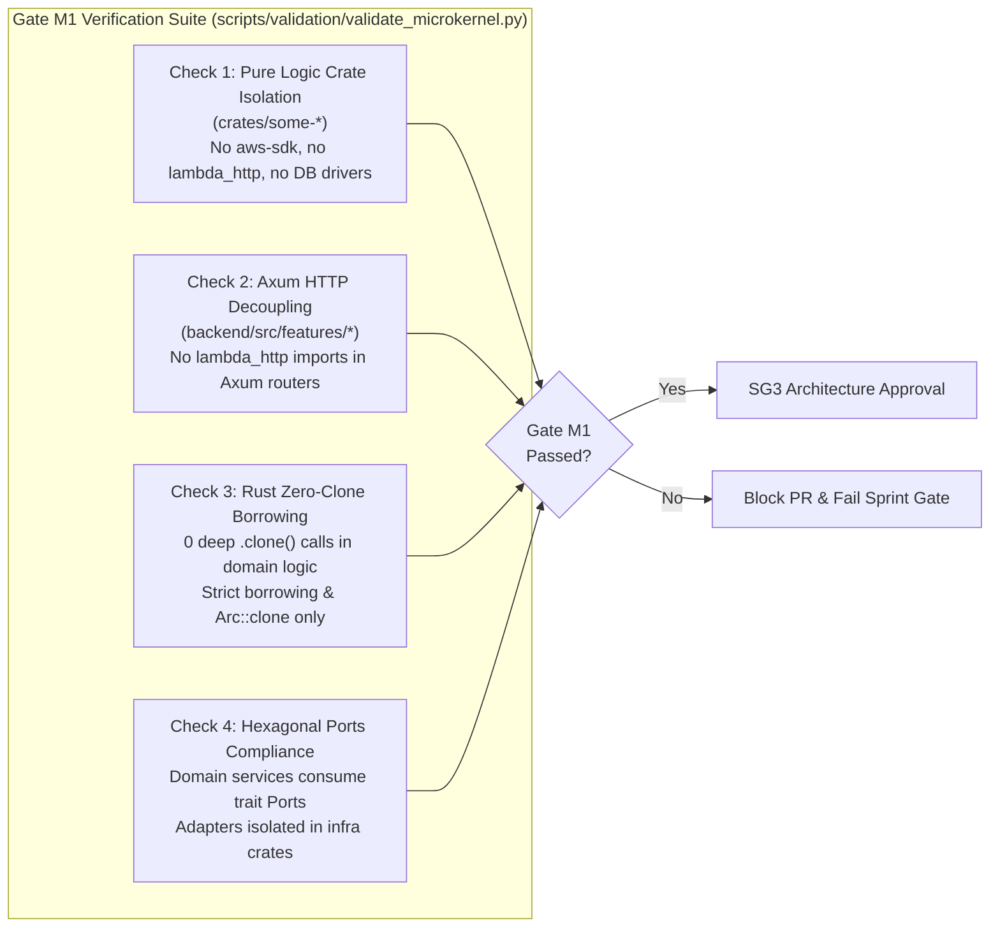
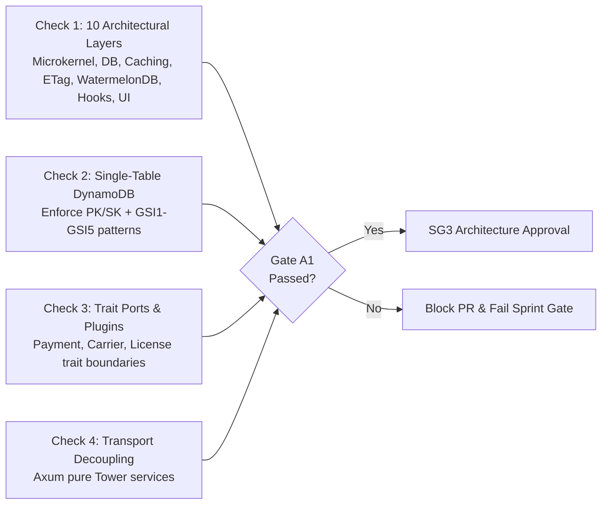
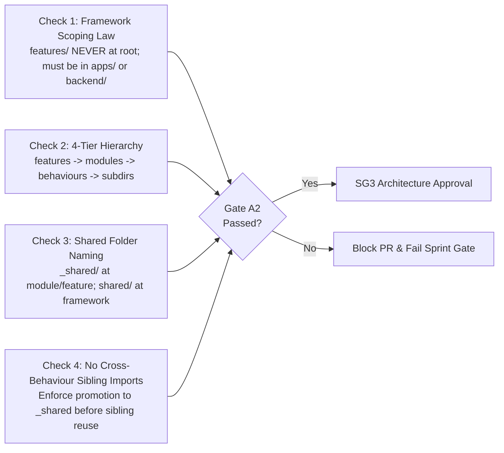
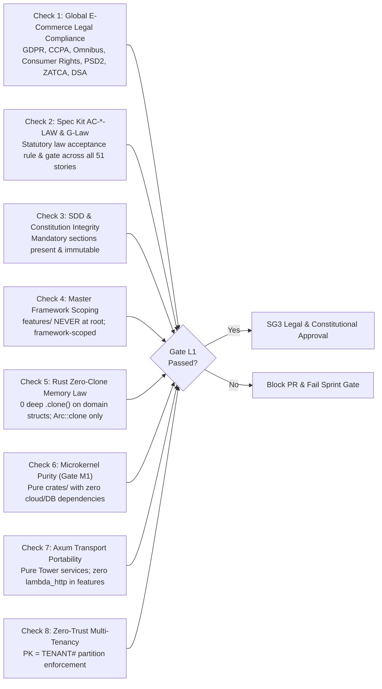

# Quality Gates & Governance Standard

## Scope and status

These gates apply to **every user story (G0–G4 + G-Review + G-Law)**, every implementation PR, **every sprint as a whole (SG0–SG4)**, the **microkernel architecture (Gate M1)**, **system architecture (Gate A1)**, **folder architecture (Gate A2)**, and the **Project Constitution non-negotiable laws (Gate L1)**. They replace weaker sprint checklists and blanket claims of “100% test coverage.” Each story and sprint contains strict, verifiable criteria. Passing documentation validation means only that the required sections and references exist; it does not mean the application has been tested or audited.

The repository currently contains specifications, architecture blueprints, and documentation utilities. Application gates below are **mandatory gates for delivery**.

---

## 1. Sprint-Level Quality Gates (SG0 — SG4)

While G0–G4 govern individual user stories, the **Sprint Quality Gates (SG0–SG4)** govern the cohesion, multi-tenant security, cross-story performance, microkernel boundary compliance, and release readiness of the entire sprint iteration.

| Sprint Gate | Required Timing | Accountable Owner | Exit Criteria & Verification |
|:------------|:----------------|:------------------|:-----------------------------|
| **SG0 — Sprint Planning & Architecture Readiness** | Before Sprint Kickoff | Sprint Lead + Principal Architect | 100% of backlog stories reach Gate G0; cross-story dependency DAG verified without cycles; microkernel crate boundaries confirmed; cross-cutting threat boundary mapped; shared capacity and budgets allocated. |
| **SG1 — Cross-Story Integration & Coverage** | Mid-Sprint / PR Consolidation | QA Lead + Test Reviewer | All completed stories pass Gate G1; cross-story integrated workflows pass (e.g. Auth $\to$ Catalog $\to$ Cart $\to$ Checkout); monorepo-wide coverage maintains $\ge 90\%$ line and $\ge 85\%$ branch across affected packages; 0 flaky tests. |
| **SG2 — Monorepo Security & Tenant Isolation Audit** | Pre-Feature Freeze | Security Lead + G2 Auditor | All stories pass Gate G2; monorepo-wide SAST, dependency vulnerability scan, and SBOM generated with 0 Critical/High issues; synthetic multi-tenant penetration test verifies zero cross-tenant data leakage across all sprint endpoints; zero hardcoded credentials or unmasked PII. |
| **SG3 — Architecture, Microkernel Boundary & Code Quality** | Code Freeze | Architecture Reviewer | Monorepo passes **Gate M1** (zero cloud SDKs in pure domain crates, zero `lambda_http` in Axum routers, zero-clone borrowing audit in Rust); code duplication $< 3\%$; cyclomatic complexity $\le 10$; directory structure conforms 100% to framework-scoped LoB standard (`features/modules/behaviours`). |
| **SG4 — Sprint Release Candidate & Operational Readiness** | Release Sign-Off | Release Manager + DevOps Lead | All stories reach Gate G4; staging deployment smoke tests pass across web and mobile platforms; load test verifies SLA budgets (p95 latency $< 150\text{ms}$ warm, $< 400\text{ms}$ cold); AWS CDK synth/diff clean; backup/restore & rollback verification verified; release candidate tagged and cryptographically signed. |

### SG0 — Sprint Planning & Architecture Readiness
- **Backlog G0 Conformance**: Every story scheduled for the sprint must have passed Gate G0 with stable identifiers (`AC-*`, `TC-*`), resolved design blockers, and numerical latency/throughput budgets.
- **Microkernel Allocation**: Identify whether any pure domain logic needs promotion to a standalone `crates/some-*` microkernel package. If so, draft the port-and-adapter interface contract before starting story implementation.
- **Threat Surface Alignment**: Review cross-cutting security invariants (e.g. JWT claims propagation, KMS envelope keys, multi-tenant DynamoDB partition keys) across all interacting stories in the sprint.

### SG1 — Cross-Story Integration & Coverage
- **Integration Test Suites**: Execute cross-boundary test suites linking multiple modules delivered within the sprint. A single story's mock passing does not fulfill SG1.
- **Regression Prevention**: Automated verification in CI ensuring no previously implemented features or test suites experienced coverage drops or broken assertions.
- **Concurrency & Eventual Consistency**: Assert eventual consistency across DynamoDB streams, Redis L2 cache invalidation, and WatermelonDB client sync under concurrent multi-user load.

### SG2 — Monorepo Security & Tenant Isolation Audit
- **Tenant Isolation Stress Test**: Automated penetration test executing concurrent interleaved requests across different `TenantId` contexts, asserting 0 cross-tenant reads or writes.
- **OWASP ASVS Verification**: monorepo-level audit against OWASP ASVS v4.0.3 L2 controls.
- **Dependency & License Audit**: `cargo audit`, `npm audit`, and license compliance check (`deny.toml`) verifying zero high/critical CVEs and zero GPL/copyleft license contamination in client/backend bundles.

### SG3 — Architecture, Microkernel Boundary & Code Quality
- **Mandatory Gate M1 Execution**: Automated execution of `scripts/validation/validate_microkernel.py` verifying:
  1. Pure domain crates (`crates/some-*`) have zero references to cloud SDKs (`aws-sdk-*`, `azure_*`, `google-cloud-*`), zero direct DB drivers, and zero network runtimes.
  2. Axum API handlers in `backend/src/features/` have zero references to `lambda_http` or AWS Lambda runtime types, maintaining 100% portability.
  3. Rust zero-clone borrowing audit confirms zero deep `.clone()` calls on domain structs (permitting only `Arc::clone` / `Rc::clone`).
- **Locality of Behavior (LoB) Audit**: Automated directory scanner verifying that code is strictly placed inside `apps/storefront/src/features/...` and `backend/src/features/...` following the 4-tier model.
- **Complexity and Duplication**: Pinned duplicate-code detector verifying $< 3\%$ duplication on handwritten production code; cyclomatic complexity $\le 10$ across all new functions.

### SG4 — Sprint Release Candidate & Operational Readiness
- **Mandatory sprint closeout**: Before SG4 and CTO review, every sprint completes benchmark, integration, fuzz and applicable Rust Loom tests on its exact candidate, with independent E1–E5 evidence under [SPRINT_TESTING.md](SPRINT_TESTING.md). Missing harnesses/results remain Pending; bounded exploration and scope-based N/A require explicit review.
- **Staging Verification**: End-to-end verification in staging environment deploying AWS CDK stacks and verifying both mobile (Expo Go / TestFlight) and web storefront builds.
- **Performance & Resource Budgets**: P95 API response times under simulated load meet defined thresholds (e.g. Catalog browse $< 80\text{ms}$, Checkout $< 200\text{ms}$).
- **Rollback & Recovery Drill**: Dry-run rollback of database schema migration and cloud infrastructure stack without data corruption or service disruption.

---

## 2. Gate M1: Microkernel Logic Abstraction & Cloud Decoupling Gate

Gate M1 is a dedicated, automated architectural gate verifying the microkernel foundation and cloud portability of `some-commerce`:



### Gate M1 Verification Rules
1. **Rule M1.1 (Crate Purity)**: Any crate residing in `crates/some-*` or tagged as a domain microkernel package must have a `Cargo.toml` free of any cloud vendor SDKs (`aws-sdk-*`, `azure-*`, `google-cloud-*`), cloud transport runtimes (`lambda_http`, `aws_lambda_events`), and direct network I/O drivers (`reqwest`, `tokio-postgres`, `mongodb`, `redis`).
2. **Rule M1.2 (Axum Transport Decoupling)**: Axum router and handler files located in `backend/src/features/` must be pure Tower HTTP services. They must NEVER import `lambda_http`. AWS Lambda specific bindings must exist exclusively in `backend/bins/lambda-serverless`.
3. **Rule M1.3 (Zero-Clone Borrowing Invariant)**: In accordance with the Constitution, Rust code in microkernel crates and Axum feature logic must rely on borrowing (`&T`, `&mut T`), lifetimes, and zero-copy byte slices. Any `.clone()` on non-`Arc`/`Rc` types triggers a failing check unless explicitly annotated with a justified architectural exemption.
4. **Rule M1.4 (Publishability Guarantee)**: Every microkernel crate must maintain clean metadata, zero internal path hacks, and compile cleanly for `wasm32-unknown-unknown` to ensure immediate distribution on crates.io.

---

## 3. Gate A1: System Architecture Conformance Gate

Gate A1 enforces strict conformance to the master architectural blueprints defined in [`docs/SYSTEM_ARCHITECTURE.md`](SYSTEM_ARCHITECTURE.md):



### Gate A1 Verification Rules
- **Rule A1.1 (10-Layer Integrity)**: Asserts that every feature implementation respects the 10 core architectural layers specified in `docs/SYSTEM_ARCHITECTURE.md`.
- **Rule A1.2 (Single-Table Key Standard)**: Validates that database entities implement `PK`, `SK`, and compound GSI index keys without table proliferation.
- **Rule A1.3 (Polyglot Decoupling)**: Asserts strict operational boundaries between DynamoDB (OLTP), OpenSearch (facets/search), Redis/Moka (caching), and WatermelonDB (client offline sync).
- **Enforcement Script**: `python3 scripts/validation/validate_system_architecture.py`

---

## 4. Gate A2: Folder Architecture & Locality of Behavior (LoB) Conformance Gate

Gate A2 enforces strict adherence to the monorepo directory layout and colocation rules defined in [`docs/FOLDER_ARCHITECTURE.md`](FOLDER_ARCHITECTURE.md):



### Gate A2 Verification Rules
- **Rule A2.1 (Framework Scoping Law)**: The `features/` directory is strictly forbidden at the monorepo root. All behavioral slices must be located within `apps/storefront/src/features/` or `backend/src/features/`.
- **Rule A2.2 (4-Tier LoB Hierarchy)**: Validates that all behaviour code lives under `features/<feature>/modules/<module>/behaviours/<behaviour>/[services, designs, logic, types, constants]`.
- **Rule A2.3 (Client vs Backend Directory Purity)**: The `designs/` directory is strictly reserved for the client application (`apps/storefront/`); it is prohibited in backend microservices.
- **Rule A2.4 (No Direct Sibling Imports)**: Sibling behaviours within a module must not import directly from each other; shared contracts must be promoted to module `_shared/` or feature `_shared/`.
- **Enforcement Script**: `python3 scripts/validation/validate_folder_architecture.py`

---

## 5. Gate L1: Global E-Commerce Legal & Regulatory Compliance Gate (and Constitutional Invariants)

Gate L1 enforces strict monorepo-wide compliance with international statutory e-commerce legal mandates across global jurisdictions as well as the non-negotiable Project Constitution defined in [`.specify/memory/constitution.md`](../.specify/memory/constitution.md):



### Gate L1 Verification Rules
- **Rule L1.1 (Global Legal & Regulatory E-Commerce Compliance)**: Asserts that all features, schemas, and user journeys satisfy international statutory e-commerce requirements across privacy (GDPR, CCPA/CPRA), pricing transparency (EU Omnibus Directive 2019/2161, FTC Deceptive Pricing Guides), consumer cancellation & warranty rights (EU Consumer Rights Directive 2011/83/EU, 2-Year Conformity Warranty), payment regulations (PCI-DSS v4.0, PSD2/PSD3 SCA, cash ceiling caps), fiscal invoicing (VAT, KSA ZATCA Phase 2), platform governance (EU DSA, P2B Regulation, US INFORM Consumers Act), and accessibility (EAA Directive 2019/882, ADA Title III).
- **Rule L1.2 (Spec Kit Law Acceptance Rules & G-Law)**: Verifies that all 51 user stories contain an explicit domain-specific legal acceptance scenario `[AC-US-X.Y.Z-LAW]`, mapped test case `TC-X.Y.Z-LAW`, and validation gate `US-X.Y.Z-G-Law`.
- **Rule L1.3 (Constitution & SDD Integrity)**: Verifies presence of `.specify/memory/constitution.md` and complete coverage of all core constitutional and statutory laws.
- **Rule L1.4 (Master Framework Scoping Law)**: Asserts that `features/` does NOT exist at the monorepo root. All behavioral slices must reside under `apps/storefront/src/features/` or `backend/src/features/`.
- **Rule L1.5 (Rust Zero-Clone Memory Law)**: Scans domain crates (`crates/`) and Axum handlers (`backend/src/features/`) for deep `.clone()` calls on domain structs (permitting only `Arc::clone` and `Rc::clone`).
- **Rule L1.6 (Pure Microkernel Domain Law)**: Scans all `crates/*/Cargo.toml` to guarantee zero cloud SDK dependencies (`aws-sdk-*`, `azure_*`, `google-cloud-*`), zero `lambda_http`, and zero direct DB drivers (`tokio-postgres`, `mongodb`, `sqlx`).
- **Rule L1.7 (Axum Transport Portability Law)**: Asserts route handlers in `backend/src/features/` never import `lambda_http`, ensuring portability to Docker, GCP, Azure, and bare-metal.
- **Rule L1.8 (Security Gateway & Multi-Tenancy Law)**: Verifies that all 51 user stories enforce `PK = TENANT#<id>` partition filtering and STRIDE threat matrices.
- **Rule L1.9 (Role Separation & Agency-Agents Governance Law)**: Asserts exactly 17 company roles are configured in catalog and profiles, with active Code Reviewer (Gate G-Review) and Legal Compliance Auditor (Gate G-Law) standards.
- **Enforcement Script**: `python3 scripts/validation/validate_laws.py`

---

## 6. User story validation gates (G0 — G4 + G-Review + G-Law)

## Gate sequence and ownership

| Gate | Required before | Accountable reviewer | Pass condition |
|:-----|:----------------|:---------------------|:---------------|
| G0 — Ready | Starting implementation | Story owner + domain reviewer | Acceptance criteria and existing TC IDs mapped; affected layers, dependencies, data ownership, threat boundaries, measurable budgets, and linked design blockers resolved. Assign named reviewers and evidence location. |
| G1 — Tests and coverage | Merging each PR | Test reviewer | Relevant automated tests pass, coverage meets the thresholds below, every changed acceptance outcome has an assertion, and story-specific failure scenarios are tested. |
| G2 — Security audit | Merging each PR | Security reviewer | Threat review, applicable scans, and adversarial tests pass; no open critical/high findings; lower-severity findings have an owner and due date. |
| G3 — Architecture and maintainability | Merging each PR | Architecture reviewer | Dependency boundaries, reuse, complexity, readability, and changeability checks pass with a recorded review. |
| G-Review — Code review | Merging each PR and before final acceptance | Code reviewer / Senior peer reviewer | Independent senior code review completed across 5 pillars (Correctness, Security, Maintainability, Performance, Test completeness) with 4-tier triage (🔴 Blocker, 🟡 Suggestion, 🟢 Nitpick, 🌟 Praise); zero open Blocker issues, all Suggestions addressed or formally resolved, concrete actionable code suggestions recorded. |
| G-Law — Law validation | Merging each PR and before final acceptance | Compliance auditor / Legal specialist (agency-legal-compliance-checker) | Independent verification of compliance with applicable global e-commerce legal & statutory requirements across jurisdictions (GDPR/CCPA privacy, EU Omnibus pricing, 14-day statutory withdrawal, PCI-DSS/PSD2 payment rules, ZATCA/VAT fiscal invoicing, DSA/P2B platform rules, and EAA/ADA accessibility) and Project Constitution invariants; explicit `[AC-US-X.Y.Z-LAW]` verified with zero legal violations. |
| G4 — Integrated acceptance | Marking the story Done or releasing it | Story owner + release reviewer | Complete story works across its affected layers/platforms, required provider sandbox checks and operational drills pass, and all G0–G3, G-Review, and G-Law evidence refers to the release candidate commit. |

Reviewers must be identified; “reviewed by agent” without an identity and evidence is insufficient. An implementation author cannot be the sole approver of G2 or G3. One qualified independent reviewer may cover multiple roles. Splitting work into several PRs does not defer tests, security, or architecture until the last PR. A partially implemented story stays In Progress and is inaccessible in production until G4 passes.

## G0 — Ready

- Require approved top-down company/master-plan lineage, parent task node and the canonical story record with current acknowledged revision. Planning-only tasks can produce missing artifacts from approved upstream direction; draft plans cannot pass implementation G0. Record every story action and role transfer under constitution sections 10–11, and reconcile all expected child outputs before integrated acceptance.

- Give every Gherkin scenario a stable `AC-<story>-NN` identifier before implementation. Preserve existing `TC-*` identifiers. Map each AC, existing TC, and story gate scenario to test name, path, level, expected assertion, and evidence. Table entries with no executable assertion are unimplemented requirements.
- Record scope: API/routes, events, schemas, supported platforms, tenancy/roles, migrations, external providers, and dependencies. Link an ADR for new boundaries, incompatible contracts, consistency models, or shared business policies. Small changes can use a PR design note.
- Resolve applicable blocking findings in the stress-test register. For every unresolved product choice, record an accountable owner and decision deadline before its dependent story starts. Do not silently select different policies in different stories.
- For each measurable feature, set a numeric latency/error/resource budget and test environment. Specify dataset size, device/browser, cold/warm state, concurrency/arrival rate, run length, percentile, sample count, and dependency latency. “Instant,” “unlimited,” “zero cost,” and “no lag” are not pass criteria.

## G1 — Tests and coverage

The following thresholds are project defaults, not a guarantee of correctness:

| Measurement | Required result |
|:------------|:----------------|
| Acceptance traceability | 100% of this story's ACs, existing TCs, and added gate scenarios mapped to passing tests or explicit reviewed manual evidence where automation is impractical. No unexplained omissions. |
| Changed handwritten production code | At least 90% line and 85% branch coverage in **each** affected Rust/TypeScript package, measured against the PR base. Do not average weak packages into stronger ones. |
| Critical domain modules | At least 95% branch coverage for authorization, money/allocation, stock reservations, payment/refund transitions, license verification, and metering. All identified invariant and deny/error outcomes require tests even if the percentage already passes. |
| Existing baseline | No reduction in total line or branch coverage for an affected package without a documented, time-limited exception. First implementation establishes its baseline and must meet changed-code thresholds. |
| Critical rule mutation tests | At least 90% of non-equivalent mutations killed in changed critical pure-domain rules. Review every survivor; exclude equivalent mutations only with a rationale. CI timeout/crash is a failed run, not a killed mutation. |

Exclude generated files and vendored code only with explicit paths and ownership. Do not exclude handwritten adapters, handlers, error branches, migrations, or UI logic. If branch measurement is unsupported by the chosen toolchain, the gate is Pending until an approved alternative measures the relevant decisions; report no invented percentage.

Tests must include the layers the story changes:

- Pure unit/property tests for invariants and boundaries, using injected clock/randomness/IDs for deterministic failures.
- Repository integration tests for real conditional writes, transactions, pagination, ownership filters, migrations, and cache behavior. Mocks alone cannot prove storage/provider semantics.
- API and provider contract tests for success, malformed requests, version drift, authentication, denial, timeout, retry, replay, and ambiguous outcomes. Use sandbox evidence for actual provider behavior before release.
- Client/component and end-to-end tests for affected web/iOS/Android flows, locale/RTL, keyboard or assistive navigation, loading/empty/error/offline states, and reconnect. An API-only story can mark UI testing N/A with a reason.
- Concurrency/fault tests asserting final state and side-effect counts after retries, reordered/duplicated messages, process restart, and dependency failure. A successful HTTP response alone is insufficient.

Fix newly failing or flaky required tests before merge. Quarantining a failing invariant or dropping assertions to raise coverage does not pass G1. Store commands, seed, environment, logs, and coverage reports with the exact source commit.

## G2 — Security audit

Use a pinned [OWASP ASVS](https://asvs.owasp.org/) version and applicable requirement IDs as a review checklist. ASVS provides verifiable security requirements; a scanner alone does not establish conformance.

For every story, document assets, entry points, trust boundaries, actors, abuse cases, and mitigations. Test unauthenticated access, wrong role, same-role different user/vendor/org/tenant, stale/revoked privilege, and forged object identifiers wherever relevant. Derive authority server-side. Check list/count/export endpoints, storage URLs, search facets, caches, sync, background jobs, and AI tools as well as detail endpoints.

Required CI jobs cover secret scanning, SAST, dependency vulnerability/license audit, and an SBOM for changed deployable artifacts. IaC changes also require policy/configuration scans. Runtime/API changes require authenticated dynamic abuse tests in an isolated environment. Uploads need content/size validation and quarantine; configurable outbound URLs need SSRF controls. Web/native credential storage, CSRF where cookies authenticate, CORS, XSS, log redaction, and retention controls must be reviewed when affected.

Zero unresolved **critical or high** findings is a merge/release requirement. Scanner errors, stale/unavailable vulnerability data, missing artifacts, or untriaged results are Pending/Fail, never Pass. Record scanner/tool and advisory database versions, commit, scope, findings, and remediation evidence. False positives require independent justification and a narrow suppression; never suppress a whole class of vulnerabilities.

Medium/low risk acceptance needs reviewer, rationale, compensating control, issue, and expiry. Tenant isolation, credential exposure, unauthorized money movement, and broken signature checks cannot be waived. Production credentials or customer data must not appear in test fixtures or reports.

## G3 — Architecture and maintainability

### Boundaries and useful abstraction

Dependencies flow from UI to hooks/services, from HTTP/event adapters to application use cases, and from infrastructure adapters to domain-owned ports. Domain rules depend on value types and small interfaces, not on Axum, AWS SDKs, database records, Redis, React, or provider DTOs. Composition roots wire implementations. Inspect the actual import/dependency graph; enforce allowed edges and reject cycles in CI.

Prefer one canonical owner for each rule. A port is justified by an external boundary, multiple concrete consumers/providers, or a testable substitution need. Do not create an interface, generic repository, plugin registry, extra crate, or forwarding service merely to satisfy the seven-layer diagram. Record why a new abstraction reduces the cost of a concrete change. Platform-specific presentation may differ while sharing application policy and view models.

| Concern | Canonical responsibility | Reuse requirement |
|:--------|:-------------------------|:------------------|
| Money, rounding, fees, discounts, deposits, allocations | Domain value types and pricing/allocation policies | Checkout, COD, refunds, B2B, ledger, and metering must consume the same policy or shared conformance fixtures across languages. |
| Authentication and authorization | Identity adapter + shared authorization policy | HTTP, MCP, sync, workers, downloads, and admin actions enforce the same ownership rules. |
| Addresses | Address domain/schema and account use cases | US-3.1.4 and US-7.1.2 share validation, persistence, default selection, and hooks; checkout stores an immutable order snapshot. |
| Order, payment, inventory, shipment, refund, payout | Separate explicit state machines and application services | Adapters translate provider events; they do not invent transitions or edit balances directly. |
| Cache identity, ETags, sync | Shared infrastructure policies with typed scoped keys | No independently assembled tenant/user keys or parallel client sources of truth. |
| MCP/WebMCP/Bedrock | One tool contract and application use case per operation | Transports adapt schemas and context; no copied checkout/admin logic. |
| Carrier/payment providers | Small capability ports and adapter contract suites | Retry/timeout mechanisms are shared; provider-specific idempotency/signature rules stay explicit. |
| License formats and SDKs | Versioned protocol, trusted primitives, shared golden vectors | Rust/TypeScript/LAN implementations agree on encodings, keys, time and revocation semantics. |

### Redundancy, readability, and changeability

- Search existing code before adding a helper or rule; document reused components and removed duplication. **No new duplicated domain policy** without an approved design reason. Generated bindings and intentionally independent test oracles are not duplicate business implementations.
- Run a pinned duplication detector on handwritten production code. Changed-code duplication above 3% triggers a failing review item until it is refactored or a narrow justified exception is approved. A lower number does not excuse repeated business rules.
- Run formatting, strict type checks, lint, unused dependency/export checks, and dependency-boundary checks. No new unexplained suppressions, dead code, unused abstractions, catch-all `any`, unchecked panics in request paths, or swallowed errors.
- Cyclomatic complexity above 10, functions above 50 logical lines, or modules above 400 logical lines trigger a recorded decomposition review. These are review triggers, not a reason to fragment cohesive code into meaningless wrappers.
- Use domain names, small explicit inputs/outputs, typed errors, visible side effects, and comments explaining invariants or decisions. A reviewer must be able to trace a request to the owning rule and its persistence effects without following unrelated utility modules.
- Demonstrate one relevant change exercise: add a provider, a fee rule, a locale, or a consumer in the design/test fixture. Show which files change and why. Avoid editing unrelated modules or copying existing implementations. Do not add an unused feature just for this exercise.
- Document public contracts and migration/version compatibility. Build affected consumers and run shared conformance tests after changing reused code. Keep secrets, mutable global state, clocks, and external clients injectable at boundaries.

## G-Review — Code review (Agency-Agents Standard)

The **G-Review** validation gate enforces independent, rigorous, and educational peer code review modeled after the industry-leading [Agency-Agents Code Reviewer standard](https://github.com/msitarzewski/agency-agents). Code review is not merely an adversarial obstacle; it serves as a teaching opportunity, a quality firewall, and a knowledge-sharing bridge between senior reviewers and junior authors.

Every implementation PR must obtain an independent G-Review sign-off before merge, and every user story must complete integrated G-Review sign-off before Gate G4.

### Core Mindset & Principles
- **Educational & Mentoring Focus**: Reviews explain the *why* behind requested changes, offering clear rationale, architectural references, and educational context to elevate the team.
- **Single-Pass Completeness**: Reviewers perform exhaustive reviews in a single pass to eliminate review churn and avoid "death by a thousand roundtrips."
- **Actionable & Constructive**: Every critique must include a concrete code snippet, replacement diff, or specific implementation suggestion—never vague complaints.
- **Holistic Assessment**: Balance critical scrutiny with recognition—call out elegant design patterns and thorough test suites with praise.

### The 5 Evaluation Pillars

| Pillar | Core Invariants & Inspection Focus | Pass Criteria |
|:-------|:-----------------------------------|:--------------|
| **1. Correctness** | Invariant preservation, edge case handling, off-by-one errors, error propagation, concurrency safety, async cancellation, state machine validity. | Zero logic bugs, zero unhandled error states, deterministic behavior under race conditions. |
| **2. Security** | OWASP ASVS v4.0.3 L2 compliance, zero-trust tenant isolation, object-level authorization (IDOR), input sanitization, cryptographic keys, secret hygiene. | Zero vulnerabilities; all tenant boundaries filtered by `PK = TENANT#<id>`; zero raw PII in logs. |
| **3. Maintainability** | Locality of Behavior (LoB), 4-tier folder hierarchy, zero code duplication (<3%), cyclomatic complexity ($\le 10$), clean naming, domain clarity. | High readability, clean domain boundaries, minimal cognitive load, zero dead code or catch-all `any`. |
| **4. Performance** | Algorithmic efficiency, Rust zero-clone borrowing discipline (zero deep `.clone()` on domain structs), DynamoDB query optimization, memory bounds, cache hit ratios. | Linear or logarithmic scaling, zero unnecessary heap allocations, p95 API latency budgets respected. |
| **5. Testing** | Acceptance criteria mapping (100% of ACs/TCs asserted), property-based test coverage, real repository integration, failure/recovery cases, mutation test survival ($\ge 90\%$). | Comprehensive test assertions, zero skipped or unasserted branches, reproducible test seeds. |

### 4-Tier Feedback Triage System

All review findings must be explicitly classified into one of four tiers:

- 🔴 **Blocker**: Critical defects that **must be resolved before merge**.
  - *Examples*: Logic bugs, security vulnerabilities (ASVS L2 violations), invariant breaches, unauthorized `.clone()` calls in pure domain logic, data loss risks, race conditions, missing test assertions for core acceptance criteria.
  - *Enforcement*: Hard stop. The PR cannot merge and Gate G-Review fails until a new candidate is submitted with verified regression evidence.
- 🟡 **Suggestion**: Strongly recommended improvements for architecture, robustness, or readability.
  - *Examples*: Extracting reusable helpers to module `_shared/`, minor edge-case handling, idiomatic Rust/TypeScript refactoring, improving docstrings or invariant comments.
  - *Enforcement*: Non-blocking for emergency hotfixes, but required for standard PRs. Must be implemented or explicitly triaged with an agreed follow-up issue before Gate G4 sign-off.
- 🟢 **Nitpick**: Minor stylistic, typographical, or non-critical cosmetic preferences.
  - *Examples*: Variable renaming for extra clarity, comment typos, trivial formatting tweaks.
  - *Enforcement*: Completely non-blocking. Author may implement or decline at their discretion.
- 🌟 **Praise**: Explicit positive recognition of high-quality craftsmanship.
  - *Examples*: Elegant functional composition, exceptional property test design, clear domain modeling, thorough documentation of tricky concurrency invariants.
  - *Enforcement*: Reviewers are encouraged to include at least one praise comment per substantial PR to foster psychological safety and team excellence.

### Review Output Format & Evidence
Every G-Review sign-off produces a standardized review record:
```markdown
## Code Review: PR #[pr_number] — [Story ID] [Pillar Name]
**Reviewer**: [Name / Agent Profile] (Independent Senior Reviewer)
**Verdict**: [APPROVE | CHANGES REQUESTED]

### Executive Summary
- **Correctness**: [Pass | Concerns]
- **Security**: [Pass | Concerns]
- **Maintainability**: [Pass | Concerns]
- **Performance**: [Pass | Concerns]
- **Testing**: [Pass | Concerns]

### Triage Breakdown
- 🔴 Blockers: [Count]
- 🟡 Suggestions: [Count]
- 🟢 Nitpicks: [Count]
- 🌟 Praises: [Count]

### Detailed Feedback & Actionable Diffs
[Actionable code comments with exact files, line numbers, and proposed diffs]
```

## G-Law — Law validation (Global E-Commerce Legal & Regulatory Compliance)

The **G-Law** validation gate enforces independent, rigorous legal and regulatory compliance across international e-commerce jurisdictions. Every pull request and user story must satisfy both statutory legal requirements governing international digital commerce and foundational Project Constitution invariants before merging and final acceptance.

Compliance sign-off is certified by an authorized compliance auditor leveraging the [`agency-legal-compliance-checker`](../.agents/skills/agency-legal-compliance-checker) and [`agency-compliance-auditor`](../.agents/skills/agency-compliance-auditor) capabilities.

### Core International Statutory E-Commerce Pillars Enforced by G-Law

| Statutory Domain | Global Legal Frameworks & Directives | Mandatory Verification Criteria |
|:-----------------|:-------------------------------------|:--------------------------------|
| **1. Data Protection & Consumer Privacy** | EU GDPR (Reg 2016/679), US CCPA/CPRA, Canada PIPEDA, Brazil LGPD, EU ePrivacy (Dir 2002/58/EC) | Explicit lawful basis (Art 6), verifiable consent (Art 7), age gating for minors (COPPA / GDPR Art 8), right of access/rectification (Art 15/16), right to erasure/forgotten (Art 17), and prior affirmative consent for non-essential cookies/storage. |
| **2. Pricing Transparency & Consumer Protection** | EU Omnibus Directive (Dir 2019/2161 Art 6a), EU Price Indication Directive (Dir 98/6/EC), US FTC Deceptive Pricing Guides (16 CFR Part 233) | Mandatory display of prior 30-day lowest price on all discount/promotional claims; unit pricing per kg/L/unit; prohibition of deceptive urgency (fake countdowns / false stock counters per EU DSA Art 25); total price transparency with zero hidden fees (drip pricing). |
| **3. Consumer Rights, Cancellation & Warranty** | EU Consumer Rights Directive (Dir 2011/83/EU), EU Sales of Goods Directive (Dir 2019/771), UK Consumer Rights Act | 14-calendar-day statutory Right of Withdrawal without cause; provision of statutory model cancellation form; unambiguous purchase button labeling ("Pay now" / "Order with obligation to pay"); prohibition of pre-ticked add-on checkboxes; 2-year statutory conformity warranty. |
| **4. Payments, Financial Integrity & Surcharges** | PCI-DSS v4.0 (SAQ-A), EU PSD2 / PSD3 & RTS on Strong Customer Authentication (SCA 3DS2), National AML Cash Limits | Zero storage of raw PAN/CVV; mandatory 3DS2 SCA authentication on electronic payments; statutory ban on consumer credit/debit card surcharges (PSD2 Art 62(4)); automated enforcement of national cash-on-delivery (COD) statutory ceilings (e.g. EU €1,000–€5,000 caps). |
| **5. Invoicing, Fiscalization & Taxation** | EU VAT Directive (Dir 2006/112/EC), KSA ZATCA FATOORAH Phase 2 E-Invoicing, US Marketplace Facilitator Laws (Wayfair) | Sequential, tamper-proof, gapless tax invoicing; ZATCA cryptographic compliance (QR code TLV encoding, UBL 2.1 XML); itemized VAT/tax calculations per jurisdiction; separation of marketplace facilitator deemed supplier remittance vs vendor tax. |
| **6. Marketplace & Platform Governance** | EU Digital Services Act (Reg 2022/2065), EU Platform-to-Business (Reg 2019/1150 / P2B), US INFORM Consumers Act, EU DAC7 | Mandatory KYB seller traceability verification prior to onboarding; public disclosure of seller identity on listings; 15-day advance notice for terms modifications; objective ranking parameter transparency; DAC7 / 1099-K statutory tax earnings reporting. |
| **7. Universal Digital Accessibility** | European Accessibility Act (EAA Dir 2019/882 / EN 301 549), US Americans with Disabilities Act (ADA Title III), Section 508 | Strict WCAG 2.1 Level AA conformance across web and mobile storefronts; minimum 4.5:1 text contrast; accessible screen reader semantics; keyboard accessibility; touch targets $\ge 44\times 44\text{pt}$. |
| **8. Cross-Border Customs, Trade & Product Safety** | Harmonized System (HS) Tariff Codes, EU Import One-Stop Shop (IOSS), EU General Product Safety Reg (GPSR 2023/988), IATA/ADR Dangerous Goods | Validated 6-10 digit HS codes on cross-border shipments; IOSS VAT compliance for consignments $\le €150$; GPSR manufacturer contact & CE marking indications on product listings; hazardous goods (lithium batteries) transport compliance. |
| **9. Promotions, Gift Cards & Loyalty Governance** | US Credit CARD Act of 2009 (15 U.S.C. § 1693l-1), State Escheatment / Unclaimed Property Laws, FTC Endorsement Guides (16 CFR Part 255) | Gift cards non-expiring for minimum 5 years; prohibition of dormancy fees unless statutory conditions are met; cash redemption for small balances where mandated; clear "#ad" endorsement disclosures for affiliate/influencer links. |

### Architectural Invariants Also Audited under G-Law
In addition to statutory legal compliance, G-Law verifies that the code implements these legal requirements without violating core Project Constitution invariants:
- Strict Locality of Behavior (LoB) framework scoping (features/ NEVER at monorepo root)
- Rust zero-clone borrowing discipline (zero deep `.clone()` on domain structs)
- Pure microkernel domain crate isolation with zero cloud SDK coupling (Gate M1)
- Zero-trust multi-tenant partition key enforcement (`PK = TENANT#<id>`)

### Pass Condition
- Every user story contains an explicit domain-tailored `[AC-US-X.Y.Z-LAW]` Gherkin scenario defining the applicable statutory legal requirements.
- Mapped test case `TC-X.Y.Z-LAW` passes with concrete legal assertions.
- Section 6 checklist `### G-Law — Law validation` is verified and signed off by the compliance auditor.
- Automated execution of `python3 scripts/validation/validate_laws.py` exits with code 0 (zero statutory legal or constitutional violations).

## G4 — Integrated acceptance and operations

Verify the complete user outcome across the affected APIs, workers, storage, and clients. Include upgrade/rollback with representative data; restart/retry without lost or duplicated effects; tenant-safe logs/metrics/traces; alert delivery and runbook; and backup/restore when persisted data changes. Record numeric RPO/RTO and demonstrate them before the first production release of a stateful feature.

Performance evidence uses the G0 environment and budgets. Shared-resource stories need noisy-neighbor and rate/cost-limit tests. Financial scenarios reconcile expected and recorded amounts after injected failures. A provider timeout with an unknown outcome requires reconciliation rather than a blind second side effect. Releases cannot depend on a later sprint to implement a security or correctness prerequisite.

## Evidence record and exceptions

Copy the [story evidence template](validation/STORY_EVIDENCE_TEMPLATE.md) to a story-specific review artifact or PR body. Attach immutable CI run links/artifacts, commit, reviewer, result, and date for each gate. Allowed results are **Pending**, **Pass**, **Fail**, and **N/A**. A gate can be N/A only for a demonstrably unaffected sub-check, with reviewer and rationale; the overall test, security, and architecture gates always apply.

No critical/high security waiver, isolation waiver, or financial invariant waiver is allowed. Other exceptions require the affected criterion, reason, compensating evidence, owner, independent approval, expiry, and remediation issue. Expired exceptions fail the gate. An exception cannot turn a failing test into a passing test; report the exception separately.

## CI enforcement contract

The implemented `docs-validation` job runs `python3 scripts/validation/validate_docs.py`. It checks documentation structure and cross-references only. It does not run application audits, validate evidence authenticity, or configure GitHub branch protection.

Before merging the first application implementation, add blocking CI checks named `story-tests`, `story-security`, `story-architecture`, `story-review`, `story-law`, and `story-acceptance`, backed by real commands for the affected packages. Configure branch protection/rulesets to require them and independent review. Conditional jobs must explicitly report reviewed N/A sub-checks; missing reports, skipped required tests, or `continue-on-error` cannot produce a successful gate. A final aggregator must fail when any required job fails, is cancelled, or is unexpectedly skipped.

Tools can include Rust coverage/property tests and dependency audits, TypeScript branch coverage and browser/device tests, dependency graph checks, duplication analysis, IaC/security scanners, and mutation tests. Pin tools and lockfiles after compatibility verification; tool selection is not evidence that a check ran. Maintain path-to-story ownership so a shared module change runs all affected story suites. Re-run required checks on the merge candidate when its dependencies change.
