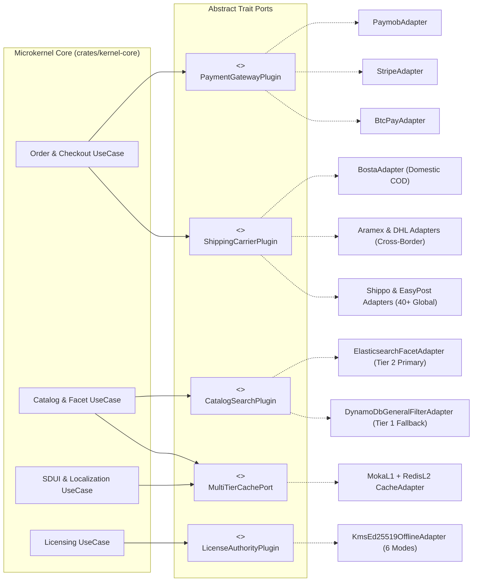
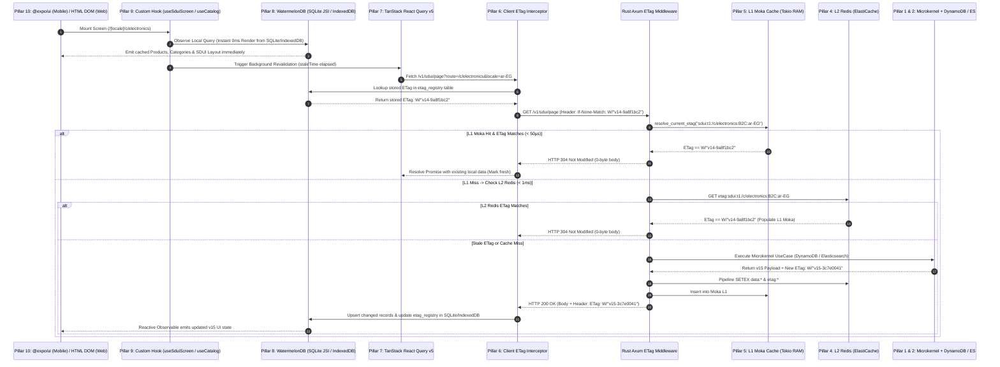

# some-commerce: Detailed System Architecture Specification (`docs/SYSTEM_ARCHITECTURE.md`)

## 1. End-to-End System Architecture Overview & Master Diagram

`some-commerce` is built on a **Client-First, Multi-Tier Cached, Microkernel Architecture** combining a 5-binary [Rust](https://docs.aws.amazon.com/lambda/latest/dg/lambda-rust.html) + [Cargo Lambda](https://www.cargo-lambda.info/) backend on AWS with a universal, local-first [Expo](https://docs.expo.dev/) frontend. Every layer is decoupled through strict contracts:

1. **Microkernel Abstract Logic (`crates/kernel-core`)**: Pure domain rules isolated from payment gateways, shipping carriers, search engines, and storage drivers via trait ports and runtime plugin registries.
2. **Polyglot Database Schema**: Backend Single-Table [Amazon DynamoDB](https://docs.aws.amazon.com/amazondynamodb/latest/developerguide/Introduction.html) (`PK`/`SK` + `GSI1`–`GSI5`), [Elasticsearch](https://www.elastic.co/docs/explore-analyze/query-filter/aggregations) / [Amazon OpenSearch](https://docs.aws.amazon.com/opensearch-service/latest/developerguide/what-is.html) nested facet index, and Frontend [WatermelonDB](https://watermelondb.dev/docs) local SQLite/LokiJS tables.
3. **Repository Tools & Monorepo Toolchain**: Unified Rust Cargo Workspace + Bun/Turborepo + [AWS CDK v2](https://docs.aws.amazon.com/cdk/api/v2/) + automated JSON Schema / OpenAPI / [W3C WebMCP](https://webmachinelearning.github.io/webmcp/) code generation.
4. **L2 Distributed Caching with Redis**: [Amazon ElastiCache Serverless for Redis](https://docs.aws.amazon.com/AmazonElastiCache/latest/dg/WhatIs.html) (`redis-rs` multiplexed async connections + Redis Pub/Sub cache invalidation fan-out).
5. **L1 In-Process Caching with Moka**: [`moka::future::Cache`](https://docs.rs/moka/latest/moka/) TinyLFU in-memory cache shared across concurrent Tokio tasks inside each Rust Lambda execution environment (especially effective on [AWS Lambda Managed Instances](https://aws.amazon.com/lambda/lambda-managed-instances/)).
6. **HTTP `ETag` & `If-None-Match` (`304 Not Modified`) Freshness Protocol**: Deterministic `BLAKE3` entity digests (`ETag`) verified at the L1 Moka / L2 Redis edge in `< 0.1ms` to short-circuit unchanged responses with [`HTTP 304 Not Modified`](https://developer.mozilla.org/en-US/docs/Web/HTTP/Reference/Status/304).
7. **Frontend Server-State Caching with [TanStack React Query](https://tanstack.com/query/latest/docs/framework/react/overview)**: ETag-aware query client managing faceted search, shipping rate quotes, Split COD calculations, and optimistic mutations.
8. **Client-First Local Database with [WatermelonDB](https://watermelondb.dev/docs)**: Offline-first reactive SQLite (JSI on iOS/Android) and IndexedDB/LokiJS (Web) storage synchronized via delta pull/push endpoints (`/v1/sync/pull` & `/v1/sync/push`).
9. **Headless Custom Hooks (`packages/domain-hooks`)**: Pure TypeScript hooks that encapsulate WatermelonDB observables, TanStack Query + ETag freshness checks, RTL/LTR localization, and WebMCP tool calls—exposing clean ViewModels to the UI.
10. **Platform-Adaptive UI Layer**: Native SwiftUI & Jetpack Compose controls via [`@expo/ui`](https://docs.expo.dev/versions/latest/sdk/ui/) + custom Swift/Kotlin [Expo Native Modules](https://docs.expo.dev/modules/overview/) on iOS/Android, paired with semantic HTML5 DOM + CSS Grid/Logical Properties + [Expo DOM Components](https://docs.expo.dev/guides/dom-components/) on Web.

### Master End-to-End Architecture Diagram

```mermaid
flowchart TB
    subgraph ClientLayer["Universal Client Layer (iOS, Android & Static Web on S3 + CloudFront)"]
        subgraph UILayer["10. Platform-Adaptive UI Design Layer (Zero Business Logic)"]
            MobileUI["Mobile UI: @expo/ui (SwiftUI / Jetpack Compose)\n+ Custom Expo Native Modules (Ed25519 Keychain, QR, Biometrics)"]
            WebUI["Web UI: Semantic HTML5 DOM (<main>, <nav>, CSS Grid, Logical RTL/LTR)\n+ Expo DOM Components (Admin SDUI Studio) + W3C WebMCP (navigator.modelContext)"]
        end

        subgraph HooksLayer["9. Headless Custom Hooks Layer (packages/domain-hooks)"]
            Hooks["useSduiScreen • useCatalogSearchAndFacets • useProductConfigurator\nuseSplitCodCheckout • useCustomerAccount • useDigitalLicenseVault • useWebMcpBridge"]
        end

        subgraph ClientDataLayer["6, 7 & 8. Client-First Storage, Server-State Cache & ETag Freshness"]
            RQ["7. TanStack React Query v5\n(Volatile Queries, Facets, Rate Quotes & Optimistic Mutations)"]
            ETagClient["6. ETag Freshness Interceptor\n(Sends If-None-Match -> Resolves 304 Not Modified from Local Store)"]
            WDB["8. WatermelonDB Local-First DB\n(SQLite via JSI on Mobile / LokiJS + IndexedDB on Web)\nTables: products, categories, brands, sdui_layouts, cart_items, licenses_vault"]
        end

        MobileUI --> Hooks
        WebUI --> Hooks
        Hooks --> RQ
        Hooks --> WDB
        RQ --> ETagClient
        WDB <-->|"Delta Sync (/v1/sync/pull & push)"| ETagClient
    end

    subgraph EdgeLayer["AWS Edge & Auth Layer"]
        CF["Amazon CloudFront CDN + Origin Access Control (OAC)"]
        Cognito["Amazon Cognito User Pools\n+ Pre-Token Generation V2 Lambda Trigger (RBAC & Locale Claims)"]
    end

    ETagClient ==>|"HTTPS (If-None-Match: W/\"blake3-hash\" + Bearer JWT)"| CF

    subgraph BackendLayer["Rust Cargo Lambda Workspace (Standard On-Demand OR Lambda Managed Instances)"]
        AxumEtag["6. Axum ETag & Conditional Request Middleware\n(Short-circuits 304 Not Modified in < 0.1ms on L1/L2 Match)"]

        subgraph CacheLayer["4 & 5. Two-Tier Backend Caching Layer"]
            L1Moka["5. L1 In-Process Cache: Moka (moka::future::Cache)\nLock-Free Concurrent TinyLFU in Tokio RAM (< 50µs)"]
            L2Redis["4. L2 Distributed Cache: Amazon ElastiCache Serverless for Redis\n(redis-rs Multiplexed Async + Pub/Sub L1 Invalidation Channel)"]
        end

        subgraph MicrokernelLayer["1. Rust Microkernel Core (crates/kernel-core)"]
            Kernel["CommerceKernel<C, S, P, Sh, L, N>\nPure Domain Rules: Split-COD Math, N-Level Taxonomy, B2B MOQ, SDUI Fallback, License Policy"]
            Ports["Trait Ports: CatalogRepoPort • SearchPort • PaymentPlugin • CarrierPlugin • LicensePlugin"]
        end

        subgraph PluginsLayer["1. Pluggable Adapter Drivers (crates/plugins-*)"]
            PayPlugins["Payment Plugins:\nPaymob • Stripe • BTCPay"]
            ShipPlugins["Carrier Plugins:\nBosta • Aramex • DHL • Shippo • EasyPost"]
            SearchPlugins["Search Plugins:\nTier 2 Elasticsearch/OpenSearch\nTier 1 DynamoDB Filter Fallback"]
            LicPlugins["License & AI Plugins:\nAWS KMS Ed25519 (6 Modes)\nAmazon Bedrock Converse MCP"]
        end

        CF --> AxumEtag
        AxumEtag --> L1Moka
        L1Moka <-->|"Miss / Fill + Pub/Sub Evict"| L2Redis
        AxumEtag --> Kernel
        Kernel --> Ports
        Ports --> PayPlugins
        Ports --> ShipPlugins
        Ports --> SearchPlugins
        Ports --> LicPlugins
    end

    subgraph PersistenceLayer["2. AWS Persistence & Messaging Layer"]
        DDB["Amazon DynamoDB Single-Table\n(PK/SK + GSI1..GSI5 Sync Log)"]
        ES["Elasticsearch / Amazon OpenSearch\n(Zero-ETL / Stream Sync + Nested Facets)"]
        KMS["AWS KMS (FIPS 140-3 HSM)\nEd25519 Signing & Gateway Vault"]
        SNS["Amazon SNS\n(APNs/FCM Push + SMS + Webhooks)"]
    end

    SearchPlugins --> DDB
    SearchPlugins --> ES
    LicPlugins --> KMS
    Kernel --> SNS
```

## 2. Pillar 1: Microkernel Abstract Logic (`crates/kernel-core`)

Rather than coupling HTTP routes directly to AWS SDKs or third-party REST payloads, `some-commerce` uses a strict **Microkernel (Core + Plug-in Ports) Architecture** inside `crates/kernel-core`.

### 2.1 Core Microkernel Responsibilities vs. Plug-in Adapters

* **The Microkernel (`crates/kernel-core`)**: Contains **zero** HTTP client libraries (`reqwest`), **zero** database drivers (`aws-sdk-dynamodb`), and **zero** vendor-specific JSON structs. It owns deterministic domain invariants:
  * **Locale Resolution Engine**: Evaluates `requested_locale -> language_root -> tenant_default_locale -> "en"` across any localized map.
  * **Unlimited N-Level Taxonomy & Property Inheritance**: Computes materialized paths (`ancestor_ids`) and merges inherited `PROPERTY_DEF` schemas down the category tree.
  * **Split Cash-on-Delivery (`DEPOSIT_COD`) Invariant Engine**: Computes `upfront_online_deposit_cents` vs. `remaining_cod_balance_cents` per governorate/zone rule and blocks COD when `has_digital_items == true`.
  * **B2B Wholesale Contract & MOQ Engine**: Enforces `qty >= moq_min` and resolves tiered volume pricing (`B2B_CONTRACT#<org_id>`).
  * **6-Mode Non-Heartbeat License Verifier**: Canonicalizes license claims and validates release timestamps and seat counts.
* **Plug-in Ports & Registry (`crates/kernel-ports` & `crates/plugins-*`)**: Every external capability implements an async Rust trait (`Send + Sync + 'static`) registered in the `PluginRegistry` so tenants can hot-swap providers per country or category without touching kernel logic.

### 2.2 Rust Microkernel Trait Contracts (`crates/kernel-core/src/ports.rs`)

```rust
use async_trait::async_trait;
use serde::{Deserialize, Serialize};

#[derive(Debug, Clone, Serialize, Deserialize)]
pub struct EntityEnvelope<T> {
    pub data: T,
    pub version: u64,
    pub updated_at_ms: i64,
    pub etag: String, // Deterministic BLAKE3 digest: W/"v{version}-{hash}"
}

#[async_trait]
pub trait MultiTierCachePort: Send + Sync {
    async fn get_etag(&self, cache_key: &str) -> Option<String>;
    async fn get_or_fetch<T, F, Fut>(
        &self,
        cache_key: &str,
        ttl_secs: u64,
        loader: F,
    ) -> Result<EntityEnvelope<T>, KernelError>
    where
        T: Serialize + for<'de> Deserialize<'de> + Clone + Send + Sync + 'static,
        F: FnOnce() -> Fut + Send,
        Fut: std::future::Future<Output = Result<EntityEnvelope<T>, KernelError>> + Send;
    async fn invalidate_prefix(&self, tenant_id: &str, prefix: &str) -> Result<(), KernelError>;
}

#[async_trait]
pub trait PaymentGatewayPlugin: Send + Sync {
    fn plugin_id(&self) -> &'static str; // "paymob" | "stripe" | "btcpay"
    async fn create_checkout_intention(
        &self,
        ctx: &TenantContext,
        req: &PaymentIntentionRequest,
    ) -> Result<PaymentIntentionResponse, KernelError>;
    async fn verify_webhook_signature(
        &self,
        headers: &HeaderMap,
        raw_body: &[u8],
        secret: &[u8],
    ) -> Result<VerifiedPaymentEvent, KernelError>;
}

#[async_trait]
pub trait ShippingCarrierPlugin: Send + Sync {
    fn carrier_id(&self) -> &'static str; // "bosta" | "aramex" | "dhl" | "shippo" | "easypost"
    async fn quote_rates(&self, req: &RateQuoteRequest) -> Result<Vec<CarrierRateQuote>, KernelError>;
    async fn create_awb_shipment(&self, req: &AwbBookingRequest) -> Result<AwbReceipt, KernelError>;
}

#[async_trait]
pub trait CatalogSearchPlugin: Send + Sync {
    async fn search_and_aggregate(
        &self,
        query: &CatalogSearchQuery,
    ) -> Result<EntityEnvelope<CatalogSearchResponse>, KernelError>;
}
```

### 2.3 Microkernel Plug-in Dispatch Diagram



## 3. Pillar 2: Polyglot Database Schema (DynamoDB Single-Table + Elasticsearch + WatermelonDB)

### 3.1 Backend Single-Table Schema ([Amazon DynamoDB](https://docs.aws.amazon.com/amazondynamodb/latest/developerguide/Introduction.html))

All operational entities reside in `some_commerce_core` with partition key `PK` and sort key `SK`. Every mutable item stores `version: u64`, `updated_at_ms: i64`, and `etag: String` (`W/"v{version}-{blake3_prefix}"`) to drive L1/L2 caching, HTTP `ETag` headers, and WatermelonDB delta synchronization.

| Entity Type | `PK` | `SK` | `GSI1PK` / `GSI1SK` (Category & Price) | `GSI2PK` / `GSI2SK` (Brand / User) | `GSI5PK` / `GSI5SK` (WatermelonDB Delta Sync) | Key Attributes |
| :--- | :--- | :--- | :--- | :--- | :--- | :--- |
| **Tenant Config** | `TENANT#<tid>` | `CONFIG#MAIN` | — | — | `TENANT#<tid>#SYNC` / `TS#<ms>#CONFIG` | `default_locale`, `supported_locales[]`, `currencies[]`, `etag` |
| **User Profile** | `TENANT#<tid>` | `USER#<cognito_sub>` | — | `USER#<email_or_phone>` / `TENANT#<tid>` | `USER#<sub>#SYNC` / `TS#<ms>#PROFILE` | `persona`, `b2b_org_id`, `vendor_id`, `pref_locale`, `addresses[]`, `sns_endpoints[]` |
| **N-Level Category** | `TENANT#<tid>` | `TAXONOMY_NODE#<nid>` | `TENANT#<tid>#PARENT#<pid>` / `SORT#<idx>` | — | `TENANT#<tid>#SYNC` / `TS#<ms>#TAX#<nid>` | `ancestor_ids[]`, `depth`, `names_i18n`, `slugs_i18n`, `property_codes[]`, `etag` |
| **Brand** | `TENANT#<tid>` | `BRAND#<bid>` | `TENANT#<tid>#BRANDS` / `NAME#<slug>` | — | `TENANT#<tid>#SYNC` / `TS#<ms>#BRAND#<bid>` | `names_i18n`, `descriptions_i18n`, `logo_url`, `featured_cat_ids[]`, `etag` |
| **Property Definition** | `TENANT#<tid>` | `PROPERTY_DEF#<code>` | — | — | `TENANT#<tid>#SYNC` / `TS#<ms>#PROP#<code>` | `data_type` (`COLOR_SWATCH`, `NUMBER`, `ENUM`), `ui_widget`, `labels_i18n`, `options[]` |
| **Product Master** | `TENANT#<tid>` | `PRODUCT#<pid>` | `TENANT#<tid>#CAT#<leaf_cid>` / `STATUS#<st>#PRICE#<pad>` | `TENANT#<tid>#BRAND#<bid>` / `PRICE#<pad>` | `TENANT#<tid>#SYNC` / `TS#<ms>#PROD#<pid>` | `titles_i18n`, `ancestor_category_ids[]`, `properties_map`, `supports_cod`, `b2b_tiers[]`, `etag` |
| **SKU Variant** | `TENANT#<tid>` | `PRODUCT#<pid>#VARIANT#<sku>` | — | `TENANT#<tid>#VENDOR#<vid>` / `SKU#<sku>` | `TENANT#<tid>#SYNC` / `TS#<ms>#VAR#<sku>` | `axis_values` (`{"color":"blk","size":"XL"}`), `stock_available`, `price_override_cents` |
| **SDUI Page Layout** | `TENANT#<tid>` | `SDUI#<route>#<persona>#<ver>` | — | — | `TENANT#<tid>#SYNC` / `TS#<ms>#SDUI#<route>` | `blocks_i18n`, `theme_tokens`, `direction_override`, `version`, `etag` |
| **Zone & COD Rule** | `TENANT#<tid>` | `LOCALE_FEES#<country>#<zone>` | — | — | `TENANT#<tid>#SYNC` / `TS#<ms>#FEES#<zone>` | `shipping_cents`, `cod_fee_cents`, `deposit_formula` (`SHIPPING_PLUS_COD`), `carriers[]` |
| **Customer Order** | `TENANT#<tid>` | `ORDER#<order_id>` | — | `USER#<sub>#ORDERS` / `TS#<ms>` | `USER#<sub>#SYNC` / `TS#<ms>#ORD#<order_id>` | `payment_mode` (`DEPOSIT_COD`), `upfront_deposit_cents`, `remaining_cod_cents`, `awb_number` |
| **Vendor Sub-Order** | `TENANT#<tid>` | `SUBORDER#<vid>#<sub_id>` | — | `VENDOR#<vid>#ORDERS` / `STATUS#<st>#TS#<ms>` | — | `parent_order_id`, `vendor_subtotal_cents`, `escrow_status`, `commission_cents` |
| **Digital License** | `TENANT#<tid>` | `LICENSE#<lic_id>` | — | `USER#<sub>#LICENSES` / `PROD#<pid>` | `USER#<sub>#SYNC` / `TS#<ms>#LIC#<lic_id>` | `ed25519_cert_b64`, `verification_mode`, `max_machines`, `activated_hw_hashes[]`, `updates_until` |

### 3.2 Search Engine Nested Facet Schema ([Elasticsearch](https://www.elastic.co/docs/explore-analyze/query-filter/aggregations) / [Amazon OpenSearch](https://docs.aws.amazon.com/opensearch-service/latest/developerguide/what-is.html))

Each tenant index (`some_commerce_catalog_v1`) uses language-specific analyzers (`arabic` stemmer, `english`, `french`, `german`) plus a `nested` `properties` array so admins can create unlimited filterable product properties at runtime without re-indexing or altering mappings:

```json
{
  "mappings": {
    "properties": {
      "tenant_id": { "type": "keyword" },
      "product_id": { "type": "keyword" },
      "vendor_id": { "type": "keyword" },
      "brand_id": { "type": "keyword" },
      "ancestor_category_ids": { "type": "keyword" },
      "leaf_category_id": { "type": "keyword" },
      "product_type": { "type": "keyword" },
      "supports_cod": { "type": "boolean" },
      "in_stock": { "type": "boolean" },
      "base_price_cents": { "type": "long" },
      "b2b_moq_min": { "type": "integer" },
      "titles": {
        "properties": {
          "ar": { "type": "text", "analyzer": "arabic" },
          "en": { "type": "text", "analyzer": "english" }
        }
      },
      "properties": {
        "type": "nested",
        "properties": {
          "code": { "type": "keyword" },
          "val_kw": { "type": "keyword" },
          "val_num": { "type": "double" },
          "val_bool": { "type": "boolean" },
          "swatch_hex": { "type": "keyword" }
        }
      },
      "etag": { "type": "keyword", "index": false },
      "updated_at_ms": { "type": "date", "format": "epoch_millis" }
    }
  }
}
```

## 4. Pillar 3: Repository Tools & Monorepo Toolchain

The repository is structured as a single polyglot monorepo combining a **Rust Cargo Workspace** for serverless compute and a **Bun + Turborepo Workspace** for the universal Expo client and AWS CDK infrastructure:

```text
some-commerce/
├── Cargo.toml                        # Rust Workspace root (resolver = "2", LTO = "thin")
├── Turbo.json                        # Turborepo task pipeline (build, test, lint, typecheck)
├── crates/
│   ├── kernel-core/                  # Pillar 1: Pure Microkernel domain logic & trait ports
│   ├── db-schema/                    # Pillar 2: DynamoDB Single-Table, ES & WatermelonDB sync models
│   ├── cache-tier/                   # Pillars 4, 5 & 6: Moka L1 + Redis L2 + HTTP ETag engine
│   ├── plugins-payments/             # Paymob, Stripe & BTCPay Server Greenfield adapters
│   ├── plugins-shipping/             # Bosta, Aramex, DHL Express, Shippo & EasyPost adapters
│   ├── plugins-licensing/            # 6-Mode AWS KMS Ed25519 & CloudFront CRL licensing engine
│   └── mcp-tools/                    # Shared Customer & Admin WebMCP + Bedrock Converse schemas
├── bins/
│   ├── storefront-sdui-api/          # Lambda #1: Public SDUI, Search, Sync Pull & Customer WebMCP
│   ├── checkout-webhooks-api/        # Lambda #2: Split-COD Checkout, Rates & Signed Webhooks
│   ├── admin-vendor-api/             # Lambda #3: Taxonomy, Properties, SDUI Studio & Admin WebMCP
│   ├── fulfillment-worker/           # Lambda #4: AWB dispatch, SNS Push/SMS, KMS .lic & ES indexing
│   └── durable-orchestrator/         # Lambda #5: AWS Lambda Durable Functions (COD, RFQ, Escrow)
├── packages/
│   ├── watermelon-db/                # Pillar 8: WatermelonDB schema, models, migrations & sync engine
│   ├── query-etag-client/            # Pillars 6 & 7: TanStack React Query v5 + ETag HTTP interceptor
│   ├── domain-hooks/                 # Pillar 9: Headless React hooks abstracting logic from UI design
│   └── ui-primitives/                # Pillar 10: Platform-adaptive @expo/ui (Mobile) + HTML DOM (Web)
├── modules/
│   └── expo-crypto-license/          # Pillar 10: Custom Swift/Kotlin Expo Module (Ed25519 & Secure Enclave)
├── apps/
│   └── universal-storefront/         # Universal Expo Router app (iOS, Android & Static S3 Web)
└── infra/
    └── cdk/                          # AWS CDK v2 (On-Demand vs. Lambda Managed Instances + ElastiCache)
```

| Tool Category | Selected Tooling | Purpose in Repository |
| :--- | :--- | :--- |
| **Rust Build & Serverless Runner** | [Cargo Lambda](https://www.cargo-lambda.info/) (`cargo lambda watch` / `cargo lambda build --release --arm64`) | Cross-compiles the 5 Rust binaries for AWS Graviton (`provided.al2023`) using Zig and emulates Lambda locally. |
| **Rust Test & Quality Gate** | `cargo-nextest`, `cargo clippy -- -D warnings`, `cargo-deny`, `proptest` | Runs parallel unit/property tests on Microkernel invariants (Split-COD math, locale fallback, ETag determinism) and audits crate licenses. |
| **Schema & Contract Codegen** | `schemars` + `utoipa` + `ts-rs` | Automatically exports Rust structs in `crates/db-schema` and `crates/mcp-tools` to TypeScript types, OpenAPI 3.1 specs, and [W3C WebMCP](https://webmachinelearning.github.io/webmcp/) tool JSON Schemas. |
| **Frontend & Monorepo Runner** | `Bun` + `Turborepo` + `Biome` | Executes sub-second TypeScript linting, formatting, and incremental package builds across `packages/*` and `apps/universal-storefront`. |
| **Local Cloud Emulation** | Docker Compose (`DynamoDB Local`, `Redis 7.4`, `OpenSearch 2.x`, `LocalStack KMS/SNS/S3`) | Enables 100% offline integration testing of the full L1 Moka -> L2 Redis -> DynamoDB/OpenSearch pipeline. |

## 5. Pillar 4 & Pillar 5: Two-Tier Backend Caching (L1 Moka + L2 Redis)

To guarantee sub-millisecond reads while scaling across both Standard On-Demand AWS Lambda and multi-concurrent [AWS Lambda Managed Instances](https://aws.amazon.com/lambda/lambda-managed-instances/) (`MaxConcurrency: 64`), `crates/cache-tier` implements a coherent **Two-Tier Read-Through Cache with Pub/Sub Invalidation**:

* **Pillar 5 — L1 In-Process Cache ([`moka::future::Cache`](https://docs.rs/moka/latest/moka/))**:
  * Lives directly in the Rust process memory (`Arc<Cache<String, Bytes>>`) using TinyLFU admission and lock-free concurrent hash maps.
  * Lookup latency is **< 50 microseconds** with zero serialization or network overhead.
  * Uses `moka::future::Cache::try_get_with(key, async_loader)` to coalesce concurrent cache misses (thundering-herd protection) across all 64 concurrent Tokio tasks inside a Lambda Managed Instance.
* **Pillar 4 — L2 Distributed Cache ([Amazon ElastiCache Serverless for Redis](https://docs.aws.amazon.com/AmazonElastiCache/latest/dg/WhatIs.html) + [`redis-rs`](https://docs.rs/redis/latest/redis/))**:
  * Shared across all Lambda execution environments via `redis::aio::MultiplexedConnection`.
  * Stores compressed `EntityEnvelope<T>` payloads alongside a lightweight `etag:{cache_key}` string key (`GET etag:{cache_key}` takes `< 0.8ms`).
  * **Cross-Instance L1 Eviction**: When an Admin or Vendor mutates a product, category, or SDUI page, `admin-vendor-api` deletes/updates the L2 Redis key and publishes an invalidation event to the [Redis Pub/Sub](https://redis.io/docs/latest/develop/use-cases/pub-sub/rust/) channel `cache:evict:{tenant_id}`. Every running Lambda Managed Instance subscribes via a background Tokio task and immediately calls `l1_moka.invalidate(&key)`.

### Rust Implementation: Coherent L1 Moka + L2 Redis Cache (`crates/cache-tier/src/lib.rs`)

```rust
use bytes::Bytes;
use moka::future::Cache as MokaCache;
use redis::{aio::MultiplexedConnection, AsyncCommands};
use std::time::Duration;

#[derive(Clone)]
pub struct TwoTierCache {
    l1_payloads: MokaCache<String, Bytes>,
    l1_etags: MokaCache<String, String>,
    l2_redis: MultiplexedConnection,
}

impl TwoTierCache {
    pub fn new(l2_redis: MultiplexedConnection) -> Self {
        Self {
            l1_payloads: MokaCache::builder()
                .max_capacity(10_000)
                .time_to_live(Duration::from_secs(120))
                .time_to_idle(Duration::from_secs(30))
                .build(),
            l1_etags: MokaCache::builder()
                .max_capacity(50_000)
                .time_to_live(Duration::from_secs(300))
                .build(),
            l2_redis,
        }
    }

    /// Ultra-fast ETag lookup (< 50µs on L1 hit, < 1ms on L2 Redis hit)
    pub async fn resolve_current_etag(&self, key: &str) -> Option<String> {
        if let Some(etag) = self.l1_etags.get(key).await {
            return Some(etag);
        }
        let mut conn = self.l2_redis.clone();
        let redis_etag_key = format!("etag:{key}");
        if let Ok(Some(etag)) = conn.get::<_, Option<String>>(&redis_etag_key).await {
            self.l1_etags.insert(key.to_string(), etag.clone()).await;
            return Some(etag);
        }
        None
    }

    /// Coalesced L1 -> L2 -> Origin loader with automatic ETag indexing
    pub async fn get_or_load_bytes<F, Fut>(
        &self,
        key: &str,
        ttl_secs: u64,
        origin_loader: F,
    ) -> Result<(Bytes, String), CacheError>
    where
        F: FnOnce() -> Fut + Send,
        Fut: std::future::Future<Output = Result<(Bytes, String), CacheError>> + Send,
    {
        let mut redis_conn = self.l2_redis.clone();
        let l1_etags = self.l1_etags.clone();
        let key_owned = key.to_string();

        let payload = self
            .l1_payloads
            .try_get_with(key_owned.clone(), async move {
                let data_key = format!("data:{key_owned}");
                let etag_key = format!("etag:{key_owned}");
                if let Ok((Some(cached_bytes), Some(cached_etag))) = redis::pipe()
                    .get(&data_key)
                    .get(&etag_key)
                    .query_async::<(Option<Vec<u8>>, Option<String>)>(&mut redis_conn)
                    .await
                {
                    l1_etags.insert(key_owned.clone(), cached_etag).await;
                    return Ok(Bytes::from(cached_bytes));
                }

                let (fresh_bytes, fresh_etag) = origin_loader().await?;
                let _: Result<(), _> = redis::pipe()
                    .atomic()
                    .set_ex(&data_key, fresh_bytes.as_ref(), ttl_secs)
                    .set_ex(&etag_key, &fresh_etag, ttl_secs * 2)
                    .query_async(&mut redis_conn)
                    .await;
                l1_etags.insert(key_owned, fresh_etag).await;
                Ok(fresh_bytes)
            })
            .await
            .map_err(|e| CacheError::OriginFailure(e.to_string()))?;

        let etag = self.l1_etags.get(key).await.unwrap_or_default();
        Ok((payload, etag))
    }
}
```

## 6. Pillar 6: HTTP `ETag` & `If-None-Match` (`304 Not Modified`) Freshness Protocol

To prevent re-downloading unchanged SDUI page layouts, N-level category trees, product details, and WatermelonDB sync snapshots over mobile networks, every read endpoint implements the [RFC 9110 `ETag` / `If-None-Match` conditional request protocol](https://developer.mozilla.org/en-US/docs/Web/HTTP/Reference/Headers/If-None-Match):

1. **Deterministic Entity Tag Generation**: Whenever an entity (`PRODUCT#<pid>`, `SDUI#<route>#<persona>`, `TAXONOMY_TREE#<tid>`) is written or aggregated, `crates/db-schema` computes:
   `ETag = W/"v{version}-{blake3_64bit_hex(tenant_id || locale || persona || canonical_payload)}"`
2. **Zero-Deserialization `304 Not Modified` Short-Circuit**:
   - The Expo client attaches `If-None-Match: W/"v14-9a8f1bc2"` on every `GET` request.
   - The Axum middleware computes the canonical cache key (`sdui:t1:/index:B2C:ar-EG`) and calls `two_tier_cache.resolve_current_etag(&key)`.
   - If the client's `If-None-Match` matches the L1 Moka or L2 Redis `ETag`, Axum immediately returns **`HTTP 304 Not Modified`** with `0 bytes` of body in `< 0.1ms`—never reading the full payload from Redis and never querying DynamoDB or Elasticsearch.
3. **Optimistic Concurrency on Admin/Vendor Writes (`If-Match`)**:
   - Admin and Vendor `PUT`/`PATCH` mutations send `If-Match: W/"v14-9a8f1bc2"`. If another administrator updated the record concurrently, DynamoDB's `ConditionExpression: etag = :expected_etag` fails and the API returns `HTTP 412 Precondition Failed`.

### Sequence Diagram: End-to-End Freshness Check (WatermelonDB + TanStack Query + ETag + L1 Moka + L2 Redis)



## 7. Pillar 7: Frontend Server-State Caching with [TanStack React Query (`@tanstack/react-query`)](https://tanstack.com/query/latest/docs/framework/react/overview)

While [WatermelonDB](https://watermelondb.dev/docs) owns structured, relational offline entities (products, categories, cart, addresses, digital licenses), **[TanStack React Query v5](https://tanstack.com/query/latest/docs/framework/react/overview)** manages parameterized server state, faceted Elasticsearch aggregations, carrier rate quotes, and optimistic mutations (`packages/query-etag-client`):

```typescript
import { QueryClient } from '@tanstack/react-query';
import { Database } from '@nozbe/watermelondb';

export function createCommerceQueryClient(watermelonDb: Database) {
  return new QueryClient({
    defaultOptions: {
      queries: {
        staleTime: 30_000, // 30s before background conditional ETag check
        gcTime: 1000 * 60 * 30, // Keep in memory 30m
        retry: 2,
        refetchOnWindowFocus: true,
        refetchOnReconnect: true,
      },
    },
  });
}

export async function fetchWithEtag<T>(
  url: string,
  watermelonDb: Database,
  headers?: Record<string, string>
): Promise<T> {
  const etagCollection = watermelonDb.collections.get('etag_registry');
  const cachedEntry = await etagCollection.find(url).catch(() => null);

  const requestHeaders: Record<string, string> = {
    Accept: 'application/json',
    ...headers,
  };
  if (cachedEntry?.etag) {
    requestHeaders['If-None-Match'] = cachedEntry.etag;
  }

  const response = await fetch(url, { headers: requestHeaders });

  if (response.status === 304 && cachedEntry) {
    return JSON.parse(cachedEntry.payloadJson) as T;
  }

  if (!response.ok) {
    throw new Error(`HTTP ${response.status}: ${await response.text()}`);
  }

  const freshData = (await response.json()) as T;
  const freshEtag = response.headers.get('ETag');

  if (freshEtag) {
    await watermelonDb.write(async () => {
      if (cachedEntry) {
        await cachedEntry.update((rec: any) => {
          rec.etag = freshEtag;
          rec.payloadJson = JSON.stringify(freshData);
          rec.updatedAt = Date.now();
        });
      } else {
        await etagCollection.create((rec: any) => {
          rec._raw.id = url;
          rec.etag = freshEtag;
          rec.payloadJson = JSON.stringify(freshData);
          rec.updatedAt = Date.now();
        });
      }
    });
  }

  return freshData;
}
```

## 8. Pillar 8: Client-First Local Database using [WatermelonDB (`@nozbe/watermelondb`)](https://watermelondb.dev/docs)

`packages/watermelon-db` gives `some-commerce` an **instant-loading, offline-capable Client-First Database**:
* **On iOS & Android**: Uses `SQLiteAdapter` with `jsi: true` (C++ JSI bridge) so SQL queries and reactive observables execute on a native background thread without blocking the 60/120fps UI thread.
* **On Static Web (`S3` + `CloudFront`)**: Uses `LokiJSAdapter` backed by `IndexedDB` with Web Worker offloading.
* **Built-In Delta Synchronization ([WatermelonDB Sync Protocol](https://watermelondb.dev/docs/Sync/Intro))**: Calls `synchronize()` against `GET /v1/sync/pull?last_pulled_at={epoch_ms}&locale={locale}` (backed by DynamoDB `GSI5` `TENANT#<tid>#SYNC` + HTTP `ETag` conditional checks) and `POST /v1/sync/push` (for offline cart changes and address book edits).

```typescript
import { appSchema, tableSchema } from '@nozbe/watermelondb';

export const commerceWatermelonSchema = appSchema({
  version: 1,
  tables: [
    tableSchema({
      name: 'taxonomy_nodes',
      columns: [
        { name: 'parent_id', type: 'string', isOptional: true, isIndexed: true },
        { name: 'ancestor_ids_json', type: 'string' },
        { name: 'depth', type: 'number' },
        { name: 'names_i18n_json', type: 'string' },
        { name: 'slugs_i18n_json', type: 'string' },
        { name: 'property_codes_json', type: 'string' },
        { name: 'etag', type: 'string' },
        { name: 'updated_at', type: 'number' },
      ],
    }),
    tableSchema({
      name: 'products',
      columns: [
        { name: 'leaf_category_id', type: 'string', isIndexed: true },
        { name: 'brand_id', type: 'string', isIndexed: true },
        { name: 'vendor_id', type: 'string', isIndexed: true },
        { name: 'titles_i18n_json', type: 'string' },
        { name: 'base_price_cents', type: 'number', isIndexed: true },
        { name: 'supports_cod', type: 'boolean', isIndexed: true },
        { name: 'properties_json', type: 'string' },
        { name: 'b2b_tiers_json', type: 'string', isOptional: true },
        { name: 'etag', type: 'string' },
        { name: 'updated_at', type: 'number' },
      ],
    }),
    tableSchema({
      name: 'sdui_pages',
      columns: [
        { name: 'route_key', type: 'string', isIndexed: true },
        { name: 'direction', type: 'string' },
        { name: 'blocks_json', type: 'string' },
        { name: 'theme_tokens_json', type: 'string' },
        { name: 'version', type: 'number' },
        { name: 'etag', type: 'string' },
        { name: 'updated_at', type: 'number' },
      ],
    }),
    tableSchema({
      name: 'cart_items',
      columns: [
        { name: 'product_id', type: 'string', isIndexed: true },
        { name: 'variant_sku', type: 'string', isIndexed: true },
        { name: 'vendor_id', type: 'string', isIndexed: true },
        { name: 'quantity', type: 'number' },
        { name: 'unit_price_cents', type: 'number' },
        { name: 'updated_at', type: 'number' },
      ],
    }),
    tableSchema({
      name: 'licenses_vault',
      columns: [
        { name: 'product_id', type: 'string', isIndexed: true },
        { name: 'ed25519_cert_b64', type: 'string' },
        { name: 'activation_token_b64', type: 'string', isOptional: true },
        { name: 'verification_mode', type: 'string' },
        { name: 'updates_until_ms', type: 'number' },
      ],
    }),
    tableSchema({
      name: 'etag_registry',
      columns: [
        { name: 'etag', type: 'string' },
        { name: 'payload_json', type: 'string' },
        { name: 'updated_at', type: 'number' },
      ],
    }),
  ],
});
```

## 9. Pillar 9: Headless Custom Hooks to Abstract Logic from Design (`packages/domain-hooks`)

To guarantee that **UI components contain zero data-fetching, caching, localization fallback, or payment/shipping math**, every screen and SDUI block binds exclusively to **Headless Custom Hooks** in `packages/domain-hooks`.

| Custom Hook | Abstracted Domain, Cache & Sync Logic | Returned ViewModel & Action Contract |
| :--- | :--- | :--- |
| **`useSduiScreen(route, locale)`** | Subscribes to `sdui_pages` in WatermelonDB for `0ms` initial mount, triggers background TanStack Query `fetchWithEtag` (`If-None-Match`), and computes `RTL`/`LTR` logical layout tokens. | `{ blocks, themeTokens, direction, isRevalidating, refresh }` |
| **`useCatalogSearchAndFacets(params)`** | Combines local WatermelonDB category/brand metadata with TanStack Query Elasticsearch faceted search, manages URL/filter state (`props_kw`, `props_range`), and registers the `search_and_filter_catalog` WebMCP handler. | `{ products, facets, activeFilters, toggleFacet, setRangeFilter, clearFilters, isLoading }` |
| **`useProductConfigurator(productSlug)`** | Observes `products` and `variants` in WatermelonDB, resolves valid Cartesian SKU combinations (`Color x Size`), evaluates B2B volume-tier pricing and MOQ rules, and exposes `addToCart`. | `{ product, selectedAxes, activeVariant, effectiveUnitPrice, moqStatus, selectAxis, addToCart }` |
| **`useSplitCodCheckout()`** | Observes local `cart_items`, groups items by `vendor_id`, queries `/v1/rates/calculate` via TanStack Query, computes `upfront_online_deposit_cents` vs. `remaining_cod_balance_cents`, and orchestrates Paymob/Stripe/BTCPay sessions. | `{ vendorGroups, carrierQuotes, splitCodBreakdown, selectedPaymentMode, submitCheckout }` |
| **`useDigitalLicenseVault()`** | Observes `licenses_vault` in WatermelonDB, invokes the native `expo-crypto-license` module for offline Ed25519 signature verification and Air-Gapped QR challenge signing, and fetches presigned S3 download URLs. | `{ licenses, verifyOfflineCert, scanAirGappedChallengeQr, downloadAsset }` |

## 10. Pillar 10: Platform-Adaptive UI Design Layer (`@expo/ui` + Native Modules for Mobile, Semantic HTML DOM for Web)

The visual layer in `packages/ui-primitives` consumes the headless hooks from Pillar 9 and renders through **platform-native primitives** resolved automatically by Metro bundler file extensions (`.native.tsx` for iOS/Android vs. `.web.tsx` for Static Web):

* **Mobile UI Architecture ([`@expo/ui`](https://docs.expo.dev/versions/latest/sdk/ui/) + Custom [Expo Native Modules](https://docs.expo.dev/modules/overview/))**:
  * On **iOS**, `@expo/ui/swift-ui` renders native **SwiftUI** `BottomSheet`, `Picker`, `Slider`, `Switch`, `ColorPicker`, and `ContextMenu` controls.
  * On **Android**, `@expo/ui/jetpack-compose` renders native **Jetpack Compose Material 3** controls.
  * Custom Swift/Kotlin module `modules/expo-crypto-license` stores `Ed25519` `.lic` certificates inside the iOS Secure Enclave / Android StrongBox Keystore and performs native QR challenge scanning.
* **Web UI Architecture (Semantic HTML5 DOM + CSS Grid + [Expo DOM Components](https://docs.expo.dev/guides/dom-components/))**:
  * `.web.tsx` components render semantic HTML5 DOM tags (`<header>`, `<nav>`, `<main>`, `<aside>`, `<article>`, `<fieldset>`, `<dialog>`) styled with CSS Grid and **CSS Logical Properties** (`margin-inline-start`, `padding-inline-end`) for instant `RTL`/`LTR` mirroring and crawlable SEO.
