# some-commerce: Deep User Stories (Pages, Workflows & Diagrams) and Sprint Checklists (`docs/USER_STORIES_AND_SPRINTS.md`)

## 1. Complete Route & Page Map (Universal Expo Router + SDUI + Headless Hooks)

All storefront, customer account, B2B portal, vendor, and admin pages live in a single universal [Expo Router](https://docs.expo.dev/router/introduction/) tree prefixed by `/[locale]`. Every page binds to a **Headless Custom Hook** (`packages/domain-hooks`) backed by **[WatermelonDB](https://watermelondb.dev/docs)** + **[TanStack React Query](https://tanstack.com/query/latest/docs/framework/react/overview)** (`If-None-Match` / `ETag` revalidation against **L1 [Moka](https://docs.rs/moka/latest/moka/)** + **L2 [Redis](https://docs.aws.amazon.com/AmazonElastiCache/latest/dg/WhatIs.html)**), and renders through **[`@expo/ui`](https://docs.expo.dev/versions/latest/sdk/ui/)** + **[Expo Native Modules](https://docs.expo.dev/modules/overview/)** on Mobile and **Semantic HTML5 DOM** + **[Expo DOM Components](https://docs.expo.dev/guides/dom-components/)** on Web:

| Route Group | Expo Router Path (`app/[locale]/...`) | Page Name | Headless Hook (`packages/domain-hooks`) | Primary SDUI Blocks & Interactive Components |
| :--- | :--- | :--- | :--- | :--- |
| **Public Storefront** | `/[locale]/index` | **Storefront Home Page** | `useSduiScreen('/index', locale)` | `HeroBannerCarouselBlock`, `CategoryTreeRailBlock`, `BrandShowcaseStripBlock`, `FeaturedProductGridBlock`, `WebMcpAssistantFAB` |
| **Public Storefront** | `/[locale]/c/[...category_slug]` | **N-Level Category & Search Listing Page (PLP)** | `useCatalogSearchAndFacets(categoryId, locale)` | `BreadcrumbTrailBlock`, `SubCategoryPillsBlock`, `SearchFacetFilterSidebarBlock` (`COLOR_SWATCH_GRID`, `RANGE_SLIDER`, `CHECKBOX_LIST`), `ProductCardGridBlock` |
| **Public Storefront** | `/[locale]/b/[brand_slug]` | **Brand Flagship Store Page** | `useBrandCatalog(brandSlug, locale)` | `BrandHeroHeaderBlock`, `BrandCategoryTabsBlock`, `SearchFacetFilterSidebarBlock`, `ProductCardGridBlock` |
| **Public Storefront** | `/[locale]/products/[slug]` | **Product Detail Page (PDP)** | `useProductConfigurator(slug, locale)` | `ProductMediaGalleryBlock`, `VariantSelectorMatrixBlock` (`Color x Size`), `B2BVolumeTierTableBlock`, `CustomPropertySpecsTableBlock`, `CodEligibilityBadgeBlock` |
| **Public Storefront** | `/[locale]/compare` | **AI & Customer Product Comparison Page** | `useWebMcpComparison(locale)` | `WebMcpComparisonTableBlock`, `PropertyDiffHighlightToggle`, `BestValueRecommendationBannerBlock` |
| **Auth & Onboarding** | `/[locale]/(auth)/sign-in` | **Unified Sign-In & OTP Challenge Page** | `useCognitoAuth(locale)` | `AuthMethodTabsBlock` (Phone OTP, Email/Password, Passkey, Google/Apple OIDC), `OtpVerificationInputBlock` |
| **Auth & Onboarding** | `/[locale]/(auth)/b2b-register` | **B2B Organization Registration Page** | `useB2BOnboarding(locale)` | `CompanyTaxIdFormBlock`, `CommercialRegistryUploadBlock`, `CreditLimitRequestBlock` |
| **Cart & Checkout** | `/[locale]/cart` | **Shopping Cart & Split-COD Estimator Page** | `useOfflineCart(locale)` | `CartVendorGroupListBlock`, `QuickZoneRateEstimatorBlock`, `DepositCodBreakdownCardBlock` |
| **Cart & Checkout** | `/[locale]/checkout` | **Multi-Step Localized Checkout Page** | `useSplitCodCheckout(locale)` | `SavedAddressSelectorBlock`, `CarrierRateCardSelectorBlock`, `PaymentModeSelectorBlock` (`PREPAID_FULL`, `DEPOSIT_COD`, `B2B_NET_TERMS`, `BTCPAY`), `PaymobIframeModal` |
| **Cart & Checkout** | `/[locale]/orders/[order_id]/confirmation` | **Order Confirmation & Live Tracker Page** | `useOrderLiveTracker(orderId)` | `OrderStatusTimelineBlock`, `CodBalanceDueBannerBlock`, `BostaAramexLiveTrackingMapBlock`, `InitiateReturnRmaModalBlock` |
| **Customer Account** | `/[locale]/account/profile` | **Customer Profile & Address Book Page** | `useCustomerAccount(locale)` | `ProfileDetailsFormBlock`, `AddressBookGridBlock`, `NotificationPreferencesToggleBlock`, `WebMcpProfileConfirmationModalBlock` |
| **Customer Account** | `/[locale]/account/licenses` | **Digital Vault & Offline License Manager Page** | `useDigitalLicenseVault()` | `PurchasedDigitalAssetsListBlock`, `Ed25519CertificateDownloadCard`, `AirGappedQrScannerModalBlock`, `EnterpriseSeatPoolSummaryCardBlock` |
| **B2B Portal** | `/[locale]/b2b/rfq` | **B2B Request-for-Quote (RFQ) & Net-Terms Portal** | `useB2BRfqNegotiation()` | `BulkSkuMatrixOrderBlock`, `RfqProposalNegotiationTimelineBlock`, `ProformaInvoicePdfDownloadBlock`, `ApprovePoAndCheckoutButton` |
| **Vendor Portal** | `/[locale]/vendor/dashboard` | **Vendor Catalog, Sub-Orders & Escrow Dashboard** | `useVendorPortal()` | `VendorSubOrderQueueTableBlock`, `AwbLabelPrintActionBlock`, `VendorProductEditorBlock`, `EscrowLedgerBalanceCardBlock` |
| **Admin Studio** | `/[locale]/admin/catalog-taxonomy` | **Admin N-Level Taxonomy, Brands & Properties Manager** | `useAdminTaxonomyBuilder()` | `InfiniteCategoryTreeDragDropBlock`, `PropertyDefSchemaBuilderModal`, `BrandRegistryTableBlock`, `WebMcpAdminCopilotDrawer` |
| **Admin Studio** | `/[locale]/admin/settings-gateways` | **Admin Payment Vault, Carrier & Split-COD Rules Page** | `useAdminGatewayConfig()` | `KmsGatewayVaultFormBlock`, `GovernorateCodRuleMatrixBlock`, `LicensingModePolicyBlock`, `RuntimeEditionStatusBannerBlock` |
| **Admin Studio** | `/[locale]/admin/sdui-studio` | **Visual Multi-Locale SDUI Studio & AI Theme Designer** | `useAdminSduiStudio()` | `ExpoDomDualViewportCanvasBlock` (`ar-EG` RTL + `en-US` LTR), `SduiComponentPaletteSidebarBlock`, `WebMcpStylePromptBar`, `PublishAndInvalidateCdnButton` |

## 2. Deep User Stories (`US-1.1` – `US-6.1`) with Pages, End-to-End Workflows & Mermaid Diagrams

### Slice 1 (`v1.0`): Core Multilingual Storefront, Auth, Taxonomy, Elasticsearch, WebMCP, Payments & Split COD

#### US-1.1: Passwordless & Social Authentication with Role/Tenant JWT Enrichment
* **As a** B2C Customer, B2B Buyer, Vendor, or Store Administrator,
* **I want to** sign in via Phone OTP (SMS), Email/Password, Passkeys (WebAuthn), or Social OIDC through [Amazon Cognito User Pools](https://docs.aws.amazon.com/cognito/latest/developerguide/cognito-user-pools.html) and automatically receive a role- and locale-enriched JWT via a [Pre-Token Generation Lambda Trigger](https://docs.aws.amazon.com/cognito/latest/developerguide/user-pool-lambda-pre-token-generation.html),
* **So that** the storefront, B2B portal, and admin APIs authorize my actions and render my preferred language (`RTL` or `LTR`) without per-request database profile lookups.

##### Pages & SDUI Screen Inventory (`US-1.1`)
| Page / Route | Direction & Access | Rendered SDUI Blocks & Headless Hook | Transition Out |
| :--- | :--- | :--- | :--- |
| `/[locale]/(auth)/sign-in` | `RTL` / `LTR`, Public | `AuthMethodTabsBlock`, `PhoneCountryCodeInput`, `OtpSixDigitInputBlock` (`useCognitoAuth`) | Redirects to `return_to` route or role home (`/admin/sdui-studio`, `/vendor/dashboard`, `/b2b/rfq`, or `/[locale]`) |
| `/[locale]/(auth)/b2b-register` | `RTL` / `LTR`, Public | `CompanyProfileFormBlock`, `TaxCardUploadBlock` (`useB2BOnboarding`) | Redirects to `/[locale]/(auth)/sign-in?pending_b2b=true` |
| `/[locale]/account/profile` | `RTL` / `LTR`, Authenticated | `SessionSecurityCardBlock`, `ConnectedPasskeysListBlock`, `RoleBadgeBannerBlock` (`useCustomerAccount`) | Updates active Cognito attributes & triggers WatermelonDB user sync |

##### Step-by-Step End-to-End Workflow (`US-1.1`)
1. **Initiation on `/[locale]/(auth)/sign-in`**: The user selects their sign-in method (e.g., Egyptian mobile number `+2010...` for SMS OTP or Passkey/Email) via `useCognitoAuth`.
2. **PKCE Challenge**: The Expo client initiates an OAuth 2.0 Authorization Code flow with PKCE against the [Amazon Cognito User Pool](https://docs.aws.amazon.com/cognito/latest/developerguide/cognito-user-pools.html).
3. **OTP Delivery via Amazon SNS**: For Phone OTP, Cognito invokes [Amazon SNS](https://docs.aws.amazon.com/sns/latest/dg/sns-mobile-phone-number-as-subscriber.html) to send a localized verification SMS in the user's active `locale` (`ar-EG` or `en-US`).
4. **Pre-Token Generation Enrichment**: Upon valid OTP/credential verification, Cognito triggers the Rust `pre-token-enrichment` handler, which checks L1 Moka / L2 Redis or reads `USER#<cognito_sub>` from [Amazon DynamoDB](https://docs.aws.amazon.com/amazondynamodb/latest/developerguide/Introduction.html) (< 5ms) and injects `custom:tenant_id`, `custom:persona`, `custom:pref_locale`, `custom:b2b_org_id`, and `custom:vendor_id` into the ID and Access JWT claims.
5. **Token Storage & WatermelonDB Delta Sync**: The Expo app stores tokens in `expo-secure-store` (Mobile) or secure cookies (Web), switches UI direction (`RTL`/`LTR`) if `custom:pref_locale` differs, runs `synchronize()` to pull user-scoped records into WatermelonDB, and navigates to the role landing page.

##### Workflow & Sequence Diagram (`US-1.1`)
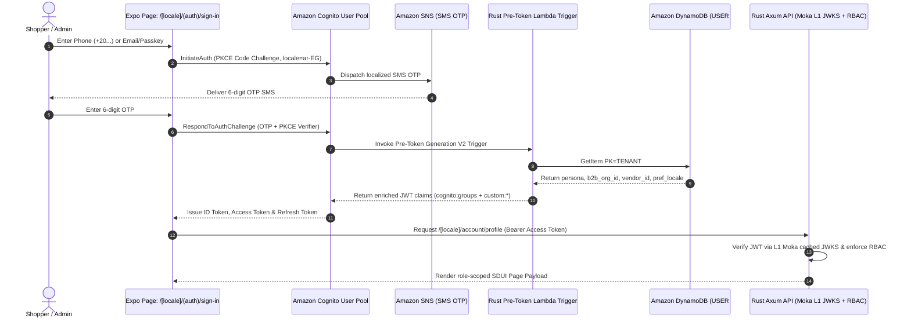

#### US-1.2: Multilingual (`RTL`/`LTR`) Server-Driven UI (SDUI) Storefront & End-to-End `ETag` / `WatermelonDB` Caching
* **As a** global or regional shopper browsing in Arabic (`ar-EG`), English (`en-US`), French (`fr-FR`), German (`de-DE`), or Turkish (`tr-TR`),
* **I want** every storefront page to render instantaneously (`0ms`) from local [WatermelonDB](https://watermelondb.dev/docs) storage in my language with native `RTL` or `LTR` geometry while background-revalidating via [TanStack React Query](https://tanstack.com/query/latest/docs/framework/react/overview) (`If-None-Match` -> L1 Moka / L2 Redis `HTTP 304 Not Modified`),
* **So that** navigation feels native and instant even on flaky mobile connections.

##### Pages & SDUI Screen Inventory (`US-1.2`)
| Page / Route | Direction & Access | Rendered SDUI Blocks & Headless Hook | Transition Out |
| :--- | :--- | :--- | :--- |
| `/[locale]/index` | Dynamic `RTL` / `LTR`, Public | `AppHeaderLocaleBarBlock`, `HeroBannerCarouselBlock`, `CategoryTreeRailBlock`, `FeaturedProductGridBlock` (`useSduiScreen`) | Navigates to `/[locale]/c/[...category_slug]` or `/[locale]/products/[slug]` |
| `/[locale]/products/[slug]` | Dynamic `RTL` / `LTR`, Public | `LocalizedSeoHeadBlock` (`hreflang`), `ProductMediaGalleryBlock`, `LocalizedPriceBadgeBlock` (`useProductConfigurator`) | Opens Cart Drawer or navigates to `/[locale]/cart` |

##### Step-by-Step End-to-End Workflow (`US-1.2`)
1. **0ms Local Mount from WatermelonDB**: When the shopper opens `/ar-EG/index`, `useSduiScreen('/index', 'ar-EG')` immediately observes the `sdui_pages` record in local WatermelonDB (SQLite via JSI on Mobile, IndexedDB on Web) and renders the page in `0ms`.
2. **Conditional Background Revalidation (`If-None-Match`)**: TanStack React Query calls `fetchWithEtag('/v1/sdui/page?route=/index&locale=ar-EG', db)`, attaching `If-None-Match: W/"v14-9a8f1bc2"`.
3. **L1 Moka / L2 Redis `304 Not Modified` Short-Circuit**: `storefront-sdui-api` checks L1 Moka (`< 50µs`) and L2 Redis (`< 1ms`) for `etag:sdui:t1:/index:B2C:ar-EG`. If unchanged, it immediately returns `HTTP 304 Not Modified` with an empty body.
4. **Origin Miss & Deterministic Fallback**: If a new layout `v15` was published, the Microkernel resolves `ar-EG -> ar -> tenant_default_locale -> en`, computes `ETag: W/"v15-3c7e0041"`, populates L2 Redis + L1 Moka, and returns `200 OK`, updating WatermelonDB reactively.

##### Workflow & Sequence Diagram (`US-1.2`)
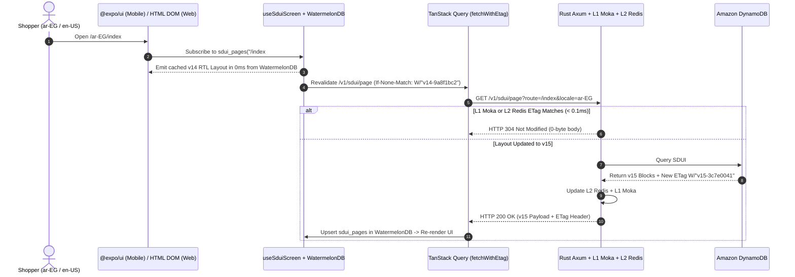

#### US-1.3: Unlimited N-Level Categories, Sub-Categories, Brands & Admin-Customizable Product Properties
* **As a** Store Administrator (`STORE_ADMIN`) or Vendor (`VENDOR`),
* **I want to** create an unlimited N-level hierarchy of localized Categories and Sub-Categories (`Electronics > Computers > Laptops > Gaming Laptops`), manage Brands (`BRAND#<bid>`), and define custom filterable Product Properties (`PROPERTY_DEF#<code>` such as `Color Swatch`, `Size`, `RAM`, `Refresh Rate`, `Fabric`, `Author`, or `License Tier`) with custom SDUI filter widget types,
* **So that** any vertical can be modeled and filtered without changing code or database schemas.

##### Pages & SDUI Screen Inventory (`US-1.3`)
| Page / Route | Direction & Access | Rendered SDUI Blocks & Headless Hook | Transition Out |
| :--- | :--- | :--- | :--- |
| `/[locale]/admin/catalog-taxonomy` | `RTL` / `LTR`, `STORE_ADMIN` | `InfiniteCategoryTreeDragDropBlock`, `CategoryNodeEditorDrawer`, `BrandRegistryTableBlock` (`useAdminTaxonomyBuilder`) | Saves `TAXONOMY_NODE#<nid>` & publishes Redis Pub/Sub cache eviction |
| `/[locale]/admin/catalog-taxonomy/properties` | `RTL` / `LTR`, `STORE_ADMIN` | `PropertyDefSchemaBuilderModal`, `UiWidgetTypeSelectorBlock` (`COLOR_SWATCH_GRID`, `RANGE_SLIDER`, `CHECKBOX_LIST`) | Saves `PROPERTY_DEF#<code>` |
| `/[locale]/vendor/products/new` | `RTL` / `LTR`, `STORE_ADMIN` / `VENDOR` | `CategoryCascadingPickerBlock`, `DynamicPropertyFormRendererBlock`, `VariantCartesianMatrixBuilderBlock` | Publishes `PRODUCT#<pid>` + `VARIANT#<sku>` items |

##### Step-by-Step End-to-End Workflow (`US-1.3`)
1. **Create N-Level Category Node**: On `/[locale]/admin/catalog-taxonomy`, the admin creates `Gaming Laptops` under `Computers` (`cat_01_02`), saving `TAXONOMY_NODE#cat_01_02_01` with `ancestor_ids: ["cat_01", "cat_01_02", "cat_01_02_01"]`.
2. **Define Custom Product Property**: On `/[locale]/admin/catalog-taxonomy/properties`, the admin defines `ram_gb` (`NUMBER`, `RANGE_SLIDER`) and `color` (`COLOR_SWATCH`, `COLOR_SWATCH_GRID`) and attaches them to `cat_01_02_01`.
3. **Dynamic Product Form Hydration**: On `/[locale]/vendor/products/new`, selecting `Gaming Laptops` loads inherited `PROPERTY_DEF` schemas from L1 Moka / L2 Redis and renders the Color Swatch picker, RAM input, and SKU variant matrix.
4. **Atomic Write, Redis Pub/Sub Eviction & Stream Sync**: Saving the product writes `PRODUCT#<pid>`, `VARIANT#<sku>`, and `GSI5` delta-sync keys to DynamoDB, publishes `cache:evict:{tenant}` on Redis Pub/Sub to clear L1 Moka caches, and indexes `properties[]` into Elasticsearch.

##### Workflow & Sequence Diagram (`US-1.3`)
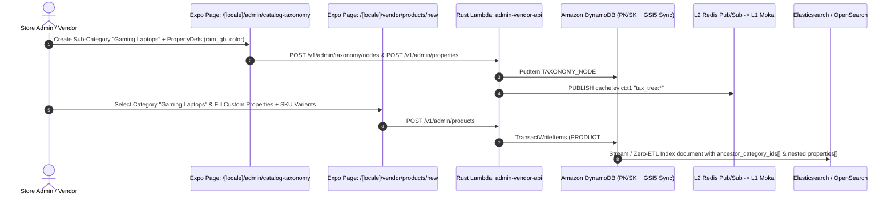

#### US-1.4: Dual-Tier Catalog Search: General DynamoDB Filtration & Advanced Elasticsearch Nested Faceted Filtration
* **As a** Shopper browsing a category page, brand page, or search bar,
* **I want to** filter products by Category/Sub-Category, Brand, Price Range, Stock Status, Payment Eligibility (`supports_cod`), and any dynamic Category-Specific Property (`Color Swatch`, `Size`, `RAM`) with live facet counts rendered via `@expo/ui` on Mobile and semantic `<aside>` HTML DOM controls on Web,
* **So that** I can narrow down thousands of products in under 50ms—and still browse and filter seamlessly via DynamoDB General Filtration if Elasticsearch is unreachable.

##### Pages & SDUI Screen Inventory (`US-1.4`)
| Page / Route | Direction & Access | Rendered SDUI Blocks & Headless Hook | Transition Out |
| :--- | :--- | :--- | :--- |
| `/[locale]/c/[...category_slug]` | `RTL` / `LTR`, Public | `BreadcrumbTrailBlock`, `SubCategoryPillsBlock`, `SearchFacetFilterSidebarBlock`, `ProductCardGridBlock` (`useCatalogSearchAndFacets`) | Updates URL query string & navigates to `/[locale]/products/[slug]` |
| `/[locale]/b/[brand_slug]` | `RTL` / `LTR`, Public | `BrandHeroHeaderBlock`, `SearchFacetFilterSidebarBlock`, `ProductCardGridBlock` (`useBrandCatalog`) | Filters within the brand across all N-level categories |

##### Step-by-Step End-to-End Workflow (`US-1.4`)
1. **Facet Selection via Headless Hook**: The shopper toggles `Brand = ASUS`, `Color = Black`, and `RAM = 16..64GB` inside `CatalogFacetFilterSheet` (`.native.tsx` `@expo/ui` `BottomSheet`/`Slider`/`Picker` on Mobile; `.web.tsx` `<aside>`/`<fieldset>` HTML DOM on Web), invoking `useCatalogSearchAndFacets`.
2. **ETag & L1/L2 Cache Lookup**: TanStack Query calls `fetchWithEtag('/v1/search?...', db)`. If the query hash is cached in L1 Moka or L2 Redis and matches `If-None-Match`, Axum returns `304 Not Modified` in `< 0.1ms`.
3. **Dual-Tier Microkernel Search Execution**: On a cache miss, the Microkernel calls `CatalogSearchPlugin`:
   - **Tier 2 Primary**: Queries [Elasticsearch](https://www.elastic.co/docs/explore-analyze/query-filter/aggregations) / [Amazon OpenSearch](https://docs.aws.amazon.com/opensearch-service/latest/developerguide/what-is.html) with a `bool` query + `nested` property filters + `nested` facet bucket aggregations.
   - **Tier 1 Circuit-Breaker Fallback**: Queries DynamoDB `GSI1` / `GSI2` with `FilterExpression` on `properties_map`.

##### Workflow & Sequence Diagram (`US-1.4`)
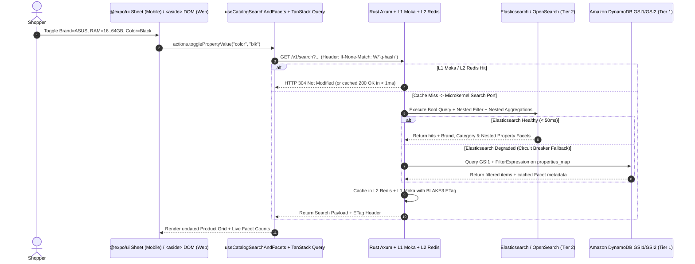

#### US-1.5: Localized Checkout with Paymob, Stripe & Upfront Deposit + Split Cash on Delivery (`DEPOSIT_COD`)
* **As a** B2C Customer in Egypt/MENA or internationally,
* **I want to** pay either 100% online via [Paymob](https://developers.paymob.com/paymob-docs) or [Stripe](https://docs.stripe.com/api), OR choose **Cash on Delivery (`DEPOSIT_COD`)** by paying the shipping + COD fee deposit online upfront and paying only the remaining product balance in cash to the courier upon delivery,
* **So that** I can shop with confidence using COD while the merchant is protected against fake orders and uncollected return-shipping losses.

##### Pages & SDUI Screen Inventory (`US-1.5`)
| Page / Route | Direction & Access | Rendered SDUI Blocks & Headless Hook | Transition Out |
| :--- | :--- | :--- | :--- |
| `/[locale]/cart` | `RTL` / `LTR`, Public / Auth | `CartLineItemListBlock`, `QuickGovernorateRateEstimatorBlock`, `DepositCodSummaryBannerBlock` (`useOfflineCart`) | Navigates to `/[locale]/checkout` |
| `/[locale]/checkout` | `RTL` / `LTR`, `B2C_CUSTOMER` / `B2B_BUYER` | `SavedAddressSelectorBlock`, `PaymentModeRadioGroupBlock` (`PREPAID_FULL` vs. `DEPOSIT_COD`), `SplitCodMathBreakdownCardBlock` (`useSplitCodCheckout`) | Navigates to `/[locale]/orders/[order_id]/confirmation` |

##### Step-by-Step End-to-End Workflow (`US-1.5`)
1. **Local Cart & Governorate Selection**: On `/[locale]/checkout`, `useSplitCodCheckout` reads the shopper's cart from WatermelonDB and selected address (`Dakahlia / Mansoura`).
2. **Microkernel Split-COD Calculation**: Calling `POST /v1/rates/calculate` invokes the Microkernel's `SplitCodEngine` (backed by L1 Moka cached `LOCALE_FEES#EG#DAKAHLIA`), returning `upfront_online_deposit_cents: 10000` (`100 EGP` online now) and `remaining_cod_balance_cents: 200000` (`2,000 EGP` cash on delivery).
3. **Payment Intention & Durable Saga**: `checkout-webhooks-api` reserves inventory in DynamoDB, calls `PaymentGatewayPlugin` (`PaymobAdapter` or `StripeAdapter`) for `100 EGP`, and starts the 30-minute [AWS Lambda Durable Function](https://aws.plainenglish.io/aws-lambda-updates-in-2025-2e664f4070d2) deposit wait state.
4. **Signed Webhook Confirmation**: Upon verified `HMAC-SHA512` / `Stripe-Signature` webhook receipt, the order transitions to `DEPOSIT_PAID_AWAITING_SHIPMENT`.

##### Workflow & Sequence Diagram (`US-1.5`)
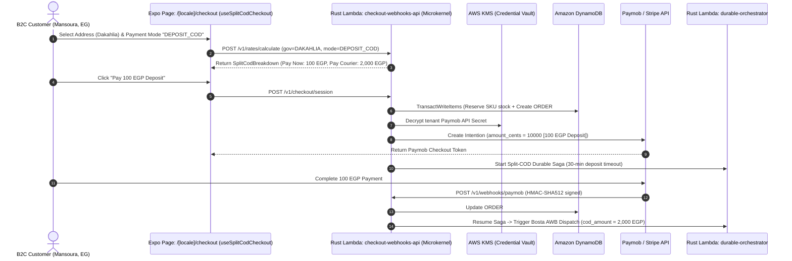

#### US-1.6: Domestic Last-Mile Fulfillment (Bosta) & Localized Amazon SNS Push/SMS Notifications
* **As a** Customer and Store Operations Manager,
* **I want** confirmed physical orders to automatically book an Air Waybill (AWB) with [Bosta](https://docs.bosta.co/) carrying the exact `remaining_cod_balance_cents` to collect at the door, while sending localized [Amazon SNS](https://docs.aws.amazon.com/sns/latest/dg/welcome.html) Push (APNs/FCM) and SMS notifications at every milestone,
* **So that** the customer can track their courier in real time in Arabic or English and have the exact cash balance ready upon delivery.

##### Pages & SDUI Screen Inventory (`US-1.6`)
| Page / Route | Direction & Access | Rendered SDUI Blocks & Headless Hook | Transition Out |
| :--- | :--- | :--- | :--- |
| `/[locale]/orders/[order_id]/confirmation` | `RTL` / `LTR`, Authenticated | `OrderStatusTimelineBlock`, `BostaAwbTrackingCardBlock`, `CodCashToPrepareBannerBlock` (`useOrderLiveTracker`) | Deep-links from SMS/Push notification |
| `/[locale]/vendor/dashboard` | `RTL` / `LTR`, `STORE_ADMIN` / `VENDOR` | `PendingFulfillmentQueueBlock`, `PrintBostaAwbLabelButtonBlock` (`useVendorPortal`) | Downloads PDF AWB label from S3 |

##### Step-by-Step End-to-End Workflow (`US-1.6`)
1. **AWB Creation via Carrier Plugin**: `fulfillment-worker` invokes `BostaAdapter::create_awb_shipment` with `cod = remaining_cod_balance_cents / 100` (`2,000 EGP`).
2. **Label Storage & Order Update**: Stores the `awb_number` and PDF label in S3 and updates `ORDER#<id>` + `GSI5` delta sync in DynamoDB.
3. **Localized SNS Push & SMS Dispatch**: Formats the customer's `ar-EG` or `en-US` notification template and dispatches via [Amazon SNS](https://docs.aws.amazon.com/sns/latest/dg/welcome.html) (APNs/FCM Push + SMS).

##### Workflow & Sequence Diagram (`US-1.6`)
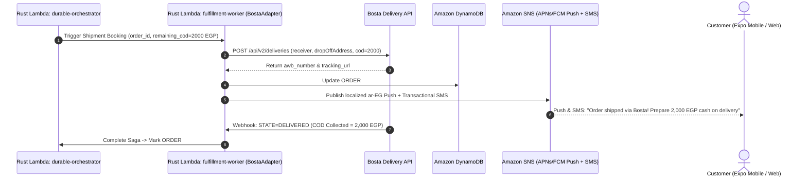

#### US-1.7: Customer WebMCP (`navigator.modelContext`) & Amazon Bedrock Shopping Assistant
* **As a** Shopper browsing on a WebMCP-capable browser ([W3C WebMCP `navigator.modelContext`](https://webmachinelearning.github.io/webmcp/)) or using the built-in store AI assistant on iOS, Android, or Web,
* **I want to** search and filter the catalog in natural language (`search_and_filter_catalog`), compare recommended products side-by-side (`recommend_and_compare_products`), quote Split COD fees for my cart (`prepare_cart_and_quote_cod`), and populate my account/delivery address details from a single sentence (`update_customer_account_details`),
* **So that** I can discover the best product for my budget and complete my profile and checkout preparation in seconds.

##### Pages & SDUI Screen Inventory (`US-1.7`)
| Page / Route | Direction & Access | Rendered SDUI Blocks & Headless Hook | Transition Out |
| :--- | :--- | :--- | :--- |
| `/[locale]/c/[...category_slug]` | `RTL` / `LTR`, Public / Auth | `WebMcpAssistantDrawerBlock`, `SearchFacetFilterSidebarBlock`, `ProductCardGridBlock` (`useWebMcpBridge` + `useCatalogSearchAndFacets`) | Live-updates facet filters when `search_and_filter_catalog` runs |
| `/[locale]/compare` | `RTL` / `LTR`, Public / Auth | `WebMcpComparisonTableBlock`, `BestPickHighlightCardBlock` (`useWebMcpComparison`) | Populated by `recommend_and_compare_products`; transitions to `/[locale]/cart` |
| `/[locale]/account/profile` | `RTL` / `LTR`, Authenticated | `WebMcpProfileConfirmationModalBlock`, `AddressBookGridBlock` (`useCustomerAccount`) | Commits validated address after user clicks Confirm |

##### Step-by-Step End-to-End Workflow (`US-1.7`)
1. **Tool Registration via `useWebMcpBridge`**: Registers `search_and_filter_catalog`, `recommend_and_compare_products`, `prepare_cart_and_quote_cod`, and `update_customer_account_details` on `navigator.modelContext` (Web) and `/v1/mcp/customer` ([Amazon Bedrock Converse API](https://docs.aws.amazon.com/bedrock/latest/userguide/tool-use.html)).
2. **Conversational Search & Comparison**: Natural-language prompts translate into structured facet filter state in `useCatalogSearchAndFacets` and render `WebMcpComparisonTableBlock` on `/[locale]/compare`.
3. **Confirmed Account Autofill & Split-COD Quote**: `update_customer_account_details` opens `WebMcpProfileConfirmationModalBlock` for explicit user approval before writing to DynamoDB + WatermelonDB, and `prepare_cart_and_quote_cod` quotes the exact `SplitCodBreakdown`.

##### Workflow & Sequence Diagram (`US-1.7`)
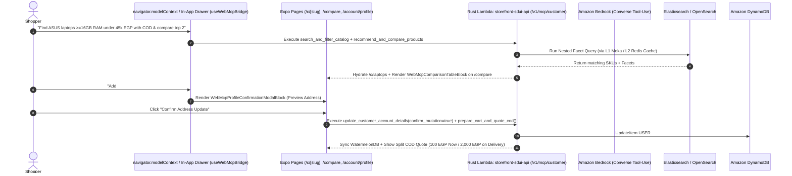

#### US-1.8: Admin WebMCP (`navigator.modelContext`) & Amazon Bedrock Store Copilot
* **As a** Store Administrator (`STORE_ADMIN`) or Vendor (`VENDOR`),
* **I want to** use WebMCP tools (`admin_style_and_generate_sdui`, `admin_configure_store_and_fees`, `admin_create_and_translate_product`) inside the Admin Studio to style SDUI pages and themes, configure N-level categories, custom properties, and regional Split-COD fees, and generate translated multilingual products with SKU variants from raw spec notes,
* **So that** I can launch campaigns, configure store rules, and onboard multi-language catalogs 10x faster with strict draft-preview and schema guardrails.

##### Pages & SDUI Screen Inventory (`US-1.8`)
| Page / Route | Direction & Access | Rendered SDUI Blocks & Headless Hook | Transition Out |
| :--- | :--- | :--- | :--- |
| `/[locale]/admin/sdui-studio` | `RTL` / `LTR`, `STORE_ADMIN` | `WebMcpStylePromptBar`, `ExpoDomDualViewportCanvasBlock` (`DRAFT` vs. `PUBLISHED`), `PublishAndInvalidateCdnButton` (`useAdminSduiStudio`) | Publishes approved `SDUI#<route>#<persona>` & triggers Redis Pub/Sub + CloudFront invalidation |
| `/[locale]/admin/catalog-taxonomy` | `RTL` / `LTR`, `STORE_ADMIN` | `WebMcpAdminCopilotDrawer`, `TaxonomyAndPropertyDiffPreviewModal` (`useAdminTaxonomyBuilder`) | Commits new `TAXONOMY_NODE`, `PROPERTY_DEF`, or `LOCALE_FEES` |
| `/[locale]/vendor/products/new` | `RTL` / `LTR`, `STORE_ADMIN` / `VENDOR` | `WebMcpProductSpecPasteModal`, `MultiLocaleTranslationPreviewTabs` (`ar-EG`, `en-US`, `fr-FR`) | Saves translated `PRODUCT#<pid>` + `VARIANT#<sku>` items |

##### Step-by-Step End-to-End Workflow (`US-1.8`)
1. **Role-Gated Admin Tool Registration**: Registers `admin_style_and_generate_sdui`, `admin_configure_store_and_fees`, and `admin_create_and_translate_product` when `cognito:groups` contains `STORE_ADMIN` or `VENDOR`.
2. **Draft SDUI Generation & Dual-Viewport Preview**: `admin_style_and_generate_sdui(publish_immediately: false)` validates logical spacing (`paddingStart`/`paddingEnd`) and WCAG contrast, saves a `DRAFT` in DynamoDB, and renders simultaneous `ar-EG` (`RTL`) and `en-US` (`LTR`) previews in `ExpoDomDualViewportCanvasBlock`.
3. **Publish & Cache Eviction**: Clicking **Approve & Publish** promotes `DRAFT -> PUBLISHED`, computes a new `BLAKE3` `ETag`, publishes a Redis Pub/Sub eviction message to clear L1 Moka caches, and invalidates CloudFront.

##### Workflow & Sequence Diagram (`US-1.8`)
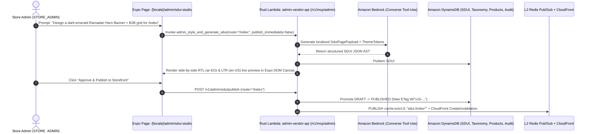

### Slice 2 (`v2.0`): Digital Products, 6-Mode Non-Heartbeat Licensing Engine & Presigned S3 Delivery

#### US-2.1: Digital Asset Ingestion, Envelope Encryption (AWS KMS) & Presigned S3 Delivery with Jurisdiction VAT
* **As a** Digital Creator or Software Vendor,
* **I want to** upload software binaries, archives, e-books, or media packages that are encrypted at rest with [AWS KMS](https://docs.aws.amazon.com/kms/latest/developerguide/concepts.html) and delivered to verified buyers via short-lived [Amazon S3 Presigned URLs](https://docs.aws.amazon.com/AmazonS3/latest/userguide/ShareObjectPreSignedURL.html) with automatic jurisdiction VAT calculation,
* **So that** my intellectual property cannot be hotlinked or pirated and tax compliance is handled automatically.

##### Pages & SDUI Screen Inventory (`US-2.1`)
| Page / Route | Direction & Access | Rendered SDUI Blocks & Headless Hook | Transition Out |
| :--- | :--- | :--- | :--- |
| `/[locale]/vendor/products/new` | `RTL` / `LTR`, `STORE_ADMIN` / `VENDOR` | `DigitalAssetMultipartUploaderBlock`, `SHA256ChecksumBadge`, `LicensingModeSelectorBlock` (`useVendorPortal`) | Uploads artifact to private S3 vault via presigned `PUT` |
| `/[locale]/account/licenses` | `RTL` / `LTR`, Authenticated | `PurchasedDigitalAssetsListBlock`, `GeneratePresignedDownloadButton` (`useDigitalLicenseVault`) | Triggers 15-minute presigned S3 `GET` download |

##### Step-by-Step End-to-End Workflow (`US-2.1`)
1. **Encrypted Upload**: Vendor uploads binary via presigned S3 `PUT` with `SSE-KMS` and optional `AES-256-GCM` Content Encryption Key (`CEK`) wrapping.
2. **Prepaid-Only Digital Checkout**: `SplitCodEngine` disables COD for carts containing `DIGITAL_LICENSE` items and applies jurisdiction digital VAT.
3. **Presigned Delivery**: Buyer clicks download on `/[locale]/account/licenses` (`useDigitalLicenseVault`), receiving a 15-minute presigned S3 `GET` URL.

##### Workflow & Sequence Diagram (`US-2.1`)
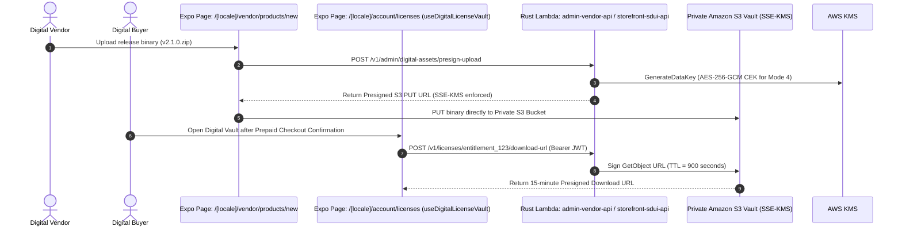

#### US-2.2: 6-Mode Non-Heartbeat Digital Licensing Engine (Offline Ed25519, Air-Gapped QR, CloudFront CRLs, CEK Unsealing & Release Gating)
* **As a** Software Vendor or Digital Product Buyer,
* **I want** digital licenses to verify authenticity without requiring a constant online heartbeat—using **(1) Offline [Ed25519 (RFC 8032)](https://www.rfc-editor.org/info/rfc8032/) `.lic` Certificates**, **(2) Air-Gapped Challenge-Response QR Activation**, **(3) [CloudFront](https://docs.aws.amazon.com/AmazonCloudFront/latest/DeveloperGuide/Introduction.html) Edge-Cached Revocation Lists (`revoked.crl.bin` — [RFC 5280](https://www.rfc-editor.org/info/rfc5280/))**, **(4) Cryptographic Content Key Unsealing**, **(5) Release-Timestamp Gating**, and **(6) [Amazon SNS](https://docs.aws.amazon.com/sns/latest/dg/welcome.html) Revocation Push**,
* **So that** legitimate customers can run their purchased tools completely offline or in air-gapped environments with zero server latency.

##### Pages & SDUI Screen Inventory (`US-2.2`)
| Page / Route | Direction & Access | Rendered SDUI Blocks & Headless Hook | Transition Out |
| :--- | :--- | :--- | :--- |
| `/[locale]/account/licenses` | `RTL` / `LTR`, Authenticated | `LicenseEntitlementCardBlock`, `DownloadEd25519CertButton`, `AirGappedQrScannerModalBlock` (`useDigitalLicenseVault` + Native Module `expo-crypto-license`) | Generates signed `.lic` file in WatermelonDB `licenses_vault` & Secure Enclave or scans air-gapped QR challenge |
| `/[locale]/admin/settings-gateways` | `RTL` / `LTR`, `STORE_ADMIN` | `LicensingModePolicyMatrixBlock`, `PublicKeyJwksExportCard`, `ForceRevokeLicenseModalBlock` (`useAdminGatewayConfig`) | Publishes updated `revoked.crl.bin` to S3 + CloudFront |

##### Step-by-Step End-to-End Workflow (`US-2.2`)
1. **KMS Ed25519 Certificate Issuance (`Mode 1`)**: At purchase, `fulfillment-worker` signs the canonical license payload via [AWS KMS `Sign`](https://docs.aws.amazon.com/kms/latest/APIReference/API_Sign.html) (`ED25519_SHA_512`) and syncs it to the buyer's `licenses_vault` table in WatermelonDB and hardware Keychain (`modules/expo-crypto-license`).
2. **Air-Gapped QR Activation (`Mode 2`)**: Using the native camera scanner in `modules/expo-crypto-license`, the buyer scans the offline workstation's `ChallengeQR` on `/[locale]/account/licenses` and displays the KMS-signed `ResponseQR`.
3. **Offline Verification, CEK Unsealing & Edge CRL (`Modes 1, 3, 4, 5 & 6`)**: The client software verifies the Ed25519 signature offline (`< 0.2ms`), checks `binary_build_ts <= updates_until` (`Mode 5`), unseals the `AES-256-GCM` key (`Mode 4`), and passively checks `revoked.crl.bin` via `If-None-Match` on CloudFront (`Mode 3`).

##### Workflow & Sequence Diagram (`US-2.2`)
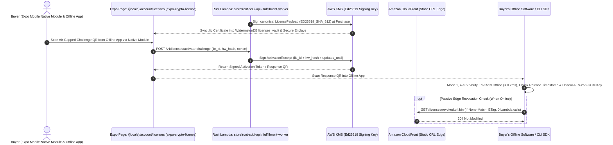

### Slice 3 (`v3.0`): B2B Wholesale Portal, MOQ/Tiered Pricing, Cross-Border Express & RFQ Orchestration

#### US-3.1: B2B Organization Onboarding, Tiered Volume Pricing, MOQ Enforcement & Custom B2B Property Filtration
* **As a** B2B Wholesale Buyer (`B2B_BUYER`) or Organization Admin (`B2B_ORG_ADMIN`),
* **I want** the storefront to automatically display wholesale volume-tier pricing (`10–49 units`, `50–199 units`, `200+ units`), enforce Minimum Order Quantities (`MOQ`), and unlock B2B-specific Elasticsearch facet filters (`MOQ Range`, `Lead Time Days`, `Pallet Weight`, `HS Code`),
* **So that** my procurement team can source bulk inventory with organization-specific contract pricing.

##### Pages & SDUI Screen Inventory (`US-3.1`)
| Page / Route | Direction & Access | Rendered SDUI Blocks & Headless Hook | Transition Out |
| :--- | :--- | :--- | :--- |
| `/[locale]/c/[...category_slug]` | `RTL` / `LTR`, `B2B_BUYER` / `B2B_ORG_ADMIN` | `B2BFacetFilterExtensionBlock`, `WholesaleProductCardGridBlock` (`useCatalogSearchAndFacets`) | Navigates to `/[locale]/products/[slug]` or `/[locale]/b2b/rfq` |
| `/[locale]/products/[slug]` | `RTL` / `LTR`, `B2B_BUYER` / `B2B_ORG_ADMIN` | `B2BVolumeTierTableBlock`, `BulkVariantMatrixOrderGridBlock`, `MoqValidationBannerBlock` (`useProductConfigurator`) | Adds bulk matrix rows to WatermelonDB `cart_items` or opens RFQ draft |

##### Step-by-Step End-to-End Workflow (`US-3.1`)
1. **Persona-Aware SDUI Hydration**: `useProductConfigurator` reads the B2B contract tiers cached in WatermelonDB / L1 Moka (`B2B_CONTRACT#org_99`).
2. **Bulk Matrix Entry & MOQ Enforcement**: Buyer enters quantities across variants in `BulkVariantMatrixOrderGridBlock`; the Microkernel validates `total_sku_qty >= moq_min` and applies the matching volume-tier price.

##### Workflow & Sequence Diagram (`US-3.1`)
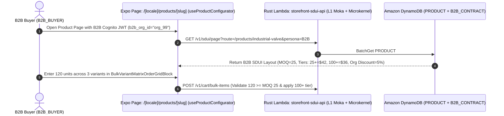

#### US-3.2: Durable RFQ Negotiation & Net-Terms Invoice Workflow (AWS Lambda Durable Functions)
* **As a** B2B Buyer (`B2B_BUYER`) and Merchant Account Manager (`STORE_ADMIN` / `VENDOR`),
* **I want to** submit a Request for Quote (`RFQ`), negotiate custom unit pricing and Net-30/Net-60 payment terms, generate a bilingual Proforma Invoice PDF, and track approval state via [AWS Lambda Durable Functions](https://aws.plainenglish.io/aws-lambda-updates-in-2025-2e664f4070d2),
* **So that** large wholesale orders can be negotiated, approved by organization admins, and converted into executable orders.

##### Pages & SDUI Screen Inventory (`US-3.2`)
| Page / Route | Direction & Access | Rendered SDUI Blocks & Headless Hook | Transition Out |
| :--- | :--- | :--- | :--- |
| `/[locale]/b2b/rfq` | `RTL` / `LTR`, `B2B_BUYER` / `B2B_ORG_ADMIN` | `RfqCreationFormBlock`, `CounterOfferComparisonCardBlock`, `ApprovePoAndCheckoutButton` (`useB2BRfqNegotiation`) | Converts approved RFQ into a Net-Terms Order |
| `/[locale]/vendor/dashboard` | `RTL` / `LTR`, `STORE_ADMIN` / `VENDOR` | `IncomingRfqQueueTableBlock`, `VendorCounterQuoteModalBlock` (`useVendorPortal`) | Sends counter-offer and resumes Durable Saga |

##### Step-by-Step End-to-End Workflow (`US-3.2`)
1. **RFQ Submission**: Buyer submits quantities and target pricing on `/[locale]/b2b/rfq` via `useB2BRfqNegotiation`.
2. **Durable Wait State**: `durable-orchestrator` checkpoints `RFQ#<id>` (`AWAITING_VENDOR_QUOTE`) with zero idle compute cost.
3. **Vendor Counter-Quote & PO Approval**: Vendor submits counter-offer on `/[locale]/vendor/dashboard`, generating a bilingual Proforma PDF; `B2B_ORG_ADMIN` approves with a Purchase Order (`PO`) number to create `ORDER#<id>`.

##### Workflow & Sequence Diagram (`US-3.2`)
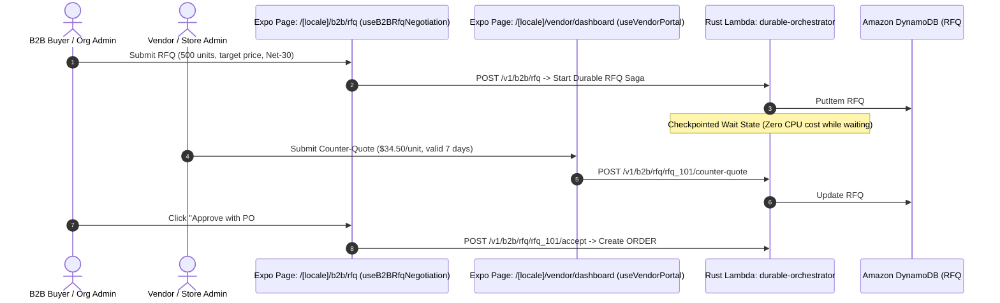

#### US-3.3: Cross-Border Express Shipping & Customs Commercial Invoice Automation (Aramex & DHL Express)
* **As a** Cross-Border Merchant and International Buyer,
* **I want** international checkouts to fetch live air-express rates from [Aramex](https://www.aramex.com/eg/en/developers-solution-center/aramex.com-platform) and [DHL Express (MyDHL API)](https://developer.dhl.com/api-reference/dhl-express-mydhl-api?language_content_entity=en), compute Volumetric vs. Dead Weight (`max(actual_kg, L*W*H/5000)`), and automatically attach harmonized customs declarations (`HS Codes`, Country of Origin, Bilingual Commercial Invoice),
* **So that** cross-border shipments clear customs without manual paperwork delays.

##### Pages & SDUI Screen Inventory (`US-3.3`)
| Page / Route | Direction & Access | Rendered SDUI Blocks & Headless Hook | Transition Out |
| :--- | :--- | :--- | :--- |
| `/[locale]/checkout` | `RTL` / `LTR`, `B2C_CUSTOMER` / `B2B_BUYER` | `InternationalCarrierRateSelectorBlock`, `IncotermsBadgeBlock` (`DDP` vs. `DDU`) (`useSplitCodCheckout`) | Selects international carrier rate & proceeds to payment |
| `/[locale]/vendor/dashboard` | `RTL` / `LTR`, `STORE_ADMIN` / `VENDOR` | `InternationalAwbAndCustomsDocsBlock`, `DownloadPaperlessTradeInvoiceButton` (`useVendorPortal`) | Downloads AWB + Commercial Invoice PDF bundle |

##### Step-by-Step End-to-End Workflow (`US-3.3`)
1. **Volumetric Weight Calculation**: Microkernel computes `chargeable_weight_kg = max(dead_weight_kg, (L*W*H)/5000)`.
2. **Concurrent Carrier Plugin Fan-Out**: Queries `DhlExpressAdapter` and `AramexAdapter` in parallel via `tokio::join!` and caches the rate quote in L2 Redis for 5 minutes.
3. **Paperless Trade Customs Dispatch**: Generates a bilingual Commercial Invoice PDF with line-item `hs_code` values and uploads it via DHL Paperless Trade / Aramex API.

##### Workflow & Sequence Diagram (`US-3.3`)
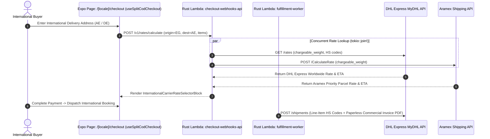

#### US-3.4: B2B Floating / Seat-Count Enterprise Licensing & On-Premise LAN License Proxy
* **As a** B2B Organization Administrator (`B2B_ORG_ADMIN`),
* **I want to** purchase a multi-seat software license (`50 concurrent seats`), manage seat assignments on `/[locale]/account/licenses`, or deploy the lightweight `some-commerce-license-proxy` container inside my private corporate network using a KMS-signed master lease certificate,
* **So that** engineers on internal corporate workstations can check out and release seats over LAN without individual workstation internet access.

##### Pages & SDUI Screen Inventory (`US-3.4`)
| Page / Route | Direction & Access | Rendered SDUI Blocks & Headless Hook | Transition Out |
| :--- | :--- | :--- | :--- |
| `/[locale]/account/licenses` | `RTL` / `LTR`, `B2B_ORG_ADMIN` | `EnterpriseSeatPoolSummaryCardBlock`, `DownloadMasterLeaseCertButtonBlock`, `ActiveSeatAllocationsTableBlock` (`useDigitalLicenseVault`) | Downloads 30-day KMS-signed Master Lease `.lic` for LAN Proxy |

##### Step-by-Step End-to-End Workflow (`US-3.4`)
1. **Master Lease Signing**: `B2B_ORG_ADMIN` registers their LAN proxy fingerprint on `/[locale]/account/licenses` and downloads a 30-day KMS-signed `Ed25519` `MasterLease.lic`.
2. **Offline Corporate LAN Seat Checkout**: Internal corporate workstations check out and release seats over LAN from the local proxy container (`POST http://license-proxy.corp.local/v1/seats/checkout`).

##### Workflow & Sequence Diagram (`US-3.4`)
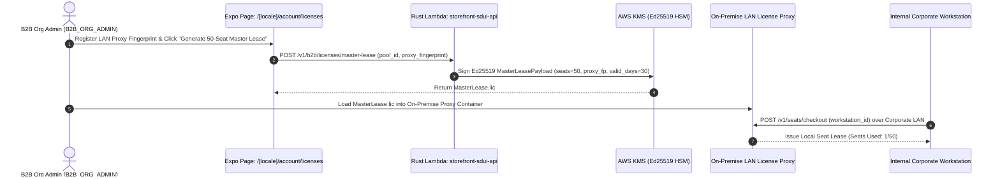

### Slice 4 (`v4.0`): Multi-Vendor Marketplace, 40+ Global Carriers, Split Escrow & Crypto Checkout

#### US-4.1: Multi-Vendor Onboarding, Scoped Catalog Management (`VENDOR` RBAC) & Automated Sub-Order Splitting
* **As a** Marketplace Vendor (`VENDOR`) and Store Administrator (`STORE_ADMIN`),
* **I want** vendors to manage only their own products and inventory while customer carts containing items from multiple vendors are automatically split into isolated per-vendor sub-orders (`SUBORDER#<vendor_id>#<sub_id>`) at checkout,
* **So that** each vendor can fulfill, print AWB labels, and track payouts independently without seeing other vendors' data.

##### Pages & SDUI Screen Inventory (`US-4.1`)
| Page / Route | Direction & Access | Rendered SDUI Blocks & Headless Hook | Transition Out |
| :--- | :--- | :--- | :--- |
| `/[locale]/vendor/dashboard` | `RTL` / `LTR`, `VENDOR` | `VendorMetricsHeaderBlock`, `VendorSubOrderQueueTableBlock`, `VendorInventoryQuickEditTableBlock` (`useVendorPortal`) | Opens sub-order fulfillment drawer or `/[locale]/vendor/products/new` |
| `/[locale]/cart` | `RTL` / `LTR`, Public / Auth | `CartVendorGroupListBlock`, `PerVendorShippingSummaryBlock` (`useOfflineCart`) | Navigates to `/[locale]/checkout` |

##### Step-by-Step End-to-End Workflow (`US-4.1`)
1. **Vendor-Scoped RBAC Enforcement**: `admin-vendor-api` enforces `custom:vendor_id` from the Cognito JWT on every DynamoDB query and mutation.
2. **Atomic Sub-Order Splitting**: At checkout, the Microkernel splits a multi-vendor cart into a parent `ORDER#<id>` and isolated `SUBORDER#<vendor_id>#<sub_id>` items in a single `TransactWriteItems` call.

##### Workflow & Sequence Diagram (`US-4.1`)
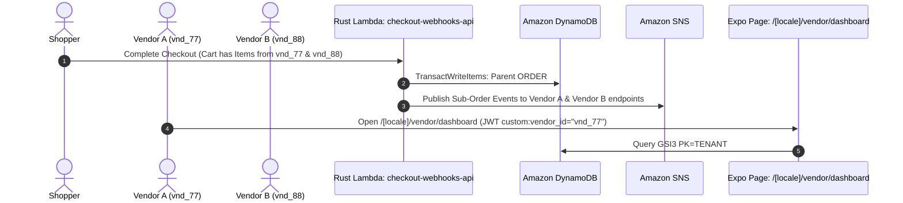

#### US-4.2: Global Multi-Carrier Rate Shopping (Shippo & EasyPost), Return Merchandise Authorization (RMA) & Escrow Payouts
* **As a** Global Marketplace Operator, Vendor, and Shopper,
* **I want** checkout and return portals to aggregate live rates across 40+ global carriers via [Shippo](https://docs.goshippo.com/) and [EasyPost](https://docs.easypost.com/), generate self-service return labels (`RMA`), and hold vendor payouts in escrow inside [AWS Lambda Durable Functions](https://aws.plainenglish.io/aws-lambda-updates-in-2025-2e664f4070d2) until the delivery + return-window period completes,
* **So that** global fulfillment, returns, and marketplace commission splits run autonomously.

##### Pages & SDUI Screen Inventory (`US-4.2`)
| Page / Route | Direction & Access | Rendered SDUI Blocks & Headless Hook | Transition Out |
| :--- | :--- | :--- | :--- |
| `/[locale]/orders/[order_id]/confirmation` | `RTL` / `LTR`, Authenticated | `SubOrderShipmentTrackerListBlock`, `InitiateReturnRmaModalBlock`, `DownloadReturnLabelButtonBlock` (`useOrderLiveTracker`) | Generates prepaid return AWB via Shippo/EasyPost |
| `/[locale]/vendor/dashboard` | `RTL` / `LTR`, `VENDOR` | `EscrowLedgerBalanceCardBlock`, `CommissionBreakdownTableBlock` (`useVendorPortal`) | Tracks escrow release countdown and settled payouts |

##### Step-by-Step End-to-End Workflow (`US-4.2`)
1. **Multi-Carrier Rate Shopping**: `ShippoAdapter` and `EasyPostAdapter` quote rates across 40+ global carriers.
2. **Escrow Hold & 14-Day Return Timer**: Upon delivery, `durable-orchestrator` credits `ESCROW_HOLD` (`subtotal - commission`) and starts a 14-day Durable timer.
3. **RMA Return or Settlement**: Customer RMA request generates a return label and freezes escrow; otherwise, funds automatically transition to `AVAILABLE_FOR_PAYOUT`.

##### Workflow & Sequence Diagram (`US-4.2`)
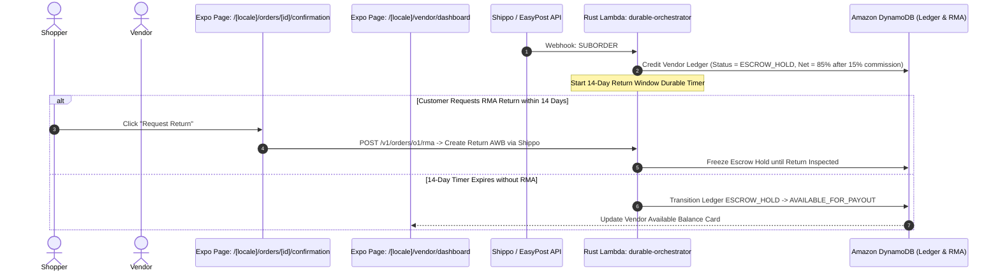

#### US-4.3: Self-Hosted Bitcoin & Lightning Network Checkout via BTCPay Server Greenfield API
* **As a** Privacy-Conscious or Global Crypto Shopper,
* **I want to** pay for physical or digital orders using on-chain Bitcoin (`BTC`) or instant Lightning Network (`BOLT11` / `LNURL`) invoices generated via the merchant's self-hosted [BTCPay Server Greenfield API](https://docs.btcpayserver.org/API/Greenfield/v1/),
* **So that** I can settle global purchases with zero intermediary payment processor fees or chargeback risk.

##### Pages & SDUI Screen Inventory (`US-4.3`)
| Page / Route | Direction & Access | Rendered SDUI Blocks & Headless Hook | Transition Out |
| :--- | :--- | :--- | :--- |
| `/[locale]/checkout` | `RTL` / `LTR`, Public / Auth | `PaymentModeRadioGroupBlock`, `BtcPayInvoiceQrModalBlock` (`useSplitCodCheckout`) | Auto-navigates to `/[locale]/orders/[order_id]/confirmation` when `InvoiceSettled` webhook arrives |

##### Step-by-Step End-to-End Workflow (`US-4.3`)
1. **Invoice Creation via `BtcPayAdapter`**: `checkout-webhooks-api` decrypts the BTCPay token from KMS and creates an invoice on the merchant's BTCPay Server.
2. **Lightning/On-Chain Settlement**: `BtcPayInvoiceQrModalBlock` renders the `BOLT11` QR code; `BTCPay-Sig` `HMAC-SHA256` webhook confirms payment and triggers fulfillment.

##### Workflow & Sequence Diagram (`US-4.3`)
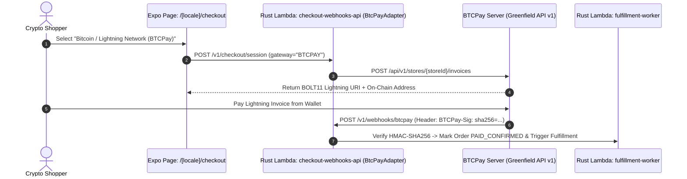

### Slice 5 (`v5.0`): Enterprise Dual-Edition Deployment & Zero-ETL Observability

#### US-5.1: Dual AWS Marketplace Packaging: Standard On-Demand Lambda Edition vs. AWS Lambda Managed Instances Edition with DynamoDB Zero-ETL
* **As a** DevOps Engineer or Enterprise Architect deploying `some-commerce` from AWS CDK or AWS Marketplace,
* **I want to** toggle a single CDK context parameter (`computeMode: "ON_DEMAND" | "MANAGED_INSTANCES"`) to deploy the exact same 5 Rust Lambda binaries either on scale-to-zero Standard On-Demand AWS Lambda OR on dedicated multi-concurrent [AWS Lambda Managed Instances](https://aws.amazon.com/lambda/lambda-managed-instances/) (where 64 concurrent requests share the in-memory **L1 [Moka](https://docs.rs/moka/latest/moka/)** cache) with [Amazon DynamoDB Zero-ETL to Amazon OpenSearch](https://docs.aws.amazon.com/amazondynamodb/latest/developerguide/OpenSearchIngestionForDynamoDB.html),
* **So that** indie merchants pay `$0` idle compute while high-volume enterprise flash sales get zero cold starts and sub-50µs L1 cache hits.

##### Pages & SDUI Screen Inventory (`US-5.1`)
| Page / Route | Direction & Access | Rendered SDUI Blocks & Headless Hook | Transition Out |
| :--- | :--- | :--- | :--- |
| `/[locale]/admin/settings-gateways` | `RTL` / `LTR`, `STORE_ADMIN` | `RuntimeEditionStatusBannerBlock`, `CacheHitRatioTelemetryCardBlock` (`L1 Moka` vs. `L2 Redis` vs. `304 ETag`), `SearchPipelineHealthCardBlock` (`useAdminGatewayConfig`) | Displays live runtime telemetry from CloudWatch |

##### Step-by-Step End-to-End Workflow (`US-5.1`)
1. **CDK Context Selection**: Deploy with `-c computeMode=ON_DEMAND` or `-c computeMode=MANAGED_INSTANCES`.
2. **Multi-Concurrent L1 Moka Sharing**: On Managed Instances (`MaxConcurrency: 64`), all 64 concurrent Tokio tasks share the same `Arc<TwoTierCache>` L1 Moka cache and multiplexed L2 Redis connection.

##### Workflow & Architecture Diagram (`US-5.1`)
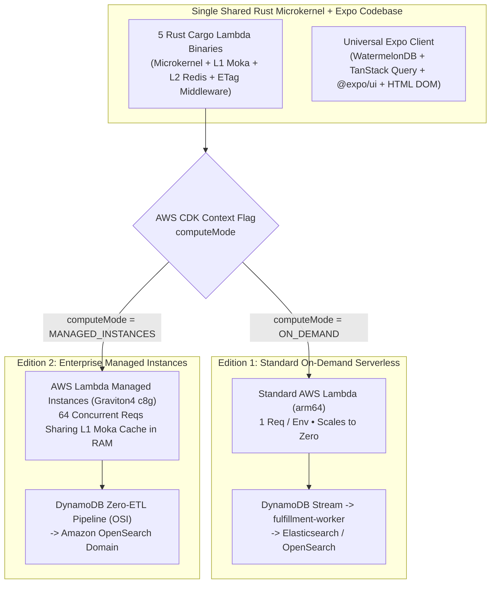

### Slice 6 (`v6.0`): Visual Multi-Locale SDUI Studio & White-Label Mobile Pipeline

#### US-6.1: Visual Drag-and-Drop Multi-Locale SDUI Studio (Expo DOM Components) with Admin WebMCP Copilot & White-Label EAS Mobile Build Pipeline
* **As a** Brand Designer, Agency Developer, or Store Administrator (`STORE_ADMIN`),
* **I want to** visually reorder, configure, and AI-style SDUI blocks inside `/[locale]/admin/sdui-studio` with simultaneous side-by-side Arabic (`RTL`) and English (`LTR`) live previews powered by [Expo DOM Components](https://docs.expo.dev/guides/dom-components/), and trigger white-label iOS/Android mobile builds,
* **So that** I can launch seasonal campaigns, custom landing pages, and branded mobile apps without waiting on frontend code deployments.

##### Pages & SDUI Screen Inventory (`US-6.1`)
| Page / Route | Direction & Access | Rendered SDUI Blocks & Headless Hook | Transition Out |
| :--- | :--- | :--- | :--- |
| `/[locale]/admin/sdui-studio` | `RTL` / `LTR`, `STORE_ADMIN` | `SduiComponentPaletteSidebarBlock`, `ExpoDomDualViewportCanvasBlock`, `WebMcpStylePromptBar`, `VersionHistoryRollbackDrawerBlock` (`useAdminSduiStudio`) | Publishes validated `SDUI#<route>#<persona>`, updates `ETag`, & evicts L1/L2 + CloudFront caches |
| `/[locale]/admin/sdui-studio/mobile-builds` | `RTL` / `LTR`, `STORE_ADMIN` | `WhiteLabelBrandConfigFormBlock`, `TriggerEasBuildWorkflowButton` (`useAdminSduiStudio`) | Dispatches GitHub Actions / EAS Build pipeline for iOS & Android |

##### Step-by-Step End-to-End Workflow (`US-6.1`)
1. **Dual-Viewport Editing**: Designer edits SDUI blocks or prompts Admin WebMCP inside `/[locale]/admin/sdui-studio`, previewing `ar-EG` (`RTL`) and `en-US` (`LTR`) side-by-side via `ExpoDomDualViewportCanvasBlock`.
2. **Atomic Publish & Cache Invalidation**: Clicking **Publish** writes `SDUI#<route>#<persona>#v<N>` with a new `BLAKE3` `ETag`, broadcasts a Redis Pub/Sub eviction event to all Lambda L1 Moka caches, and invalidates CloudFront so WatermelonDB clients pull the delta immediately.

##### Workflow & Sequence Diagram (`US-6.1`)
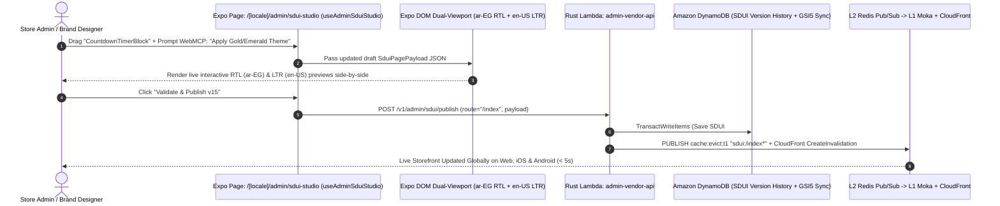
