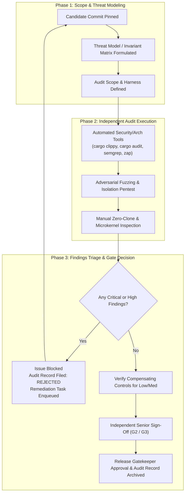

# some-commerce: Platform Audits — Master Index

> **Total Audit Domains**: 4 · **Total Sprints Covered**: 12 (across 6 slices) · **Governing Quality Gates**: SG2, SG3, G2, G3, Gate M1, Gate A1, Gate A2, AWS FTR

This directory is the central repository for all **Security, Architectural, Compliance, and Quality Audits** for the `some-commerce` platform. Just as [`docs/user-stories/`](../user-stories/) acts as the canonical source for functional specifications, `docs/audits/` serves as the authoritative, reviewable location for all formal system audits, vulnerability assessments, zero-clone borrowing verifications, and compliance certifications.

---

## 1. Audit Domain Directory

| # | Domain | Focus & Scope | Governing Gates | Accountable Roles | Description |
|:--|:-------|:--------------|:----------------|:------------------|:------------|
| 01 | [Security & Penetration](./01-security-and-penetration/README.md) | OWASP ASVS v4.0.3 L2, tenant isolation, KMS envelope crypto, penetration testing | Gate G2, SG2 | `security-engineer`, `senior-security-qa-auditor` | Evaluates adversarial tenant leakage, cryptographic implementation (Ed25519, CEK), Cognito JWKS validation, and API abuse matrices. |
| 02 | [Architecture & Zero-Clone](./02-architecture-and-zero-clone/README.md) | Microkernel purity, Rust Zero-Clone Law, Axum-Tower transport decoupling, Locality of Behavior (LoB) | Gate G3, SG3, Gate M1, Gate A1, Gate A2 | `system-architect`, `backend-engineer`, `client-engineer` | Audits pure microkernel abstraction, eliminates unnecessary clones/heap allocations in hot paths, and verifies 4-tier LoB directory conformance. |
| 03 | [Compliance & AWS FTR](./03-compliance-and-aws-ftr/README.md) | AWS Marketplace Foundational Technical Review (FTR), SaaS metering audit, Well-Architected Review | Gate G2, SG4 | `devops-engineer`, `chief-technology-officer` | Verifies multi-tenant data segregation, CloudFront OAC S3 private access, disaster recovery, immutable audit trails, and metering dimension telemetry. |
| 04 | [Quality & Gates](./04-quality-and-gates/README.md) | Story G0–G4 gate adherence, Sprint SG0–SG4 closeout sign-offs, 6-Layer Governance audit | Gate G0–G4, SG0–SG4 | `release-gatekeeper`, `tech-lead`, `chief-technology-officer` | Independent sign-off certifications across the 6 validation layers, ensuring no silent bypass, flaky test waivers, or unauthorized PR promotions. |

---

## 2. Sprint-by-Sprint Audit Traceability Matrix

Every sprint requires explicit audit sign-offs before passing Sprint Quality Gate **SG2 (Security & Tenant Audit)**, **SG3 (Architecture & Gate M1 Audit)**, and **SG4 (CTO Agreement & RC)**:

| Sprint | Slice | Security & Pen-Test (01) | Architecture & Zero-Clone (02) | Compliance & AWS FTR (03) | Quality Gates Sign-Off (04) | Status |
|:-------|:------|:-------------------------|:-------------------------------|:--------------------------|:----------------------------|:-------|
| [Sprint 1.1](../sprints/sprint-1.1.md) | v1.0 | Cognito RBAC, OTP brute-force, JWT replay | Gate M1 trait purity, zero-clone hot path | IAM least-privilege, DynamoDB encryption | G0–G4, SG0–SG3 audit log | Pending |
| [Sprint 1.2](../sprints/sprint-1.2.md) | v1.0 | KMS credential vault, HMAC webhook tampering | Zero-clone money arithmetic, Axum decoupling | S3 audit bucket retention, RTO compliance | G0–G4, SG0–SG3 audit log | Pending |
| [Sprint 2.1](../sprints/sprint-2.1.md) | v2.0 | Ed25519 signing key safety, Bloom filter DOS | Zero-clone CEK decrypt, CRL binary parser | Digital asset vault private S3 / KMS | G0–G4, SG0–SG3 audit log | Pending |
| [Sprint 2.2](../sprints/sprint-2.2.md) | v2.0 | Golden vector tamper, air-gapped QR bypass | Zero-clone SDK verification engine | Customer entitlement audit records | G0–G4, SG0–SG3 audit log | Pending |
| [Sprint 3.1](../sprints/sprint-3.1.md) | v3.0 | B2B org cross-tenant isolation, price spoofing | Zero-clone tiered price calculators | Multi-org data isolation, tax audit trails | G0–G4, SG0–SG3 audit log | Pending |
| [Sprint 3.2](../sprints/sprint-3.2.md) | v3.0 | RFQ quote tampering, LAN proxy auth hijack | Zero-clone state machine transitions | Net-terms credit ledger immutable audit | G0–G4, SG0–SG3 audit log | Pending |
| [Sprint 4.1](../sprints/sprint-4.1.md) | v4.0 | Vendor portal IDOR, sub-order fee hijacking | Zero-clone cart split allocations | Multi-vendor escrow separation | G0–G4, SG0–SG3 audit log | Pending |
| [Sprint 4.2](../sprints/sprint-4.2.md) | v4.0 | Double-spend payout races, BTCPay webhook forgery | Zero-clone double-entry ledger balance | FinCEN / Escrow regulatory compliance | G0–G4, SG0–SG3 audit log | Pending |
| [Sprint 5.1](../sprints/sprint-5.1.md) | v5.0 | IAM roles for service accounts, CDK secrets | Zero-clone metering batch accumulators | AWS FTR formal audit, metering reconciliation | G0–G4, SG0–SG3 audit log | Pending |
| [Sprint 6.1](../sprints/sprint-6.1.md) | v6.0 | SDUI AST script injection, admin XSS | Zero-clone SDUI schema parsing | SDUI layout versioning & rollback audit | G0–G4, SG0–SG3 audit log | Pending |
| [Sprint 6.2](../sprints/sprint-6.2.md) | v6.0 | White-label signing key exposure, build sandbox | Zero-clone build pipeline dispatcher | Commercial software distribution compliance | G0–G4, SG0–SG3 audit log | Pending |
| [Sprint 6.3](../sprints/sprint-6.3.md) | v6.0 | Final OWASP ASVS L2 pentest, full threat model | Comprehensive Gate M1/A1/A2 re-certification | Final AWS Marketplace FTR & CTO Sign-Off | Full SG0–SG4 release audit | Pending |

---

## 3. Multi-Agent Audit Lifecycle & Review Protocol

Platform audits are conducted independently of feature development. The executing agent cannot audit their own implementation:

### Governance Rules for Audits:
1. **Separation of Concerns**: Junior authors implement code; independent senior auditors (`senior-security-qa-auditor`, `system-architect`) author and execute the audit.
2. **Immutable Traceability**: Each audit is recorded in a standalone markdown file following [`AUDIT_RECORD_TEMPLATE.md`](./AUDIT_RECORD_TEMPLATE.md) and committed alongside reproduction commands and artifact digests.
3. **Zero Critical/High Waiver Law**: No story or sprint candidate may pass Gate G2 or SG2 with an unresolved Critical or High finding. Any Medium/Low risk acceptance must specify compensating controls, an owner, and an expiration date.

---

## 4. Audit File Naming Convention

All audit files in this directory tree follow the canonical format:
`AUDIT-<DOMAIN_PREFIX>-<SPRINT_OR_MODULE>-<DESCRIPTOR>.md`

Examples:
- `docs/audits/01-security-and-penetration/AUDIT-SEC-sprint-1.1-cognito-jwt-rbac.md`
- `docs/audits/02-architecture-and-zero-clone/AUDIT-ARCH-sprint-1.1-m1-zero-clone-cache.md`
- `docs/audits/03-compliance-and-aws-ftr/AUDIT-COMP-sprint-5.1-aws-ftr-readiness.md`
- `docs/audits/04-quality-and-gates/AUDIT-GATE-sprint-1.1-sg0-sg4-certification.md`

---

## 5. Audit Record Template

To initiate a new audit, instantiate [`docs/audits/AUDIT_RECORD_TEMPLATE.md`](./AUDIT_RECORD_TEMPLATE.md) into the appropriate domain directory.
