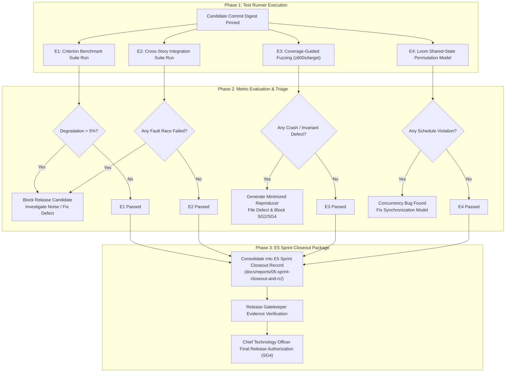

# some-commerce: Test & Operational Reports — Master Index

> **Total Report Categories**: 5 (E1–E5) · **Total Sprints Covered**: 12 (across 6 slices) · **Governing Quality Gates**: SG1, SG4, G1, G4, Gate M1, Gate A1

This directory is the central repository for all **Test, Benchmark, Concurrency, and Closeout Reports** for the `some-commerce` platform. Just as [`docs/user-stories/`](../user-stories/) defines functional requirements, and [`docs/audits/`](../audits/) documents compliance and security sign-offs, `docs/reports/` preserves the raw, reproducible operational test execution evidence required by [`docs/SPRINT_TESTING.md`](../SPRINT_TESTING.md) and [`docs/QUALITY_GATES.md`](../QUALITY_GATES.md).

---

## 1. Report Category Directory

| # | Category | Focus & Test Method | Governing Gate | Accountable Roles | Description |
|:--|:---------|:---------------------|:---------------|:------------------|:------------|
| 01 | [Benchmarks & Performance](./01-benchmarks-and-performance/README.md) | **E1 Benchmark Tests**: Criterion statistical measurements, P95/P99 latency, allocations | SG1, SG4, Gate M1 | `junior-testing-qa-engineer`, `backend-engineer` | Microbenchmarks and load tests measuring request coalescing, cache reads (<0.1ms), cold-starts, and DB query latency against strict budgets. |
| 02 | [Integration & Cross-Module](./02-integration-and-cross-module/README.md) | **E2 Integration Tests**: Real component boundaries, transactional rollback, multi-provider flows | SG1, SG4, Gate G4 | `testing-qa-engineer`, `client-engineer` | End-to-end integration flows across real DynamoDB tables, Redis caches, Bosta/Paymob sandboxes, and EventBridge background workers. |
| 03 | [Fuzzing & Adversarial](./03-fuzzing-and-adversarial/README.md) | **E3 Fuzz Tests**: Coverage-guided `cargo-fuzz`/`libFuzzer`, 600s budgets, crash reproducers | SG2, SG4 | `senior-security-qa-auditor`, `backend-engineer` | Adversarial state sequences, malformed parser inputs (SDUI AST, QR codes, CRL binary filters, webhook payloads) with zero unexpected panics. |
| 04 | [Concurrency & Loom](./04-concurrency-and-loom/README.md) | **E4 Loom Concurrency Tests**: Rust shared-state atomics, channels, locks, scheduling permutations | SG3, Gate M1 | `backend-engineer`, `system-architect` | Exhaustive state exploration of in-process Rust synchronization primitives using Loom to prove zero lost updates, deadlocks, or races. |
| 05 | [Sprint Closeout & Release Candidate](./05-sprint-closeout-and-rc/README.md) | **E5 Sprint Closeout & RC**: Integrated evidence packages, staging verification, CTO releases | SG4, Gate G4 | `release-gatekeeper`, `tech-lead`, `chief-technology-officer` | Consolidated closeout evidence combining E1–E4 into a single release candidate evaluation for CTO production authorization. |

---

## 2. Sprint-by-Sprint Report Traceability Matrix

Every sprint must execute and document the five standardized test categories (E1–E5) prior to SG4 release candidate acceptance:

| Sprint | Slice | E1 Benchmarks (01) | E2 Integration (02) | E3 Fuzzing (03) | E4 Loom Concurrency (04) | E5 Closeout Package (05) | Status |
|:-------|:------|:-------------------|:--------------------|:----------------|:-------------------------|:-------------------------|:-------|
| [Sprint 1.1](../sprints/sprint-1.1.md) | v1.0 | SDUI 304 cache, faceted search latency | Sign-in → search → profile update | Phone/locale, JWT, SDUI AST fuzz | Rust cache publish/invalidate ordering | Sprint 1.1 E5 Package | Pending |
| [Sprint 1.2](../sprints/sprint-1.2.md) | v1.0 | Cart sync, carrier quote throughput | Offline cart → checkout → Bosta/Paymob | Cart mutations, webhook decoders | In-process reservation state guard | Sprint 1.2 E5 Package | Pending |
| [Sprint 2.1](../sprints/sprint-2.1.md) | v2.0 | Digital streaming, Ed25519 verify speed | Upload → purchase → license download | License/QR/CRL binary parsers | Key/CRL snapshot rotation locks | Sprint 2.1 E5 Package | Pending |
| [Sprint 2.2](../sprints/sprint-2.2.md) | v2.0 | Cross-SDK golden vectors, vault rendering | Golden vectors → vault → revocation | Versioned certs, malformed QR | Entitlement snapshot publication | Sprint 2.2 E5 Package | Pending |
| [Sprint 3.1](../sprints/sprint-3.1.md) | v3.0 | Tier/MOQ pricing, parallel carrier quotes | B2B register → MOQ cart → invoice | Tier boundaries, discount rounding | Org/price-list snapshot refresh | Sprint 3.1 E5 Package | Pending |
| [Sprint 3.2](../sprints/sprint-3.2.md) | v3.0 | RFQ transitions, LAN proxy checkout | RFQ → counter-offer → PO approval | RFQ revisions, invoice/lease tokens | Final-seat checkout/release locks | Sprint 3.2 E5 Package | Pending |
| [Sprint 4.1](../sprints/sprint-4.1.md) | v4.0 | Multi-vendor grouping, gateway secret read | Vendor onboarding → split sub-orders | Vendor IDs, sub-order allocations | Credential rotation cache reads | Sprint 4.1 E5 Package | Pending |
| [Sprint 4.2](../sprints/sprint-4.2.md) | v4.0 | Double-entry ledger balance, payout speed | Delivery → escrow payout / RMA refund | Ledger amounts, BTCPay events | Payout/RMA release coordination | Sprint 4.2 E5 Package | Pending |
| [Sprint 5.1](../sprints/sprint-5.1.md) | v5.0 | CDK synth time, SaaS metering throughput | Deploy → subscription → metering API | Subscriber IDs, billing batches | Metering accumulator buffer flush | Sprint 5.1 E5 Package | Pending |
| [Sprint 6.1](../sprints/sprint-6.1.md) | v6.0 | SDUI visual studio render, edition cutover | Studio draft → preview → publish cutover | Large SDUI AST nesting fuzz | Layout/version atomic publication | Sprint 6.1 E5 Package | Pending |
| [Sprint 6.2](../sprints/sprint-6.2.md) | v6.0 | White-label build queue, bundle startup | Brand config → build → signed app | Brand assets/metadata schemas | Build job status cache coordination | Sprint 6.2 E5 Package | Pending |
| [Sprint 6.3](../sprints/sprint-6.3.md) | v6.0 | Full platform P95/P99 launch load capacity | End-to-end full customer/admin journeys | Monorepo fuzz regression re-run | All repository Loom models re-run | Final Production Launch E5 Package | Pending |

---

## 3. Evidence Lifecycle & Collection Workflow

Test execution and reporting follow strict binding to candidate tree digests:

---

## 4. Report File Naming Convention

All report files in this directory tree follow the canonical format:
`REPORT-<CATEGORY_PREFIX>-<SPRINT_OR_FLOW>-<DESCRIPTOR>.md`

Examples:
- `docs/reports/01-benchmarks-and-performance/REPORT-BENCH-sprint-1.1-sdui-cache.md`
- `docs/reports/02-integration-and-cross-module/REPORT-INT-sprint-1.1-auth-storefront-flow.md`
- `docs/reports/03-fuzzing-and-adversarial/REPORT-FUZZ-sprint-1.1-jwt-sdui-parsers.md`
- `docs/reports/04-concurrency-and-loom/REPORT-LOOM-sprint-1.1-cache-invalidation.md`
- `docs/reports/05-sprint-closeout-and-rc/REPORT-RC-sprint-1.1-final-closeout.md`

---

## 5. Report Record Template

To log and record test suite evidence, instantiate [`docs/reports/REPORT_RECORD_TEMPLATE.md`](./REPORT_RECORD_TEMPLATE.md) into the appropriate category directory.
