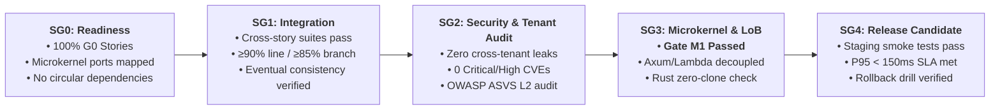
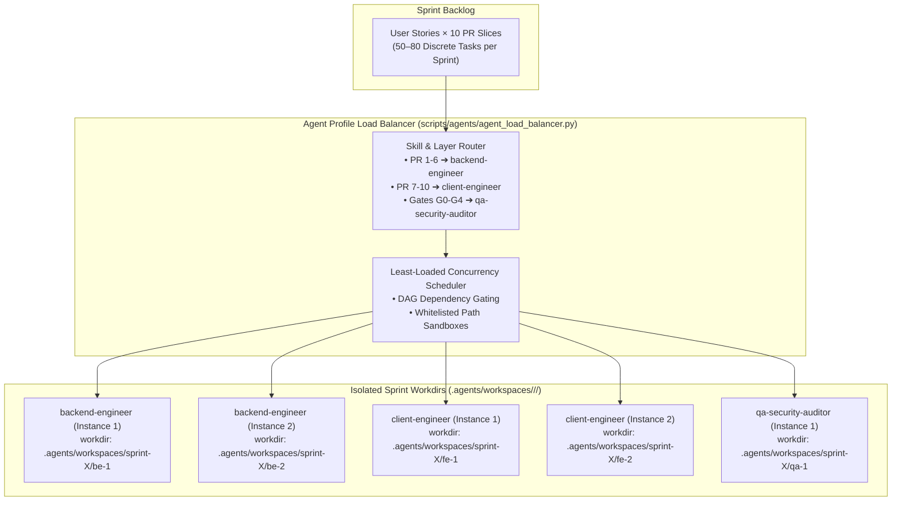

# Sprints — Master Index

> **Total Sprints**: 12 · **Across 6 Slices** · **Sprint Duration**: 2 weeks each · **Governing Gates**: SG0 — SG4

This directory is the central hub for sprint planning and execution in `some-commerce`. Just as [`docs/user-stories/`](../user-stories/) houses the functional specifications, this directory coordinates sprint specifications, live operational records, and retrospectives, closely coupled to [`docs/audits/`](../audits/) and [`docs/reports/`](../reports/).

---

## Sprint Documentation Subsystems

- 📋 **Sprint Specifications & Plans**: Formally defined 2-week milestones ([`sprint-1.1.md`](./sprint-1.1.md) through [`sprint-6.3.md`](./sprint-6.3.md)).
- 📝 **[Canonical Sprint Records](./records/README.md)**: Live execution records tracking backlog progress, agent workdir leases, gate transitions, and handoffs (`SPRINT-<id>.md`).
- 🔄 **[Sprint Retrospectives](./retrospectives/README.md)**: Post-sprint review logs, blocker root-cause analyses, velocity metrics, and process adaptations.
- 🛡️ **[Sprint Audits Hub](../audits/README.md)**: Security, Zero-Clone, AWS FTR, and Quality Gate certifications (SG2 / SG3 / G2 / G3).
- 📊 **[Sprint Reports Hub](../reports/README.md)**: Empirical test logs for E1 Benchmarks, E2 Integration, E3 Fuzzing, E4 Loom Concurrency, and E5 Closeout packages (SG1 / SG4).

---

## Sprint Calendar & Governance Directory

| Sprint | Slice | Duration | Theme | Sprint Plan | Execution Record | Audits Link | Reports Link | Status |
|:-------|:------|:---------|:------|:------------|:-----------------|:------------|:-------------|:-------|
| Sprint 1.1 | v1.0 | Weeks 1–2 | Auth + Storefront + Customer Foundation | [Plan](./sprint-1.1.md) | [Record](./records/README.md#sprint-11) | [Audits](../audits/README.md#2-sprint-by-sprint-audit-traceability-matrix) | [Reports](../reports/README.md#2-sprint-by-sprint-report-traceability-matrix) | Planned |
| Sprint 1.2 | v1.0 | Weeks 3–4 | Cart + Checkout + Payments + Fulfillment | [Plan](./sprint-1.2.md) | [Record](./records/README.md#sprint-12) | [Audits](../audits/README.md#2-sprint-by-sprint-audit-traceability-matrix) | [Reports](../reports/README.md#2-sprint-by-sprint-report-traceability-matrix) | Planned |
| Sprint 2.1 | v2.0 | Weeks 5–6 | Digital Asset Pipeline + Licensing (Modes 1–4) | [Plan](./sprint-2.1.md) | [Record](./records/README.md#sprint-21) | [Audits](../audits/README.md#2-sprint-by-sprint-audit-traceability-matrix) | [Reports](../reports/README.md#2-sprint-by-sprint-report-traceability-matrix) | Planned |
| Sprint 2.2 | v2.0 | Weeks 7–8 | Licensing (Modes 5–6) + SDKs + License Vault | [Plan](./sprint-2.2.md) | [Record](./records/README.md#sprint-22) | [Audits](../audits/README.md#2-sprint-by-sprint-audit-traceability-matrix) | [Reports](../reports/README.md#2-sprint-by-sprint-report-traceability-matrix) | Planned |
| Sprint 3.1 | v3.0 | Weeks 9–10 | B2B Onboarding + Tiered Pricing + Cross-Border | [Plan](./sprint-3.1.md) | [Record](./records/README.md#sprint-31) | [Audits](../audits/README.md#2-sprint-by-sprint-audit-traceability-matrix) | [Reports](../reports/README.md#2-sprint-by-sprint-report-traceability-matrix) | Planned |
| Sprint 3.2 | v3.0 | Weeks 11–12 | RFQ Negotiation + Net-Terms + LAN Proxy | [Plan](./sprint-3.2.md) | [Record](./records/README.md#sprint-32) | [Audits](../audits/README.md#2-sprint-by-sprint-audit-traceability-matrix) | [Reports](../reports/README.md#2-sprint-by-sprint-report-traceability-matrix) | Planned |
| Sprint 4.1 | v4.0 | Weeks 13–14 | Multi-Vendor Onboarding + Sub-Order Splitting | [Plan](./sprint-4.1.md) | [Record](./records/README.md#sprint-41) | [Audits](../audits/README.md#2-sprint-by-sprint-audit-traceability-matrix) | [Reports](../reports/README.md#2-sprint-by-sprint-report-traceability-matrix) | Planned |
| Sprint 4.2 | v4.0 | Weeks 15–16 | Escrow Ledger + Vendor Portal + BTCPay + RMA | [Plan](./sprint-4.2.md) | [Record](./records/README.md#sprint-42) | [Audits](../audits/README.md#2-sprint-by-sprint-audit-traceability-matrix) | [Reports](../reports/README.md#2-sprint-by-sprint-report-traceability-matrix) | Planned |
| Sprint 5.1 | v5.0 | Weeks 17–18 | CDK Packaging + AWS Marketplace + Metering | [Plan](./sprint-5.1.md) | [Record](./records/README.md#sprint-51) | [Audits](../audits/README.md#2-sprint-by-sprint-audit-traceability-matrix) | [Reports](../reports/README.md#2-sprint-by-sprint-report-traceability-matrix) | Planned |
| Sprint 6.1 | v6.0 | Weeks 19–20 | SDUI Visual Studio + Dual-Edition Toggle | [Plan](./sprint-6.1.md) | [Record](./records/README.md#sprint-61) | [Audits](../audits/README.md#2-sprint-by-sprint-audit-traceability-matrix) | [Reports](../reports/README.md#2-sprint-by-sprint-report-traceability-matrix) | Planned |
| Sprint 6.2 | v6.0 | Weeks 21–22 | White-Label Pipeline + Marketplace Launch | [Plan](./sprint-6.2.md) | [Record](./records/README.md#sprint-62) | [Audits](../audits/README.md#2-sprint-by-sprint-audit-traceability-matrix) | [Reports](../reports/README.md#2-sprint-by-sprint-report-traceability-matrix) | Planned |
| Sprint 6.3 | v6.0 | Weeks 23–24 | Hardening, Performance Tuning + Launch Prep | [Plan](./sprint-6.3.md) | [Record](./records/README.md#sprint-63) | [Audits](../audits/README.md#2-sprint-by-sprint-audit-traceability-matrix) | [Reports](../reports/README.md#2-sprint-by-sprint-report-traceability-matrix) | Planned |

---

## Sprint Quality Gates Lifecycle (SG0 — SG4)

Every sprint in `some-commerce` is governed as a unified delivery milestone through the 5 **Sprint Quality Gates** detailed in [QUALITY_GATES.md](../QUALITY_GATES.md):



1. **SG0 (Planning & Readiness)**: Story backlogs verified; pure domain logic isolated for crates.io packaging.
2. **SG1 (Cross-Story Integration)**: End-to-end multi-module flows verified under realistic data schemas.
3. **SG2 (Security & Tenant Isolation)**: Monorepo vulnerability scan and adversarial multi-tenant fuzzing with zero data leaks.
4. **SG3 (Architecture & Gate M1)**: Strict verification of pure microkernel logic crates, Axum transport decoupling from `lambda_http`, zero-clone Rust borrowing compliance, and framework-scoped LoB folder hierarchy (`apps/storefront/src/features/...` and `backend/src/features/...`).
5. **SG4 (Release Candidate & Operations)**: Production staging deployment, load budgets met, operational recovery drill verified.

---

---

## Multi-Agent Sprint Delivery Framework & Profile Load Balancer

The engineering delivery of `some-commerce` across all 12 sprints is orchestrated through a scalable multi-agent organization powered by the **Agent Profile Load Balancer** ([`scripts/agents/agent_load_balancer.py`](../../scripts/agents/agent_load_balancer.py)) and detailed in [COMPANY_ROLES_AND_AGENT_PROFILES.md](../COMPANY_ROLES_AND_AGENT_PROFILES.md) and [AGENT_PROFILES_AND_MULTI_AGENT_FRAMEWORK.md](../AGENT_PROFILES_AND_MULTI_AGENT_FRAMEWORK.md).



### 1. The 3 Core Execution Profiles
1. **`backend-engineer`**: Delivers PR 1–6 (Pillar 1 Microkernel, Pillar 2 Schemas, Pillar 3 Repos, Pillar 4 L2 Redis, Pillar 5 L1 Moka, Pillar 6 ETag/Axum). Strictly adheres to the **Rust Zero-Clone Law** and microkernel purity (**Gate M1**).
2. **`client-engineer`**: Delivers PR 7–10 (Pillar 7 TanStack Query, Pillar 8 WatermelonDB Sync, Pillar 9 Headless Hooks, Pillar 10 Platform-Adaptive UI). Strictly adheres to framework-scoped LoB (**Gate A2**), `@expo/ui`, Tailwind v4, and bilingual RTL layout.
3. **`qa-security-auditor`**: Enforces Security Gateways (G2), OWASP ASVS v4.0.3 L2 compliance, synthetic tenant isolation pentesting, and signs off on Quality Gates (G0–G4, SG0–SG4, Gate A1, Gate A2, Gate M1).

### 2. Physical Sprint-Level Workdir Isolation
Every agent spawned by the load balancer receives an isolated sprint-level working directory:
`.agents/workspaces/<sprint-id>/<agent-name>/`
containing:
- `agent.yaml`: Config with write-whitelisted and blacklisted paths to guarantee zero merge collisions.
- `context.md`: Tailored context bundle with story narrative, Gherkin ACs `[AC-US-X.Y.Z-NN]`, and exact PR deliverables.
- `tasks.md`: Ordered task execution checklist.
- `workspace/`: (Optional) Dedicated Git worktree on branch `agent/<sprint-id>/<agent-name>`.

---

## The 10-PR Vertical Slicing Standard (Aligned with 10-Pillar System Architecture)

The ten rows below identify architectural responsibilities directly matching the [10-Pillar System Architecture](../SYSTEM_ARCHITECTURE.md). At G0, select affected layers, record reuse and justify N/A layers. Combine layers when that produces a coherent, independently testable change; preserve dependency order and backwards-compatible contracts. Do not introduce empty packages, unnecessary wrappers, or duplicate rules to fill a layer. Every PR and story must pass the [quality gates](../QUALITY_GATES.md); coverage is measured by those rules.

| PR # | Pillar | Architectural Layer | Primary Targets & Crates | Deliverables & Definition of Done | Profile Owner |
|:-----|:-------|:--------------------|:-------------------------|:-----------------------------------|:--------------|
| **PR 1** | **Pillar 1** | **Microkernel Domain Logic & Plugin Ports** | `crates/kernel-core`, `crates/plugins-*` | Pure, vendor-agnostic Rust domain rules, trait definitions (`PaymentGatewayPlugin`, `ShippingCarrierPlugin`, `MultiTierCachePort`), value objects (`Money`, `Locale`), math calculations (Split-COD, tiered volume pricing, Ed25519 license validation), and exhaustive property-based unit tests (`proptest`, `cargo-nextest`). Zero external cloud dependencies. | `backend-engineer` |
| **PR 2** | **Pillar 2** | **Polyglot Database Schema Definitions** | `crates/db-schema`, `packages/watermelon-db` | Strongly typed Rust item structs, Single-Table DynamoDB key schemas (`PK`, `SK`, `GSI1`–`GSI5`), OpenSearch `nested` property mappings, and local WatermelonDB SQLite/IndexedDB table definitions. Automated codegen pipelines (`ts-rs`, `schemars`). | `backend-engineer` |
| **PR 3** | **Pillar 3** | **Repository Adapters & Infrastructure Connectors** | `crates/db-dynamo`, `crates/search-elastic`, `crates/notify-sns`, `crates/kms-vault` | Single-Table DynamoDB CRUD queries, `TransactWriteItems` atomic transactions, Tier 1 DynamoDB filter + Tier 2 OpenSearch engine, SNS notification publisher, and KMS envelope encryption vault adapter. | `backend-engineer` |
| **PR 4** | **Pillar 4** | **Distributed L2 Cache & Invalidation Engine** | `crates/cache-tier` | Amazon ElastiCache Serverless Redis connection pool (`redis::aio::MultiplexedConnection`), pipelined L2 `data:{key}` and `etag:{key}` reads/writes, and Redis Pub/Sub invalidation channels (`cache:evict:{tenant}`) across active Lambda instances. | `backend-engineer` |
| **PR 5** | **Pillar 5** | **In-Process L1 Moka Cache & Request Coalescing** | `crates/cache-tier` | In-memory `moka::future::Cache` (TinyLFU admission, lock-free concurrent hash maps), sub-50 microsecond lookups, and `try_get_with` request coalescing across concurrent Tokio tasks (thundering-herd protection under 64-concurrency Lambda Managed Instances). | `backend-engineer` |
| **PR 6** | **Pillar 6** | **HTTP ETag Protocol & Pure Axum Handlers** | `bins/storefront-sdui-api`, `bins/checkout-webhooks-api`, `bins/admin-vendor-api`, `bins/durable-orchestrator`, `bins/fulfillment-worker` | Deterministic `BLAKE3` ETag generator (`W/"v{version}-{hash}"`), Axum conditional request middleware (`If-None-Match` $\rightarrow$ `304 Not Modified`, `If-Match` $\rightarrow$ `412 Precondition Failed`), Cognito JWT validation extractors, and WebMCP tool registration endpoints (`/v1/mcp/*`). Decoupled from `lambda_http`. | `backend-engineer` |
| **PR 7** | **Pillar 7** | **Frontend Server-State Caching (TanStack Query)** | `packages/query-client`, `packages/api-client` | TanStack React Query v5 query/mutation declarations, `fetchWithEtag` client interceptor resolving `304 Not Modified` from local client storage, query key factories, and optimistic cache mutations. | `client-engineer` |
| **PR 8** | **Pillar 8** | **Client-First Local Database (WatermelonDB Sync)** | `packages/watermelon-db`, `apps/storefront/src/features/.../services/` | WatermelonDB schema, reactive model classes (`@nozbe/watermelondb/decorators`), JSI SQLite adapter on iOS/Android, IndexedDB adapter on Web, and delta synchronization against `/v1/sync/pull` and `/v1/sync/push` (DynamoDB `GSI5`). | `client-engineer` |
| **PR 9** | **Pillar 9** | **Headless Custom Hooks & Logic Abstraction** | `packages/domain-hooks`, `apps/storefront/src/features/.../logic/` | Pure TypeScript headless custom React hooks (`useSduiScreen`, `useCatalogSearchAndFacets`, `useProductConfigurator`, `useSplitCodCheckout`, `useCustomerAccount`, `useDigitalLicenseVault`, `useWebMcpBridge`), isolating business logic, state machines, and data subscriptions from visual presentation. | `client-engineer` |
| **PR 10** | **Pillar 10** | **Platform-Adaptive UI Design & Native Modules** | `apps/storefront`, `packages/ui-primitives`, `modules/expo-*` | Native SwiftUI & Jetpack Compose components via [`@expo/ui`](https://docs.expo.dev/versions/latest/sdk/ui/) for iOS and Android, paired with semantic HTML5 elements (`<main>`, `<aside>`, `<nav>`, `<article>`, `<fieldset>`) styled with **Tailwind CSS v4** for Web, Expo Native Modules (`expo-crypto-license`, camera QR, biometrics), and bidirectional RTL/LTR layout mirroring (`ar-EG` / `en-US`). | `client-engineer` |

---

## Toolchain compatibility gate

Version labels in the earlier system guides are design inputs, not verified pins. Before the first application PR, select a compatible toolchain from official release metadata and commit exact manifests/lockfiles. Rust 2024 requires Rust 1.85 or later; dependency MSRVs may require a newer compiler. See the [Rust edition guide](https://doc.rust-lang.org/edition-guide/rust-2024/index.html).

Verify the Expo/React/React Native/Router/native-module combination on web, iOS and Android; Rust/AWS/CDK compatibility in target regions; and current security advisories with named sources. Record the selected versions, source links, date and build evidence. Do not assert a CVE is fixed without a matching advisory. Updates require compatibility and security gates; “latest stable” is not a reproducible version constraint. See findings F17/F18 in the [stress-test register](../DOCS_STRESS_TEST.md).

---

## Sprint Workflow

```mermaid
flowchart LR
    Backlog[Sprint Backlog] --> Assign[Assign Stories to Agents α, β, γ]
    Assign --> PR_Pipeline[10-PR Sequential Slices (Pillars 1–10)]
    PR_Pipeline --> CI[Automated CI: nextest + biome + typecheck]
    CI --> Review[Agent Peer Review & Merge]
    Review --> DoD[Definition of Done Validation]
    DoD --> NextStory[Pull Next Story]
```


## Definition of Ready and Done

Every sprint plan ends with its **End-of-Sprint Test Gate**: E1 benchmarks, E2 integration, E3 fuzz tests, E4 applicable Rust Loom concurrency models and E5 independent evidence review. These block SG4/CTO review until satisfied under the [closeout policy](../SPRINT_TESTING.md); use the [sprint evidence template](../validation/SPRINT_TEST_EVIDENCE_TEMPLATE.md). Approve scope, baselines, workloads and resource/model bounds at SG0. Documentation validation does not run these application tests.

Every story, including P1/P2 work, requires [G0–G4 validation](../QUALITY_GATES.md) and its [evidence record](../validation/STORY_EVIDENCE_TEMPLATE.md). Security, architecture and tests are merge gates in every sprint. Sprint 6.3 repeats system-wide validation and cannot substitute for earlier checks.

The calendar records current planning, not validated dependency order or capacity. Resolve [F21 dependency gaps](../DOCS_STRESS_TEST.md) before committing a sprint. Story points now match their tables; estimates must include gate work. Stories appearing in multiple sprints remain In Progress until all of their acceptance criteria and integrated gates pass.
