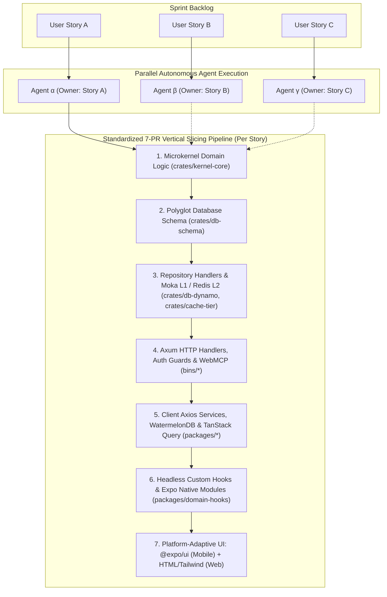
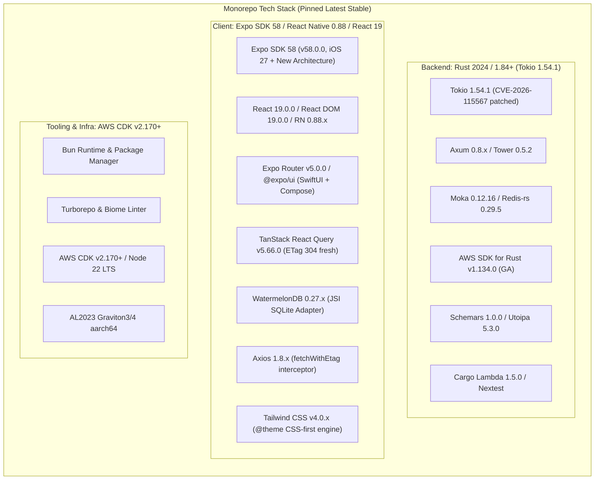
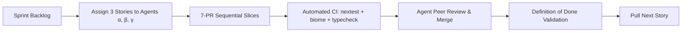

# Sprints — Master Index

> **Total Sprints**: 12 · **Across 6 Slices** · **Sprint Duration**: 2 weeks each

## Sprint Calendar

| Sprint | Slice | Duration | Theme | Status |
|:-------|:------|:---------|:------|:-------|
| [Sprint 1.1](./sprint-1.1.md) | v1.0 | Weeks 1–2 | Auth + Storefront + Customer Foundation | Planned |
| [Sprint 1.2](./sprint-1.2.md) | v1.0 | Weeks 3–4 | Cart + Checkout + Payments + Fulfillment | Planned |
| [Sprint 2.1](./sprint-2.1.md) | v2.0 | Weeks 5–6 | Digital Asset Pipeline + Licensing Engine (Modes 1–4) | Planned |
| [Sprint 2.2](./sprint-2.2.md) | v2.0 | Weeks 7–8 | Licensing Engine (Modes 5–6) + SDKs + License Vault | Planned |
| [Sprint 3.1](./sprint-3.1.md) | v3.0 | Weeks 9–10 | B2B Onboarding + Tiered Pricing + Cross-Border | Planned |
| [Sprint 3.2](./sprint-3.2.md) | v3.0 | Weeks 11–12 | RFQ Negotiation + Net-Terms + LAN Proxy | Planned |
| [Sprint 4.1](./sprint-4.1.md) | v4.0 | Weeks 13–14 | Multi-Vendor Onboarding + Sub-Order Splitting | Planned |
| [Sprint 4.2](./sprint-4.2.md) | v4.0 | Weeks 15–16 | Escrow Ledger + Vendor Portal + BTCPay + RMA | Planned |
| [Sprint 5.1](./sprint-5.1.md) | v5.0 | Weeks 17–18 | CDK Packaging + AWS Marketplace + Metering | Planned |
| [Sprint 6.1](./sprint-6.1.md) | v6.0 | Weeks 19–20 | SDUI Visual Studio + Dual-Edition Toggle | Planned |
| [Sprint 6.2](./sprint-6.2.md) | v6.0 | Weeks 21–22 | White-Label Pipeline + Marketplace Launch | Planned |
| [Sprint 6.3](./sprint-6.3.md) | v6.0 | Weeks 23–24 | Hardening, Performance Tuning + Launch Prep | Planned |

---

## Autonomous 3-Agent Parallel Delivery Framework

The development and implementation of `some-commerce` is executed using **3 concurrent, autonomous AI coding agents** (Agent $\alpha$, Agent $\beta$, Agent $\gamma$). Each agent takes end-to-end ownership of one distinct User Story at a time from the sprint backlog to prevent merge conflicts and maintain complete domain context.

---

## The 7-PR Vertical Slicing Standard

Every single User Story must be delivered through the following **7 sequential, atomic Pull Requests (PRs)** to ensure rock-solid quality, strict separation of concerns, and 100% test coverage at each architectural layer:

| PR # | Architectural Layer | Primary Targets & Crates | Deliverables & Definition of Done |
|:-----|:--------------------|:-------------------------|:-----------------------------------|
| **PR 1** | **Microkernel Domain Logic** | `crates/kernel-core`, `crates/plugins-*` | Pure, vendor-agnostic Rust domain rules, trait definitions (`PaymentGatewayPlugin`, `ShippingCarrierPlugin`, etc.), value objects (`Money`, `Locale`), math calculations (Split-COD, tiered volume pricing, Ed25519 license validation), and exhaustive property-based unit tests (`proptest`, `cargo-nextest`). Zero external cloud dependencies. |
| **PR 2** | **Database Schema Definitions** | `crates/db-schema`, `packages/watermelon-db` | Strongly typed Rust item structs, Single-Table DynamoDB key schemas (`PK`, `SK`, `GSI1`–`GSI5`), OpenSearch `nested` property mappings, and local WatermelonDB SQLite/IndexedDB table definitions. Automated codegen pipelines (`ts-rs`, `schemars`). |
| **PR 3** | **Repository Handlers & Caching** | `crates/db-dynamo`, `crates/cache-tier`, `crates/search-elastic` | Single-Table DynamoDB CRUD queries, `TransactWriteItems` atomic transactions, Tier 1 DynamoDB filter + Tier 2 OpenSearch engine, L1 in-process Moka TinyLFU cache, L2 ElastiCache Redis multiplexed connection, Redis Pub/Sub invalidation channels (`cache:evict:{tenant}`), and deterministic `BLAKE3` RFC 9110 HTTP `ETag` generation. |
| **PR 4** | **Axum Handlers & API Routes** | `bins/storefront-sdui-api`, `bins/checkout-webhooks-api`, `bins/admin-vendor-api`, `bins/durable-orchestrator`, `bins/fulfillment-worker` | Axum HTTP router definitions, request/response DTOs, Tower middleware (`If-None-Match` $\rightarrow$ `304 Not Modified`), Cognito JWT validation (`RequireStoreAdmin`, `RequireVendor`, `RequireB2bBuyer`), webhook signature verification (`HMAC-SHA512`, `Stripe-Signature`), and WebMCP tool registration endpoints (`/v1/mcp/*`). |
| **PR 5** | **Client Services & Local Database** | `packages/api-client`, `packages/watermelon-db`, `packages/query-client` | Strongly-typed client HTTP service modules using `axios` with `fetchWithEtag` interceptor, WatermelonDB model classes and reactive schema actions, delta synchronization against `/v1/sync/pull` and `/v1/sync/push`, and TanStack React Query v5 query/mutation declarations. |
| **PR 6** | **Headless Custom Hooks & Native Modules** | `packages/domain-hooks`, `modules/expo-*` | Pure TypeScript headless custom hooks (`useSduiScreen`, `useCatalogSearchAndFacets`, `useProductConfigurator`, `useSplitCodCheckout`, `useDigitalLicenseVault`, `useWebMcpBridge`), and Expo Native Modules (`@expo/ui`, `expo-camera` QR scanner, `expo-crypto`, biometrics). |
| **PR 7** | **Platform-Adaptive UI Design** | `apps/storefront-mobile`, `apps/storefront-web`, `packages/ui-primitives` | Native SwiftUI & Jetpack Compose components via [`@expo/ui`](https://docs.expo.dev/versions/latest/sdk/ui/) for iOS and Android, paired with semantic HTML5 elements (`<main>`, `<aside>`, `<nav>`, `<article>`, `<fieldset>`) styled with **Tailwind CSS v4** (CSS-first `@theme` configuration with Lightning CSS engine) for Web, enforcing bidirectional RTL/LTR layout mirroring (`ar-EG` / `en-US`). |

---

## Toolchain & Package Ecosystem: Always Latest Stable Versions (Expo SDK 58 & Tokio 1.54.1)

All development agents must strictly install, declare, and pin the **latest stable releases** across the monorepo workspace, anchored on **Expo SDK 58** and **Tokio 1.54.1**. Legacy patterns, deprecated APIs, and end-of-life dependencies are strictly prohibited.

| Layer | Technology | Minimum Pinned Version | Rationale & Compatibility Guarantee |
|:------|:-----------|:-----------------------|:------------------------------------|
| **Async Runtime** | Tokio | **`1.54.1`** | **Explicitly Pinned**. Includes critical fix for `CVE-2026-115567` (`Interval` race condition). Multi-threaded runtime with cooperative scheduling. |
| **Rust Compiler** | Rust | **`2024 Edition (1.84+)`** | Native async closures, RPITIT (return-position `impl Trait` in traits), modern borrow checker. |
| **HTTP Framework** | Axum | **`0.8.x` (0.8.9)** | Fully compatible with Tokio 1.54.1. Modern routing, Tower 0.5 middleware, zero-copy streaming. |
| **In-Memory Cache** | Moka | **`0.12.16`** | Lock-free TinyLFU cache with `try_get_with` request coalescing across 64 concurrent tasks. |
| **Distributed Cache** | Redis-rs | **`0.29.5`** | Async multiplexed connections with automatic pipeline bundling and Redis Pub/Sub support. |
| **Cloud SDK** | AWS SDK for Rust | **`v1.134.0` (GA)** | Strongly-typed official SDK (`aws-sdk-dynamodb`, `aws-sdk-kms`, `aws-sdk-sns`, `aws-sdk-bedrockruntime`, `aws-sdk-marketplacemetering`). |
| **Type & API Codegen** | Schemars & Utoipa | **`schemars 1.0.0` / `utoipa 5.3.0`** | Automated Rust-to-TypeScript interfaces, OpenAPI 3.1 specs, and W3C WebMCP tool schemas. |
| **Packaging & Compute**| Cargo Lambda | **`1.5.0+`** | Cross-compilation for Amazon Linux 2023 (`al2023`) targeting ARM64 Graviton. |
| **Mobile & Web App** | Expo SDK | **`SDK 58 (v58.0.0)`** | **Explicitly Pinned**. iOS 27 support, New Architecture (RN 0.88), `@expo/ui` SwiftUI/Jetpack Compose, Expo Router v5, and native MCP support. |
| **Client Core** | React / React Native | **`React 19.0.0` / `RN 0.88.x`** | Bundled with Expo SDK 58. Native Actions, `use()` hook, Server Components compatibility, and asset preloading. |
| **Web Styling** | Tailwind CSS | **`v4.0.x`** | Modern CSS-first engine (`@theme`), Lightning CSS compilation, zero legacy `tailwind.config.js`. Compatible with Expo 58 Web. |
| **Server State** | TanStack React Query | **`v5.66.0`** | ETag conditional request caching (`304 Not Modified`), optimistic offline mutations. |
| **Client Database** | WatermelonDB | **`0.27.x`** | High-speed SQLite adapter over C++ JSI on iOS/Android (via Expo 58 config plugin); LokiJS/IndexedDB on Web. |
| **HTTP Client** | Axios | **`1.8.x`** | Interceptor pipeline handling RFC 9110 HTTP `ETag` / `If-None-Match` caching transparently. |
| **Package Manager** | Bun | **`Latest Stable`** | Fast JS/TS runtime, package manager, and bundler for monorepo tasks. |
| **Monorepo Build** | Turborepo & Biome | **`Latest Stable`** | Cache-accelerated monorepo task graph + sub-second Biome linting and formatting. |
| **Infra as Code** | AWS CDK | **`v2.170+`** | CloudFormation synthesis targeting Node 22 LTS with Graviton4 Managed Instance L2 constructs. |

---

## Sprint Workflow

