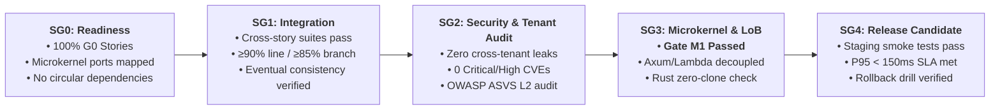

# Sprints — Master Index

> **Total Sprints**: 12 · **Across 6 Slices** · **Sprint Duration**: 2 weeks each

## Sprint Calendar

| Sprint | Slice | Duration | Theme | Status |
|:-------|:------|:---------|:------|:-------|
| [Sprint 1.1](./sprint-1.1.md) | v1.0 | Weeks 1–2 | Auth + Storefront + Customer Foundation | Planned |
| [Sprint 1.2](./sprint-1.2.md) | v1.0 | Weeks 3–4 | Cart + Checkout + Payments + Fulfillment | Planned |
| [Sprint 2.1](./sprint-2.1.md) | v2.0 | Weeks 5–6 | Digital Asset Pipeline + Licensing Engine (Modes 1–4) | Planned |
| [Sprint 2.2](./sprint-2.2.md) | v2.0 | Weeks 7–8 | Licensing Engine (Modes 5–6) + SDKs + License Vault | Planned |
| [Sprint 3.1](./sprint-3.1.md) | v3.0 | Weeks 9–10 | B2B Onboarding + Tiered Pricing + Cross-Border | Planned |
| [Sprint 3.2](./sprint-3.2.md) | v3.0 | Weeks 11–12 | RFQ Negotiation + Net-Terms + LAN Proxy | Planned |
| [Sprint 4.1](./sprint-4.1.md) | v4.0 | Weeks 13–14 | Multi-Vendor Onboarding + Sub-Order Splitting | Planned |
| [Sprint 4.2](./sprint-4.2.md) | v4.0 | Weeks 15–16 | Escrow Ledger + Vendor Portal + BTCPay + RMA | Planned |
| [Sprint 5.1](./sprint-5.1.md) | v5.0 | Weeks 17–18 | CDK Packaging + AWS Marketplace + Metering | Planned |
| [Sprint 6.1](./sprint-6.1.md) | v6.0 | Weeks 19–20 | SDUI Visual Studio + Dual-Edition Toggle | Planned |
| [Sprint 6.2](./sprint-6.2.md) | v6.0 | Weeks 21–22 | White-Label Pipeline + Marketplace Launch | Planned |
| [Sprint 6.3](./sprint-6.3.md) | v6.0 | Weeks 23–24 | Hardening, Performance Tuning + Launch Prep | Planned |

---

## Sprint Quality Gates Lifecycle (SG0 — SG4)

Every sprint in `some-commerce` is governed as a unified delivery milestone through the 5 **Sprint Quality Gates** detailed in [QUALITY_GATES.md](../QUALITY_GATES.md):

1. **SG0 (Planning & Readiness)**: Story backlogs verified; pure domain logic isolated for crates.io packaging.
2. **SG1 (Cross-Story Integration)**: End-to-end multi-module flows verified under realistic data schemas.
3. **SG2 (Security & Tenant Isolation)**: Monorepo vulnerability scan and adversarial multi-tenant fuzzing with zero data leaks.
4. **SG3 (Architecture & Gate M1)**: Strict verification of pure microkernel logic crates, Axum transport decoupling from `lambda_http`, zero-clone Rust borrowing compliance, and framework-scoped LoB folder hierarchy (`apps/storefront/src/features/...` and `backend/src/features/...`).
5. **SG4 (Release Candidate & Operations)**: Production staging deployment, load budgets met, operational recovery drill verified.

---

---

## Multi-Agent Sprint Delivery Framework & Profile Load Balancer

The engineering delivery of `some-commerce` across all 12 sprints is orchestrated through a scalable multi-agent organization powered by the **Agent Profile Load Balancer** ([`scripts/agent_load_balancer.py`](../scripts/agent_load_balancer.py)) and detailed in [COMPANY_ROLES_AND_AGENT_PROFILES.md](../COMPANY_ROLES_AND_AGENT_PROFILES.md) and [AGENT_PROFILES_AND_MULTI_AGENT_FRAMEWORK.md](../AGENT_PROFILES_AND_MULTI_AGENT_FRAMEWORK.md).

### 1. The 3 Core Execution Profiles
1. **`backend-engineer`**: Delivers PR 1 (Microkernel logic), PR 2 (Schemas), PR 3 (Repos/Caching), and PR 4 (Pure Axum routes). Strictly adheres to the **Rust Zero-Clone Law** and microkernel purity (**Gate M1**).
2. **`client-engineer`**: Delivers PR 5 (API clients & WatermelonDB sync), PR 6 (Custom hooks & logic), and PR 7 (Platform-adaptive UI). Strictly adheres to framework-scoped LoB (**Gate A2**), `@expo/ui`, Tailwind, and bilingual RTL layout.
3. **`qa-security-auditor`**: Enforces Security Gateways (G2), OWASP ASVS v4.0.3 L2 compliance, synthetic tenant isolation pentesting, and signs off on Quality Gates (G0–G4, SG0–SG4, Gate A1, Gate A2, Gate M1).

### 2. Physical Sprint-Level Workdir Isolation
Every agent spawned by the load balancer receives an isolated sprint-level working directory:
`.agents/workspaces/<sprint-id>/<agent-name>/`
containing:
- `agent.yaml`: Config with write-whitelisted and blacklisted paths to guarantee zero merge collisions.
- `context.md`: Tailored context bundle with story narrative, Gherkin ACs `[AC-US-X.Y.Z-NN]`, and exact PR deliverables.
- `tasks.md`: Ordered task execution checklist.
- `workspace/`: (Optional) Dedicated Git worktree on branch `agent/<sprint-id>/<agent-name>`.

---

## The 7-PR Vertical Slicing Standard

The seven rows below identify architectural responsibilities, not a mandatory PR count. At G0, select affected layers, record reuse and justify N/A layers. Combine layers when that produces a coherent, independently testable change; preserve dependency order and backwards-compatible contracts. Do not introduce empty packages, unnecessary wrappers, or duplicate rules to fill a layer. Every PR and story must pass the [quality gates](../QUALITY_GATES.md); coverage is measured by those rules.

| PR # | Architectural Layer | Primary Targets & Crates | Deliverables & Definition of Done |
|:-----|:--------------------|:-------------------------|:-----------------------------------|
| **PR 1** | **Microkernel Domain Logic** | `crates/kernel-core`, `crates/plugins-*` | Pure, vendor-agnostic Rust domain rules, trait definitions (`PaymentGatewayPlugin`, `ShippingCarrierPlugin`, etc.), value objects (`Money`, `Locale`), math calculations (Split-COD, tiered volume pricing, Ed25519 license validation), and exhaustive property-based unit tests (`proptest`, `cargo-nextest`). Zero external cloud dependencies. |
| **PR 2** | **Database Schema Definitions** | `crates/db-schema`, `packages/watermelon-db` | Strongly typed Rust item structs, Single-Table DynamoDB key schemas (`PK`, `SK`, `GSI1`–`GSI5`), OpenSearch `nested` property mappings, and local WatermelonDB SQLite/IndexedDB table definitions. Automated codegen pipelines (`ts-rs`, `schemars`). |
| **PR 3** | **Repository Handlers & Caching** | `crates/db-dynamo`, `crates/cache-tier`, `crates/search-elastic` | Single-Table DynamoDB CRUD queries, `TransactWriteItems` atomic transactions, Tier 1 DynamoDB filter + Tier 2 OpenSearch engine, L1 in-process Moka TinyLFU cache, L2 ElastiCache Redis multiplexed connection, Redis Pub/Sub invalidation channels (`cache:evict:{tenant}`), and deterministic `BLAKE3` RFC 9110 HTTP `ETag` generation. |
| **PR 4** | **Axum Handlers & API Routes** | `bins/storefront-sdui-api`, `bins/checkout-webhooks-api`, `bins/admin-vendor-api`, `bins/durable-orchestrator`, `bins/fulfillment-worker` | Axum HTTP router definitions, request/response DTOs, Tower middleware (`If-None-Match` $\rightarrow$ `304 Not Modified`), Cognito JWT validation (`RequireStoreAdmin`, `RequireVendor`, `RequireB2bBuyer`), webhook signature verification (`HMAC-SHA512`, `Stripe-Signature`), and WebMCP tool registration endpoints (`/v1/mcp/*`). |
| **PR 5** | **Client Services & Local Database** | `packages/api-client`, `packages/watermelon-db`, `packages/query-client` | Strongly-typed client HTTP service modules using `axios` with `fetchWithEtag` interceptor, WatermelonDB model classes and reactive schema actions, delta synchronization against `/v1/sync/pull` and `/v1/sync/push`, and TanStack React Query v5 query/mutation declarations. |
| **PR 6** | **Headless Custom Hooks & Native Modules** | `packages/domain-hooks`, `modules/expo-*` | Pure TypeScript headless custom hooks (`useSduiScreen`, `useCatalogSearchAndFacets`, `useProductConfigurator`, `useSplitCodCheckout`, `useDigitalLicenseVault`, `useWebMcpBridge`), and Expo Native Modules (`@expo/ui`, `expo-camera` QR scanner, `expo-crypto`, biometrics). |
| **PR 7** | **Platform-Adaptive UI Design** | `apps/storefront-mobile`, `apps/storefront-web`, `packages/ui-primitives` | Native SwiftUI & Jetpack Compose components via [`@expo/ui`](https://docs.expo.dev/versions/latest/sdk/ui/) for iOS and Android, paired with semantic HTML5 elements (`<main>`, `<aside>`, `<nav>`, `<article>`, `<fieldset>`) styled with **Tailwind CSS v4** (CSS-first `@theme` configuration with Lightning CSS engine) for Web, enforcing bidirectional RTL/LTR layout mirroring (`ar-EG` / `en-US`). |

---

## Toolchain compatibility gate

Version labels in the earlier system guides are design inputs, not verified pins. Before the first application PR, select a compatible toolchain from official release metadata and commit exact manifests/lockfiles. Rust 2024 requires Rust 1.85 or later; dependency MSRVs may require a newer compiler. See the [Rust edition guide](https://doc.rust-lang.org/edition-guide/rust-2024/index.html).

Verify the Expo/React/React Native/Router/native-module combination on web, iOS and Android; Rust/AWS/CDK compatibility in target regions; and current security advisories with named sources. Record the selected versions, source links, date and build evidence. Do not assert a CVE is fixed without a matching advisory. Updates require compatibility and security gates; “latest stable” is not a reproducible version constraint. See findings F17/F18 in the [stress-test register](../DOCS_STRESS_TEST.md).

---

## Sprint Workflow

## Definition of Ready and Done

Every story, including P1/P2 work, requires [G0–G4 validation](../QUALITY_GATES.md) and its [evidence record](../validation/STORY_EVIDENCE_TEMPLATE.md). Security, architecture and tests are merge gates in every sprint. Sprint 6.3 repeats system-wide validation and cannot substitute for earlier checks.

The calendar records current planning, not validated dependency order or capacity. Resolve [F21 dependency gaps](../DOCS_STRESS_TEST.md) before committing a sprint. Story points now match their tables; estimates must include gate work. Stories appearing in multiple sprints remain In Progress until all of their acceptance criteria and integrated gates pass.
