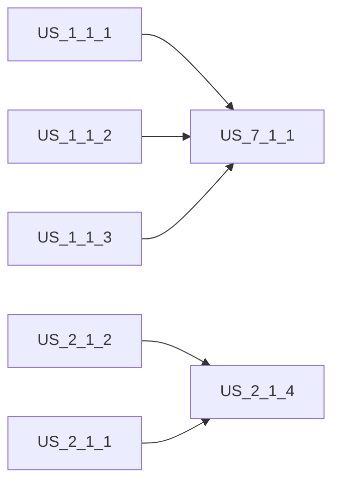

# Sprint 1.1 — Auth + Storefront + Customer Foundation

> **Slice**: v1.0 · **Duration**: Weeks 1–2 · **Story Points**: 34

## Goal

Stand up the authentication layer, SDUI storefront rendering, catalog search, and customer account foundation. By sprint end, a customer can sign in, browse the catalog, search with facets, view product details, and manage their profile.

## User Stories

| Priority | Story | Module | Points | Description |
|:---------|:------|:-------|:-------|:------------|
| P0 | [US-1.1.1](../user-stories/01-auth-and-onboarding/us-1.1.1-phone-otp-passwordless-sign-in.md) | Auth | 5 | Phone OTP passwordless sign-in |
| P0 | [US-1.1.2](../user-stories/01-auth-and-onboarding/us-1.1.2-email-password-passkey-webauthn-sign-in.md) | Auth | 5 | Email/Password & Passkey sign-in |
| P0 | [US-1.1.3](../user-stories/01-auth-and-onboarding/us-1.1.3-social-oidc-sign-in-google-apple.md) | Auth | 3 | Social OIDC sign-in (Google & Apple) |
| P0 | [US-2.1.1](../user-stories/02-storefront-and-catalog/us-2.1.1-multilingual-sdui-storefront-with-instant-watermelondb-rendering.md) | Storefront | 8 | SDUI storefront with WatermelonDB |
| P1 | [US-2.1.2](../user-stories/02-storefront-and-catalog/us-2.1.2-unlimited-n-level-category-taxonomy-brand-management.md) | Storefront | 5 | N-Level taxonomy & brands |
| P1 | [US-2.1.4](../user-stories/02-storefront-and-catalog/us-2.1.4-dual-tier-catalog-search-with-nested-faceted-filtration.md) | Storefront | 5 | Dual-tier search + facets |
| P1 | [US-7.1.1](../user-stories/07-customer-account/us-7.1.1-customer-profile-management.md) | Account | 3 | Customer profile management |

## Dependencies

## Infrastructure Setup (Sprint 0 pre-work)

Status: unverified prerequisites; attach deployment evidence before marking these complete.

- [ ] AWS Account + CDK bootstrap
- [ ] Cognito User Pool + Identity Pool
- [ ] DynamoDB table with GSI1 + GSI2
- [ ] ElastiCache Serverless for Redis
- [ ] Elasticsearch dev domain
- [ ] S3 buckets (sdui-assets, digital-vault)

## Definition of Done

- [ ] All test cases for P0 stories pass
- [ ] ETag-based caching verified (304 responses)
- [ ] WatermelonDB offline browsing works
- [ ] RTL (ar-EG) and LTR (en-US) layouts validated
- [ ] Code review completed for all PRs
- [ ] No critical security findings

## Mandatory Story Validation

- [ ] Every story delivered in this sprint passes [G0–G4](../QUALITY_GATES.md), including its tailored test, security and architecture checks; attach a [story evidence record](../validation/STORY_EVIDENCE_TEMPLATE.md).
- [ ] Resolve relevant [design and dependency blockers](../DOCS_STRESS_TEST.md) before commitment/release. Partial story work remains In Progress; P1/P2 priority does not exempt it from gates.
- [ ] Non-story tasks that change production behavior use the same gates and have an accountable owner and evidence record.
