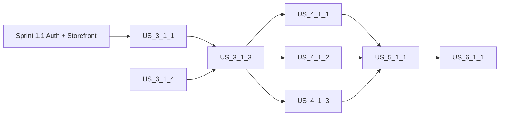

# Sprint 1.2 — Cart + Checkout + Payments + Fulfillment

> **Slice**: v1.0 · **Duration**: Weeks 3–4 · **Story Points**: 38

## Goal

Complete the purchasing flow: offline cart, multi-step checkout, all payment methods (Prepaid, Full COD, Deposit COD), Bosta domestic fulfillment, and order tracking. By sprint end, a customer can complete a full purchase.

## User Stories

| Priority | Story | Module | Points | Description |
|:---------|:------|:-------|:-------|:------------|
| P0 | [US-3.1.1](../user-stories/03-cart-and-checkout/us-3.1.1-offline-first-cart-with-watermelondb-sync.md) | Cart | 5 | Offline-first cart with WatermelonDB |
| P0 | [US-3.1.3](../user-stories/03-cart-and-checkout/us-3.1.3-multi-step-checkout-flow.md) | Checkout | 8 | Multi-step checkout flow |
| P0 | [US-4.1.1](../user-stories/04-payments-and-cod/us-4.1.1-full-prepaid-online-payment-paymob-stripe.md) | Payments | 5 | Full prepaid (Paymob & Stripe) |
| P0 | [US-4.1.2](../user-stories/04-payments-and-cod/us-4.1.2-full-cash-on-delivery-100-cod.md) | Payments | 3 | Full Cash on Delivery (100% COD) |
| P0 | [US-4.1.3](../user-stories/04-payments-and-cod/us-4.1.3-upfront-deposit-split-cash-on-delivery-deposit-cod.md) | Payments | 5 | Deposit + Split COD |
| P1 | [US-5.1.1](../user-stories/05-fulfillment-and-shipping/us-5.1.1-domestic-shipping-via-bosta-with-cod-collection.md) | Fulfillment | 5 | Bosta domestic shipping |
| P1 | [US-6.1.1](../user-stories/06-orders-and-returns/us-6.1.1-real-time-order-tracking-live-status-timeline.md) | Orders | 3 | Order tracking timeline |
| P1 | [US-3.1.4](../user-stories/03-cart-and-checkout/us-3.1.4-localized-address-management.md) | Cart | 2 | Localized address management |
| P2 | [US-5.1.4](../user-stories/05-fulfillment-and-shipping/us-5.1.4-localized-sns-push-sms-notifications-at-every-milestone.md) | Fulfillment | 2 | Localized SNS notifications |

## Dependencies

## Key Deliverables

- SplitCodEngine fully operational (FULL_COD, DEPOSIT_COD, PREPAID)
- KMS vault with encrypted gateway credentials
- Bosta AWB auto-booking via fulfillment-worker
- End-to-end checkout test (product → cart → pay → shipped → delivered)

## Definition of Done

- [ ] Full checkout E2E test passes for all 3 payment modes
- [ ] COD surcharge correctly applied per zone
- [ ] Bosta AWB label generated and stored in S3
- [ ] SNS notifications sent in Arabic for ar-EG locale
- [ ] Webhook idempotency verified (duplicate rejection)

## Mandatory Story Validation

- [ ] Every story delivered in this sprint passes [G0–G4](../QUALITY_GATES.md), including its tailored test, security and architecture checks; attach a [story evidence record](../validation/STORY_EVIDENCE_TEMPLATE.md).
- [ ] Resolve relevant [design and dependency blockers](../DOCS_STRESS_TEST.md) before commitment/release. Partial story work remains In Progress; P1/P2 priority does not exempt it from gates.
- [ ] Non-story tasks that change production behavior use the same gates and have an accountable owner and evidence record.
