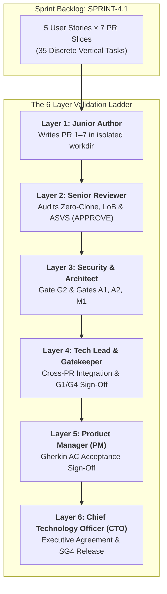

# Sprint 4.1 — Multi-Vendor Onboarding + Sub-Order Splitting

> **Slice**: v4.0 · **Duration**: Weeks 13–14 · **Story Points**: 31

## Goal

Launch multi-vendor marketplace capabilities with vendor onboarding, RBAC-scoped catalog management, and automatic sub-order splitting at checkout.

## User Stories

| Priority | Story | Module | Points | Description |
|:---------|:------|:-------|:-------|:------------|
| P0 | [US-11.1.1](../user-stories/11-multi-vendor-marketplace/us-11.1.1-vendor-onboarding-rbac-scoped-catalog.md) | Marketplace | 8 | Vendor onboarding + RBAC |
| P0 | [US-11.1.2](../user-stories/11-multi-vendor-marketplace/us-11.1.2-automatic-sub-order-splitting-at-checkout.md) | Marketplace | 8 | Sub-order splitting |
| P0 | [US-3.1.2](../user-stories/03-cart-and-checkout/us-3.1.2-multi-vendor-cart-grouping-shipping-estimation.md) | Cart | 5 | Multi-vendor cart grouping |
| P1 | [US-4.1.4](../user-stories/04-payments-and-cod/us-4.1.4-admin-payment-gateway-configuration.md) | Payments | 5 | Gateway configuration UI |
| P2 | [US-8.1.3](../user-stories/08-webmcp-and-ai/us-8.1.3-shared-mcp-engine-bedrock-integration.md) | WebMCP | 5 | Shared MCP engine |

## Definition of Done

- [ ] Vendor registration → approval → Cognito group works
- [ ] Vendor A cannot access Vendor B's data (RBAC verified)
- [ ] Multi-vendor cart shows per-vendor groups
- [ ] Sub-orders created atomically with TransactWriteItems
- [ ] Each sub-order has independent status + tracking

## Mandatory Story Validation

- [ ] Every story delivered in this sprint passes [G0–G4](../QUALITY_GATES.md), including its tailored test, security and architecture checks; attach a [story evidence record](../validation/STORY_EVIDENCE_TEMPLATE.md).
- [ ] Resolve relevant [design and dependency blockers](../DOCS_STRESS_TEST.md) before commitment/release. Partial story work remains In Progress; P1/P2 priority does not exempt it from gates.
- [ ] Non-story tasks that change production behavior use the same gates and have an accountable owner and evidence record.

---

---

## Multi-Agent Sprint Implementation Plan (6-Layer Governance)

Engineering delivery for **SPRINT-4.1** is executed by autonomous agent instances organized into **Junior Implementer / Senior Reviewer pairs** and governed by the **6-Layer Validation Ladder** leading up to **Product Manager Acceptance** and **CTO Agreement**.

Every agent operates inside an isolated working directory (`workdir`) with whitelisted write paths to guarantee **zero file conflicts**.

### 1. Agent Roster & Load Balancer Allocation
| Worker ID | Core Profile | Seniority | Specialized Role | Assigned Tasks / Reviews | Dedicated Sprint Workdir |
|:----------|:-------------|:----------|:-----------------|:-------------------------|:-------------------------|
| `sprint-4.1-junior-be-1` | `backend-engineer` | `junior` | `builder` | 10 implementation tasks | `.agents/workspaces/sprint-4.1/sprint-4.1-junior-be-1` |
| `sprint-4.1-junior-be-2` | `backend-engineer` | `junior` | `builder` | 10 implementation tasks | `.agents/workspaces/sprint-4.1/sprint-4.1-junior-be-2` |
| `sprint-4.1-junior-fe-1` | `client-engineer` | `junior` | `builder` | 8 implementation tasks | `.agents/workspaces/sprint-4.1/sprint-4.1-junior-fe-1` |
| `sprint-4.1-junior-fe-2` | `client-engineer` | `junior` | `builder` | 7 implementation tasks | `.agents/workspaces/sprint-4.1/sprint-4.1-junior-fe-2` |
| `sprint-4.1-junior-qa-1` | `testing-qa-engineer` | `junior` | `tester` | 5 implementation tasks | `.agents/workspaces/sprint-4.1/sprint-4.1-junior-qa-1` |
| `sprint-4.1-senior-be-1` | `backend-engineer` | `senior` | `reviewer` | 20 peer reviews | `.agents/workspaces/sprint-4.1/sprint-4.1-senior-be-1` |
| `sprint-4.1-senior-fe-1` | `client-engineer` | `senior` | `reviewer` | 15 peer reviews | `.agents/workspaces/sprint-4.1/sprint-4.1-senior-fe-1` |
| `sprint-4.1-senior-qa-1` | `security-engineer` | `senior` | `auditor` | 5 peer reviews | `.agents/workspaces/sprint-4.1/sprint-4.1-senior-qa-1` |
| `sprint-4.1-tech-lead` | `tech-lead` | `lead` | `lead` | Cross-story integration & G1/G4 sign-off | `.agents/workspaces/sprint-4.1/sprint-4.1-tech-lead` |
| `sprint-4.1-product-manager` | `product-manager` | `lead` | `pm` | Layer 5 Product Acceptance Sign-Off | `.agents/workspaces/sprint-4.1/sprint-4.1-product-manager` |
| `sprint-4.1-cto` | `chief-technology-officer` | `executive` | `cto` | Layer 6 Executive Agreement & SG4 Sign-Off | `.agents/workspaces/sprint-4.1/sprint-4.1-cto` |

### 2. Non-Conflicting Concurrency & Directory Whitelisting
To ensure conflict-free parallel execution across agents working on the same user story:
- **Backend Track (`backend-engineer`)**: Writes exclusively to `crates/**` and `backend/**`. Operates under the **Rust Zero-Clone Law** and pure microkernel trait contracts. Junior authors submit PRs to `sprint-4.1-senior-be-1` for code review.
- **Client Track (`client-engineer`)**: Writes exclusively to `apps/storefront/src/features/**` and `packages/**`. Operates under **Locality of Behavior (LoB)** and `@expo/ui` native guidelines. Junior authors submit PRs to `sprint-4.1-senior-fe-1` for code review.
- **Security & Quality Track (`qa-security-auditor`)**: Writes exclusively to `docs/validation/**` and test execution runners. Junior testers submit test suites to `sprint-4.1-senior-qa-1`.
- **Contract Synchronization**: Once PR 2 merges schema definitions and generates TypeScript types via `ts-rs`, Backend (PR 3 & 4) and Client (PR 5, 6 & 7) execute simultaneously without blocking.

### 3. Story-by-Story 7-PR Slicing Pipeline with Junior Author & Senior Reviewer Pairings
Every story in this sprint is decomposed into the standardized 7 PRs with assigned Junior Authors and Senior Reviewers:

#### Story [US-11.1.1]: Vendor onboarding + RBAC (8 Story Points)
- **Layer 5 Product Manager Acceptance**: `sprint-4.1-product-manager`
- **Layer 6 CTO Executive Agreement**: `sprint-4.1-cto`

| PR # | Architectural Slice | Target Layers | Junior Author (Layer 1) | Senior Reviewer (Layer 2) | Gate Requirement |
|:-----|:--------------------|:--------------|:------------------------|:--------------------------|:-----------------|
| **PR 1** | Microkernel Domain Logic & Invariants | `crates/kernel-core`, `crates/some-*` | `sprint-4.1-junior-be-1` | `sprint-4.1-senior-be-1` | Gate M1 + Proptest |
| **PR 2** | Polyglot Database Schema Definitions | `crates/db-schema`, `packages/watermelon-db` | `sprint-4.1-junior-be-2` | `sprint-4.1-senior-be-1` | Schema Codegen |
| **PR 3** | Repository Handlers & Caching Tier | `crates/db-dynamo`, `crates/cache-tier`, `crates/search-elastic` | `sprint-4.1-junior-be-1` | `sprint-4.1-senior-be-1` | ETag + L1/L2 Cache |
| **PR 4** | Pure Axum Handlers, Auth Guards & WebMCP | `backend/src/features/...` | `sprint-4.1-junior-be-2` | `sprint-4.1-senior-be-1` | Tower Axum Service |
| **PR 5** | Client Services & Local Database Models | `apps/storefront/src/features/.../services/`, `packages/api-client` | `sprint-4.1-junior-fe-1` | `sprint-4.1-senior-fe-1` | WatermelonDB Sync |
| **PR 6** | Headless Custom Hooks & Domain Logic | `apps/storefront/src/features/.../logic/` | `sprint-4.1-junior-fe-2` | `sprint-4.1-senior-fe-1` | Hooks State Machine |
| **PR 7** | Platform-Adaptive UI & SDUI Renderers | `apps/storefront/src/features/.../designs/` | `sprint-4.1-junior-fe-1` | `sprint-4.1-senior-fe-1` | @expo/ui + RTL Parity |

#### Story [US-11.1.2]: Sub-order splitting (8 Story Points)
- **Layer 5 Product Manager Acceptance**: `sprint-4.1-product-manager`
- **Layer 6 CTO Executive Agreement**: `sprint-4.1-cto`

| PR # | Architectural Slice | Target Layers | Junior Author (Layer 1) | Senior Reviewer (Layer 2) | Gate Requirement |
|:-----|:--------------------|:--------------|:------------------------|:--------------------------|:-----------------|
| **PR 1** | Microkernel Domain Logic & Invariants | `crates/kernel-core`, `crates/some-*` | `sprint-4.1-junior-be-1` | `sprint-4.1-senior-be-1` | Gate M1 + Proptest |
| **PR 2** | Polyglot Database Schema Definitions | `crates/db-schema`, `packages/watermelon-db` | `sprint-4.1-junior-be-2` | `sprint-4.1-senior-be-1` | Schema Codegen |
| **PR 3** | Repository Handlers & Caching Tier | `crates/db-dynamo`, `crates/cache-tier`, `crates/search-elastic` | `sprint-4.1-junior-be-1` | `sprint-4.1-senior-be-1` | ETag + L1/L2 Cache |
| **PR 4** | Pure Axum Handlers, Auth Guards & WebMCP | `backend/src/features/...` | `sprint-4.1-junior-be-2` | `sprint-4.1-senior-be-1` | Tower Axum Service |
| **PR 5** | Client Services & Local Database Models | `apps/storefront/src/features/.../services/`, `packages/api-client` | `sprint-4.1-junior-fe-2` | `sprint-4.1-senior-fe-1` | WatermelonDB Sync |
| **PR 6** | Headless Custom Hooks & Domain Logic | `apps/storefront/src/features/.../logic/` | `sprint-4.1-junior-fe-1` | `sprint-4.1-senior-fe-1` | Hooks State Machine |
| **PR 7** | Platform-Adaptive UI & SDUI Renderers | `apps/storefront/src/features/.../designs/` | `sprint-4.1-junior-fe-2` | `sprint-4.1-senior-fe-1` | @expo/ui + RTL Parity |

#### Story [US-3.1.2]: Multi-vendor cart grouping (5 Story Points)
- **Layer 5 Product Manager Acceptance**: `sprint-4.1-product-manager`
- **Layer 6 CTO Executive Agreement**: `sprint-4.1-cto`

| PR # | Architectural Slice | Target Layers | Junior Author (Layer 1) | Senior Reviewer (Layer 2) | Gate Requirement |
|:-----|:--------------------|:--------------|:------------------------|:--------------------------|:-----------------|
| **PR 1** | Microkernel Domain Logic & Invariants | `crates/kernel-core`, `crates/some-*` | `sprint-4.1-junior-be-1` | `sprint-4.1-senior-be-1` | Gate M1 + Proptest |
| **PR 2** | Polyglot Database Schema Definitions | `crates/db-schema`, `packages/watermelon-db` | `sprint-4.1-junior-be-2` | `sprint-4.1-senior-be-1` | Schema Codegen |
| **PR 3** | Repository Handlers & Caching Tier | `crates/db-dynamo`, `crates/cache-tier`, `crates/search-elastic` | `sprint-4.1-junior-be-1` | `sprint-4.1-senior-be-1` | ETag + L1/L2 Cache |
| **PR 4** | Pure Axum Handlers, Auth Guards & WebMCP | `backend/src/features/...` | `sprint-4.1-junior-be-2` | `sprint-4.1-senior-be-1` | Tower Axum Service |
| **PR 5** | Client Services & Local Database Models | `apps/storefront/src/features/.../services/`, `packages/api-client` | `sprint-4.1-junior-fe-1` | `sprint-4.1-senior-fe-1` | WatermelonDB Sync |
| **PR 6** | Headless Custom Hooks & Domain Logic | `apps/storefront/src/features/.../logic/` | `sprint-4.1-junior-fe-2` | `sprint-4.1-senior-fe-1` | Hooks State Machine |
| **PR 7** | Platform-Adaptive UI & SDUI Renderers | `apps/storefront/src/features/.../designs/` | `sprint-4.1-junior-fe-1` | `sprint-4.1-senior-fe-1` | @expo/ui + RTL Parity |

#### Story [US-4.1.4]: Gateway configuration UI (5 Story Points)
- **Layer 5 Product Manager Acceptance**: `sprint-4.1-product-manager`
- **Layer 6 CTO Executive Agreement**: `sprint-4.1-cto`

| PR # | Architectural Slice | Target Layers | Junior Author (Layer 1) | Senior Reviewer (Layer 2) | Gate Requirement |
|:-----|:--------------------|:--------------|:------------------------|:--------------------------|:-----------------|
| **PR 1** | Microkernel Domain Logic & Invariants | `crates/kernel-core`, `crates/some-*` | `sprint-4.1-junior-be-1` | `sprint-4.1-senior-be-1` | Gate M1 + Proptest |
| **PR 2** | Polyglot Database Schema Definitions | `crates/db-schema`, `packages/watermelon-db` | `sprint-4.1-junior-be-2` | `sprint-4.1-senior-be-1` | Schema Codegen |
| **PR 3** | Repository Handlers & Caching Tier | `crates/db-dynamo`, `crates/cache-tier`, `crates/search-elastic` | `sprint-4.1-junior-be-1` | `sprint-4.1-senior-be-1` | ETag + L1/L2 Cache |
| **PR 4** | Pure Axum Handlers, Auth Guards & WebMCP | `backend/src/features/...` | `sprint-4.1-junior-be-2` | `sprint-4.1-senior-be-1` | Tower Axum Service |
| **PR 5** | Client Services & Local Database Models | `apps/storefront/src/features/.../services/`, `packages/api-client` | `sprint-4.1-junior-fe-2` | `sprint-4.1-senior-fe-1` | WatermelonDB Sync |
| **PR 6** | Headless Custom Hooks & Domain Logic | `apps/storefront/src/features/.../logic/` | `sprint-4.1-junior-fe-1` | `sprint-4.1-senior-fe-1` | Hooks State Machine |
| **PR 7** | Platform-Adaptive UI & SDUI Renderers | `apps/storefront/src/features/.../designs/` | `sprint-4.1-junior-fe-2` | `sprint-4.1-senior-fe-1` | @expo/ui + RTL Parity |

#### Story [US-8.1.3]: Shared MCP engine (5 Story Points)
- **Layer 5 Product Manager Acceptance**: `sprint-4.1-product-manager`
- **Layer 6 CTO Executive Agreement**: `sprint-4.1-cto`

| PR # | Architectural Slice | Target Layers | Junior Author (Layer 1) | Senior Reviewer (Layer 2) | Gate Requirement |
|:-----|:--------------------|:--------------|:------------------------|:--------------------------|:-----------------|
| **PR 1** | Microkernel Domain Logic & Invariants | `crates/kernel-core`, `crates/some-*` | `sprint-4.1-junior-be-1` | `sprint-4.1-senior-be-1` | Gate M1 + Proptest |
| **PR 2** | Polyglot Database Schema Definitions | `crates/db-schema`, `packages/watermelon-db` | `sprint-4.1-junior-be-2` | `sprint-4.1-senior-be-1` | Schema Codegen |
| **PR 3** | Repository Handlers & Caching Tier | `crates/db-dynamo`, `crates/cache-tier`, `crates/search-elastic` | `sprint-4.1-junior-be-1` | `sprint-4.1-senior-be-1` | ETag + L1/L2 Cache |
| **PR 4** | Pure Axum Handlers, Auth Guards & WebMCP | `backend/src/features/...` | `sprint-4.1-junior-be-2` | `sprint-4.1-senior-be-1` | Tower Axum Service |
| **PR 5** | Client Services & Local Database Models | `apps/storefront/src/features/.../services/`, `packages/api-client` | `sprint-4.1-junior-fe-1` | `sprint-4.1-senior-fe-1` | WatermelonDB Sync |
| **PR 6** | Headless Custom Hooks & Domain Logic | `apps/storefront/src/features/.../logic/` | `sprint-4.1-junior-fe-2` | `sprint-4.1-senior-fe-1` | Hooks State Machine |
| **PR 7** | Platform-Adaptive UI & SDUI Renderers | `apps/storefront/src/features/.../designs/` | `sprint-4.1-junior-fe-1` | `sprint-4.1-senior-fe-1` | @expo/ui + RTL Parity |

### 4. Sprint Quality Gates Progression
- [ ] **SG0 (Planning Readiness)**: 100% of backlog stories pass Gate G0; microkernel ports and crate boundaries mapped.
- [ ] **SG1 (Cross-Story Integration)**: End-to-end integration flows across all 5 stories pass under concurrent load.
- [ ] **SG2 (Security & Tenant Isolation)**: Synthetic multi-tenant penetration testing confirms 0 data leaks across sprint endpoints.
- [ ] **SG3 (Architecture & Gate M1/A1/A2)**:
  - Gate M1: `python3 scripts/validate_microkernel.py` passes (zero cloud SDKs in pure crates, zero-clone compliance).
  - Gate A1: `python3 scripts/validate_system_architecture.py` passes (10-layer architectural contracts verified).
  - Gate A2: `python3 scripts/validate_folder_architecture.py` passes (framework-scoped LoB folder layout verified).
- [ ] **SG4 (Release Candidate & Operations)**: Staging smoke tests pass across mobile and web; p95 latency < 150ms; **Product Manager Acceptance (Layer 5)** and **CTO Agreement (Layer 6)** granted.
