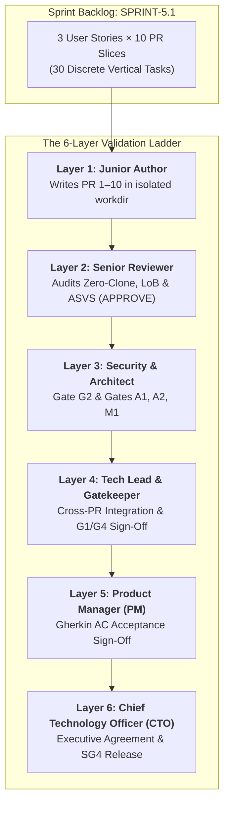

# Sprint 5.1 — CDK Packaging + AWS Marketplace + Metering

> **Slice**: v5.0 · **Duration**: Weeks 17–18 · **Story Points**: 34

## Goal

Package the entire platform as a deployable CDK application, pass the AWS FTR audit, list on AWS Marketplace, and implement SaaS usage metering.

## User Stories

| Priority | Story | Module | Points | Description |
|:---------|:------|:-------|:-------|:------------|
| P0 | [US-13.1.1](../user-stories/13-deployment-and-aws-marketplace/us-13.1.1-cdk-infrastructure-stack-packaging.md) | Deployment | 13 | CDK stack packaging |
| P0 | [US-13.1.2](../user-stories/13-deployment-and-aws-marketplace/us-13.1.2-aws-marketplace-listing-ftr-compliance.md) | Deployment | 13 | FTR compliance + listing |
| P0 | [US-13.1.3](../user-stories/13-deployment-and-aws-marketplace/us-13.1.3-saas-metering-usage-based-billing.md) | Deployment | 8 | SaaS metering |

## Key Deliverables

- Single `cdk deploy --all` deploys entire platform
- FTR self-assessment passes all checks
- Quick Start CloudFormation template published
- Hourly metering reports to AWS Marketplace
- Free / Standard / Enterprise pricing tiers configured

## Definition of Done

- [ ] `cdk deploy` works in clean AWS account
- [ ] `cdk destroy` cleanly removes all resources
- [ ] FTR checklist 100% compliant
- [ ] Metering data appears in AWS Marketplace console
- [ ] Free tier limits enforced correctly

## Mandatory Story Validation

- [ ] Every story delivered in this sprint passes [G0–G4](../QUALITY_GATES.md), including its tailored test, security and architecture checks; attach a [story evidence record](../validation/STORY_EVIDENCE_TEMPLATE.md).
- [ ] Resolve relevant [design and dependency blockers](../DOCS_STRESS_TEST.md) before commitment/release. Partial story work remains In Progress; P1/P2 priority does not exempt it from gates.
- [ ] Non-story tasks that change production behavior use the same gates and have an accountable owner and evidence record.

---

## Multi-Agent Sprint Implementation Plan (6-Layer Governance)

### Company planning → role execution → upward validation

**Status: allocation proposal, not dispatch authorization.** Leadership planning precedes the junior roster; the L1–L6 ladder below is the upward review path. Approve P0–P4 and the company master-plan revision before implementation.

| Stage | Accountable role | Required output |
|:------|:-----------------|:----------------|
| P0 | `chief-technology-officer` | Authorized initiative charter, constraints and success criteria |
| P1 | `product-manager` | Spec Kit requirements, personas, scope and acceptance criteria |
| P2 | `system-architect` | Shared contracts and affected specialist role subplans |
| P3 | `tech-lead` | Reconciled master plan, child manifest, task DAG and review/test capacity |
| P4 | `planning-control-owners-and-cto` | Approved plan baseline and G0/SG0 inputs before implementation |
| EXECUTE | `assigned-role-contributors-and-seniors` | Parallel approved tasks, independent branch reviews and bounded repairs |
| COLLECT | `tech-lead` | Every expected child output and canonical story record reconciled on one candidate |
| VALIDATE | `qa-security-architecture` | Integrated candidate plus E1-E5 sprint evidence and complete action history |
| ACCEPT | `product-manager` | Original charter/AC-to-delivery acceptance dossier |
| RETURN | `chief-technology-officer` | Final Accepted, Changes Required or Blocked decision |

Use the [company plan template](../../.specify/templates/company-plan-template.md). Every task references its master-plan parent and canonical `docs/validation/story-records/US-<id>.md`; log each action/result and next-role receipt there. Collect all expected children, verify the exact assembled candidate and closeout suites, then return product acceptance and the full dossier to CTO. Missing children, action history or required checks block parent acceptance.

Engineering delivery for **SPRINT-5.1** is executed by autonomous agent instances organized into **Junior Implementer / Senior Reviewer pairs** and governed by the **6-Layer Validation Ladder** leading up to **Product Manager Acceptance** and **CTO Agreement**.

Every agent operates inside an isolated working directory (`workdir`) with whitelisted write paths to guarantee **zero file conflicts**.

### 1. Agent Roster & Load Balancer Allocation
| Worker ID | Core Profile | Seniority | Specialized Role | Assigned Tasks / Reviews | Dedicated Sprint Workdir |
|:----------|:-------------|:----------|:-----------------|:-------------------------|:-------------------------|
| `sprint-5.1-junior-be-1` | `backend-engineer` | `junior` | `builder` | 9 implementation tasks | `.agents/workspaces/sprint-5.1/sprint-5.1-junior-be-1` |
| `sprint-5.1-junior-be-2` | `backend-engineer` | `junior` | `builder` | 9 implementation tasks | `.agents/workspaces/sprint-5.1/sprint-5.1-junior-be-2` |
| `sprint-5.1-junior-fe-1` | `client-engineer` | `junior` | `builder` | 6 implementation tasks | `.agents/workspaces/sprint-5.1/sprint-5.1-junior-fe-1` |
| `sprint-5.1-junior-fe-2` | `client-engineer` | `junior` | `builder` | 6 implementation tasks | `.agents/workspaces/sprint-5.1/sprint-5.1-junior-fe-2` |
| `sprint-5.1-junior-qa-1` | `testing-qa-engineer` | `junior` | `tester` | 3 implementation tasks | `.agents/workspaces/sprint-5.1/sprint-5.1-junior-qa-1` |
| `sprint-5.1-senior-be-1` | `backend-engineer` | `senior` | `reviewer` | 18 peer reviews | `.agents/workspaces/sprint-5.1/sprint-5.1-senior-be-1` |
| `sprint-5.1-senior-fe-1` | `client-engineer` | `senior` | `reviewer` | 12 peer reviews | `.agents/workspaces/sprint-5.1/sprint-5.1-senior-fe-1` |
| `sprint-5.1-senior-qa-1` | `security-engineer` | `senior` | `auditor` | 3 peer reviews | `.agents/workspaces/sprint-5.1/sprint-5.1-senior-qa-1` |
| `sprint-5.1-tech-lead` | `tech-lead` | `lead` | `lead` | Cross-story integration & G1/G4 sign-off | `.agents/workspaces/sprint-5.1/sprint-5.1-tech-lead` |
| `sprint-5.1-product-manager` | `product-manager` | `lead` | `pm` | Layer 5 Product Acceptance Sign-Off | `.agents/workspaces/sprint-5.1/sprint-5.1-product-manager` |
| `sprint-5.1-cto` | `chief-technology-officer` | `executive` | `cto` | Layer 6 Executive Agreement & SG4 Sign-Off | `.agents/workspaces/sprint-5.1/sprint-5.1-cto` |

### 2. Non-Conflicting Concurrency & Directory Whitelisting
To ensure conflict-free parallel execution across agents working on the same user story:
- **Backend Track (`backend-engineer`)**: Writes exclusively to `crates/**` and `backend/**`. Operates under the **Rust Zero-Clone Law** and pure microkernel trait contracts. Junior authors submit PRs to `sprint-5.1-senior-be-1` for code review.
- **Client Track (`client-engineer`)**: Writes exclusively to `apps/storefront/src/features/**` and `packages/**`. Operates under **Locality of Behavior (LoB)** and `@expo/ui` native guidelines. Junior authors submit PRs to `sprint-5.1-senior-fe-1` for code review.
- **Security & Quality Track (`qa-security-auditor`)**: Writes exclusively to `docs/validation/**` and test execution runners. Junior testers submit test suites to `sprint-5.1-senior-qa-1`.
- **Contract Synchronization**: Once PR 2 merges schema definitions and generates TypeScript types via `ts-rs`, Backend (PR 3–6) and Client (PR 7–10) execute simultaneously without blocking.

### 3. Story-by-Story 10-PR Slicing Pipeline with Junior Author & Senior Reviewer Pairings
Every story in this sprint is decomposed into the standardized 10 PRs (aligned with the 10-Pillar System Architecture) with assigned Junior Authors and Senior Reviewers:

#### Story [US-13.1.1]: CDK stack packaging (13 Story Points)
- **Layer 5 Product Manager Acceptance**: `sprint-5.1-product-manager`
- **Layer 6 CTO Executive Agreement**: `sprint-5.1-cto`

| PR # | Architectural Slice | Target Layers | Junior Author (Layer 1) | Senior Reviewer (Layer 2) | Gate Requirement |
|:-----|:--------------------|:--------------|:------------------------|:--------------------------|:-----------------|
| **PR 1** | Pillar 1: Microkernel Domain Logic & Plugin Ports | `crates/kernel-core`, `crates/plugins-*` | `sprint-5.1-junior-be-1` | `sprint-5.1-senior-be-1` | Gate M1 + Proptest (Pillar 1) |
| **PR 2** | Pillar 2: Polyglot Database Schema Definitions | `crates/db-schema`, `packages/watermelon-db` | `sprint-5.1-junior-be-2` | `sprint-5.1-senior-be-1` | Polyglot Schema Codegen (Pillar 2) |
| **PR 3** | Pillar 3: Repository Adapters & Infrastructure Connectors | `crates/db-dynamo`, `crates/search-elastic`, `crates/notify-sns`, `crates/kms-vault` | `sprint-5.1-junior-be-1` | `sprint-5.1-senior-be-1` | Repository & TransactWrite (Pillar 3) |
| **PR 4** | Pillar 4: Distributed L2 Cache & Invalidation Engine | `crates/cache-tier` | `sprint-5.1-junior-be-2` | `sprint-5.1-senior-be-1` | Redis L2 + Invalidation (Pillar 4) |
| **PR 5** | Pillar 5: In-Process L1 Moka Cache & Request Coalescing | `crates/cache-tier` | `sprint-5.1-junior-be-1` | `sprint-5.1-senior-be-1` | Moka L1 TinyLFU + Coalescing (Pillar 5) |
| **PR 6** | Pillar 6: HTTP ETag Protocol & Pure Axum Handlers | `backend/src/features/...`, `bins/*` | `sprint-5.1-junior-be-2` | `sprint-5.1-senior-be-1` | BLAKE3 ETag + Pure Axum (Pillar 6) |
| **PR 7** | Pillar 7: Frontend Server-State Caching (TanStack Query) | `packages/query-client`, `packages/api-client` | `sprint-5.1-junior-fe-1` | `sprint-5.1-senior-fe-1` | TanStack Query + ETag Client (Pillar 7) |
| **PR 8** | Pillar 8: Client-First Local Database (WatermelonDB Sync) | `packages/watermelon-db`, `apps/storefront/src/features/.../services/` | `sprint-5.1-junior-fe-2` | `sprint-5.1-senior-fe-1` | WatermelonDB Delta Sync (Pillar 8) |
| **PR 9** | Pillar 9: Headless Custom Hooks & Logic Abstraction | `packages/domain-hooks`, `apps/storefront/src/features/.../logic/` | `sprint-5.1-junior-fe-1` | `sprint-5.1-senior-fe-1` | Headless Hooks State Machine (Pillar 9) |
| **PR 10** | Pillar 10: Platform-Adaptive UI Design & Native Modules | `apps/storefront/src/features/.../designs/`, `packages/ui-primitives`, `modules/expo-*` | `sprint-5.1-junior-fe-2` | `sprint-5.1-senior-fe-1` | @expo/ui Native + RTL Parity (Pillar 10) |

#### Story [US-13.1.2]: FTR compliance + listing (13 Story Points)
- **Layer 5 Product Manager Acceptance**: `sprint-5.1-product-manager`
- **Layer 6 CTO Executive Agreement**: `sprint-5.1-cto`

| PR # | Architectural Slice | Target Layers | Junior Author (Layer 1) | Senior Reviewer (Layer 2) | Gate Requirement |
|:-----|:--------------------|:--------------|:------------------------|:--------------------------|:-----------------|
| **PR 1** | Pillar 1: Microkernel Domain Logic & Plugin Ports | `crates/kernel-core`, `crates/plugins-*` | `sprint-5.1-junior-be-1` | `sprint-5.1-senior-be-1` | Gate M1 + Proptest (Pillar 1) |
| **PR 2** | Pillar 2: Polyglot Database Schema Definitions | `crates/db-schema`, `packages/watermelon-db` | `sprint-5.1-junior-be-2` | `sprint-5.1-senior-be-1` | Polyglot Schema Codegen (Pillar 2) |
| **PR 3** | Pillar 3: Repository Adapters & Infrastructure Connectors | `crates/db-dynamo`, `crates/search-elastic`, `crates/notify-sns`, `crates/kms-vault` | `sprint-5.1-junior-be-1` | `sprint-5.1-senior-be-1` | Repository & TransactWrite (Pillar 3) |
| **PR 4** | Pillar 4: Distributed L2 Cache & Invalidation Engine | `crates/cache-tier` | `sprint-5.1-junior-be-2` | `sprint-5.1-senior-be-1` | Redis L2 + Invalidation (Pillar 4) |
| **PR 5** | Pillar 5: In-Process L1 Moka Cache & Request Coalescing | `crates/cache-tier` | `sprint-5.1-junior-be-1` | `sprint-5.1-senior-be-1` | Moka L1 TinyLFU + Coalescing (Pillar 5) |
| **PR 6** | Pillar 6: HTTP ETag Protocol & Pure Axum Handlers | `backend/src/features/...`, `bins/*` | `sprint-5.1-junior-be-2` | `sprint-5.1-senior-be-1` | BLAKE3 ETag + Pure Axum (Pillar 6) |
| **PR 7** | Pillar 7: Frontend Server-State Caching (TanStack Query) | `packages/query-client`, `packages/api-client` | `sprint-5.1-junior-fe-1` | `sprint-5.1-senior-fe-1` | TanStack Query + ETag Client (Pillar 7) |
| **PR 8** | Pillar 8: Client-First Local Database (WatermelonDB Sync) | `packages/watermelon-db`, `apps/storefront/src/features/.../services/` | `sprint-5.1-junior-fe-2` | `sprint-5.1-senior-fe-1` | WatermelonDB Delta Sync (Pillar 8) |
| **PR 9** | Pillar 9: Headless Custom Hooks & Logic Abstraction | `packages/domain-hooks`, `apps/storefront/src/features/.../logic/` | `sprint-5.1-junior-fe-1` | `sprint-5.1-senior-fe-1` | Headless Hooks State Machine (Pillar 9) |
| **PR 10** | Pillar 10: Platform-Adaptive UI Design & Native Modules | `apps/storefront/src/features/.../designs/`, `packages/ui-primitives`, `modules/expo-*` | `sprint-5.1-junior-fe-2` | `sprint-5.1-senior-fe-1` | @expo/ui Native + RTL Parity (Pillar 10) |

#### Story [US-13.1.3]: SaaS metering (8 Story Points)
- **Layer 5 Product Manager Acceptance**: `sprint-5.1-product-manager`
- **Layer 6 CTO Executive Agreement**: `sprint-5.1-cto`

| PR # | Architectural Slice | Target Layers | Junior Author (Layer 1) | Senior Reviewer (Layer 2) | Gate Requirement |
|:-----|:--------------------|:--------------|:------------------------|:--------------------------|:-----------------|
| **PR 1** | Pillar 1: Microkernel Domain Logic & Plugin Ports | `crates/kernel-core`, `crates/plugins-*` | `sprint-5.1-junior-be-1` | `sprint-5.1-senior-be-1` | Gate M1 + Proptest (Pillar 1) |
| **PR 2** | Pillar 2: Polyglot Database Schema Definitions | `crates/db-schema`, `packages/watermelon-db` | `sprint-5.1-junior-be-2` | `sprint-5.1-senior-be-1` | Polyglot Schema Codegen (Pillar 2) |
| **PR 3** | Pillar 3: Repository Adapters & Infrastructure Connectors | `crates/db-dynamo`, `crates/search-elastic`, `crates/notify-sns`, `crates/kms-vault` | `sprint-5.1-junior-be-1` | `sprint-5.1-senior-be-1` | Repository & TransactWrite (Pillar 3) |
| **PR 4** | Pillar 4: Distributed L2 Cache & Invalidation Engine | `crates/cache-tier` | `sprint-5.1-junior-be-2` | `sprint-5.1-senior-be-1` | Redis L2 + Invalidation (Pillar 4) |
| **PR 5** | Pillar 5: In-Process L1 Moka Cache & Request Coalescing | `crates/cache-tier` | `sprint-5.1-junior-be-1` | `sprint-5.1-senior-be-1` | Moka L1 TinyLFU + Coalescing (Pillar 5) |
| **PR 6** | Pillar 6: HTTP ETag Protocol & Pure Axum Handlers | `backend/src/features/...`, `bins/*` | `sprint-5.1-junior-be-2` | `sprint-5.1-senior-be-1` | BLAKE3 ETag + Pure Axum (Pillar 6) |
| **PR 7** | Pillar 7: Frontend Server-State Caching (TanStack Query) | `packages/query-client`, `packages/api-client` | `sprint-5.1-junior-fe-1` | `sprint-5.1-senior-fe-1` | TanStack Query + ETag Client (Pillar 7) |
| **PR 8** | Pillar 8: Client-First Local Database (WatermelonDB Sync) | `packages/watermelon-db`, `apps/storefront/src/features/.../services/` | `sprint-5.1-junior-fe-2` | `sprint-5.1-senior-fe-1` | WatermelonDB Delta Sync (Pillar 8) |
| **PR 9** | Pillar 9: Headless Custom Hooks & Logic Abstraction | `packages/domain-hooks`, `apps/storefront/src/features/.../logic/` | `sprint-5.1-junior-fe-1` | `sprint-5.1-senior-fe-1` | Headless Hooks State Machine (Pillar 9) |
| **PR 10** | Pillar 10: Platform-Adaptive UI Design & Native Modules | `apps/storefront/src/features/.../designs/`, `packages/ui-primitives`, `modules/expo-*` | `sprint-5.1-junior-fe-2` | `sprint-5.1-senior-fe-1` | @expo/ui Native + RTL Parity (Pillar 10) |

### 4. Sprint Quality Gates Progression
- [ ] **SG0 (Planning Readiness)**: 100% of backlog stories pass Gate G0; microkernel ports and crate boundaries mapped.
- [ ] **SG1 (Cross-Story Integration)**: End-to-end integration flows across all 3 stories pass under concurrent load.
- [ ] **SG2 (Security & Tenant Isolation)**: Synthetic multi-tenant penetration testing confirms 0 data leaks across sprint endpoints.
- [ ] **SG3 (Architecture & Gate M1/A1/A2)**:
  - Gate M1: `python3 scripts/validation/validate_microkernel.py` passes (zero cloud SDKs in pure crates, zero-clone compliance).
  - Gate A1: `python3 scripts/validation/validate_system_architecture.py` passes (10-layer architectural contracts verified).
  - Gate A2: `python3 scripts/validation/validate_folder_architecture.py` passes (framework-scoped LoB folder layout verified).
- [ ] **SG4 (Release Candidate & Operations)**: Staging smoke tests pass across mobile and web; p95 latency < 150ms; **Product Manager Acceptance (Layer 5)** and **CTO Agreement (Layer 6)** granted.

## End-of-Sprint Test Gate

**Status: Pending — required closeout evidence, not executed test results.** Run this suite at the end of sprint-5.1, on the exact integration/release candidate, before SG4 and CTO review. Earlier story checks remain mandatory. Follow the [sprint closeout policy](../SPRINT_TESTING.md) and attach the [evidence record](../validation/SPRINT_TEST_EVIDENCE_TEMPLATE.md).

- [ ] **E1 — Benchmark tests:** Infrastructure synthesis, fresh deploy/upgrade/restore duration, usage aggregation and metering batch throughput/cost estimates.
- [ ] **E2 — Integration tests:** Fresh-account deployment → onboarding/subscription → usage → accepted metering records; test partial batch failure, entitlement change, rollback and retained-data restore.
- [ ] **E3 — Fuzz tests:** Deployment context, tenant/subscriber/dimension IDs, usage boundaries, billing batch responses and malformed subscription events.
- [ ] **E4 — Loom concurrency tests:** Rust metering accumulator snapshot/flush/retry coordination; no lost/double-flushed local usage. AWS/IaC and cross-process semantics require deployed or isolated integration evidence.
- [ ] **E5 — Independent closeout review:** QA lead records actual test/target/model counts, candidate and baseline commits, tool/environment versions, performance thresholds/results, corpus/reproducers, Loom bounds/completion and independent reviewer decisions. Missing targets, crashes, regressions, unexplored bounds or unreviewed N/A block acceptance; repairing the candidate invalidates affected results.

At SG0, assign test authors and independent senior QA/security/architecture reviewers; approve workload, benchmark baseline/regression thresholds, fuzz time/memory/input budgets and Loom model bounds. Carry forward affected regression suites. E4 is mandatory for applicable changed or affected Rust shared-state synchronization; only the scope-based N/A procedure in the policy can exclude it, with architecture + QA approval and alternative concurrency evidence. A missing implementation/harness is Pending, never N/A or Pass. Keep this section last, including after sprint-plan regeneration.
