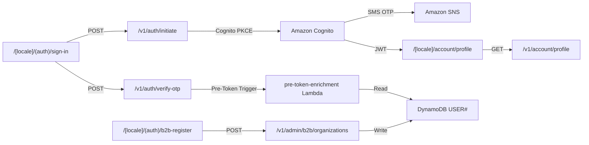
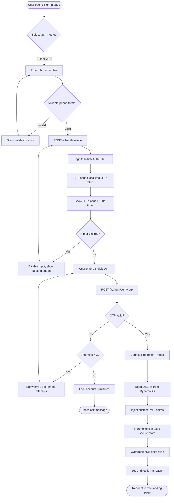
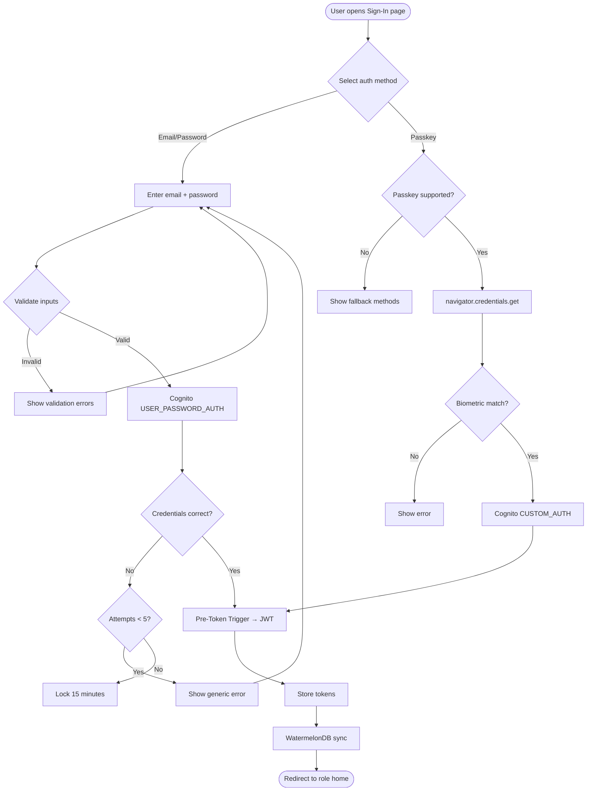
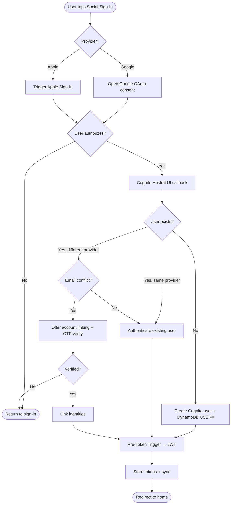
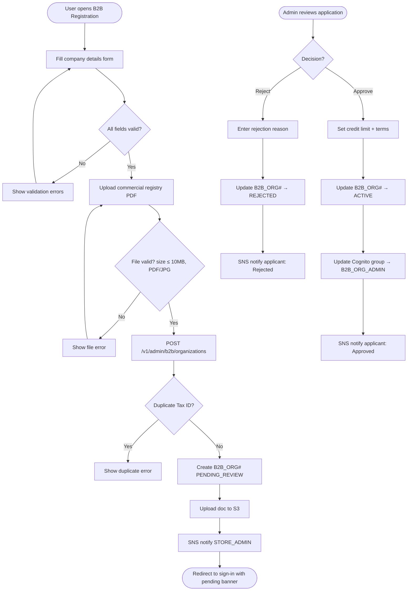

# Module 01: Auth & Onboarding

> **Slice**: v1.0 · **Sprint**: 1.1 · **Stories**: US-1.1.1 – US-1.1.4

## Overview

This module covers all authentication, authorization, and user onboarding flows including passwordless OTP, social OIDC, Passkeys (WebAuthn), B2B organization registration, and JWT enrichment via Cognito Pre-Token Generation Lambda triggers.

## Pages

| Page Route | Access | Direction | Primary Hook |
|:-----------|:-------|:----------|:-------------|
| `/[locale]/(auth)/sign-in` | Public | RTL / LTR | `useCognitoAuth` |
| `/[locale]/(auth)/b2b-register` | Public | RTL / LTR | `useB2BOnboarding` |
| `/[locale]/account/profile` | Authenticated | RTL / LTR | `useCustomerAccount` |

## API Endpoints

| Method | Endpoint | Lambda | Description |
|:-------|:---------|:-------|:------------|
| POST | `/v1/auth/initiate` | `storefront-sdui-api` | Initiate Cognito auth flow (PKCE) |
| POST | `/v1/auth/verify-otp` | `storefront-sdui-api` | Verify OTP challenge |
| POST | `/v1/auth/refresh` | `storefront-sdui-api` | Refresh token rotation |
| POST | `/v1/admin/b2b/organizations` | `admin-vendor-api` | Register B2B organization |
| GET | `/v1/account/profile` | `storefront-sdui-api` | Get authenticated user profile |
| — | Cognito Pre-Token Trigger | `pre-token-enrichment` | Injects custom JWT claims |
| — | Cognito Custom SMS Trigger | `custom-sms-trigger` | Sends localized OTP via SNS |

## Page ↔ Endpoint Flow



---

## US-1.1.1: Phone OTP Passwordless Sign-In

**As a** B2C Customer in Egypt/MENA,  
**I want to** sign in using my phone number via a 6-digit SMS OTP sent through Amazon SNS in my preferred language (Arabic or English),  
**So that** I can access the storefront without remembering a password and receive OTP messages I can understand.

### Acceptance Criteria

```gherkin
Feature: Phone OTP Passwordless Sign-In

  Scenario: Successful OTP sign-in with Egyptian phone number
    Given the user is on "/ar-EG/(auth)/sign-in"
    And the user selects the "Phone OTP" tab
    When the user enters phone number "+201012345678"
    And clicks "Send OTP"
    Then the system initiates a Cognito PKCE auth flow
    And Amazon SNS sends a 6-digit OTP via SMS in Arabic
    And the OTP input field is displayed with a 120-second countdown timer
    When the user enters the correct 6-digit OTP
    Then the system verifies the OTP via Cognito RespondToAuthChallenge
    And receives an enriched JWT with custom claims (tenant_id, persona, pref_locale)
    And the user is redirected to the storefront home "/ar-EG/"
    And the UI renders in RTL direction

  Scenario: OTP expiration
    Given the user requested an OTP for "+201012345678"
    When the 120-second timer expires before entering the OTP
    Then the OTP input is disabled
    And a "Resend OTP" button becomes active
    And a localized message "OTP expired. Please resend." is shown

  Scenario: Invalid OTP entry (3 failed attempts)
    Given the user has entered an incorrect OTP 3 times
    Then the account is temporarily locked for 5 minutes
    And a localized error "Too many attempts. Try again in 5 minutes." is shown
    And the lock state is tracked in Cognito

  Scenario: Unsupported country code
    Given the user enters a phone number with an unsupported country code
    When the user clicks "Send OTP"
    Then a validation error "This country code is not supported" is displayed
    And no Cognito auth flow is initiated

  Scenario: Network failure during OTP verification
    Given the user enters a valid 6-digit OTP
    When the network is unavailable during verification
    Then the system shows "Network error. Please check your connection and try again."
    And the OTP input remains editable for retry
```

### Test Cases

| # | Test Case | Type | Expected Result |
|:--|:----------|:-----|:----------------|
| TC-1.1.1-01 | Valid Egyptian phone (+20) with correct OTP | Happy Path | JWT issued, redirected to home |
| TC-1.1.1-02 | Valid Saudi phone (+966) with correct OTP | Happy Path | JWT issued, locale set to ar-SA |
| TC-1.1.1-03 | OTP entered after 120s expiration | Edge Case | OTP rejected, resend button shown |
| TC-1.1.1-04 | Incorrect OTP entered once | Negative | Error shown, 2 attempts remaining |
| TC-1.1.1-05 | 3 consecutive incorrect OTPs | Security | Account locked 5 minutes |
| TC-1.1.1-06 | Empty phone number submitted | Validation | Client-side validation error |
| TC-1.1.1-07 | Non-numeric characters in phone | Validation | Input rejected by mask |
| TC-1.1.1-08 | SQL injection in phone field | Security | Input sanitized, no auth flow |
| TC-1.1.1-09 | Concurrent OTP requests for same number | Concurrency | Only latest OTP is valid |
| TC-1.1.1-10 | OTP SMS language matches user locale | i18n | Arabic OTP for ar-EG, English for en-US |
| TC-1.1.1-11 | Network failure during SMS send | Error | Retry with exponential backoff |
| TC-1.1.1-12 | Cognito service unavailable | Error | Graceful error page shown |

### Activity Diagram



---

## US-1.1.2: Email/Password & Passkey (WebAuthn) Sign-In

**As a** returning Customer or Admin user,  
**I want to** sign in using my email and password or a registered FIDO2 Passkey (WebAuthn),  
**So that** I have alternative sign-in methods and can use biometric authentication for faster access.

### Acceptance Criteria

```gherkin
Feature: Email/Password & Passkey Sign-In

  Scenario: Successful email/password sign-in
    Given the user is on "/en-US/(auth)/sign-in"
    And the user selects the "Email" tab
    When the user enters email "admin@store.com" and password "SecureP@ss1!"
    And clicks "Sign In"
    Then the system authenticates via Cognito USER_PASSWORD_AUTH
    And the Pre-Token trigger enriches the JWT with STORE_ADMIN role
    And the user is redirected to "/en-US/admin/sdui-studio"

  Scenario: Passkey (WebAuthn) sign-in
    Given the user has previously registered a Passkey on this device
    When the user clicks "Sign in with Passkey"
    Then the browser/device prompts for biometric verification (Face ID / fingerprint)
    And upon successful biometric match, Cognito completes the CUSTOM_AUTH flow
    And the user is signed in without entering any credentials

  Scenario: Passkey registration from profile page
    Given the user is authenticated and on "/[locale]/account/profile"
    When the user clicks "Add Passkey"
    Then a WebAuthn registration ceremony is initiated
    And the new credential is stored in Cognito as an MFA factor
    And the passkey appears in the "Connected Passkeys" list

  Scenario: Incorrect password
    Given the user enters an incorrect password
    Then an error "Invalid email or password" is shown (no hint about which is wrong)
    And 5 consecutive failures trigger a 15-minute lockout

  Scenario: Password does not meet policy
    Given the user attempts to set a password without a special character
    Then a validation error listing all unmet requirements is shown
```

### Test Cases

| # | Test Case | Type | Expected Result |
|:--|:----------|:-----|:----------------|
| TC-1.1.2-01 | Valid email + correct password | Happy Path | JWT issued, role-based redirect |
| TC-1.1.2-02 | Passkey biometric sign-in (Face ID) | Happy Path | Authenticated without typing |
| TC-1.1.2-03 | Incorrect password (1st attempt) | Negative | Generic error shown |
| TC-1.1.2-04 | 5 incorrect passwords | Security | 15-minute account lockout |
| TC-1.1.2-05 | Email not found in Cognito | Negative | Same generic error (no enumeration) |
| TC-1.1.2-06 | Passkey on unsupported device | Edge Case | Passkey tab hidden/disabled |
| TC-1.1.2-07 | Register new Passkey | Happy Path | Passkey added, listed in profile |
| TC-1.1.2-08 | Remove existing Passkey | Happy Path | Passkey removed from list |
| TC-1.1.2-09 | Password with only lowercase chars | Validation | Policy violation error |
| TC-1.1.2-10 | XSS in email field | Security | Input sanitized |

### Activity Diagram



---

## US-1.1.3: Social OIDC Sign-In (Google & Apple)

**As a** new or returning Customer,  
**I want to** sign in with my Google or Apple account using OpenID Connect federation,  
**So that** I can create an account or sign in with one tap without creating new credentials.

### Acceptance Criteria

```gherkin
Feature: Social OIDC Sign-In

  Scenario: First-time Google sign-in (account linking)
    Given the user taps "Continue with Google" on "/ar-EG/(auth)/sign-in"
    When the Google OAuth consent screen appears and the user authorizes
    Then Cognito creates a new user record linked to the Google identity
    And the Pre-Token Trigger creates a USER# record in DynamoDB with persona=B2C_CUSTOMER
    And the user is redirected to "/ar-EG/" with a welcome banner

  Scenario: Returning Apple sign-in
    Given the user previously signed in with Apple
    When the user taps "Continue with Apple"
    Then Face ID/Touch ID prompts for verification
    And the existing Cognito user is authenticated
    And the JWT contains the existing custom claims

  Scenario: Email conflict — Google email matches existing password account
    Given a user with email "user@gmail.com" already exists via email/password
    When the user attempts Google sign-in with the same email
    Then the system offers to link the Google identity to the existing account
    And requires the user to verify ownership via OTP to the existing email

  Scenario: Apple Private Relay email
    Given the user signs in with Apple and opts for "Hide My Email"
    Then the system stores the Apple relay email as the primary identifier
    And all transactional emails are sent to the relay address
```

### Test Cases

| # | Test Case | Type | Expected Result |
|:--|:----------|:-----|:----------------|
| TC-1.1.3-01 | New user via Google OIDC | Happy Path | Account created, JWT issued |
| TC-1.1.3-02 | Returning user via Apple | Happy Path | Existing account authenticated |
| TC-1.1.3-03 | Google user cancels OAuth consent | Edge Case | Return to sign-in, no error |
| TC-1.1.3-04 | Email conflict with existing account | Conflict | Account linking flow offered |
| TC-1.1.3-05 | Apple Private Relay email | Edge Case | Relay email stored correctly |
| TC-1.1.3-06 | Google token expired mid-flow | Error | Graceful retry prompt |
| TC-1.1.3-07 | Social sign-in on Web (popup) | Platform | Popup completes, tokens stored |
| TC-1.1.3-08 | Social sign-in on Mobile (in-app browser) | Platform | Deep link returns tokens |

### Activity Diagram



---

## US-1.1.4: B2B Organization Registration & Admin Approval

**As a** B2B Buyer or Organization Administrator,  
**I want to** register my company by providing a Tax ID, commercial registry document, and requested credit limit,  
**So that** I can apply for wholesale access with tiered pricing, MOQ enforcement, and net-terms invoicing.

### Acceptance Criteria

```gherkin
Feature: B2B Organization Registration

  Scenario: Successful B2B registration submission
    Given the user is on "/en-US/(auth)/b2b-register"
    When the user fills in company name "ACME Corp", Tax ID "12345678", uploads commercial registry PDF
    And submits a credit limit request of "$50,000"
    And clicks "Submit Registration"
    Then a B2B_ORG# record is created in DynamoDB with status PENDING_REVIEW
    And an SNS notification is sent to the STORE_ADMIN
    And the user is redirected to sign-in with a "Pending B2B Review" banner

  Scenario: Admin approves B2B registration
    Given a STORE_ADMIN reviews the pending B2B_ORG# on the admin dashboard
    When the admin clicks "Approve" and sets credit_limit=$40,000 and payment_terms=NET_30
    Then the B2B_ORG# status transitions to ACTIVE
    And the registering user's Cognito group is updated to B2B_ORG_ADMIN
    And an SNS notification informs the applicant of approval

  Scenario: Admin rejects B2B registration
    Given a STORE_ADMIN reviews the pending B2B_ORG#
    When the admin clicks "Reject" with reason "Invalid tax certificate"
    Then the B2B_ORG# status transitions to REJECTED
    And the applicant receives an SNS notification with the rejection reason

  Scenario: Duplicate Tax ID submission
    Given a B2B_ORG# with Tax ID "12345678" already exists
    When another user attempts to register with the same Tax ID
    Then an error "An organization with this Tax ID already exists" is shown

  Scenario: Invalid file upload
    Given the user attempts to upload a commercial registry file > 10MB
    Then a validation error "File size must be under 10MB" is shown
    And the form is not submitted
```

### Test Cases

| # | Test Case | Type | Expected Result |
|:--|:----------|:-----|:----------------|
| TC-1.1.4-01 | Valid B2B registration submission | Happy Path | PENDING_REVIEW record created |
| TC-1.1.4-02 | Admin approves registration | Happy Path | Status → ACTIVE, Cognito group updated |
| TC-1.1.4-03 | Admin rejects registration | Happy Path | Status → REJECTED, notification sent |
| TC-1.1.4-04 | Duplicate Tax ID | Validation | Error shown, no record created |
| TC-1.1.4-05 | File > 10MB upload | Validation | Size error shown |
| TC-1.1.4-06 | Invalid file type (exe) | Security | File type rejected |
| TC-1.1.4-07 | Empty required fields | Validation | All missing fields highlighted |
| TC-1.1.4-08 | Credit limit = 0 | Edge Case | Warning shown, submission allowed |
| TC-1.1.4-09 | SQL injection in company name | Security | Input sanitized |
| TC-1.1.4-10 | Concurrent approval by 2 admins | Concurrency | ETag If-Match prevents double-approval |
| TC-1.1.4-11 | B2B reg with Arabic company name | i18n | RTL name stored in names_i18n |

### Activity Diagram


