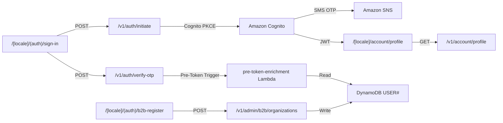

# Module 01: Auth & Onboarding

> **Slice**: v1.0 · **Sprint**: 1.1 · **Stories**: US-1.1.1 – US-1.1.4

## Overview

This module covers all authentication, authorization, and user onboarding flows including passwordless OTP, social OIDC, Passkeys (WebAuthn), B2B organization registration, and JWT enrichment via Cognito Pre-Token Generation Lambda triggers.

## Pages

| Page Route | Access | Direction | Primary Hook |
|:-----------|:-------|:----------|:-------------|
| `/[locale]/(auth)/sign-in` | Public | RTL / LTR | `useCognitoAuth` |
| `/[locale]/(auth)/b2b-register` | Public | RTL / LTR | `useB2BOnboarding` |
| `/[locale]/account/profile` | Authenticated | RTL / LTR | `useCustomerAccount` |

## API Endpoints

| Method | Endpoint | Lambda | Description |
|:-------|:---------|:-------|:------------|
| POST | `/v1/auth/initiate` | `storefront-sdui-api` | Initiate Cognito auth flow (PKCE) |
| POST | `/v1/auth/verify-otp` | `storefront-sdui-api` | Verify OTP challenge |
| POST | `/v1/auth/refresh` | `storefront-sdui-api` | Refresh token rotation |
| POST | `/v1/admin/b2b/organizations` | `admin-vendor-api` | Register B2B organization |
| GET | `/v1/account/profile` | `storefront-sdui-api` | Get authenticated user profile |
| — | Cognito Pre-Token Trigger | `pre-token-enrichment` | Injects custom JWT claims |
| — | Cognito Custom SMS Trigger | `custom-sms-trigger` | Sends localized OTP via SNS |

## Page ↔ Endpoint Flow



---

## User Stories Catalog

This module contains **4 detailed user stories**. Each user story has its own dedicated specification document containing Gherkin acceptance criteria (`Given/When/Then`), comprehensive test matrices (happy path, edge cases, error handling, security, and concurrency), Mermaid activity diagrams, and the 10-PR implementation slice plan (10-Pillar System Architecture).

| Story ID | Title | Target Persona | Sprint | Specification Document |
| :--- | :--- | :--- | :--- | :--- |
| **[US-1.1.1](us-1.1.1-phone-otp-passwordless-sign-in.md)** | Phone OTP Passwordless Sign-In | B2C Customer in Egypt/MENA | Sprint 1.1 | [View Specification →](us-1.1.1-phone-otp-passwordless-sign-in.md) |
| **[US-1.1.2](us-1.1.2-email-password-passkey-webauthn-sign-in.md)** | Email/Password & Passkey (WebAuthn) Sign-In | returning Customer or Admin user | Sprint 1.1 | [View Specification →](us-1.1.2-email-password-passkey-webauthn-sign-in.md) |
| **[US-1.1.3](us-1.1.3-social-oidc-sign-in-google-apple.md)** | Social OIDC Sign-In (Google & Apple) | new or returning Customer | Sprint 1.1 | [View Specification →](us-1.1.3-social-oidc-sign-in-google-apple.md) |
| **[US-1.1.4](us-1.1.4-b2b-organization-registration-admin-approval.md)** | B2B Organization Registration & Admin Approval | B2B Buyer or Organization Administrator | Sprint 1.1 | [View Specification →](us-1.1.4-b2b-organization-registration-admin-approval.md) |

---

## Story Summaries

#### [US-1.1.1: Phone OTP Passwordless Sign-In](us-1.1.1-phone-otp-passwordless-sign-in.md)
- **Target Persona**: B2C Customer in Egypt/MENA
- **Summary**: sign in using my phone number via a 6-digit SMS OTP sent through Amazon SNS in my preferred language (Arabic or English)
- **Specification**: [`us-1.1.1-phone-otp-passwordless-sign-in.md`](us-1.1.1-phone-otp-passwordless-sign-in.md)

#### [US-1.1.2: Email/Password & Passkey (WebAuthn) Sign-In](us-1.1.2-email-password-passkey-webauthn-sign-in.md)
- **Target Persona**: returning Customer or Admin user
- **Summary**: sign in using my email and password or a registered FIDO2 Passkey (WebAuthn)
- **Specification**: [`us-1.1.2-email-password-passkey-webauthn-sign-in.md`](us-1.1.2-email-password-passkey-webauthn-sign-in.md)

#### [US-1.1.3: Social OIDC Sign-In (Google & Apple)](us-1.1.3-social-oidc-sign-in-google-apple.md)
- **Target Persona**: new or returning Customer
- **Summary**: sign in with my Google or Apple account using OpenID Connect federation
- **Specification**: [`us-1.1.3-social-oidc-sign-in-google-apple.md`](us-1.1.3-social-oidc-sign-in-google-apple.md)

#### [US-1.1.4: B2B Organization Registration & Admin Approval](us-1.1.4-b2b-organization-registration-admin-approval.md)
- **Target Persona**: B2B Buyer or Organization Administrator
- **Summary**: register my company by providing a Tax ID
- **Specification**: [`us-1.1.4-b2b-organization-registration-admin-approval.md`](us-1.1.4-b2b-organization-registration-admin-approval.md)


---

## Autonomous Agent Implementation Standard (10-Pillar System Architecture)

Every user story in this module is executed by an autonomous AI agent across the standardized **10-PR vertical slice framework** directly matching the [10-Pillar System Architecture](../../SYSTEM_ARCHITECTURE.md):

```
[PR 1: Kernel Core] ──> [PR 2: DB Schema] ──> [PR 3: Repositories] ──> [PR 4: L2 Redis] ──> [PR 5: L1 Moka]
                                                                                                 │
[PR 10: Platform UI] <── [PR 9: Headless Hooks] <── [PR 8: WatermelonDB] <── [PR 7: TanStack Query] <── [PR 6: ETag & Axum]
```

1. **PR 1: Microkernel Domain Logic & Plugin Ports** (`crates/kernel-core`, `crates/plugins-*`) [Pillar 1]
2. **PR 2: Polyglot Database Schema Definitions** (`crates/db-schema`, `packages/watermelon-db`) [Pillar 2]
3. **PR 3: Repository Adapters & Infrastructure Connectors** (`crates/db-dynamo`, `crates/search-elastic`, `crates/notify-sns`, `crates/kms-vault`) [Pillar 3]
4. **PR 4: Distributed L2 Cache & Pub/Sub Invalidation Engine** (`crates/cache-tier`) [Pillar 4]
5. **PR 5: In-Process L1 Moka Cache & Request Coalescing** (`crates/cache-tier`) [Pillar 5]
6. **PR 6: HTTP ETag Protocol & Pure Axum Handlers** (`bins/*`, `crates/cache-tier`) [Pillar 6]
7. **PR 7: Frontend Server-State Caching & TanStack Query** (`packages/query-client`, `packages/api-client`) [Pillar 7]
8. **PR 8: Client-First Local Database & WatermelonDB Sync** (`packages/watermelon-db`, `apps/storefront/src/features/.../services/`) [Pillar 8]
9. **PR 9: Headless Custom Hooks & Logic Abstraction** (`packages/domain-hooks`, `apps/storefront/src/features/.../logic/`) [Pillar 9]
10. **PR 10: Platform-Adaptive UI Design & Native Modules** (`apps/storefront`, `packages/ui-primitives`, `modules/expo-*`) [Pillar 10]

---

## Navigation & Cross-References

- [← Back to Master User Stories Index](../README.md)
- [Sprint Schedule & 3-Agent Parallel Framework](../../sprints/README.md)
- [System Architecture & Multi-Tier Caching](../../SYSTEM_ARCHITECTURE.md)
- [Deployment & AWS Marketplace Guide](../../DEPLOYMENT_AND_AWS_MARKETPLACE.md)
