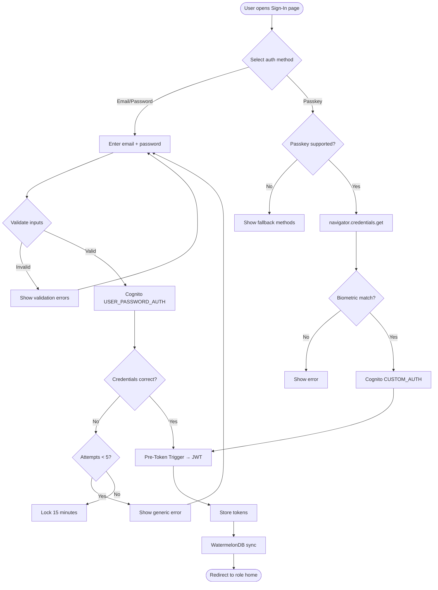

# US-1.1.2: Email/Password & Passkey (WebAuthn) Sign-In

> **Spec Kit Specification**: [Specification Lifecycle Active (.specify/)](../../../.specify/memory/constitution.md)  
> **Domain Feature**: `identity-and-access`  
> **Domain Module**: `auth-and-onboarding`  
> **Autonomous Behaviour**: `passkey-webauthn-sign-in`  
> **Client Framework Path**: `apps/storefront/src/features/identity-and-access/modules/auth-and-onboarding/behaviours/passkey-webauthn-sign-in`  
> **Backend Framework Path**: `backend/src/features/identity-and-access/modules/auth-and-onboarding/behaviours/passkey-webauthn-sign-in`  
> **Execution Sprint**: [Sprint 1.1](../../sprints/README.md)  
> **Slicing Standard**: [10-PR Vertical Slicing Framework](../../sprints/README.md#the-10-pr-vertical-slicing-standard-aligned-with-10-pillar-system-architecture)  
> **Security Gateway**: [ASVS Level 2 Verification Gate (security-audit)](#5-security-gateway-powered-by-security-audit)

---

## 1. Spec Kit Specification: User Story & Domain Scope

### 1.1 User Story Narrative

**As a** returning Customer or Admin user,  
**I want to** sign in using my email and password or a registered FIDO2 Passkey (WebAuthn),  
**So that** I have alternative sign-in methods and can use biometric authentication for faster access.

### 1.2 Acceptance Criteria (Gherkin Scenarios)

```gherkin
Feature: Email/Password & Passkey Sign-In
  Scenario: [AC-US-1.1.2-01] Successful email/password sign-in
    Given the user is on "/en-US/(auth)/sign-in"
    And the user selects the "Email" tab
    When the user enters email "admin@store.com" and password "SecureP@ss1!"
    And clicks "Sign In"
    Then the system authenticates via Cognito USER_PASSWORD_AUTH
    And the Pre-Token trigger enriches the JWT with STORE_ADMIN role
    And the user is redirected to "/en-US/admin/sdui-studio"
  Scenario: [AC-US-1.1.2-02] Passkey (WebAuthn) sign-in
    Given the user has previously registered a Passkey on this device
    When the user clicks "Sign in with Passkey"
    Then the browser/device prompts for biometric verification (Face ID / fingerprint)
    And upon successful biometric match, Cognito completes the CUSTOM_AUTH flow
    And the user is signed in without entering any credentials
  Scenario: [AC-US-1.1.2-03] Passkey registration from profile page
    Given the user is authenticated and on "/[locale]/account/profile"
    When the user clicks "Add Passkey"
    Then a WebAuthn registration ceremony is initiated
    And the new credential is stored in Cognito as an MFA factor
    And the passkey appears in the "Connected Passkeys" list
  Scenario: [AC-US-1.1.2-04] Incorrect password
    Given the user enters an incorrect password
    Then an error "Invalid email or password" is shown (no hint about which is wrong)
    And 5 consecutive failures trigger a 15-minute lockout
  Scenario: [AC-US-1.1.2-05] Password does not meet policy
    Given the user attempts to set a password without a special character
    Then a validation error listing all unmet requirements is shown
  Scenario: [AC-US-1.1.2-LAW] Global e-commerce legal compliance and authentication security regulations
    Given user registration or authentication using Passkeys or passwords
    When evaluated against international authentication and security standards
    Then biometric data must remain exclusively on the local authenticator hardware per FIDO2 and eIDAS (Regulation 910/2014) specifications
    And stored passwords must be hashed using memory-hard Argon2id with unique salts under GDPR Art 32 security of processing
    And credential failure telemetry must support mandatory 72-hour breach disclosure reporting under GDPR Art 33
```

### 1.3 Test Cases & Traceability Matrix

| # | Test Case | Type | Expected Result |
|:--|:----------|:-----|:----------------|
| TC-1.1.2-01 | Valid email + correct password | Happy Path | JWT issued, role-based redirect |
| TC-1.1.2-02 | Passkey biometric sign-in (Face ID) | Happy Path | Authenticated without typing |
| TC-1.1.2-03 | Incorrect password (1st attempt) | Negative | Generic error shown |
| TC-1.1.2-04 | 5 incorrect passwords | Security | 15-minute account lockout |
| TC-1.1.2-05 | Email not found in Cognito | Negative | Same generic error (no enumeration) |
| TC-1.1.2-06 | Passkey on unsupported device | Edge Case | Passkey tab hidden/disabled |
| TC-1.1.2-07 | Register new Passkey | Happy Path | Passkey added, listed in profile |
| TC-1.1.2-08 | Remove existing Passkey | Happy Path | Passkey removed from list |
| TC-1.1.2-09 | Password with only lowercase chars | Validation | Policy violation error |
| TC-1.1.2-10 | XSS in email field | Security | Input sanitized |
| TC-1.1.2-LAW | Global legal & regulatory compliance (FIDO2/eIDAS biometric boundary, GDPR Art 32 Argon2id, Art 33 breach notification) | Legal / Regulatory | Statutory compliance verified with zero legal or regulatory violations |

---

## 2. Behavior-Centric Architecture & Folder Blueprint

This user story is implemented directly inside the respective **Expo client** and **Cargo Lambda Axum backend** frameworks according to the **Locality of Behavior (LoB)** architectural law. Private services, designs, logic, types, and constants are strictly colocated within their framework behaviour directory.

### 2.1 Colocated Behaviour Directory Tree

#### Client Architecture (Universal Expo SDK 58):
```
apps/storefront/src/features/identity-and-access/modules/auth-and-onboarding/behaviours/passkey-webauthn-sign-in/
├── services/
│   │   ├── webauthn_client.rs
│   │   ├── cognito_passkey_adapter.rs
│   │   ├── passkey_api.ts
├── designs/
│   │   ├── PasskeySignInScreen.tsx
│   │   ├── PasskeyEnrollmentModal.tsx
│   │   ├── BiometricPrompt.tsx
├── logic/
│   │   ├── usePasskeyAuth.ts
│   │   ├── webauthn_challenge_verifier.rs
│   │   ├── credential_policy.ts
├── types/
│   │   ├── PasskeyRegistrationPayload.ts
│   │   ├── PasskeyAssertionResponse.ts
│   │   ├── WebAuthnCredential.ts
└── constants/
│   │   ├── PasskeyEndpoints.ts
│   │   ├── RelyingPartyConfig.ts
│   │   ├── PasskeyErrorCodes.ts
```

#### Backend Architecture (Cargo Lambda + Axum 0.8):
```
backend/src/features/identity-and-access/modules/auth-and-onboarding/behaviours/passkey-webauthn-sign-in/
├── services/
│   │   ├── webauthn_client.rs
│   │   ├── cognito_passkey_adapter.rs
│   │   ├── passkey_api.ts
├── logic/
│   │   ├── usePasskeyAuth.ts
│   │   ├── webauthn_challenge_verifier.rs
│   │   ├── credential_policy.ts
├── types/
│   │   ├── PasskeyRegistrationPayload.ts
│   │   ├── PasskeyAssertionResponse.ts
│   │   ├── WebAuthnCredential.ts
└── constants/
│   │   ├── PasskeyEndpoints.ts
│   │   ├── RelyingPartyConfig.ts
│   │   ├── PasskeyErrorCodes.ts
```

### 2.2 Scoping & Promotion Blueprint

| Layer / Tier | Client Path (Expo) | Backend Path (Cargo Lambda / Axum) | Purpose & Promotion Rules |
| :--- | :--- | :--- | :--- |
| **Behaviour-Local** | `.../behaviours/passkey-webauthn-sign-in/` | `.../behaviours/passkey-webauthn-sign-in/` | **Default Private Scope**: Colocated services, designs, logic, types, and constants private to this story. |
| **Module-Shared** | `.../modules/auth-and-onboarding/_shared/` | `.../modules/auth-and-onboarding/_shared/` | Shared domain primitives and UI elements used by $\ge 2$ behaviours in `auth-and-onboarding`. |
| **Feature-Shared** | `.../features/identity-and-access/_shared/` | `.../features/identity-and-access/_shared/` | Feature-level contracts, ports, and cross-module bridges across `identity-and-access`. |
| **Framework-Shared** | `apps/storefront/src/shared/` | `backend/crates/kernel-core/` | System-wide microkernel traits, `Money` arithmetic, RFC 9110 ETag middleware, and database adapters. |

---

## 3. Technical Implementation Plan (Spec Kit Plan)

### 3.1 Domain Invariants & Storage Schema
- **State Machine**: Enforces valid state transitions and rejects unauthorized or out-of-order mutations.
- **Data Persistence**: Single-table Amazon DynamoDB partitioning (`PK = TENANT#<id>`, `SK = ENTITY#<id>`) paired with reactive local-first WatermelonDB sync.
- **Freshness & Caching**: Multi-tier caching (L1 Moka in-memory + L2 ElastiCache Redis) with RFC 9110 `ETag` conditional `304 Not Modified` short-circuiting.

### 3.2 Activity & Interaction Diagram



---

## 4. Granular Implementation Tasks (Spec Kit Tasks)

### Phase 1: Core Domain Logic, Types & Constants
- [ ] **Task 1.1 (Types)**: Define strongly typed models and DTO schemas in `types/`.
- [ ] **Task 1.2 (Constants)**: Define routes, action codes, and validation limits in `constants/`.
- [ ] **Task 1.3 (Logic)**: Implement pure business logic, calculations, and state machines in `logic/`.
- [ ] **Task 1.4 (Unit Tests)**: Write pure property-based and unit tests verifying domain invariants.

### Phase 2: Services & Infrastructure Adapters
- [ ] **Task 2.1 (API / Gateway)**: Implement client adapters and backend handlers in `services/`.
- [ ] **Task 2.2 (ETag & Cache)**: Integrate RFC 9110 ETag headers and multi-tier caching (Moka L1 / Redis L2).
- [ ] **Task 2.3 (Storage & Sync)**: Implement DynamoDB storage operations and WatermelonDB delta sync.
- [ ] **Task 2.4 (Integration Tests)**: Verify service contract tests and real database conditional writes.

### Phase 3: Platform-Adaptive Designs & UI
- [ ] **Task 3.1 (UI Presentation)**: Build platform-adaptive screens and SDUI components in `designs/`.
- [ ] **Task 3.2 (Headless Hooks)**: Bind headless domain hooks from `logic/` into the UI presentation.
- [ ] **Task 3.3 (i18n & RTL)**: Implement bidirectional RTL/LTR layout mirroring and localized font switching.
- [ ] **Task 3.4 (Component Tests)**: Test empty, loading, offline, and error states across web and mobile.

### Phase 4: Security Gateway Verification & Release Readiness
- [ ] **Task 4.1 (Abuse Testing)**: Execute automated adversarial penetration tests against the threat matrix.
- [ ] **Task 4.2 (Zero-Trust Audit)**: Verify strict tenant isolation and object-level authorization (IDOR).
- [ ] **Task 4.3 (SAST & Audit)**: Run static analysis, dependency audit, and secret scanning.
- [ ] **Task 4.4 (Gate Sign-Off)**: Obtain independent security sign-off for the G2 Security Gateway.

---

## 5. Security Gateway (Powered by security-audit)

### 5.1 Trust Boundaries & Security Actors
- **Trust Boundaries**:
  - `Untrusted Zone`: Mobile client app, public web browser, and external network callers.
  - `Gateway Edge`: AWS CloudFront, API Gateway, and Cognito JWT authentication guard.
  - `Secure Application Boundary`: Axum Tower route extractors enforcing tenant and RBAC/ABAC isolation.
  - `Encrypted Storage & Secret Vault`: Amazon DynamoDB KMS-encrypted tables and AWS KMS vault.
- **Authorized Principals**:
  - Identified Actors: `AuthenticatedCustomer`, `B2bBuyer`, `Vendor`, `StoreAdmin`, or `AnonymousShopper` (read-only).
  - Multi-Tenancy Invariant: Every request must extract `tenant_id` from verified JWT claims. Injections via query params or payload body are rejected with `403 Forbidden`.

### 5.2 Threat Modeling & Abuse Matrix (STRIDE / ASVS)

| Threat Vector | Severity | Vulnerability Mechanism | Mitigating Control & Security Invariant |
| :--- | :--- | :--- | :--- |
| **Spoofing & Impersonation** | Critical | Forged `sub` or `tenant_id` identity claims | Server-side RS256 JWKS signature verification; strict claims extraction in Axum. |
| **Tampering & Invariant Bypass** | High | Manipulating payload parameters or prices | Authoritative server recalculation; strict schema validation; BLAKE3 ETag integrity checks. |
| **Information Disclosure (IDOR)** | Critical | Cross-tenant or cross-user data scraping | Explicit `PK = TENANT#<id>` partition filtering on every database and cache operation. |
| **Denial of Service / Abuse** | High | Replay attacks, invalid WebAuthn origin spoofing, attestation tampering, and credential harvesting | Token-bucket rate limiting per IP and account; strict input length validation. |
| **Elevation of Privilege** | Critical | Bypassing role-based permission checks | Tower extractors (`RequireStoreAdmin`, `RequireVendor`) guard sensitive endpoints. |

### 5.3 Cryptographic & Data Protection Controls
- **Encryption in Transit**: TLS 1.3 enforced on all external and internal endpoints; HSTS active.
- **Encryption at Rest**: DynamoDB AWS KMS customer-managed keys; AES-256-GCM for sensitive client tokens in `expo-secure-store`.
- **PII & Secret Redaction**: Passwords, OTPs, auth tokens, and credit card numbers are stripped from logs and traces via `tracing` redaction filters.

### 5.4 Automated Security Verification Checklist
- [ ] **SAST Analysis**: Clean report from static code analyzers; 0 high or critical vulnerabilities.
- [ ] **Dependency Audit**: `cargo deny` and `bun audit` pass with 0 unreviewed security advisories.
- [ ] **Abuse & IDOR Fuzzing**: Test suite confirms that requests with modified `tenant_id` or `user_id` fail with `401 Unauthorized` or `403 Forbidden`.
- [ ] **Secret Scanning**: Gitleaks scanner confirms zero hardcoded credentials, API keys, or private keys.

### 5.5 Security Gateway (G2) Sign-Off Checklist
- [ ] Threat boundary and entry points verified against OWASP ASVS Level 2 requirements.
- [ ] Multi-tenant isolation verified with automated cross-tenant penetration test.
- [ ] Anti-abuse and rate limiting confirmed active on all public interfaces.
- [ ] Audit log redaction verified — zero plaintext secrets in output logs.
- [ ] Independent reviewer sign-off obtained; zero open Critical or High findings.

---

## 6. Validation Gates & Acceptance Sign-Off

**Status: Pending — specification only; no implementation evidence.** All [G0–G4 quality gates + G-Review + G-Borrow + G-UI + G-Law](../../QUALITY_GATES.md) apply to this story. The following checks add to its acceptance criteria and test cases; they do not replace them.

### G1 — Test coverage
- [ ] **US-1.1.2-G1:** Automated test suite maps 100% of acceptance criteria and test cases with >=90% line and >=85% branch coverage in affected packages.

### G2 — Security audit
- [ ] **US-1.1.2-G2:** Verify zero-trust tenant isolation, object-level authorization (IDOR), and defense against Replay attacks, invalid WebAuthn origin spoofing, attestation tampering, and credential harvesting. No unresolved critical or high findings.

### G3 — Architecture and maintainability
- [ ] **US-1.1.2-G3:** Strict compliance with framework colocation (`apps/storefront/src/features/` or `backend/src/features/`), zero-clone borrowing discipline in Rust, and clean domain boundaries.

### G-Review — Code review
- [ ] **US-1.1.2-G-Review:** Independent senior code review signed off by the Code Reviewer; verification across Correctness, Security, Maintainability, Performance, and Testing using the Agency-Agents code review standard; zero open Blocker or unresolved Suggestion findings.

### G-Borrow — Rust zero-clone borrowing validation
- [ ] **US-1.1.2-G-Borrow:** Backend code relies strictly on borrowing (&T, &mut T), explicit lifetimes, zero-copy byte buffers (bytes::Bytes), and zero unauthorized deep .clone() calls on domain entities and models (Arc::clone and Rc::clone pointer copies permitted only); certified by systems reviewer.

### G-UI — UI/UX validation
- [ ] **US-1.1.2-G-UI:** Pure separation of presentation (designs/, owned by ui-ux-designer) and headless hooks (logic/, owned by client-engineer); mobile components use @expo/ui primitives and native modules; web components use semantic HTML5 styled with Tailwind CSS; WCAG 2.1 AA and Arabic RTL layout parity verified; certified by UI/UX designer.

### G-Law — Law validation
- [ ] **US-1.1.2-G-Law:** Independent verification against global e-commerce legal and statutory requirements: FIDO2 / eIDAS biometric privacy boundaries, GDPR Art 32 cryptographic security, and Art 33 breach notification readiness; certified by compliance reviewer (`agency-legal-compliance-checker`).

### G4 — Integrated acceptance
- [ ] **US-1.1.2-G4:** End-to-end user journey validation across supported platforms (Web, iOS, Android) and verified sandbox integration.

---

[← Back to Module auth-and-onboarding Catalog (README.md)](README.md) | [Master User Stories Index](../README.md)
