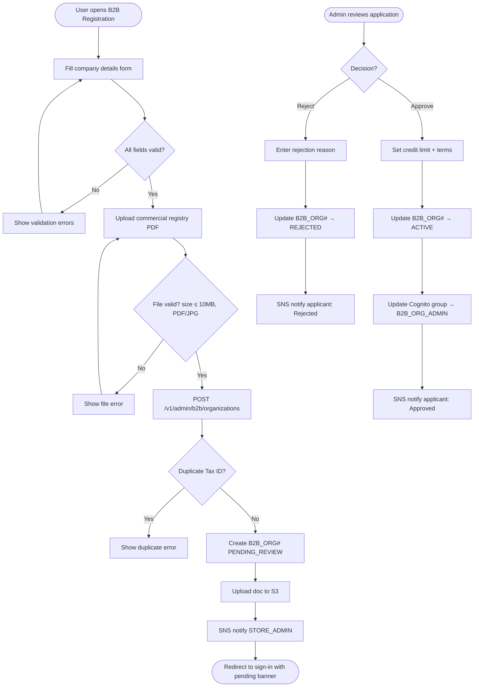

# US-1.1.4: B2B Organization Registration & Admin Approval

> **Spec Kit Specification**: [Specification Lifecycle Active (.specify/)](../../../.specify/memory/constitution.md)  
> **Domain Feature**: `identity-and-access`  
> **Domain Module**: `auth-and-onboarding`  
> **Autonomous Behaviour**: `b2b-org-registration`  
> **Client Framework Path**: `apps/storefront/src/features/identity-and-access/modules/auth-and-onboarding/behaviours/b2b-org-registration`  
> **Backend Framework Path**: `backend/src/features/identity-and-access/modules/auth-and-onboarding/behaviours/b2b-org-registration`  
> **Execution Sprint**: [Sprint 1.1](../../sprints/README.md)  
> **Slicing Standard**: [10-PR Vertical Slicing Framework](../../sprints/README.md#the-10-pr-vertical-slicing-standard-aligned-with-10-pillar-system-architecture)  
> **Security Gateway**: [ASVS Level 2 Verification Gate (security-audit)](#5-security-gateway-powered-by-security-audit)

---

## 1. Spec Kit Specification: User Story & Domain Scope

### 1.1 User Story Narrative

**As a** B2B Buyer or Organization Administrator,  
**I want to** register my company by providing a Tax ID, commercial registry document, and requested credit limit,  
**So that** I can apply for wholesale access with tiered pricing, MOQ enforcement, and net-terms invoicing.

### 1.2 Acceptance Criteria (Gherkin Scenarios)

```gherkin
Feature: B2B Organization Registration
  Scenario: [AC-US-1.1.4-01] Successful B2B registration submission
    Given the user is on "/en-US/(auth)/b2b-register"
    When the user fills in company name "ACME Corp", Tax ID "12345678", uploads commercial registry PDF
    And submits a credit limit request of "$50,000"
    And clicks "Submit Registration"
    Then a B2B_ORG# record is created in DynamoDB with status PENDING_REVIEW
    And an SNS notification is sent to the STORE_ADMIN
    And the user is redirected to sign-in with a "Pending B2B Review" banner
  Scenario: [AC-US-1.1.4-02] Admin approves B2B registration
    Given a STORE_ADMIN reviews the pending B2B_ORG# on the admin dashboard
    When the admin clicks "Approve" and sets credit_limit=$40,000 and payment_terms=NET_30
    Then the B2B_ORG# status transitions to ACTIVE
    And the registering user's Cognito group is updated to B2B_ORG_ADMIN
    And an SNS notification informs the applicant of approval
  Scenario: [AC-US-1.1.4-03] Admin rejects B2B registration
    Given a STORE_ADMIN reviews the pending B2B_ORG#
    When the admin clicks "Reject" with reason "Invalid tax certificate"
    Then the B2B_ORG# status transitions to REJECTED
    And the applicant receives an SNS notification with the rejection reason
  Scenario: [AC-US-1.1.4-04] Duplicate Tax ID submission
    Given a B2B_ORG# with Tax ID "12345678" already exists
    When another user attempts to register with the same Tax ID
    Then an error "An organization with this Tax ID already exists" is shown
  Scenario: [AC-US-1.1.4-05] Invalid file upload
    Given the user attempts to upload a commercial registry file > 10MB
    Then a validation error "File size must be under 10MB" is shown
    And the form is not submitted
  Scenario: [AC-US-1.1.4-LAW] Global e-commerce legal compliance and B2B corporate verification regulations
    Given an enterprise submitting a B2B organization registration
    When vetted prior to administrative onboarding approval
    Then corporate entity credentials and VAT registration numbers must be validated against official registries (e.g., EU VIES)
    And corporate officers and beneficial owners must be screened against OFAC and EU international trade sanctions lists
    And an immutable audit trail of verification evidence must be recorded for statutory Anti-Money Laundering (AMLD) audits
```

### 1.3 Test Cases & Traceability Matrix

| # | Test Case | Type | Expected Result |
|:--|:----------|:-----|:----------------|
| TC-1.1.4-01 | Valid B2B registration submission | Happy Path | PENDING_REVIEW record created |
| TC-1.1.4-02 | Admin approves registration | Happy Path | Status → ACTIVE, Cognito group updated |
| TC-1.1.4-03 | Admin rejects registration | Happy Path | Status → REJECTED, notification sent |
| TC-1.1.4-04 | Duplicate Tax ID | Validation | Error shown, no record created |
| TC-1.1.4-05 | File > 10MB upload | Validation | Size error shown |
| TC-1.1.4-06 | Invalid file type (exe) | Security | File type rejected |
| TC-1.1.4-07 | Empty required fields | Validation | All missing fields highlighted |
| TC-1.1.4-08 | Credit limit = 0 | Edge Case | Warning shown, submission allowed |
| TC-1.1.4-09 | SQL injection in company name | Security | Input sanitized |
| TC-1.1.4-10 | Concurrent approval by 2 admins | Concurrency | ETag If-Match prevents double-approval |
| TC-1.1.4-11 | B2B reg with Arabic company name | i18n | RTL name stored in names_i18n |
| TC-1.1.4-LAW | Global legal & regulatory compliance (EU AMLD KYB due diligence, VIES VAT validation, OFAC/EU trade sanctions screening) | Legal / Regulatory | Statutory compliance verified with zero legal or regulatory violations |

---

## 2. Behavior-Centric Architecture & Folder Blueprint

This user story is implemented directly inside the respective **Expo client** and **Cargo Lambda Axum backend** frameworks according to the **Locality of Behavior (LoB)** architectural law. Private services, designs, logic, types, and constants are strictly colocated within their framework behaviour directory.

### 2.1 Colocated Behaviour Directory Tree

#### Client Architecture (Universal Expo SDK 58):
```
apps/storefront/src/features/identity-and-access/modules/auth-and-onboarding/behaviours/b2b-org-registration/
├── services/
│   │   ├── b2b_registration_client.rs
│   │   ├── tax_vat_verifier.rs
│   │   ├── b2b_approval_api.ts
├── designs/
│   │   ├── B2bRegistrationFormScreen.tsx
│   │   ├── DocumentUploadSection.tsx
│   │   ├── PendingApprovalBanner.tsx
├── logic/
│   │   ├── useB2bRegistration.ts
│   │   ├── vat_tax_validator.rs
│   │   ├── org_domain_verifier.rs
├── types/
│   │   ├── OrganizationApplication.ts
│   │   ├── TaxVatProof.ts
│   │   ├── B2bApprovalStatus.ts
└── constants/
│   │   ├── B2bOrgEndpoints.ts
│   │   ├── VatValidationRules.ts
│   │   ├── OrgRegistrationErrors.ts
```

#### Backend Architecture (Cargo Lambda + Axum 0.8):
```
backend/src/features/identity-and-access/modules/auth-and-onboarding/behaviours/b2b-org-registration/
├── services/
│   │   ├── b2b_registration_client.rs
│   │   ├── tax_vat_verifier.rs
│   │   ├── b2b_approval_api.ts
├── logic/
│   │   ├── useB2bRegistration.ts
│   │   ├── vat_tax_validator.rs
│   │   ├── org_domain_verifier.rs
├── types/
│   │   ├── OrganizationApplication.ts
│   │   ├── TaxVatProof.ts
│   │   ├── B2bApprovalStatus.ts
└── constants/
│   │   ├── B2bOrgEndpoints.ts
│   │   ├── VatValidationRules.ts
│   │   ├── OrgRegistrationErrors.ts
```

### 2.2 Scoping & Promotion Blueprint

| Layer / Tier | Client Path (Expo) | Backend Path (Cargo Lambda / Axum) | Purpose & Promotion Rules |
| :--- | :--- | :--- | :--- |
| **Behaviour-Local** | `.../behaviours/b2b-org-registration/` | `.../behaviours/b2b-org-registration/` | **Default Private Scope**: Colocated services, designs, logic, types, and constants private to this story. |
| **Module-Shared** | `.../modules/auth-and-onboarding/_shared/` | `.../modules/auth-and-onboarding/_shared/` | Shared domain primitives and UI elements used by $\ge 2$ behaviours in `auth-and-onboarding`. |
| **Feature-Shared** | `.../features/identity-and-access/_shared/` | `.../features/identity-and-access/_shared/` | Feature-level contracts, ports, and cross-module bridges across `identity-and-access`. |
| **Framework-Shared** | `apps/storefront/src/shared/` | `backend/crates/kernel-core/` | System-wide microkernel traits, `Money` arithmetic, RFC 9110 ETag middleware, and database adapters. |

---

## 3. Technical Implementation Plan (Spec Kit Plan)

### 3.1 Domain Invariants & Storage Schema
- **State Machine**: Enforces valid state transitions and rejects unauthorized or out-of-order mutations.
- **Data Persistence**: Single-table Amazon DynamoDB partitioning (`PK = TENANT#<id>`, `SK = ENTITY#<id>`) paired with reactive local-first WatermelonDB sync.
- **Freshness & Caching**: Multi-tier caching (L1 Moka in-memory + L2 ElastiCache Redis) with RFC 9110 `ETag` conditional `304 Not Modified` short-circuiting.

### 3.2 Activity & Interaction Diagram



---

## 4. Granular Implementation Tasks (Spec Kit Tasks)

### Phase 1: Core Domain Logic, Types & Constants
- [ ] **Task 1.1 (Types)**: Define strongly typed models and DTO schemas in `types/`.
- [ ] **Task 1.2 (Constants)**: Define routes, action codes, and validation limits in `constants/`.
- [ ] **Task 1.3 (Logic)**: Implement pure business logic, calculations, and state machines in `logic/`.
- [ ] **Task 1.4 (Unit Tests)**: Write pure property-based and unit tests verifying domain invariants.

### Phase 2: Services & Infrastructure Adapters
- [ ] **Task 2.1 (API / Gateway)**: Implement client adapters and backend handlers in `services/`.
- [ ] **Task 2.2 (ETag & Cache)**: Integrate RFC 9110 ETag headers and multi-tier caching (Moka L1 / Redis L2).
- [ ] **Task 2.3 (Storage & Sync)**: Implement DynamoDB storage operations and WatermelonDB delta sync.
- [ ] **Task 2.4 (Integration Tests)**: Verify service contract tests and real database conditional writes.

### Phase 3: Platform-Adaptive Designs & UI
- [ ] **Task 3.1 (UI Presentation)**: Build platform-adaptive screens and SDUI components in `designs/`.
- [ ] **Task 3.2 (Headless Hooks)**: Bind headless domain hooks from `logic/` into the UI presentation.
- [ ] **Task 3.3 (i18n & RTL)**: Implement bidirectional RTL/LTR layout mirroring and localized font switching.
- [ ] **Task 3.4 (Component Tests)**: Test empty, loading, offline, and error states across web and mobile.

### Phase 4: Security Gateway Verification & Release Readiness
- [ ] **Task 4.1 (Abuse Testing)**: Execute automated adversarial penetration tests against the threat matrix.
- [ ] **Task 4.2 (Zero-Trust Audit)**: Verify strict tenant isolation and object-level authorization (IDOR).
- [ ] **Task 4.3 (SAST & Audit)**: Run static analysis, dependency audit, and secret scanning.
- [ ] **Task 4.4 (Gate Sign-Off)**: Obtain independent security sign-off for the G2 Security Gateway.

---

## 5. Security Gateway (Powered by security-audit)

### 5.1 Trust Boundaries & Security Actors
- **Trust Boundaries**:
  - `Untrusted Zone`: Mobile client app, public web browser, and external network callers.
  - `Gateway Edge`: AWS CloudFront, API Gateway, and Cognito JWT authentication guard.
  - `Secure Application Boundary`: Axum Tower route extractors enforcing tenant and RBAC/ABAC isolation.
  - `Encrypted Storage & Secret Vault`: Amazon DynamoDB KMS-encrypted tables and AWS KMS vault.
- **Authorized Principals**:
  - Identified Actors: `AuthenticatedCustomer`, `B2bBuyer`, `Vendor`, `StoreAdmin`, or `AnonymousShopper` (read-only).
  - Multi-Tenancy Invariant: Every request must extract `tenant_id` from verified JWT claims. Injections via query params or payload body are rejected with `403 Forbidden`.

### 5.2 Threat Modeling & Abuse Matrix (STRIDE / ASVS)

| Threat Vector | Severity | Vulnerability Mechanism | Mitigating Control & Security Invariant |
| :--- | :--- | :--- | :--- |
| **Spoofing & Impersonation** | Critical | Forged `sub` or `tenant_id` identity claims | Server-side RS256 JWKS signature verification; strict claims extraction in Axum. |
| **Tampering & Invariant Bypass** | High | Manipulating payload parameters or prices | Authoritative server recalculation; strict schema validation; BLAKE3 ETag integrity checks. |
| **Information Disclosure (IDOR)** | Critical | Cross-tenant or cross-user data scraping | Explicit `PK = TENANT#<id>` partition filtering on every database and cache operation. |
| **Denial of Service / Abuse** | High | Forged business registration documents, VAT tax ID spoofing, unauthorized organization ownership claims | Token-bucket rate limiting per IP and account; strict input length validation. |
| **Elevation of Privilege** | Critical | Bypassing role-based permission checks | Tower extractors (`RequireStoreAdmin`, `RequireVendor`) guard sensitive endpoints. |

### 5.3 Cryptographic & Data Protection Controls
- **Encryption in Transit**: TLS 1.3 enforced on all external and internal endpoints; HSTS active.
- **Encryption at Rest**: DynamoDB AWS KMS customer-managed keys; AES-256-GCM for sensitive client tokens in `expo-secure-store`.
- **PII & Secret Redaction**: Passwords, OTPs, auth tokens, and credit card numbers are stripped from logs and traces via `tracing` redaction filters.

### 5.4 Automated Security Verification Checklist
- [ ] **SAST Analysis**: Clean report from static code analyzers; 0 high or critical vulnerabilities.
- [ ] **Dependency Audit**: `cargo deny` and `bun audit` pass with 0 unreviewed security advisories.
- [ ] **Abuse & IDOR Fuzzing**: Test suite confirms that requests with modified `tenant_id` or `user_id` fail with `401 Unauthorized` or `403 Forbidden`.
- [ ] **Secret Scanning**: Gitleaks scanner confirms zero hardcoded credentials, API keys, or private keys.

### 5.5 Security Gateway (G2) Sign-Off Checklist
- [ ] Threat boundary and entry points verified against OWASP ASVS Level 2 requirements.
- [ ] Multi-tenant isolation verified with automated cross-tenant penetration test.
- [ ] Anti-abuse and rate limiting confirmed active on all public interfaces.
- [ ] Audit log redaction verified — zero plaintext secrets in output logs.
- [ ] Independent reviewer sign-off obtained; zero open Critical or High findings.

---

## 6. Validation Gates & Acceptance Sign-Off

**Status: Pending — specification only; no implementation evidence.** All [G0–G4 quality gates + G-Review + G-Borrow + G-UI + G-Law](../../QUALITY_GATES.md) apply to this story. The following checks add to its acceptance criteria and test cases; they do not replace them.

### G1 — Test coverage
- [ ] **US-1.1.4-G1:** Automated test suite maps 100% of acceptance criteria and test cases with >=90% line and >=85% branch coverage in affected packages.

### G2 — Security audit
- [ ] **US-1.1.4-G2:** Verify zero-trust tenant isolation, object-level authorization (IDOR), and defense against Forged business registration documents, VAT tax ID spoofing, unauthorized organization ownership claims. No unresolved critical or high findings.

### G3 — Architecture and maintainability
- [ ] **US-1.1.4-G3:** Strict compliance with framework colocation (`apps/storefront/src/features/` or `backend/src/features/`), zero-clone borrowing discipline in Rust, and clean domain boundaries.

### G-Review — Code review
- [ ] **US-1.1.4-G-Review:** Independent senior code review signed off by the Code Reviewer; verification across Correctness, Security, Maintainability, Performance, and Testing using the Agency-Agents code review standard; zero open Blocker or unresolved Suggestion findings.

### G-Borrow — Rust zero-clone borrowing validation
- [ ] **US-1.1.4-G-Borrow:** Backend code relies strictly on borrowing (&T, &mut T), explicit lifetimes, zero-copy byte buffers (bytes::Bytes), and zero unauthorized deep .clone() calls on domain entities and models (Arc::clone and Rc::clone pointer copies permitted only); certified by systems reviewer.

### G-UI — UI/UX validation
- [ ] **US-1.1.4-G-UI:** Pure separation of presentation (designs/, owned by ui-ux-designer) and headless hooks (logic/, owned by client-engineer); mobile components use @expo/ui primitives and native modules; web components use semantic HTML5 styled with Tailwind CSS; WCAG 2.1 AA and Arabic RTL layout parity verified; certified by UI/UX designer.

### G-Law — Law validation
- [ ] **US-1.1.4-G-Law:** Independent verification against global e-commerce legal and statutory requirements: EU AMLD corporate KYB verification, VIES VAT registry confirmation, and international trade sanctions screening; certified by compliance reviewer (`agency-legal-compliance-checker`).

### G4 — Integrated acceptance
- [ ] **US-1.1.4-G4:** End-to-end user journey validation across supported platforms (Web, iOS, Android) and verified sandbox integration.

---

[← Back to Module auth-and-onboarding Catalog (README.md)](README.md) | [Master User Stories Index](../README.md)
