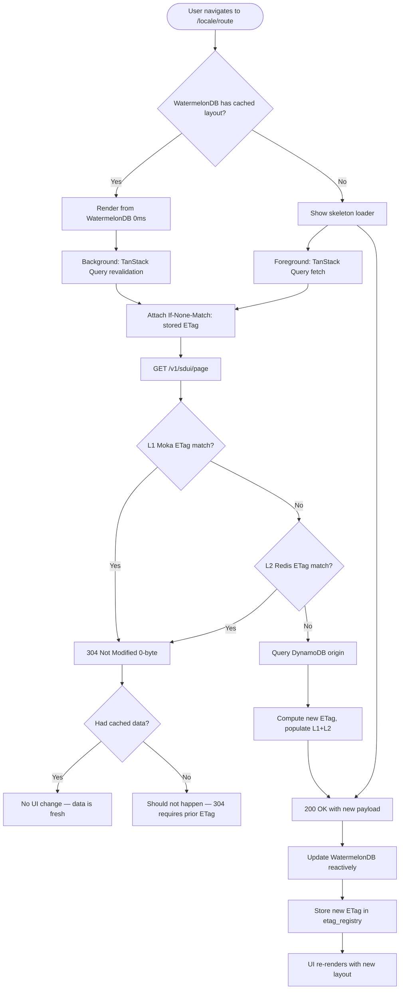
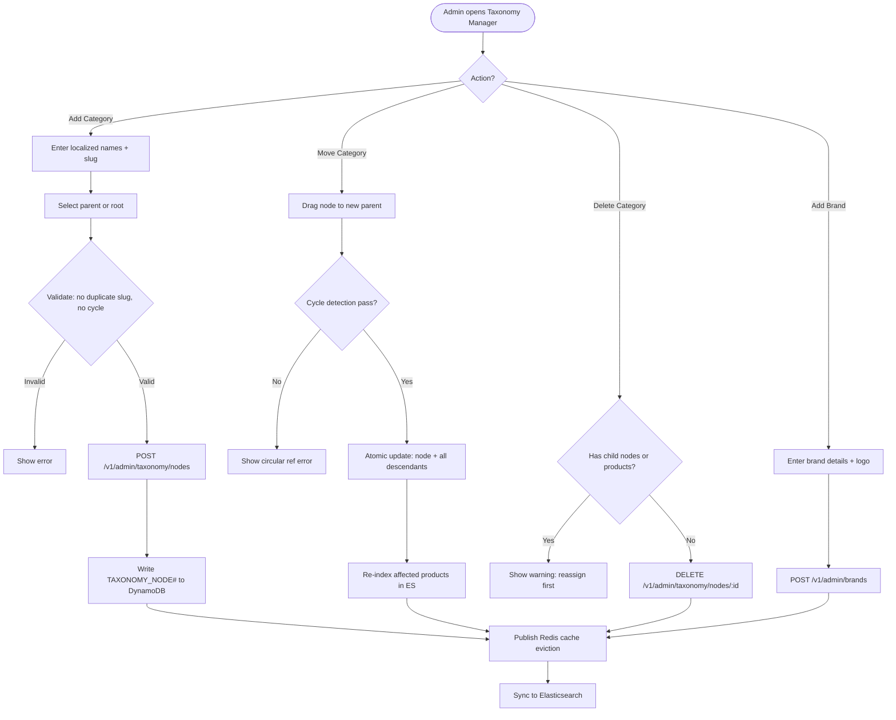
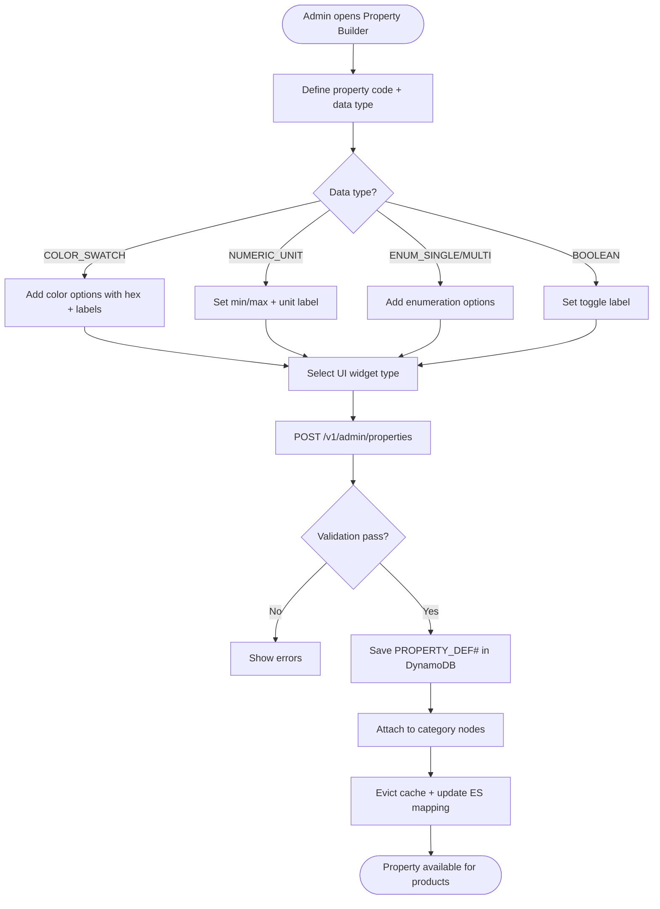
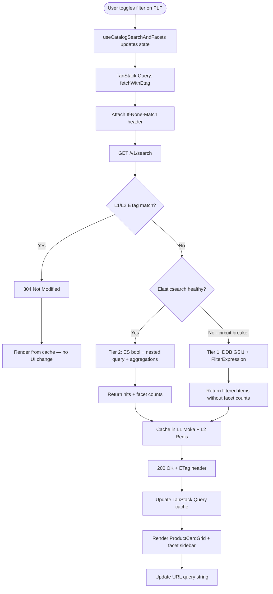
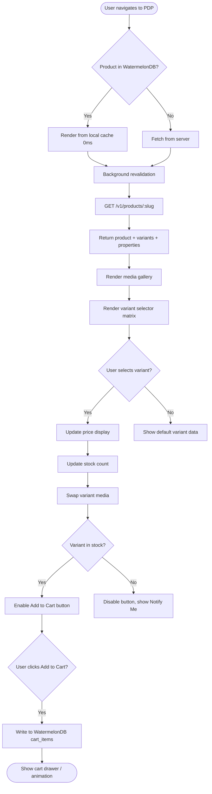

# Module 02: Storefront & Catalog

> **Slice**: v1.0 · **Sprint**: 1.1 · **Stories**: US-2.1.1 – US-2.1.5

## Overview

This module covers the multilingual SDUI storefront rendering, N-level category taxonomy, brand management, custom product properties, dual-tier catalog search (Elasticsearch + DynamoDB fallback), and the Product Detail Page (PDP) with variant configuration.

## Pages

| Page Route | Access | Direction | Primary Hook |
|:-----------|:-------|:----------|:-------------|
| `/[locale]/index` | Public | RTL / LTR | `useSduiScreen` |
| `/[locale]/c/[...category_slug]` | Public | RTL / LTR | `useCatalogSearchAndFacets` |
| `/[locale]/b/[brand_slug]` | Public | RTL / LTR | `useBrandCatalog` |
| `/[locale]/products/[slug]` | Public | RTL / LTR | `useProductConfigurator` |
| `/[locale]/admin/catalog-taxonomy` | STORE_ADMIN | RTL / LTR | `useAdminTaxonomyBuilder` |
| `/[locale]/vendor/products/new` | STORE_ADMIN / VENDOR | RTL / LTR | `useVendorProductEditor` |

## API Endpoints

| Method | Endpoint | Lambda | Description |
|:-------|:---------|:-------|:------------|
| GET | `/v1/sdui/page?route=&locale=` | `storefront-sdui-api` | Fetch SDUI page layout with ETag |
| GET | `/v1/search?q=&category=&brand=&props=` | `storefront-sdui-api` | Dual-tier catalog search |
| GET | `/v1/products/:slug` | `storefront-sdui-api` | Product detail + variants |
| GET | `/v1/sync/pull?last_pulled_at=` | `storefront-sdui-api` | WatermelonDB delta sync |
| POST | `/v1/admin/taxonomy/nodes` | `admin-vendor-api` | Create/update category nodes |
| POST | `/v1/admin/properties` | `admin-vendor-api` | Create/update property definitions |
| POST | `/v1/admin/brands` | `admin-vendor-api` | Create/update brands |
| POST | `/v1/admin/products` | `admin-vendor-api` | Create/update products |

---

## US-2.1.1: Multilingual SDUI Storefront with Instant WatermelonDB Rendering

**As a** global or regional shopper browsing in Arabic, English, French, German, or Turkish,  
**I want** every storefront page to render instantaneously (0ms) from local WatermelonDB storage in my language with native RTL or LTR geometry while background-revalidating via TanStack Query with ETag freshness checks,  
**So that** navigation feels native and instant even on flaky mobile connections.

### Acceptance Criteria

```gherkin
Feature: Instant SDUI Storefront Rendering

  Scenario: First visit with empty local database
    Given the user opens "/ar-EG/" for the first time (no WatermelonDB data)
    When the page loads
    Then TanStack Query fetches the SDUI layout from the server
    And the page renders within 200ms with a skeleton loader
    And the layout is cached in WatermelonDB for subsequent visits
    And the ETag is stored in the etag_registry table

  Scenario: Subsequent visit with cached data (0ms render)
    Given the user has previously visited "/ar-EG/"
    And WatermelonDB contains the SDUI layout for this route
    When the user navigates to "/ar-EG/"
    Then the page renders instantly (0ms) from WatermelonDB
    And a background TanStack Query sends If-None-Match with the stored ETag
    And if the server returns 304 Not Modified, no UI update occurs
    And if the server returns 200 with new data, WatermelonDB is updated reactively

  Scenario: Locale switch from English to Arabic
    Given the user is viewing "/en-US/" (LTR layout)
    When the user switches locale to "ar-EG"
    Then the app navigates to "/ar-EG/"
    And the UI direction flips to RTL
    And the font switches from Inter to Cairo
    And all content renders in Arabic from WatermelonDB or server

  Scenario: Offline browsing
    Given the user has cached SDUI data in WatermelonDB
    And the device loses network connectivity
    When the user navigates between previously visited pages
    Then all pages render from local WatermelonDB cache
    And a subtle offline indicator banner appears
    And background revalidation queues until connectivity restores

  Scenario: SDUI layout version updated by admin
    Given the admin publishes a new SDUI layout v15 for "/index"
    And Redis Pub/Sub broadcasts cache eviction
    When a user visits "/ar-EG/" next
    Then the ETag check returns 200 with the new v15 payload
    And WatermelonDB is reactively updated
    And the UI re-renders with the new layout without page reload
```

### Test Cases

| # | Test Case | Type | Expected Result |
|:--|:----------|:-----|:----------------|
| TC-2.1.1-01 | First visit — server fetch | Happy Path | Layout fetched, cached, rendered |
| TC-2.1.1-02 | Cached visit — 0ms render + 304 | Happy Path | Instant render, no update |
| TC-2.1.1-03 | Cached visit — server updated | Happy Path | Background update, reactive re-render |
| TC-2.1.1-04 | Offline browsing | Edge Case | Local cache renders, offline indicator |
| TC-2.1.1-05 | Locale switch en-US → ar-EG | i18n | RTL direction, Cairo font |
| TC-2.1.1-06 | Locale switch ar-EG → fr-FR | i18n | LTR direction, French content |
| TC-2.1.1-07 | Unsupported locale in URL | Edge Case | Fallback to tenant default locale |
| TC-2.1.1-08 | Corrupted WatermelonDB entry | Error | Server fetch, cache rebuilt |
| TC-2.1.1-09 | Server timeout (>5s) | Error | Cached data shown, retry scheduled |
| TC-2.1.1-10 | Concurrent requests for same page | Concurrency | TanStack Query deduplicates |
| TC-2.1.1-11 | Mobile (SQLite JSI) rendering | Platform | Native SQLite performance |
| TC-2.1.1-12 | Web (IndexedDB/LokiJS) rendering | Platform | Web adapter performance |

### Activity Diagram



---

## US-2.1.2: Unlimited N-Level Category Taxonomy & Brand Management

**As a** Store Administrator,  
**I want to** create an unlimited N-level hierarchy of localized categories and sub-categories (e.g., Electronics > Computers > Laptops > Gaming Laptops) and manage verified brands,  
**So that** any vertical can be modeled without code changes or database migrations.

### Acceptance Criteria

```gherkin
Feature: N-Level Category Taxonomy

  Scenario: Create a root category
    Given the admin is on "/en-US/admin/catalog-taxonomy"
    When the admin clicks "Add Root Category"
    And enters name_en="Electronics", name_ar="إلكترونيات", slug_en="electronics"
    Then a TAXONOMY_NODE# record is created with depth=0, parent_node_id=null
    And the category appears in the tree view
    And Redis cache is evicted via Pub/Sub

  Scenario: Create a 4th-level sub-category
    Given the category tree: Electronics > Computers > Laptops
    When the admin drags "Gaming Laptops" under "Laptops"
    Then TAXONOMY_NODE# is created with depth=3, ancestors=[electronics, computers, laptops, gaming-laptops]
    And all attached property definitions from parent categories are inherited

  Scenario: Move a sub-category to a different parent
    Given "Gaming Laptops" is under "Laptops"
    When the admin drags "Gaming Laptops" to be under "Desktops"
    Then ancestors_path is atomically updated for "Gaming Laptops" and all its descendants
    And Elasticsearch re-indexes all affected products
    And no circular reference is created (cycle detection)

  Scenario: Attempt to create circular reference
    Given "A" is parent of "B" which is parent of "C"
    When the admin tries to move "A" under "C"
    Then a validation error "Circular category reference detected" is shown
    And no changes are persisted

  Scenario: Create a brand and associate with categories
    Given the admin is on the Brand Registry tab
    When the admin creates brand "ASUS" with localized names and logo
    And associates it with categories "Laptops" and "Monitors"
    Then BRAND# record is created in DynamoDB
    And the brand appears as a filter option on associated category pages

  Scenario: Delete category with products
    Given "Gaming Laptops" has 15 products assigned
    When the admin attempts to delete "Gaming Laptops"
    Then a warning "This category has 15 products. Reassign or remove them first." is shown
    And the category is not deleted
```

### Test Cases

| # | Test Case | Type | Expected Result |
|:--|:----------|:-----|:----------------|
| TC-2.1.2-01 | Create root category | Happy Path | Node created at depth 0 |
| TC-2.1.2-02 | Create 4-level deep sub-category | Happy Path | Correct ancestor chain |
| TC-2.1.2-03 | Create 20-level deep category | Edge Case | Supported, performance acceptable |
| TC-2.1.2-04 | Move category to new parent | Happy Path | All descendants updated |
| TC-2.1.2-05 | Circular reference detection | Validation | Error, no change |
| TC-2.1.2-06 | Delete empty category | Happy Path | Category removed |
| TC-2.1.2-07 | Delete category with products | Validation | Warning, deletion blocked |
| TC-2.1.2-08 | Duplicate slug in same parent | Validation | Error shown |
| TC-2.1.2-09 | Brand with Arabic-only name | i18n | RTL name stored and searchable |
| TC-2.1.2-10 | Concurrent category edits | Concurrency | ETag If-Match → 412 on conflict |

### Activity Diagram



---

## US-2.1.3: Admin-Customizable Product Properties & Filter Widgets

**As a** Store Administrator,  
**I want to** define custom filterable product properties (e.g., Color Swatch, Size, RAM, Refresh Rate) with specific SDUI filter widget types per property,  
**So that** any product vertical can have its own filterable attributes without code changes.

### Acceptance Criteria

```gherkin
Feature: Custom Product Properties

  Scenario: Create a COLOR_SWATCH property
    Given the admin is on the Properties panel
    When the admin creates property code="color", data_type=COLOR_SWATCH, ui_widget=COLOR_SWATCH_GRID
    And adds options: [{value: "blk", hex: "#000000", label_en: "Black", label_ar: "أسود"}]
    Then PROPERTY_DEF#color is created in DynamoDB
    And the property becomes available on Product creation forms

  Scenario: Create a RANGE_SLIDER numeric property
    When the admin creates property code="ram_gb", data_type=NUMERIC_UNIT, ui_widget=RANGE_SLIDER
    And sets unit_label_en="GB", min=4, max=256
    Then the property renders as a slider on the PLP filter sidebar

  Scenario: Attach properties to a category
    When the admin attaches properties [color, ram_gb, refresh_rate] to "Gaming Laptops"
    Then all products under "Gaming Laptops" (and deeper children) inherit these properties
    And the PLP for "Gaming Laptops" shows filter widgets for each

  Scenario: Property inheritance through category tree
    Given "Laptops" has property [screen_size] and "Gaming Laptops" has [refresh_rate]
    When viewing the filter sidebar for "Gaming Laptops"
    Then both [screen_size] (inherited) and [refresh_rate] (direct) appear as filters
```

### Test Cases

| # | Test Case | Type | Expected Result |
|:--|:----------|:-----|:----------------|
| TC-2.1.3-01 | Create COLOR_SWATCH property | Happy Path | Property saved, widget available |
| TC-2.1.3-02 | Create RANGE_SLIDER property | Happy Path | Slider renders on PLP |
| TC-2.1.3-03 | Create CHECKBOX_LIST property | Happy Path | Checkboxes render on PLP |
| TC-2.1.3-04 | Attach property to category | Happy Path | Inherited by child categories |
| TC-2.1.3-05 | Duplicate property code | Validation | Error shown |
| TC-2.1.3-06 | Property with 100+ options | Performance | Loads within 100ms |
| TC-2.1.3-07 | Delete property used by products | Validation | Warning with affected count |
| TC-2.1.3-08 | Localized property labels | i18n | Labels render in user's locale |

### Activity Diagram



---

## US-2.1.4: Dual-Tier Catalog Search with Nested Faceted Filtration

**As a** Shopper browsing a category page, brand page, or using the search bar,  
**I want to** filter products by category, brand, price range, stock status, COD eligibility, and any dynamic custom property with live facet counts,  
**So that** I can narrow down thousands of products in under 50ms.

### Acceptance Criteria

```gherkin
Feature: Dual-Tier Catalog Search

  Scenario: Elasticsearch faceted search (Tier 2 primary)
    Given the user is on "/ar-EG/c/gaming-laptops"
    When the user toggles Brand=ASUS, Color=Black, RAM=16..64GB
    Then the system queries Elasticsearch with nested property filters
    And returns matching products with live facet counts in <50ms
    And the URL query string is updated for shareability

  Scenario: DynamoDB fallback search (Tier 1 circuit-breaker)
    Given Elasticsearch is unreachable (circuit breaker open)
    When the user performs a search
    Then the system falls back to DynamoDB GSI1/GSI2 with FilterExpression
    And returns filtered results (without nested facet counts)
    And a subtle "Limited filtering" indicator appears

  Scenario: ETag cache hit for identical query
    Given the user previously searched Brand=ASUS, RAM=16GB on this page
    And the results are cached in L1 Moka/L2 Redis
    When the user navigates back and the same query fires
    Then the server returns 304 Not Modified in <0.1ms
    And the UI renders from the TanStack Query cache

  Scenario: Empty search results
    Given no products match the filter combination
    Then a "No products found" message appears in the user's locale
    And suggestions to broaden filters are shown
    And the facet counts show 0 for all options

  Scenario: Search with COD eligibility filter
    When the user toggles "Cash on Delivery Available" filter
    Then only products with supports_cod=true are shown
    And the facet counts update accordingly
```

### Test Cases

| # | Test Case | Type | Expected Result |
|:--|:----------|:-----|:----------------|
| TC-2.1.4-01 | Multi-facet ES search | Happy Path | Results + facets in <50ms |
| TC-2.1.4-02 | ES unavailable, DDB fallback | Fallback | Results without facet counts |
| TC-2.1.4-03 | ETag 304 cache hit | Performance | <0.1ms response |
| TC-2.1.4-04 | Empty results | Edge Case | Helpful empty state |
| TC-2.1.4-05 | 10,000+ products in category | Performance | Pagination, <100ms |
| TC-2.1.4-06 | Arabic text search "لابتوب" | i18n | Arabic analyzer matches |
| TC-2.1.4-07 | COD eligibility filter | Happy Path | Only COD products shown |
| TC-2.1.4-08 | Price range slider 0 to max | Edge Case | All products in range |
| TC-2.1.4-09 | URL query string shareability | UX | Shared URL restores filters |
| TC-2.1.4-10 | Concurrent filter toggles | Concurrency | TanStack Query debounces |

### Activity Diagram



---

## US-2.1.5: Product Detail Page with Variant Configuration

**As a** Shopper viewing a product,  
**I want to** see a rich product detail page with a media gallery, variant selector matrix (Color × Size), pricing, stock status, COD eligibility badge, and custom property specifications,  
**So that** I can evaluate the product and select the exact variant I want before adding to cart.

### Acceptance Criteria

```gherkin
Feature: Product Detail Page

  Scenario: View product with variants
    Given the user navigates to "/ar-EG/products/asus-rog-strix-g16"
    Then the PDP renders with Arabic title, description, and specs
    And a media gallery with zoomable images and video is shown
    And the variant selector shows available Color × Size combinations
    And unavailable combinations are greyed out
    And the price updates when selecting a different variant

  Scenario: Select variant and see price update
    Given the product has Color options [Black, White] and Size options [15", 16"]
    When the user selects Color=White, Size=16"
    Then the displayed price updates to the variant-specific price
    And the stock count updates (e.g., "Only 3 left")
    And the media gallery switches to White variant images

  Scenario: Out-of-stock variant
    Given the user selects Color=Black, Size=15" which is out of stock
    Then the "Add to Cart" button is disabled
    And a "Notify when available" button appears

  Scenario: COD eligibility badge
    Given the product has supports_cod=true
    Then a "Cash on Delivery Available" badge is shown
    And clicking it shows a tooltip explaining the deposit + cash breakdown

  Scenario: Product not found
    Given the user navigates to "/en-US/products/nonexistent-slug"
    Then a 404 page is displayed with suggestions for similar products
```

### Test Cases

| # | Test Case | Type | Expected Result |
|:--|:----------|:-----|:----------------|
| TC-2.1.5-01 | PDP with 3 variant axes | Happy Path | Matrix renders correctly |
| TC-2.1.5-02 | Variant price override | Happy Path | Price updates on selection |
| TC-2.1.5-03 | Out-of-stock variant | Edge Case | Add to cart disabled |
| TC-2.1.5-04 | Product with no variants | Edge Case | Simple PDP, no selector |
| TC-2.1.5-05 | COD badge for eligible product | Happy Path | Badge shown with tooltip |
| TC-2.1.5-06 | Non-COD product | Edge Case | No COD badge |
| TC-2.1.5-07 | 404 product slug | Error | 404 page with suggestions |
| TC-2.1.5-08 | RTL media gallery | i18n | Gallery navigation mirrored |
| TC-2.1.5-09 | Product with 50+ images | Performance | Lazy loading, <2s initial |
| TC-2.1.5-10 | Deep link to specific variant | UX | Variant pre-selected from URL |

### Activity Diagram


