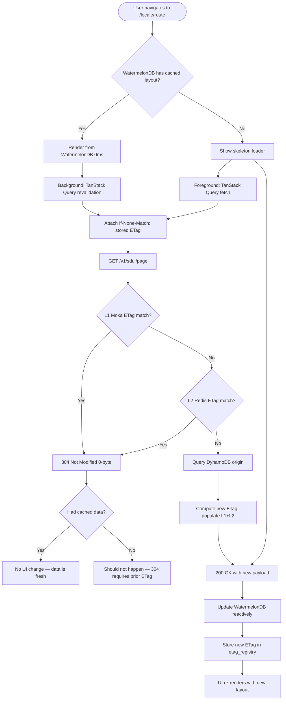

# US-2.1.1: Multilingual SDUI Storefront with Instant WatermelonDB Rendering

> **Spec Kit Specification**: [Specification Lifecycle Active (.specify/)](../../../.specify/memory/constitution.md)  
> **Domain Feature**: `catalog-and-discovery`  
> **Domain Module**: `storefront-and-catalog`  
> **Autonomous Behaviour**: `instant-sdui-storefront`  
> **Client Framework Path**: `apps/storefront/src/features/catalog-and-discovery/modules/storefront-and-catalog/behaviours/instant-sdui-storefront`  
> **Backend Framework Path**: `backend/src/features/catalog-and-discovery/modules/storefront-and-catalog/behaviours/instant-sdui-storefront`  
> **Execution Sprint**: [Sprint 1.1](../../sprints/README.md)  
> **Slicing Standard**: [10-PR Vertical Slicing Framework](../../sprints/README.md#the-10-pr-vertical-slicing-standard-aligned-with-10-pillar-system-architecture)  
> **Security Gateway**: [ASVS Level 2 Verification Gate (security-audit)](#5-security-gateway-powered-by-security-audit)

---

## 1. Spec Kit Specification: User Story & Domain Scope

### 1.1 User Story Narrative

**As a** global or regional shopper browsing in Arabic, English, French, German, or Turkish,  
**I want** every storefront page to render instantaneously (0ms) from local WatermelonDB storage in my language with native RTL or LTR geometry while background-revalidating via TanStack Query with ETag freshness checks,  
**So that** navigation feels native and instant even on flaky mobile connections.

### 1.2 Acceptance Criteria (Gherkin Scenarios)

```gherkin
Feature: Instant SDUI Storefront Rendering
  Scenario: [AC-US-2.1.1-01] First visit with empty local database
    Given the user opens "/ar-EG/" for the first time (no WatermelonDB data)
    When the page loads
    Then TanStack Query fetches the SDUI layout from the server
    And the page renders within 200ms with a skeleton loader
    And the layout is cached in WatermelonDB for subsequent visits
    And the ETag is stored in the etag_registry table
  Scenario: [AC-US-2.1.1-02] Subsequent visit with cached data (0ms render)
    Given the user has previously visited "/ar-EG/"
    And WatermelonDB contains the SDUI layout for this route
    When the user navigates to "/ar-EG/"
    Then the page renders instantly (0ms) from WatermelonDB
    And a background TanStack Query sends If-None-Match with the stored ETag
    And if the server returns 304 Not Modified, no UI update occurs
    And if the server returns 200 with new data, WatermelonDB is updated reactively
  Scenario: [AC-US-2.1.1-03] Locale switch from English to Arabic
    Given the user is viewing "/en-US/" (LTR layout)
    When the user switches locale to "ar-EG"
    Then the app navigates to "/ar-EG/"
    And the UI direction flips to RTL
    And the font switches from Inter to Cairo
    And all content renders in Arabic from WatermelonDB or server
  Scenario: [AC-US-2.1.1-04] Offline browsing
    Given the user has cached SDUI data in WatermelonDB
    And the device loses network connectivity
    When the user navigates between previously visited pages
    Then all pages render from local WatermelonDB cache
    And a subtle offline indicator banner appears
    And background revalidation queues until connectivity restores
  Scenario: [AC-US-2.1.1-05] SDUI layout version updated by admin
    Given the admin publishes a new SDUI layout v15 for "/index"
    And Redis Pub/Sub broadcasts cache eviction
    When a user visits "/ar-EG/" next
    Then the ETag check returns 200 with the new v15 payload
    And WatermelonDB is reactively updated
    And the UI re-renders with the new layout without page reload
  Scenario: [AC-US-2.1.1-LAW] Global e-commerce legal compliance and universal digital accessibility regulations
    Given a consumer accessing the storefront via web or mobile devices
    When rendering dynamic SDUI layouts across locales (Arabic RTL, English LTR)
    Then all UI elements must conform to WCAG 2.1 Level AA and the European Accessibility Act (EAA Directive 2019/882)
    And touch targets must maintain minimum 44x44pt hit areas with 4.5:1 accessible color contrast
    And zero non-essential client storage tracking or analytics may execute without prior affirmative consent under ePrivacy
```

### 1.3 Test Cases & Traceability Matrix

| # | Test Case | Type | Expected Result |
|:--|:----------|:-----|:----------------|
| TC-2.1.1-01 | First visit — server fetch | Happy Path | Layout fetched, cached, rendered |
| TC-2.1.1-02 | Cached visit — 0ms render + 304 | Happy Path | Instant render, no update |
| TC-2.1.1-03 | Cached visit — server updated | Happy Path | Background update, reactive re-render |
| TC-2.1.1-04 | Offline browsing | Edge Case | Local cache renders, offline indicator |
| TC-2.1.1-05 | Locale switch en-US → ar-EG | i18n | RTL direction, Cairo font |
| TC-2.1.1-06 | Locale switch ar-EG → fr-FR | i18n | LTR direction, French content |
| TC-2.1.1-07 | Unsupported locale in URL | Edge Case | Fallback to tenant default locale |
| TC-2.1.1-08 | Corrupted WatermelonDB entry | Error | Server fetch, cache rebuilt |
| TC-2.1.1-09 | Server timeout (>5s) | Error | Cached data shown, retry scheduled |
| TC-2.1.1-10 | Concurrent requests for same page | Concurrency | TanStack Query deduplicates |
| TC-2.1.1-11 | Mobile (SQLite JSI) rendering | Platform | Native SQLite performance |
| TC-2.1.1-12 | Web (IndexedDB/LokiJS) rendering | Platform | Web adapter performance |
| TC-2.1.1-LAW | Global legal & regulatory compliance (European Accessibility Act Directive 2019/882, ADA Title III, ePrivacy consent) | Legal / Regulatory | Statutory compliance verified with zero legal or regulatory violations |

---

## 2. Behavior-Centric Architecture & Folder Blueprint

This user story is implemented directly inside the respective **Expo client** and **Cargo Lambda Axum backend** frameworks according to the **Locality of Behavior (LoB)** architectural law. Private services, designs, logic, types, and constants are strictly colocated within their framework behaviour directory.

### 2.1 Colocated Behaviour Directory Tree

#### Client Architecture (Universal Expo SDK 58):
```
apps/storefront/src/features/catalog-and-discovery/modules/storefront-and-catalog/behaviours/instant-sdui-storefront/
├── services/
│   │   ├── sdui_page_client.rs
│   │   ├── watermelondb_sdui_adapter.ts
│   │   ├── etag_query_client.ts
├── designs/
│   │   ├── SduiScreenHost.tsx
│   │   ├── PageSkeletonLoader.tsx
│   │   ├── SduiBlockRegistry.tsx
├── logic/
│   │   ├── useSduiPage.ts
│   │   ├── etag_freshness_verifier.ts
│   │   ├── watermelon_sdui_sync.ts
├── types/
│   │   ├── SduiLayoutSchema.ts
│   │   ├── SduiBlockPayload.ts
│   │   ├── EtagRegistryEntry.ts
└── constants/
│   │   ├── SduiPageRoutes.ts
│   │   ├── CacheTtlConstants.ts
│   │   ├── SduiBlockTypes.ts
```

#### Backend Architecture (Cargo Lambda + Axum 0.8):
```
backend/src/features/catalog-and-discovery/modules/storefront-and-catalog/behaviours/instant-sdui-storefront/
├── services/
│   │   ├── sdui_page_client.rs
│   │   ├── watermelondb_sdui_adapter.ts
│   │   ├── etag_query_client.ts
├── logic/
│   │   ├── useSduiPage.ts
│   │   ├── etag_freshness_verifier.ts
│   │   ├── watermelon_sdui_sync.ts
├── types/
│   │   ├── SduiLayoutSchema.ts
│   │   ├── SduiBlockPayload.ts
│   │   ├── EtagRegistryEntry.ts
└── constants/
│   │   ├── SduiPageRoutes.ts
│   │   ├── CacheTtlConstants.ts
│   │   ├── SduiBlockTypes.ts
```

### 2.2 Scoping & Promotion Blueprint

| Layer / Tier | Client Path (Expo) | Backend Path (Cargo Lambda / Axum) | Purpose & Promotion Rules |
| :--- | :--- | :--- | :--- |
| **Behaviour-Local** | `.../behaviours/instant-sdui-storefront/` | `.../behaviours/instant-sdui-storefront/` | **Default Private Scope**: Colocated services, designs, logic, types, and constants private to this story. |
| **Module-Shared** | `.../modules/storefront-and-catalog/_shared/` | `.../modules/storefront-and-catalog/_shared/` | Shared domain primitives and UI elements used by $\ge 2$ behaviours in `storefront-and-catalog`. |
| **Feature-Shared** | `.../features/catalog-and-discovery/_shared/` | `.../features/catalog-and-discovery/_shared/` | Feature-level contracts, ports, and cross-module bridges across `catalog-and-discovery`. |
| **Framework-Shared** | `apps/storefront/src/shared/` | `backend/crates/kernel-core/` | System-wide microkernel traits, `Money` arithmetic, RFC 9110 ETag middleware, and database adapters. |

---

## 3. Technical Implementation Plan (Spec Kit Plan)

### 3.1 Domain Invariants & Storage Schema
- **State Machine**: Enforces valid state transitions and rejects unauthorized or out-of-order mutations.
- **Data Persistence**: Single-table Amazon DynamoDB partitioning (`PK = TENANT#<id>`, `SK = ENTITY#<id>`) paired with reactive local-first WatermelonDB sync.
- **Freshness & Caching**: Multi-tier caching (L1 Moka in-memory + L2 ElastiCache Redis) with RFC 9110 `ETag` conditional `304 Not Modified` short-circuiting.

### 3.2 Activity & Interaction Diagram



---

## 4. Granular Implementation Tasks (Spec Kit Tasks)

### Phase 1: Core Domain Logic, Types & Constants
- [ ] **Task 1.1 (Types)**: Define strongly typed models and DTO schemas in `types/`.
- [ ] **Task 1.2 (Constants)**: Define routes, action codes, and validation limits in `constants/`.
- [ ] **Task 1.3 (Logic)**: Implement pure business logic, calculations, and state machines in `logic/`.
- [ ] **Task 1.4 (Unit Tests)**: Write pure property-based and unit tests verifying domain invariants.

### Phase 2: Services & Infrastructure Adapters
- [ ] **Task 2.1 (API / Gateway)**: Implement client adapters and backend handlers in `services/`.
- [ ] **Task 2.2 (ETag & Cache)**: Integrate RFC 9110 ETag headers and multi-tier caching (Moka L1 / Redis L2).
- [ ] **Task 2.3 (Storage & Sync)**: Implement DynamoDB storage operations and WatermelonDB delta sync.
- [ ] **Task 2.4 (Integration Tests)**: Verify service contract tests and real database conditional writes.

### Phase 3: Platform-Adaptive Designs & UI
- [ ] **Task 3.1 (UI Presentation)**: Build platform-adaptive screens and SDUI components in `designs/`.
- [ ] **Task 3.2 (Headless Hooks)**: Bind headless domain hooks from `logic/` into the UI presentation.
- [ ] **Task 3.3 (i18n & RTL)**: Implement bidirectional RTL/LTR layout mirroring and localized font switching.
- [ ] **Task 3.4 (Component Tests)**: Test empty, loading, offline, and error states across web and mobile.

### Phase 4: Security Gateway Verification & Release Readiness
- [ ] **Task 4.1 (Abuse Testing)**: Execute automated adversarial penetration tests against the threat matrix.
- [ ] **Task 4.2 (Zero-Trust Audit)**: Verify strict tenant isolation and object-level authorization (IDOR).
- [ ] **Task 4.3 (SAST & Audit)**: Run static analysis, dependency audit, and secret scanning.
- [ ] **Task 4.4 (Gate Sign-Off)**: Obtain independent security sign-off for the G2 Security Gateway.

---

## 5. Security Gateway (Powered by security-audit)

### 5.1 Trust Boundaries & Security Actors
- **Trust Boundaries**:
  - `Untrusted Zone`: Mobile client app, public web browser, and external network callers.
  - `Gateway Edge`: AWS CloudFront, API Gateway, and Cognito JWT authentication guard.
  - `Secure Application Boundary`: Axum Tower route extractors enforcing tenant and RBAC/ABAC isolation.
  - `Encrypted Storage & Secret Vault`: Amazon DynamoDB KMS-encrypted tables and AWS KMS vault.
- **Authorized Principals**:
  - Identified Actors: `AuthenticatedCustomer`, `B2bBuyer`, `Vendor`, `StoreAdmin`, or `AnonymousShopper` (read-only).
  - Multi-Tenancy Invariant: Every request must extract `tenant_id` from verified JWT claims. Injections via query params or payload body are rejected with `403 Forbidden`.

### 5.2 Threat Modeling & Abuse Matrix (STRIDE / ASVS)

| Threat Vector | Severity | Vulnerability Mechanism | Mitigating Control & Security Invariant |
| :--- | :--- | :--- | :--- |
| **Spoofing & Impersonation** | Critical | Forged `sub` or `tenant_id` identity claims | Server-side RS256 JWKS signature verification; strict claims extraction in Axum. |
| **Tampering & Invariant Bypass** | High | Manipulating payload parameters or prices | Authoritative server recalculation; strict schema validation; BLAKE3 ETag integrity checks. |
| **Information Disclosure (IDOR)** | Critical | Cross-tenant or cross-user data scraping | Explicit `PK = TENANT#<id>` partition filtering on every database and cache operation. |
| **Denial of Service / Abuse** | High | Cross-tenant SDUI block injection, unauthorized layout tampering, and cache poison attacks | Token-bucket rate limiting per IP and account; strict input length validation. |
| **Elevation of Privilege** | Critical | Bypassing role-based permission checks | Tower extractors (`RequireStoreAdmin`, `RequireVendor`) guard sensitive endpoints. |

### 5.3 Cryptographic & Data Protection Controls
- **Encryption in Transit**: TLS 1.3 enforced on all external and internal endpoints; HSTS active.
- **Encryption at Rest**: DynamoDB AWS KMS customer-managed keys; AES-256-GCM for sensitive client tokens in `expo-secure-store`.
- **PII & Secret Redaction**: Passwords, OTPs, auth tokens, and credit card numbers are stripped from logs and traces via `tracing` redaction filters.

### 5.4 Automated Security Verification Checklist
- [ ] **SAST Analysis**: Clean report from static code analyzers; 0 high or critical vulnerabilities.
- [ ] **Dependency Audit**: `cargo deny` and `bun audit` pass with 0 unreviewed security advisories.
- [ ] **Abuse & IDOR Fuzzing**: Test suite confirms that requests with modified `tenant_id` or `user_id` fail with `401 Unauthorized` or `403 Forbidden`.
- [ ] **Secret Scanning**: Gitleaks scanner confirms zero hardcoded credentials, API keys, or private keys.

### 5.5 Security Gateway (G2) Sign-Off Checklist
- [ ] Threat boundary and entry points verified against OWASP ASVS Level 2 requirements.
- [ ] Multi-tenant isolation verified with automated cross-tenant penetration test.
- [ ] Anti-abuse and rate limiting confirmed active on all public interfaces.
- [ ] Audit log redaction verified — zero plaintext secrets in output logs.
- [ ] Independent reviewer sign-off obtained; zero open Critical or High findings.

---

## 6. Validation Gates & Acceptance Sign-Off

**Status: Pending — specification only; no implementation evidence.** All [G0–G4 quality gates + G-Review + G-Law](../../QUALITY_GATES.md) apply to this story. The following checks add to its acceptance criteria and test cases; they do not replace them.

### G1 — Test coverage
- [ ] **US-2.1.1-G1:** Automated test suite maps 100% of acceptance criteria and test cases with >=90% line and >=85% branch coverage in affected packages.

### G2 — Security audit
- [ ] **US-2.1.1-G2:** Verify zero-trust tenant isolation, object-level authorization (IDOR), and defense against Cross-tenant SDUI block injection, unauthorized layout tampering, and cache poison attacks. No unresolved critical or high findings.

### G3 — Architecture and maintainability
- [ ] **US-2.1.1-G3:** Strict compliance with framework colocation (`apps/storefront/src/features/` or `backend/src/features/`), zero-clone borrowing discipline in Rust, and clean domain boundaries.

### G-Review — Code review
- [ ] **US-2.1.1-G-Review:** Independent senior code review signed off by the Code Reviewer; verification across Correctness, Security, Maintainability, Performance, and Testing using the Agency-Agents code review standard; zero open Blocker or unresolved Suggestion findings.

### G-Law — Law validation
- [ ] **US-2.1.1-G-Law:** Independent verification against global e-commerce legal and statutory requirements: European Accessibility Act (EAA Directive 2019/882), US ADA Title III (WCAG 2.1 AA), and ePrivacy cookie/storage consent; certified by compliance reviewer (`agency-legal-compliance-checker`).

### G4 — Integrated acceptance
- [ ] **US-2.1.1-G4:** End-to-end user journey validation across supported platforms (Web, iOS, Android) and verified sandbox integration.

---

[← Back to Module storefront-and-catalog Catalog (README.md)](README.md) | [Master User Stories Index](../README.md)
