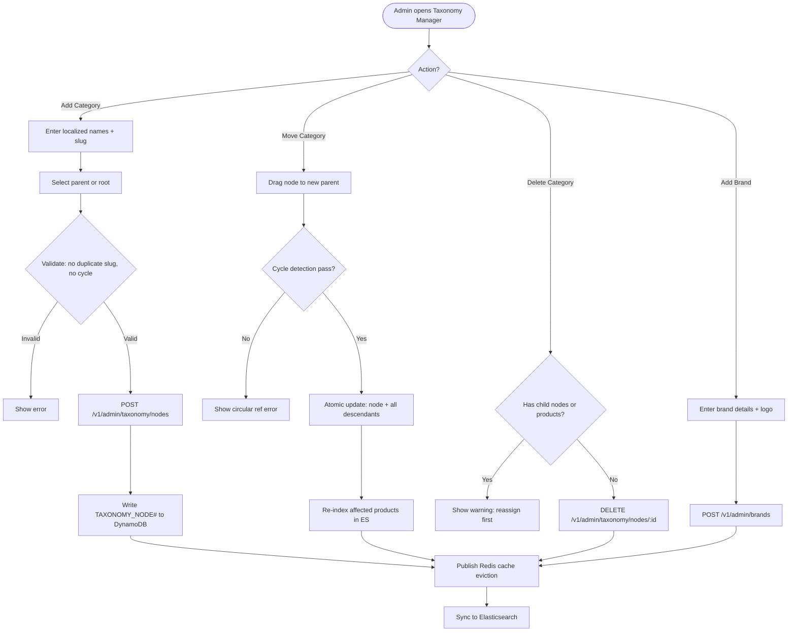

# US-2.1.2: Unlimited N-Level Category Taxonomy & Brand Management

> **Spec Kit Specification**: [Specification Lifecycle Active (.specify/)](../../../.specify/memory/constitution.md)  
> **Domain Feature**: `catalog-and-discovery`  
> **Domain Module**: `storefront-and-catalog`  
> **Autonomous Behaviour**: `n-level-taxonomy`  
> **Client Framework Path**: `apps/storefront/src/features/catalog-and-discovery/modules/storefront-and-catalog/behaviours/n-level-taxonomy`  
> **Backend Framework Path**: `backend/src/features/catalog-and-discovery/modules/storefront-and-catalog/behaviours/n-level-taxonomy`  
> **Execution Sprint**: [Sprint 1.1](../../sprints/README.md)  
> **Slicing Standard**: [7-PR Vertical Slicing Framework](../../sprints/README.md#the-7-pr-vertical-slicing-standard)  
> **Security Gateway**: [ASVS Level 2 Verification Gate (security-audit)](#5-security-gateway-powered-by-security-audit)

---

## 1. Spec Kit Specification: User Story & Domain Scope

### 1.1 User Story Narrative

**As a** Store Administrator,  
**I want to** create an unlimited N-level hierarchy of localized categories and sub-categories (e.g., Electronics > Computers > Laptops > Gaming Laptops) and manage verified brands,  
**So that** any vertical can be modeled without code changes or database migrations.

### 1.2 Acceptance Criteria (Gherkin Scenarios)

```gherkin
Feature: N-Level Category Taxonomy
  Scenario: [AC-US-2.1.2-01] Create a root category
    Given the admin is on "/en-US/admin/catalog-taxonomy"
    When the admin clicks "Add Root Category"
    And enters name_en="Electronics", name_ar="إلكترونيات", slug_en="electronics"
    Then a TAXONOMY_NODE# record is created with depth=0, parent_node_id=null
    And the category appears in the tree view
    And Redis cache is evicted via Pub/Sub
  Scenario: [AC-US-2.1.2-02] Create a 4th-level sub-category
    Given the category tree: Electronics > Computers > Laptops
    When the admin drags "Gaming Laptops" under "Laptops"
    Then TAXONOMY_NODE# is created with depth=3, ancestors=[electronics, computers, laptops, gaming-laptops]
    And all attached property definitions from parent categories are inherited
  Scenario: [AC-US-2.1.2-03] Move a sub-category to a different parent
    Given "Gaming Laptops" is under "Laptops"
    When the admin drags "Gaming Laptops" to be under "Desktops"
    Then ancestors_path is atomically updated for "Gaming Laptops" and all its descendants
    And Elasticsearch re-indexes all affected products
    And no circular reference is created (cycle detection)
  Scenario: [AC-US-2.1.2-04] Attempt to create circular reference
    Given "A" is parent of "B" which is parent of "C"
    When the admin tries to move "A" under "C"
    Then a validation error "Circular category reference detected" is shown
    And no changes are persisted
  Scenario: [AC-US-2.1.2-05] Create a brand and associate with categories
    Given the admin is on the Brand Registry tab
    When the admin creates brand "ASUS" with localized names and logo
    And associates it with categories "Laptops" and "Monitors"
    Then BRAND# record is created in DynamoDB
    And the brand appears as a filter option on associated category pages
  Scenario: [AC-US-2.1.2-06] Delete category with products
    Given "Gaming Laptops" has 15 products assigned
    When the admin attempts to delete "Gaming Laptops"
    Then a warning "This category has 15 products. Reassign or remove them first." is shown
    And the category is not deleted
```

### 1.3 Test Cases & Traceability Matrix

| # | Test Case | Type | Expected Result |
|:--|:----------|:-----|:----------------|
| TC-2.1.2-01 | Create root category | Happy Path | Node created at depth 0 |
| TC-2.1.2-02 | Create 4-level deep sub-category | Happy Path | Correct ancestor chain |
| TC-2.1.2-03 | Create 20-level deep category | Edge Case | Supported, performance acceptable |
| TC-2.1.2-04 | Move category to new parent | Happy Path | All descendants updated |
| TC-2.1.2-05 | Circular reference detection | Validation | Error, no change |
| TC-2.1.2-06 | Delete empty category | Happy Path | Category removed |
| TC-2.1.2-07 | Delete category with products | Validation | Warning, deletion blocked |
| TC-2.1.2-08 | Duplicate slug in same parent | Validation | Error shown |
| TC-2.1.2-09 | Brand with Arabic-only name | i18n | RTL name stored and searchable |
| TC-2.1.2-10 | Concurrent category edits | Concurrency | ETag If-Match → 412 on conflict |

---

## 2. Behavior-Centric Architecture & Folder Blueprint

This user story is implemented directly inside the respective **Expo client** and **Cargo Lambda Axum backend** frameworks according to the **Locality of Behavior (LoB)** architectural law. Private services, designs, logic, types, and constants are strictly colocated within their framework behaviour directory.

### 2.1 Colocated Behaviour Directory Tree

#### Client Architecture (Universal Expo SDK 58):
```
apps/storefront/src/features/catalog-and-discovery/modules/storefront-and-catalog/behaviours/n-level-taxonomy/
├── services/
│   │   ├── taxonomy_repository.rs
│   │   ├── category_cache_service.rs
│   │   ├── taxonomy_api.ts
├── designs/
│   │   ├── CategoryTreeView.tsx
│   │   ├── CategoryBreadcrumbBar.tsx
│   │   ├── BrandFilterGrid.tsx
├── logic/
│   │   ├── useCategoryTree.ts
│   │   ├── cycle_detection_validator.rs
│   │   ├── ancestor_path_calc.rs
├── types/
│   │   ├── TaxonomyNode.ts
│   │   ├── BrandRecord.ts
│   │   ├── AncestorsPath.ts
└── constants/
│   │   ├── TaxonomyEndpoints.ts
│   │   ├── DepthLimits.ts
│   │   ├── TaxonomyErrorCodes.ts
```

#### Backend Architecture (Cargo Lambda + Axum 0.8):
```
backend/src/features/catalog-and-discovery/modules/storefront-and-catalog/behaviours/n-level-taxonomy/
├── services/
│   │   ├── taxonomy_repository.rs
│   │   ├── category_cache_service.rs
│   │   ├── taxonomy_api.ts
├── logic/
│   │   ├── useCategoryTree.ts
│   │   ├── cycle_detection_validator.rs
│   │   ├── ancestor_path_calc.rs
├── types/
│   │   ├── TaxonomyNode.ts
│   │   ├── BrandRecord.ts
│   │   ├── AncestorsPath.ts
└── constants/
│   │   ├── TaxonomyEndpoints.ts
│   │   ├── DepthLimits.ts
│   │   ├── TaxonomyErrorCodes.ts
```

### 2.2 Scoping & Promotion Blueprint

| Layer / Tier | Client Path (Expo) | Backend Path (Cargo Lambda / Axum) | Purpose & Promotion Rules |
| :--- | :--- | :--- | :--- |
| **Behaviour-Local** | `.../behaviours/n-level-taxonomy/` | `.../behaviours/n-level-taxonomy/` | **Default Private Scope**: Colocated services, designs, logic, types, and constants private to this story. |
| **Module-Shared** | `.../modules/storefront-and-catalog/_shared/` | `.../modules/storefront-and-catalog/_shared/` | Shared domain primitives and UI elements used by $\ge 2$ behaviours in `storefront-and-catalog`. |
| **Feature-Shared** | `.../features/catalog-and-discovery/_shared/` | `.../features/catalog-and-discovery/_shared/` | Feature-level contracts, ports, and cross-module bridges across `catalog-and-discovery`. |
| **Framework-Shared** | `apps/storefront/src/shared/` | `backend/crates/kernel-core/` | System-wide microkernel traits, `Money` arithmetic, RFC 9110 ETag middleware, and database adapters. |

---

## 3. Technical Implementation Plan (Spec Kit Plan)

### 3.1 Domain Invariants & Storage Schema
- **State Machine**: Enforces valid state transitions and rejects unauthorized or out-of-order mutations.
- **Data Persistence**: Single-table Amazon DynamoDB partitioning (`PK = TENANT#<id>`, `SK = ENTITY#<id>`) paired with reactive local-first WatermelonDB sync.
- **Freshness & Caching**: Multi-tier caching (L1 Moka in-memory + L2 ElastiCache Redis) with RFC 9110 `ETag` conditional `304 Not Modified` short-circuiting.

### 3.2 Activity & Interaction Diagram



---

## 4. Granular Implementation Tasks (Spec Kit Tasks)

### Phase 1: Core Domain Logic, Types & Constants
- [ ] **Task 1.1 (Types)**: Define strongly typed models and DTO schemas in `types/`.
- [ ] **Task 1.2 (Constants)**: Define routes, action codes, and validation limits in `constants/`.
- [ ] **Task 1.3 (Logic)**: Implement pure business logic, calculations, and state machines in `logic/`.
- [ ] **Task 1.4 (Unit Tests)**: Write pure property-based and unit tests verifying domain invariants.

### Phase 2: Services & Infrastructure Adapters
- [ ] **Task 2.1 (API / Gateway)**: Implement client adapters and backend handlers in `services/`.
- [ ] **Task 2.2 (ETag & Cache)**: Integrate RFC 9110 ETag headers and multi-tier caching (Moka L1 / Redis L2).
- [ ] **Task 2.3 (Storage & Sync)**: Implement DynamoDB storage operations and WatermelonDB delta sync.
- [ ] **Task 2.4 (Integration Tests)**: Verify service contract tests and real database conditional writes.

### Phase 3: Platform-Adaptive Designs & UI
- [ ] **Task 3.1 (UI Presentation)**: Build platform-adaptive screens and SDUI components in `designs/`.
- [ ] **Task 3.2 (Headless Hooks)**: Bind headless domain hooks from `logic/` into the UI presentation.
- [ ] **Task 3.3 (i18n & RTL)**: Implement bidirectional RTL/LTR layout mirroring and localized font switching.
- [ ] **Task 3.4 (Component Tests)**: Test empty, loading, offline, and error states across web and mobile.

### Phase 4: Security Gateway Verification & Release Readiness
- [ ] **Task 4.1 (Abuse Testing)**: Execute automated adversarial penetration tests against the threat matrix.
- [ ] **Task 4.2 (Zero-Trust Audit)**: Verify strict tenant isolation and object-level authorization (IDOR).
- [ ] **Task 4.3 (SAST & Audit)**: Run static analysis, dependency audit, and secret scanning.
- [ ] **Task 4.4 (Gate Sign-Off)**: Obtain independent security sign-off for the G2 Security Gateway.

---

## 5. Security Gateway (Powered by security-audit)

### 5.1 Trust Boundaries & Security Actors
- **Trust Boundaries**:
  - `Untrusted Zone`: Mobile client app, public web browser, and external network callers.
  - `Gateway Edge`: AWS CloudFront, API Gateway, and Cognito JWT authentication guard.
  - `Secure Application Boundary`: Axum Tower route extractors enforcing tenant and RBAC/ABAC isolation.
  - `Encrypted Storage & Secret Vault`: Amazon DynamoDB KMS-encrypted tables and AWS KMS vault.
- **Authorized Principals**:
  - Identified Actors: `AuthenticatedCustomer`, `B2bBuyer`, `Vendor`, `StoreAdmin`, or `AnonymousShopper` (read-only).
  - Multi-Tenancy Invariant: Every request must extract `tenant_id` from verified JWT claims. Injections via query params or payload body are rejected with `403 Forbidden`.

### 5.2 Threat Modeling & Abuse Matrix (STRIDE / ASVS)

| Threat Vector | Severity | Vulnerability Mechanism | Mitigating Control & Security Invariant |
| :--- | :--- | :--- | :--- |
| **Spoofing & Impersonation** | Critical | Forged `sub` or `tenant_id` identity claims | Server-side RS256 JWKS signature verification; strict claims extraction in Axum. |
| **Tampering & Invariant Bypass** | High | Manipulating payload parameters or prices | Authoritative server recalculation; strict schema validation; BLAKE3 ETag integrity checks. |
| **Information Disclosure (IDOR)** | Critical | Cross-tenant or cross-user data scraping | Explicit `PK = TENANT#<id>` partition filtering on every database and cache operation. |
| **Denial of Service / Abuse** | High | Circular taxonomy reference exploits, unauthorized category subtree reassignment, and IDOR on brand editing | Token-bucket rate limiting per IP and account; strict input length validation. |
| **Elevation of Privilege** | Critical | Bypassing role-based permission checks | Tower extractors (`RequireStoreAdmin`, `RequireVendor`) guard sensitive endpoints. |

### 5.3 Cryptographic & Data Protection Controls
- **Encryption in Transit**: TLS 1.3 enforced on all external and internal endpoints; HSTS active.
- **Encryption at Rest**: DynamoDB AWS KMS customer-managed keys; AES-256-GCM for sensitive client tokens in `expo-secure-store`.
- **PII & Secret Redaction**: Passwords, OTPs, auth tokens, and credit card numbers are stripped from logs and traces via `tracing` redaction filters.

### 5.4 Automated Security Verification Checklist
- [ ] **SAST Analysis**: Clean report from static code analyzers; 0 high or critical vulnerabilities.
- [ ] **Dependency Audit**: `cargo deny` and `bun audit` pass with 0 unreviewed security advisories.
- [ ] **Abuse & IDOR Fuzzing**: Test suite confirms that requests with modified `tenant_id` or `user_id` fail with `401 Unauthorized` or `403 Forbidden`.
- [ ] **Secret Scanning**: Gitleaks scanner confirms zero hardcoded credentials, API keys, or private keys.

### 5.5 Security Gateway (G2) Sign-Off Checklist
- [ ] Threat boundary and entry points verified against OWASP ASVS Level 2 requirements.
- [ ] Multi-tenant isolation verified with automated cross-tenant penetration test.
- [ ] Anti-abuse and rate limiting confirmed active on all public interfaces.
- [ ] Audit log redaction verified — zero plaintext secrets in output logs.
- [ ] Independent reviewer sign-off obtained; zero open Critical or High findings.

---

## 6. Validation Gates & Acceptance Sign-Off

**Status: Pending — specification only; no implementation evidence.** All [G0–G4 quality gates](../../QUALITY_GATES.md) apply to this story. The following checks add to its acceptance criteria and test cases; they do not replace them.

### G1 — Test coverage
- [ ] **US-2.1.2-G1:** Automated test suite maps 100% of acceptance criteria and test cases with >=90% line and >=85% branch coverage in affected packages.

### G2 — Security audit
- [ ] **US-2.1.2-G2:** Verify zero-trust tenant isolation, object-level authorization (IDOR), and defense against Circular taxonomy reference exploits, unauthorized category subtree reassignment, and IDOR on brand editing. No unresolved critical or high findings.

### G3 — Architecture and maintainability
- [ ] **US-2.1.2-G3:** Strict compliance with framework colocation (`apps/storefront/src/features/` or `backend/src/features/`), zero-clone borrowing discipline in Rust, and clean domain boundaries.

### G4 — Integrated acceptance
- [ ] **US-2.1.2-G4:** End-to-end user journey validation across supported platforms (Web, iOS, Android) and verified sandbox integration.

---

[← Back to Module storefront-and-catalog Catalog (README.md)](README.md) | [Master User Stories Index](../README.md)
