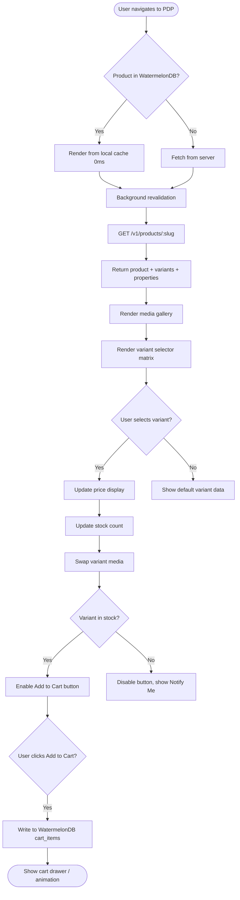

# US-2.1.5: Product Detail Page with Variant Configuration

> **Spec Kit Specification**: [Specification Lifecycle Active (.specify/)](../../../.specify/memory/constitution.md)  
> **Domain Feature**: `catalog-and-discovery`  
> **Domain Module**: `storefront-and-catalog`  
> **Autonomous Behaviour**: `product-detail-configurator`  
> **Client Framework Path**: `apps/storefront/src/features/catalog-and-discovery/modules/storefront-and-catalog/behaviours/product-detail-configurator`  
> **Backend Framework Path**: `backend/src/features/catalog-and-discovery/modules/storefront-and-catalog/behaviours/product-detail-configurator`  
> **Execution Sprint**: [Sprint 1.1](../../sprints/README.md)  
> **Slicing Standard**: [10-PR Vertical Slicing Framework](../../sprints/README.md#the-10-pr-vertical-slicing-standard-aligned-with-10-pillar-system-architecture)  
> **Security Gateway**: [ASVS Level 2 Verification Gate (security-audit)](#5-security-gateway-powered-by-security-audit)

---

## 1. Spec Kit Specification: User Story & Domain Scope

### 1.1 User Story Narrative

**As a** Shopper viewing a product,  
**I want to** see a rich product detail page with a media gallery, variant selector matrix (Color × Size), pricing, stock status, COD eligibility badge, and custom property specifications,  
**So that** I can evaluate the product and select the exact variant I want before adding to cart.

### 1.2 Acceptance Criteria (Gherkin Scenarios)

```gherkin
Feature: Product Detail Page
  Scenario: [AC-US-2.1.5-01] View product with variants
    Given the user navigates to "/ar-EG/products/asus-rog-strix-g16"
    Then the PDP renders with Arabic title, description, and specs
    And a media gallery with zoomable images and video is shown
    And the variant selector shows available Color × Size combinations
    And unavailable combinations are greyed out
    And the price updates when selecting a different variant
  Scenario: [AC-US-2.1.5-02] Select variant and see price update
    Given the product has Color options [Black, White] and Size options [15", 16"]
    When the user selects Color=White, Size=16"
    Then the displayed price updates to the variant-specific price
    And the stock count updates (e.g., "Only 3 left")
    And the media gallery switches to White variant images
  Scenario: [AC-US-2.1.5-03] Out-of-stock variant
    Given the user selects Color=Black, Size=15" which is out of stock
    Then the "Add to Cart" button is disabled
    And a "Notify when available" button appears
  Scenario: [AC-US-2.1.5-04] COD eligibility badge
    Given the product has supports_cod=true
    Then a "Cash on Delivery Available" badge is shown
    And clicking it shows a tooltip explaining the deposit + cash breakdown
  Scenario: [AC-US-2.1.5-05] Product not found
    Given the user navigates to "/en-US/products/nonexistent-slug"
    Then a 404 page is displayed with suggestions for similar products
  Scenario: [AC-US-2.1.5-LAW] Global e-commerce legal compliance and pricing transparency regulations
    Given a consumer viewing a product detail page with price discounts and variant selections
    When calculating and displaying variant pricing and promotional badges
    Then any discount claim must display the prior lowest price applied during a period not less than 30 days prior (EU Omnibus Art 6a)
    And standard unit pricing (e.g. price per kg, liter, or meter) must be displayed where required by the Price Indication Directive
    And the displayed product price must clearly indicate tax inclusion (VAT) or explicit jurisdictional tax terms
```

### 1.3 Test Cases & Traceability Matrix

| # | Test Case | Type | Expected Result |
|:--|:----------|:-----|:----------------|
| TC-2.1.5-01 | PDP with 3 variant axes | Happy Path | Matrix renders correctly |
| TC-2.1.5-02 | Variant price override | Happy Path | Price updates on selection |
| TC-2.1.5-03 | Out-of-stock variant | Edge Case | Add to cart disabled |
| TC-2.1.5-04 | Product with no variants | Edge Case | Simple PDP, no selector |
| TC-2.1.5-05 | COD badge for eligible product | Happy Path | Badge shown with tooltip |
| TC-2.1.5-06 | Non-COD product | Edge Case | No COD badge |
| TC-2.1.5-07 | 404 product slug | Error | 404 page with suggestions |
| TC-2.1.5-08 | RTL media gallery | i18n | Gallery navigation mirrored |
| TC-2.1.5-09 | Product with 50+ images | Performance | Lazy loading, <2s initial |
| TC-2.1.5-10 | Deep link to specific variant | UX | Variant pre-selected from URL |
| TC-2.1.5-LAW | Global legal & regulatory compliance (EU Omnibus Directive 2019/2161 Art 6a 30-day baseline, Price Indication Directive 98/6/EC) | Legal / Regulatory | Statutory compliance verified with zero legal or regulatory violations |

---

## 2. Behavior-Centric Architecture & Folder Blueprint

This user story is implemented directly inside the respective **Expo client** and **Cargo Lambda Axum backend** frameworks according to the **Locality of Behavior (LoB)** architectural law. Private services, designs, logic, types, and constants are strictly colocated within their framework behaviour directory.

### 2.1 Colocated Behaviour Directory Tree

#### Client Architecture (Universal Expo SDK 58):
```
apps/storefront/src/features/catalog-and-discovery/modules/storefront-and-catalog/behaviours/product-detail-configurator/
├── services/
│   │   ├── product_detail_client.rs
│   │   ├── inventory_checker_service.rs
│   │   ├── pdp_api.ts
├── designs/
│   │   ├── ProductGalleryCarousel.tsx
│   │   ├── VariantMatrixSelector.tsx
│   │   ├── PriceDisplayTag.tsx
├── logic/
│   │   ├── useProductConfigurator.ts
│   │   ├── cartesian_variant_solver.rs
│   │   ├── stock_threshold_calculator.ts
├── types/
│   │   ├── ProductDetailSchema.ts
│   │   ├── SkuVariant.ts
│   │   ├── VariantAxisSelection.ts
└── constants/
│   │   ├── PdpEndpoints.ts
│   │   ├── StockBadgeThresholds.ts
│   │   ├── PdpErrorCodes.ts
```

#### Backend Architecture (Cargo Lambda + Axum 0.8):
```
backend/src/features/catalog-and-discovery/modules/storefront-and-catalog/behaviours/product-detail-configurator/
├── services/
│   │   ├── product_detail_client.rs
│   │   ├── inventory_checker_service.rs
│   │   ├── pdp_api.ts
├── logic/
│   │   ├── useProductConfigurator.ts
│   │   ├── cartesian_variant_solver.rs
│   │   ├── stock_threshold_calculator.ts
├── types/
│   │   ├── ProductDetailSchema.ts
│   │   ├── SkuVariant.ts
│   │   ├── VariantAxisSelection.ts
└── constants/
│   │   ├── PdpEndpoints.ts
│   │   ├── StockBadgeThresholds.ts
│   │   ├── PdpErrorCodes.ts
```

### 2.2 Scoping & Promotion Blueprint

| Layer / Tier | Client Path (Expo) | Backend Path (Cargo Lambda / Axum) | Purpose & Promotion Rules |
| :--- | :--- | :--- | :--- |
| **Behaviour-Local** | `.../behaviours/product-detail-configurator/` | `.../behaviours/product-detail-configurator/` | **Default Private Scope**: Colocated services, designs, logic, types, and constants private to this story. |
| **Module-Shared** | `.../modules/storefront-and-catalog/_shared/` | `.../modules/storefront-and-catalog/_shared/` | Shared domain primitives and UI elements used by $\ge 2$ behaviours in `storefront-and-catalog`. |
| **Feature-Shared** | `.../features/catalog-and-discovery/_shared/` | `.../features/catalog-and-discovery/_shared/` | Feature-level contracts, ports, and cross-module bridges across `catalog-and-discovery`. |
| **Framework-Shared** | `apps/storefront/src/shared/` | `backend/crates/kernel-core/` | System-wide microkernel traits, `Money` arithmetic, RFC 9110 ETag middleware, and database adapters. |

---

## 3. Technical Implementation Plan (Spec Kit Plan)

### 3.1 Domain Invariants & Storage Schema
- **State Machine**: Enforces valid state transitions and rejects unauthorized or out-of-order mutations.
- **Data Persistence**: Single-table Amazon DynamoDB partitioning (`PK = TENANT#<id>`, `SK = ENTITY#<id>`) paired with reactive local-first WatermelonDB sync.
- **Freshness & Caching**: Multi-tier caching (L1 Moka in-memory + L2 ElastiCache Redis) with RFC 9110 `ETag` conditional `304 Not Modified` short-circuiting.

### 3.2 Activity & Interaction Diagram



---

## 4. Granular Implementation Tasks (Spec Kit Tasks)

### Phase 1: Core Domain Logic, Types & Constants
- [ ] **Task 1.1 (Types)**: Define strongly typed models and DTO schemas in `types/`.
- [ ] **Task 1.2 (Constants)**: Define routes, action codes, and validation limits in `constants/`.
- [ ] **Task 1.3 (Logic)**: Implement pure business logic, calculations, and state machines in `logic/`.
- [ ] **Task 1.4 (Unit Tests)**: Write pure property-based and unit tests verifying domain invariants.

### Phase 2: Services & Infrastructure Adapters
- [ ] **Task 2.1 (API / Gateway)**: Implement client adapters and backend handlers in `services/`.
- [ ] **Task 2.2 (ETag & Cache)**: Integrate RFC 9110 ETag headers and multi-tier caching (Moka L1 / Redis L2).
- [ ] **Task 2.3 (Storage & Sync)**: Implement DynamoDB storage operations and WatermelonDB delta sync.
- [ ] **Task 2.4 (Integration Tests)**: Verify service contract tests and real database conditional writes.

### Phase 3: Platform-Adaptive Designs & UI
- [ ] **Task 3.1 (UI Presentation)**: Build platform-adaptive screens and SDUI components in `designs/`.
- [ ] **Task 3.2 (Headless Hooks)**: Bind headless domain hooks from `logic/` into the UI presentation.
- [ ] **Task 3.3 (i18n & RTL)**: Implement bidirectional RTL/LTR layout mirroring and localized font switching.
- [ ] **Task 3.4 (Component Tests)**: Test empty, loading, offline, and error states across web and mobile.

### Phase 4: Security Gateway Verification & Release Readiness
- [ ] **Task 4.1 (Abuse Testing)**: Execute automated adversarial penetration tests against the threat matrix.
- [ ] **Task 4.2 (Zero-Trust Audit)**: Verify strict tenant isolation and object-level authorization (IDOR).
- [ ] **Task 4.3 (SAST & Audit)**: Run static analysis, dependency audit, and secret scanning.
- [ ] **Task 4.4 (Gate Sign-Off)**: Obtain independent security sign-off for the G2 Security Gateway.

---

## 5. Security Gateway (Powered by security-audit)

### 5.1 Trust Boundaries & Security Actors
- **Trust Boundaries**:
  - `Untrusted Zone`: Mobile client app, public web browser, and external network callers.
  - `Gateway Edge`: AWS CloudFront, API Gateway, and Cognito JWT authentication guard.
  - `Secure Application Boundary`: Axum Tower route extractors enforcing tenant and RBAC/ABAC isolation.
  - `Encrypted Storage & Secret Vault`: Amazon DynamoDB KMS-encrypted tables and AWS KMS vault.
- **Authorized Principals**:
  - Identified Actors: `AuthenticatedCustomer`, `B2bBuyer`, `Vendor`, `StoreAdmin`, or `AnonymousShopper` (read-only).
  - Multi-Tenancy Invariant: Every request must extract `tenant_id` from verified JWT claims. Injections via query params or payload body are rejected with `403 Forbidden`.

### 5.2 Threat Modeling & Abuse Matrix (STRIDE / ASVS)

| Threat Vector | Severity | Vulnerability Mechanism | Mitigating Control & Security Invariant |
| :--- | :--- | :--- | :--- |
| **Spoofing & Impersonation** | Critical | Forged `sub` or `tenant_id` identity claims | Server-side RS256 JWKS signature verification; strict claims extraction in Axum. |
| **Tampering & Invariant Bypass** | High | Manipulating payload parameters or prices | Authoritative server recalculation; strict schema validation; BLAKE3 ETag integrity checks. |
| **Information Disclosure (IDOR)** | Critical | Cross-tenant or cross-user data scraping | Explicit `PK = TENANT#<id>` partition filtering on every database and cache operation. |
| **Denial of Service / Abuse** | High | Inventory count harvesting, hidden variant pricing bypass, and manipulated price-list overrides | Token-bucket rate limiting per IP and account; strict input length validation. |
| **Elevation of Privilege** | Critical | Bypassing role-based permission checks | Tower extractors (`RequireStoreAdmin`, `RequireVendor`) guard sensitive endpoints. |

### 5.3 Cryptographic & Data Protection Controls
- **Encryption in Transit**: TLS 1.3 enforced on all external and internal endpoints; HSTS active.
- **Encryption at Rest**: DynamoDB AWS KMS customer-managed keys; AES-256-GCM for sensitive client tokens in `expo-secure-store`.
- **PII & Secret Redaction**: Passwords, OTPs, auth tokens, and credit card numbers are stripped from logs and traces via `tracing` redaction filters.

### 5.4 Automated Security Verification Checklist
- [ ] **SAST Analysis**: Clean report from static code analyzers; 0 high or critical vulnerabilities.
- [ ] **Dependency Audit**: `cargo deny` and `bun audit` pass with 0 unreviewed security advisories.
- [ ] **Abuse & IDOR Fuzzing**: Test suite confirms that requests with modified `tenant_id` or `user_id` fail with `401 Unauthorized` or `403 Forbidden`.
- [ ] **Secret Scanning**: Gitleaks scanner confirms zero hardcoded credentials, API keys, or private keys.

### 5.5 Security Gateway (G2) Sign-Off Checklist
- [ ] Threat boundary and entry points verified against OWASP ASVS Level 2 requirements.
- [ ] Multi-tenant isolation verified with automated cross-tenant penetration test.
- [ ] Anti-abuse and rate limiting confirmed active on all public interfaces.
- [ ] Audit log redaction verified — zero plaintext secrets in output logs.
- [ ] Independent reviewer sign-off obtained; zero open Critical or High findings.

---

## 6. Validation Gates & Acceptance Sign-Off

**Status: Pending — specification only; no implementation evidence.** All [G0–G4 quality gates + G-Review + G-Law](../../QUALITY_GATES.md) apply to this story. The following checks add to its acceptance criteria and test cases; they do not replace them.

### G1 — Test coverage
- [ ] **US-2.1.5-G1:** Automated test suite maps 100% of acceptance criteria and test cases with >=90% line and >=85% branch coverage in affected packages.

### G2 — Security audit
- [ ] **US-2.1.5-G2:** Verify zero-trust tenant isolation, object-level authorization (IDOR), and defense against Inventory count harvesting, hidden variant pricing bypass, and manipulated price-list overrides. No unresolved critical or high findings.

### G3 — Architecture and maintainability
- [ ] **US-2.1.5-G3:** Strict compliance with framework colocation (`apps/storefront/src/features/` or `backend/src/features/`), zero-clone borrowing discipline in Rust, and clean domain boundaries.

### G-Review — Code review
- [ ] **US-2.1.5-G-Review:** Independent senior code review signed off by the Code Reviewer; verification across Correctness, Security, Maintainability, Performance, and Testing using the Agency-Agents code review standard; zero open Blocker or unresolved Suggestion findings.

### G-Law — Law validation
- [ ] **US-2.1.5-G-Law:** Independent verification against global e-commerce legal and statutory requirements: EU Omnibus Directive (Art 6a 30-day discount baseline), EU Price Indication Directive (unit pricing), and GPSR manufacturer traceability; certified by compliance reviewer (`agency-legal-compliance-checker`).

### G4 — Integrated acceptance
- [ ] **US-2.1.5-G4:** End-to-end user journey validation across supported platforms (Web, iOS, Android) and verified sandbox integration.

---

[← Back to Module storefront-and-catalog Catalog (README.md)](README.md) | [Master User Stories Index](../README.md)
