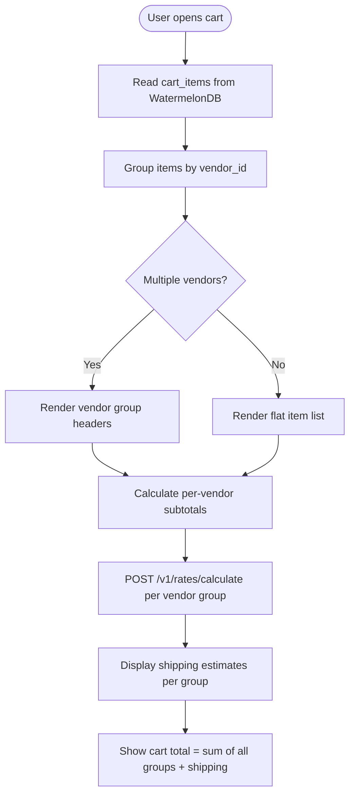
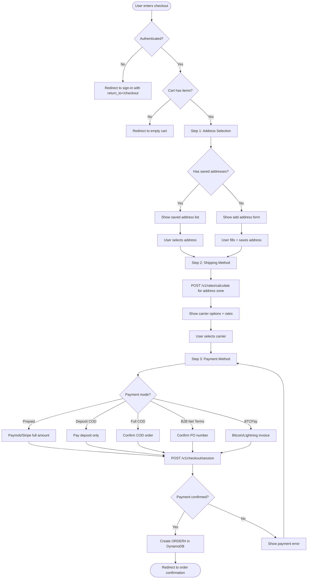
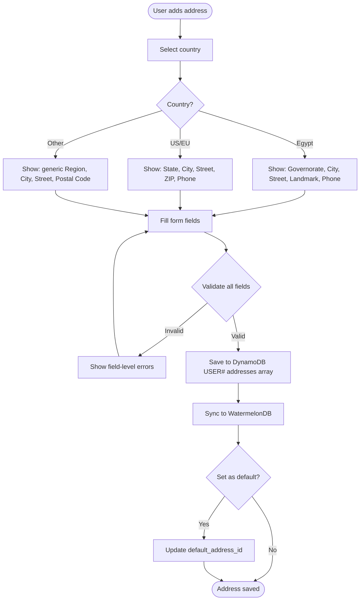

# Module 03: Cart & Checkout

> **Slice**: v1.0 · **Sprint**: 1.2 · **Stories**: US-3.1.1 – US-3.1.4

## Overview

Covers offline-first cart management via WatermelonDB, multi-vendor cart grouping, multi-step checkout flow, and address management with governorate-based rate estimation.

## Pages

| Page Route | Access | Direction | Primary Hook |
|:-----------|:-------|:----------|:-------------|
| `/[locale]/cart` | Public / Auth | RTL / LTR | `useOfflineCart` |
| `/[locale]/checkout` | Authenticated | RTL / LTR | `useSplitCodCheckout` |

## API Endpoints

| Method | Endpoint | Lambda | Description |
|:-------|:---------|:-------|:------------|
| POST | `/v1/cart/items` | `checkout-webhooks-api` | Add item to server cart |
| PUT | `/v1/cart/items/:sku` | `checkout-webhooks-api` | Update item quantity |
| DELETE | `/v1/cart/items/:sku` | `checkout-webhooks-api` | Remove item from cart |
| POST | `/v1/cart/bulk-items` | `checkout-webhooks-api` | B2B bulk matrix add |
| POST | `/v1/rates/calculate` | `checkout-webhooks-api` | Shipping + COD rate calculation |
| POST | `/v1/checkout/session` | `checkout-webhooks-api` | Create checkout payment session |
| POST | `/v1/sync/push` | `storefront-sdui-api` | Sync offline cart changes |

---

## US-3.1.1: Offline-First Cart with WatermelonDB Sync

**As a** Shopper on a mobile device with intermittent connectivity,  
**I want** my cart to work offline using WatermelonDB and sync to the server when connectivity restores,  
**So that** I never lose my cart contents regardless of network conditions.

### Acceptance Criteria

```gherkin
Feature: Offline-First Cart

  Scenario: Add item to cart while offline
    Given the user is offline
    When the user clicks "Add to Cart" on a product page
    Then the item is written to the local WatermelonDB cart_items table
    And the cart badge count updates immediately
    And a pending sync indicator appears

  Scenario: Cart sync on reconnection
    Given the user has 3 items added offline
    When the device regains connectivity
    Then WatermelonDB synchronize() pushes changes to POST /v1/sync/push
    And the server validates stock availability for all items
    And any unavailable items are flagged with a warning

  Scenario: Concurrent cart modification on another device
    Given the user has the same account on phone and web
    And adds item A on phone and item B on web
    When both devices sync
    Then the cart contains both items A and B (union merge)
    And no items are lost

  Scenario: Remove last item from cart
    When the user removes the last item from the cart
    Then the cart shows an empty state with "Continue Shopping" button
    And the cart badge shows 0

  Scenario: Quantity exceeds available stock
    Given a product has 5 units in stock
    When the user tries to set quantity to 10
    Then the quantity is capped at 5
    And a warning "Only 5 available" is shown
```

### Test Cases

| # | Test Case | Type | Expected Result |
|:--|:----------|:-----|:----------------|
| TC-3.1.1-01 | Add item offline | Happy Path | Local cart updated, sync pending |
| TC-3.1.1-02 | Sync on reconnection | Happy Path | Server cart matches local |
| TC-3.1.1-03 | Remove item | Happy Path | Item removed, badge updated |
| TC-3.1.1-04 | Quantity > stock | Validation | Capped at max stock |
| TC-3.1.1-05 | Quantity = 0 | Edge Case | Item removed from cart |
| TC-3.1.1-06 | Negative quantity | Validation | Rejected |
| TC-3.1.1-07 | Add same item twice | Edge Case | Quantity incremented |
| TC-3.1.1-08 | 50 items in cart | Performance | No lag in UI |
| TC-3.1.1-09 | Cross-device merge | Concurrency | Union merge, no data loss |
| TC-3.1.1-10 | Deleted product in cart | Error | Warning + remove option |

### Activity Diagram

```mermaid
flowchart TD
    A([User adds item to cart]) --> B{Online?}
    B -->|Yes| C[Write to WatermelonDB + POST /v1/cart/items]
    B -->|No| D[Write to WatermelonDB only]
    D --> E[Show pending sync indicator]
    C --> F[Server validates stock]
    F --> G{Stock available?}
    G -->|Yes| H[Cart updated, badge count++]
    G -->|No| I[Show "Out of stock" warning]
    
    E --> J{Connectivity restored?}
    J -->|Yes| K[WatermelonDB synchronize push]
    K --> L[Server reconciles cart]
    L --> M{Conflicts?}
    M -->|Yes| N[Show item availability warnings]
    M -->|No| H
    J -->|No| O[Continue offline with local cart]
```

---

## US-3.1.2: Multi-Vendor Cart Grouping & Shipping Estimation

**As a** Shopper with items from multiple vendors in my cart,  
**I want** my cart to visually group items by vendor and show per-vendor shipping estimates,  
**So that** I understand the shipping cost breakdown before checkout.

### Acceptance Criteria

```gherkin
Feature: Multi-Vendor Cart Grouping

  Scenario: Cart with items from 3 vendors
    Given the cart has items from Vendor A, Vendor B, and Vendor C
    Then the cart page groups items into 3 vendor sections
    And each section shows the vendor name and subtotal
    And per-vendor shipping estimates are calculated separately

  Scenario: Single-vendor cart
    Given all cart items are from the same vendor
    Then no vendor grouping header is shown
    And a single shipping estimate is displayed

  Scenario: Remove all items from one vendor group
    Given the cart has items from Vendor A and Vendor B
    When the user removes all Vendor A items
    Then the Vendor A group disappears
    And shipping is recalculated for Vendor B only
```

### Test Cases

| # | Test Case | Type | Expected Result |
|:--|:----------|:-----|:----------------|
| TC-3.1.2-01 | 3-vendor cart grouping | Happy Path | 3 groups with subtotals |
| TC-3.1.2-02 | Single vendor | Edge Case | No group headers |
| TC-3.1.2-03 | Remove vendor group | Happy Path | Group disappears, recalc |
| TC-3.1.2-04 | Per-vendor shipping estimate | Happy Path | Separate rates per vendor |
| TC-3.1.2-05 | 10 vendors in cart | Performance | All groups render <200ms |

### Activity Diagram



---

## US-3.1.3: Multi-Step Checkout Flow

**As an** authenticated Shopper,  
**I want** a multi-step checkout that guides me through address selection, shipping carrier choice, and payment method selection,  
**So that** I complete my purchase with clarity about costs at each step.

### Acceptance Criteria

```gherkin
Feature: Multi-Step Checkout

  Scenario: Complete checkout flow
    Given the user navigates to "/[locale]/checkout" with items in cart
    Then Step 1: Address Selection is shown with saved addresses
    When the user selects an address (Mansoura, Dakahlia)
    Then Step 2: Shipping Method is shown with carrier options and rates
    When the user selects Bosta domestic delivery
    Then Step 3: Payment Method is shown with options (Prepaid, Deposit COD, Full COD)
    When the user selects "Full Prepaid" and completes payment
    Then the order is created and the user is redirected to confirmation

  Scenario: Add new address during checkout
    Given the user has no saved addresses
    When the user clicks "Add New Address"
    Then a localized address form appears (Governorate/District for EG, State/Zip for US)
    And the new address is saved to the user's address book

  Scenario: Cart becomes empty during checkout
    Given the user is on Step 2 of checkout
    When another session removes the last cart item
    Then the user is redirected to the empty cart page
    And a message "Your cart is empty" is shown

  Scenario: Price change during checkout
    Given the user started checkout with item price = 1000 EGP
    When the vendor updates the price to 1200 EGP mid-checkout
    Then a warning "Price has changed for {item}" is shown
    And the user must acknowledge before proceeding
```

### Test Cases

| # | Test Case | Type | Expected Result |
|:--|:----------|:-----|:----------------|
| TC-3.1.3-01 | Complete 3-step checkout | Happy Path | Order created |
| TC-3.1.3-02 | Add new address | Happy Path | Address saved, used in order |
| TC-3.1.3-03 | No saved addresses | Edge Case | Add address form shown |
| TC-3.1.3-04 | Cart empty during checkout | Error | Redirect to cart |
| TC-3.1.3-05 | Price changed mid-checkout | Concurrency | Warning + acknowledgement |
| TC-3.1.3-06 | Stock depleted mid-checkout | Concurrency | Error, item removed |
| TC-3.1.3-07 | Back button navigation | UX | Previous step restored |
| TC-3.1.3-08 | Checkout timeout (30 min) | Edge Case | Session expired, restart |
| TC-3.1.3-09 | RTL checkout steps | i18n | Steps flow right-to-left |
| TC-3.1.3-10 | Browser refresh mid-checkout | UX | State restored from step 1 |

### Activity Diagram



---

## US-3.1.4: Localized Address Management

**As a** Customer in Egypt/MENA or internationally,  
**I want** the address form to dynamically adapt to my country (Governorate/District for EG, State/Zip for US/EU),  
**So that** I can enter my delivery address accurately in my local format.

### Acceptance Criteria

```gherkin
Feature: Localized Address Management

  Scenario: Egyptian address entry
    Given the user selects country = Egypt
    Then the form shows: Governorate (dropdown), City/District, Street, Landmark, Phone
    And governorate options are in Arabic for ar-EG locale
    And landmark field is optional but encouraged

  Scenario: US address entry
    Given the user selects country = United States
    Then the form shows: State (dropdown), City, Street, ZIP Code
    And ZIP code validation enforces 5 or 9 digit format

  Scenario: Address book management
    Given the user has 3 saved addresses
    When the user sets one as default
    Then that address is pre-selected in checkout
    And can be edited or deleted from the profile page
```

### Test Cases

| # | Test Case | Type | Expected Result |
|:--|:----------|:-----|:----------------|
| TC-3.1.4-01 | Egyptian address with governorate | Happy Path | Valid address saved |
| TC-3.1.4-02 | US address with ZIP code | Happy Path | Valid address saved |
| TC-3.1.4-03 | Invalid ZIP code format | Validation | Error shown |
| TC-3.1.4-04 | Set default address | Happy Path | Default used in checkout |
| TC-3.1.4-05 | Delete last address | Edge Case | No default remains |
| TC-3.1.4-06 | Arabic address with RTL | i18n | Fields align RTL |
| TC-3.1.4-07 | Address with special characters | Validation | Sanitized but accepted |
| TC-3.1.4-08 | Max 10 saved addresses | Edge Case | Error when adding 11th |

### Activity Diagram


