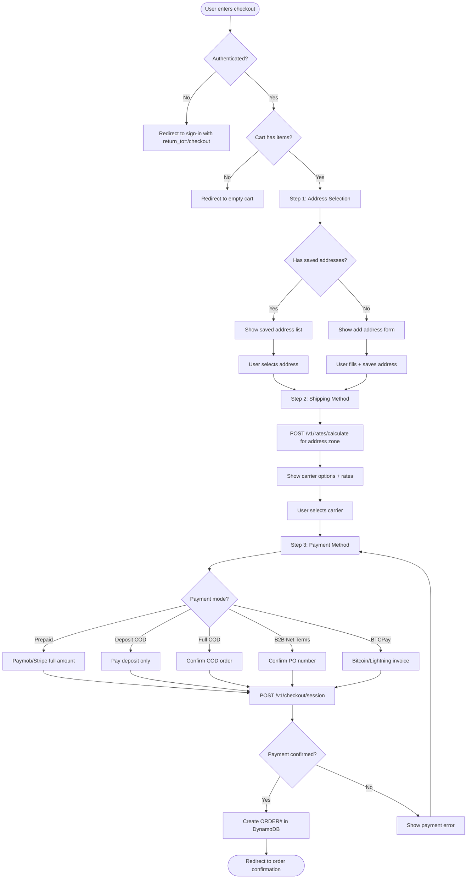

# US-3.1.3: Multi-Step Checkout Flow

> **Spec Kit Specification**: [Specification Lifecycle Active (.specify/)](../../../.specify/memory/constitution.md)  
> **Domain Feature**: `order-processing-and-commerce`  
> **Domain Module**: `cart-and-checkout`  
> **Autonomous Behaviour**: `multi-step-checkout`  
> **Client Framework Path**: `apps/storefront/src/features/order-processing-and-commerce/modules/cart-and-checkout/behaviours/multi-step-checkout`  
> **Backend Framework Path**: `backend/src/features/order-processing-and-commerce/modules/cart-and-checkout/behaviours/multi-step-checkout`  
> **Execution Sprint**: [Sprint 1.2](../../sprints/README.md)  
> **Slicing Standard**: [7-PR Vertical Slicing Framework](../../sprints/README.md#the-7-pr-vertical-slicing-standard)  
> **Security Gateway**: [ASVS Level 2 Verification Gate (security-audit)](#5-security-gateway-powered-by-security-audit)

---

## 1. Spec Kit Specification: User Story & Domain Scope

### 1.1 User Story Narrative

**As an** authenticated Shopper,  
**I want** a multi-step checkout that guides me through address selection, shipping carrier choice, and payment method selection,  
**So that** I complete my purchase with clarity about costs at each step.

### 1.2 Acceptance Criteria (Gherkin Scenarios)

```gherkin
Feature: Multi-Step Checkout
  Scenario: [AC-US-3.1.3-01] Complete checkout flow
    Given the user navigates to "/[locale]/checkout" with items in cart
    Then Step 1: Address Selection is shown with saved addresses
    When the user selects an address (Mansoura, Dakahlia)
    Then Step 2: Shipping Method is shown with carrier options and rates
    When the user selects Bosta domestic delivery
    Then Step 3: Payment Method is shown with options (Prepaid, Deposit COD, Full COD)
    When the user selects "Full Prepaid" and completes payment
    Then the order is created and the user is redirected to confirmation
  Scenario: [AC-US-3.1.3-02] Add new address during checkout
    Given the user has no saved addresses
    When the user clicks "Add New Address"
    Then a localized address form appears (Governorate/District for EG, State/Zip for US)
    And the new address is saved to the user's address book
  Scenario: [AC-US-3.1.3-03] Cart becomes empty during checkout
    Given the user is on Step 2 of checkout
    When another session removes the last cart item
    Then the user is redirected to the empty cart page
    And a message "Your cart is empty" is shown
  Scenario: [AC-US-3.1.3-04] Price change during checkout
    Given the user started checkout with item price = 1000 EGP
    When the vendor updates the price to 1200 EGP mid-checkout
    Then a warning "Price has changed for {item}" is shown
    And the user must acknowledge before proceeding
```

### 1.3 Test Cases & Traceability Matrix

| # | Test Case | Type | Expected Result |
|:--|:----------|:-----|:----------------|
| TC-3.1.3-01 | Complete 3-step checkout | Happy Path | Order created |
| TC-3.1.3-02 | Add new address | Happy Path | Address saved, used in order |
| TC-3.1.3-03 | No saved addresses | Edge Case | Add address form shown |
| TC-3.1.3-04 | Cart empty during checkout | Error | Redirect to cart |
| TC-3.1.3-05 | Price changed mid-checkout | Concurrency | Warning + acknowledgement |
| TC-3.1.3-06 | Stock depleted mid-checkout | Concurrency | Error, item removed |
| TC-3.1.3-07 | Back button navigation | UX | Previous step restored |
| TC-3.1.3-08 | Checkout timeout (30 min) | Edge Case | Session expired, restart |
| TC-3.1.3-09 | RTL checkout steps | i18n | Steps flow right-to-left |
| TC-3.1.3-10 | Browser refresh mid-checkout | UX | State restored from step 1 |

---

## 2. Behavior-Centric Architecture & Folder Blueprint

This user story is implemented directly inside the respective **Expo client** and **Cargo Lambda Axum backend** frameworks according to the **Locality of Behavior (LoB)** architectural law. Private services, designs, logic, types, and constants are strictly colocated within their framework behaviour directory.

### 2.1 Colocated Behaviour Directory Tree

#### Client Architecture (Universal Expo SDK 58):
```
apps/storefront/src/features/order-processing-and-commerce/modules/cart-and-checkout/behaviours/multi-step-checkout/
├── services/
│   │   ├── checkout_session_client.rs
│   │   ├── inventory_reservation_service.rs
│   │   ├── checkout_api.ts
├── designs/
│   │   ├── CheckoutStepperView.tsx
│   │   ├── OrderSummaryCard.tsx
│   │   ├── PlaceOrderButton.tsx
├── logic/
│   │   ├── useCheckoutFlow.ts
│   │   ├── checkout_state_machine.ts
│   │   ├── inventory_expiry_timer.ts
├── types/
│   │   ├── CheckoutSession.ts
│   │   ├── CheckoutStepState.ts
│   │   ├── OrderPlacementResult.ts
└── constants/
│   │   ├── CheckoutRoutes.ts
│   │   ├── ReservationTimeouts.ts
│   │   ├── CheckoutErrorCodes.ts
```

#### Backend Architecture (Cargo Lambda + Axum 0.8):
```
backend/src/features/order-processing-and-commerce/modules/cart-and-checkout/behaviours/multi-step-checkout/
├── services/
│   │   ├── checkout_session_client.rs
│   │   ├── inventory_reservation_service.rs
│   │   ├── checkout_api.ts
├── logic/
│   │   ├── useCheckoutFlow.ts
│   │   ├── checkout_state_machine.ts
│   │   ├── inventory_expiry_timer.ts
├── types/
│   │   ├── CheckoutSession.ts
│   │   ├── CheckoutStepState.ts
│   │   ├── OrderPlacementResult.ts
└── constants/
│   │   ├── CheckoutRoutes.ts
│   │   ├── ReservationTimeouts.ts
│   │   ├── CheckoutErrorCodes.ts
```

### 2.2 Scoping & Promotion Blueprint

| Layer / Tier | Client Path (Expo) | Backend Path (Cargo Lambda / Axum) | Purpose & Promotion Rules |
| :--- | :--- | :--- | :--- |
| **Behaviour-Local** | `.../behaviours/multi-step-checkout/` | `.../behaviours/multi-step-checkout/` | **Default Private Scope**: Colocated services, designs, logic, types, and constants private to this story. |
| **Module-Shared** | `.../modules/cart-and-checkout/_shared/` | `.../modules/cart-and-checkout/_shared/` | Shared domain primitives and UI elements used by $\ge 2$ behaviours in `cart-and-checkout`. |
| **Feature-Shared** | `.../features/order-processing-and-commerce/_shared/` | `.../features/order-processing-and-commerce/_shared/` | Feature-level contracts, ports, and cross-module bridges across `order-processing-and-commerce`. |
| **Framework-Shared** | `apps/storefront/src/shared/` | `backend/crates/kernel-core/` | System-wide microkernel traits, `Money` arithmetic, RFC 9110 ETag middleware, and database adapters. |

---

## 3. Technical Implementation Plan (Spec Kit Plan)

### 3.1 Domain Invariants & Storage Schema
- **State Machine**: Enforces valid state transitions and rejects unauthorized or out-of-order mutations.
- **Data Persistence**: Single-table Amazon DynamoDB partitioning (`PK = TENANT#<id>`, `SK = ENTITY#<id>`) paired with reactive local-first WatermelonDB sync.
- **Freshness & Caching**: Multi-tier caching (L1 Moka in-memory + L2 ElastiCache Redis) with RFC 9110 `ETag` conditional `304 Not Modified` short-circuiting.

### 3.2 Activity & Interaction Diagram



---

## 4. Granular Implementation Tasks (Spec Kit Tasks)

### Phase 1: Core Domain Logic, Types & Constants
- [ ] **Task 1.1 (Types)**: Define strongly typed models and DTO schemas in `types/`.
- [ ] **Task 1.2 (Constants)**: Define routes, action codes, and validation limits in `constants/`.
- [ ] **Task 1.3 (Logic)**: Implement pure business logic, calculations, and state machines in `logic/`.
- [ ] **Task 1.4 (Unit Tests)**: Write pure property-based and unit tests verifying domain invariants.

### Phase 2: Services & Infrastructure Adapters
- [ ] **Task 2.1 (API / Gateway)**: Implement client adapters and backend handlers in `services/`.
- [ ] **Task 2.2 (ETag & Cache)**: Integrate RFC 9110 ETag headers and multi-tier caching (Moka L1 / Redis L2).
- [ ] **Task 2.3 (Storage & Sync)**: Implement DynamoDB storage operations and WatermelonDB delta sync.
- [ ] **Task 2.4 (Integration Tests)**: Verify service contract tests and real database conditional writes.

### Phase 3: Platform-Adaptive Designs & UI
- [ ] **Task 3.1 (UI Presentation)**: Build platform-adaptive screens and SDUI components in `designs/`.
- [ ] **Task 3.2 (Headless Hooks)**: Bind headless domain hooks from `logic/` into the UI presentation.
- [ ] **Task 3.3 (i18n & RTL)**: Implement bidirectional RTL/LTR layout mirroring and localized font switching.
- [ ] **Task 3.4 (Component Tests)**: Test empty, loading, offline, and error states across web and mobile.

### Phase 4: Security Gateway Verification & Release Readiness
- [ ] **Task 4.1 (Abuse Testing)**: Execute automated adversarial penetration tests against the threat matrix.
- [ ] **Task 4.2 (Zero-Trust Audit)**: Verify strict tenant isolation and object-level authorization (IDOR).
- [ ] **Task 4.3 (SAST & Audit)**: Run static analysis, dependency audit, and secret scanning.
- [ ] **Task 4.4 (Gate Sign-Off)**: Obtain independent security sign-off for the G2 Security Gateway.

---

## 5. Security Gateway (Powered by security-audit)

### 5.1 Trust Boundaries & Security Actors
- **Trust Boundaries**:
  - `Untrusted Zone`: Mobile client app, public web browser, and external network callers.
  - `Gateway Edge`: AWS CloudFront, API Gateway, and Cognito JWT authentication guard.
  - `Secure Application Boundary`: Axum Tower route extractors enforcing tenant and RBAC/ABAC isolation.
  - `Encrypted Storage & Secret Vault`: Amazon DynamoDB KMS-encrypted tables and AWS KMS vault.
- **Authorized Principals**:
  - Identified Actors: `AuthenticatedCustomer`, `B2bBuyer`, `Vendor`, `StoreAdmin`, or `AnonymousShopper` (read-only).
  - Multi-Tenancy Invariant: Every request must extract `tenant_id` from verified JWT claims. Injections via query params or payload body are rejected with `403 Forbidden`.

### 5.2 Threat Modeling & Abuse Matrix (STRIDE / ASVS)

| Threat Vector | Severity | Vulnerability Mechanism | Mitigating Control & Security Invariant |
| :--- | :--- | :--- | :--- |
| **Spoofing & Impersonation** | Critical | Forged `sub` or `tenant_id` identity claims | Server-side RS256 JWKS signature verification; strict claims extraction in Axum. |
| **Tampering & Invariant Bypass** | High | Manipulating payload parameters or prices | Authoritative server recalculation; strict schema validation; BLAKE3 ETag integrity checks. |
| **Information Disclosure (IDOR)** | Critical | Cross-tenant or cross-user data scraping | Explicit `PK = TENANT#<id>` partition filtering on every database and cache operation. |
| **Denial of Service / Abuse** | High | Race condition in stock depletion, step-skipping state machine bypass, and double-submit order duplication | Token-bucket rate limiting per IP and account; strict input length validation. |
| **Elevation of Privilege** | Critical | Bypassing role-based permission checks | Tower extractors (`RequireStoreAdmin`, `RequireVendor`) guard sensitive endpoints. |

### 5.3 Cryptographic & Data Protection Controls
- **Encryption in Transit**: TLS 1.3 enforced on all external and internal endpoints; HSTS active.
- **Encryption at Rest**: DynamoDB AWS KMS customer-managed keys; AES-256-GCM for sensitive client tokens in `expo-secure-store`.
- **PII & Secret Redaction**: Passwords, OTPs, auth tokens, and credit card numbers are stripped from logs and traces via `tracing` redaction filters.

### 5.4 Automated Security Verification Checklist
- [ ] **SAST Analysis**: Clean report from static code analyzers; 0 high or critical vulnerabilities.
- [ ] **Dependency Audit**: `cargo deny` and `bun audit` pass with 0 unreviewed security advisories.
- [ ] **Abuse & IDOR Fuzzing**: Test suite confirms that requests with modified `tenant_id` or `user_id` fail with `401 Unauthorized` or `403 Forbidden`.
- [ ] **Secret Scanning**: Gitleaks scanner confirms zero hardcoded credentials, API keys, or private keys.

### 5.5 Security Gateway (G2) Sign-Off Checklist
- [ ] Threat boundary and entry points verified against OWASP ASVS Level 2 requirements.
- [ ] Multi-tenant isolation verified with automated cross-tenant penetration test.
- [ ] Anti-abuse and rate limiting confirmed active on all public interfaces.
- [ ] Audit log redaction verified — zero plaintext secrets in output logs.
- [ ] Independent reviewer sign-off obtained; zero open Critical or High findings.

---

## 6. Validation Gates & Acceptance Sign-Off

**Status: Pending — specification only; no implementation evidence.** All [G0–G4 quality gates](../../QUALITY_GATES.md) apply to this story. The following checks add to its acceptance criteria and test cases; they do not replace them.

### G1 — Test coverage
- [ ] **US-3.1.3-G1:** Automated test suite maps 100% of acceptance criteria and test cases with >=90% line and >=85% branch coverage in affected packages.

### G2 — Security audit
- [ ] **US-3.1.3-G2:** Verify zero-trust tenant isolation, object-level authorization (IDOR), and defense against Race condition in stock depletion, step-skipping state machine bypass, and double-submit order duplication. No unresolved critical or high findings.

### G3 — Architecture and maintainability
- [ ] **US-3.1.3-G3:** Strict compliance with framework colocation (`apps/storefront/src/features/` or `backend/src/features/`), zero-clone borrowing discipline in Rust, and clean domain boundaries.

### G4 — Integrated acceptance
- [ ] **US-3.1.3-G4:** End-to-end user journey validation across supported platforms (Web, iOS, Android) and verified sandbox integration.

---

[← Back to Module cart-and-checkout Catalog (README.md)](README.md) | [Master User Stories Index](../README.md)
