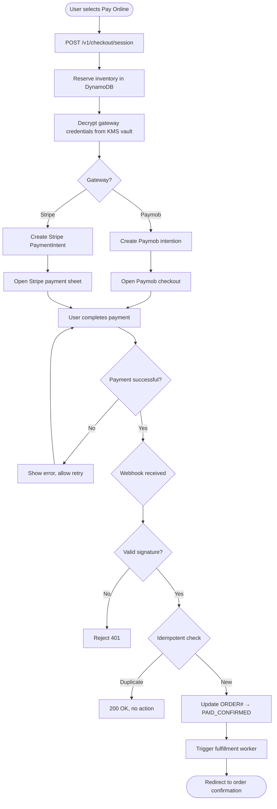
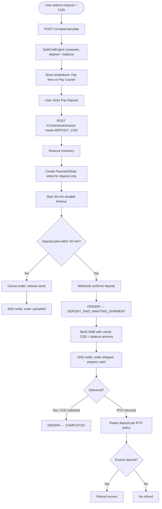

# Module 04: Payments & COD

> **Slice**: v1.0 / v4.0 · **Sprints**: 1.2, 4.2 · **Stories**: US-4.1.1 – US-4.1.5

## Overview

Covers all payment flows including full prepaid (Paymob/Stripe), full Cash on Delivery (100% COD), split Deposit COD (upfront deposit + cash balance), and self-hosted Bitcoin/Lightning payments via BTCPay Server.

## Pages

| Page Route | Access | Direction | Primary Hook |
|:-----------|:-------|:----------|:-------------|
| `/[locale]/checkout` | Authenticated | RTL / LTR | `useSplitCodCheckout` |
| `/[locale]/admin/settings-gateways` | STORE_ADMIN | RTL / LTR | `useAdminGatewayConfig` |

## API Endpoints

| Method | Endpoint | Lambda | Description |
|:-------|:---------|:-------|:------------|
| POST | `/v1/checkout/session` | `checkout-webhooks-api` | Create payment session |
| POST | `/v1/rates/calculate` | `checkout-webhooks-api` | Calculate shipping + COD rates |
| POST | `/v1/webhooks/paymob` | `checkout-webhooks-api` | Paymob HMAC-SHA512 webhook |
| POST | `/v1/webhooks/stripe` | `checkout-webhooks-api` | Stripe-Signature webhook |
| POST | `/v1/webhooks/btcpay` | `checkout-webhooks-api` | BTCPay-Sig webhook |
| PUT | `/v1/admin/vault/payment-gateways/:provider` | `admin-vendor-api` | Configure payment gateway |
| PUT | `/v1/admin/locale-fees/:country/:zone` | `admin-vendor-api` | Configure zone COD rules |

---

## US-4.1.1: Full Prepaid Online Payment (Paymob & Stripe)

**As a** B2C Customer,  
**I want to** pay 100% online via Paymob (Egypt/MENA) or Stripe (international),  
**So that** my order is fully paid and ships immediately without courier cash collection.

### Acceptance Criteria

```gherkin
Feature: Full Prepaid Online Payment

  Scenario: Paymob card payment (Egypt)
    Given the user selects "Pay Online" at checkout with address in Egypt
    When the user clicks "Pay Now"
    Then a Paymob payment intention is created for the full order amount
    And the Paymob checkout iframe/SDK opens
    When the user completes the card payment
    Then the Paymob HMAC-SHA512 webhook confirms the payment
    And the order status transitions to PAID_CONFIRMED
    And inventory is permanently reserved

  Scenario: Stripe payment (international)
    Given the user selects "Pay Online" with an international address
    When the user clicks "Pay Now"
    Then a Stripe PaymentIntent is created for the full amount
    And the Stripe payment sheet opens
    When the user completes payment
    Then the Stripe-Signature webhook confirms the payment
    And the order status transitions to PAID_CONFIRMED

  Scenario: Payment failure
    Given the user's card is declined
    Then the payment modal shows "Payment declined. Try another card."
    And the order remains in PENDING_PAYMENT status
    And inventory reservation is held for 30 minutes

  Scenario: Webhook replay attack
    Given a valid webhook has already been processed
    When a duplicate webhook arrives with the same event ID
    Then the system rejects it with 200 OK (idempotent)
    And no duplicate order state change occurs

  Scenario: KMS vault decryption for gateway credentials
    Given the admin has stored Paymob API credentials
    When a payment intent is created
    Then the system decrypts the credentials from KMS vault with encryption context
    And uses a 5-minute in-memory cache (ArcSwap) to avoid repeated KMS calls
```

### Test Cases

| # | Test Case | Type | Expected Result |
|:--|:----------|:-----|:----------------|
| TC-4.1.1-01 | Paymob card payment success | Happy Path | PAID_CONFIRMED |
| TC-4.1.1-02 | Stripe payment success | Happy Path | PAID_CONFIRMED |
| TC-4.1.1-03 | Paymob mobile wallet (Vodafone Cash) | Happy Path | Payment confirmed |
| TC-4.1.1-04 | Card declined | Error | Error shown, retry available |
| TC-4.1.1-05 | 3D Secure challenge | Happy Path | Challenge completed, paid |
| TC-4.1.1-06 | Webhook HMAC invalid | Security | Webhook rejected 401 |
| TC-4.1.1-07 | Duplicate webhook | Idempotency | 200 OK, no state change |
| TC-4.1.1-08 | KMS decryption failure | Error | Graceful error, retry |
| TC-4.1.1-09 | Payment timeout (30 min) | Edge Case | Inventory released |
| TC-4.1.1-10 | Concurrent payment for same order | Concurrency | Only one succeeds |
| TC-4.1.1-11 | Zero-amount order (free item) | Edge Case | No payment, direct confirm |
| TC-4.1.1-12 | Currency mismatch | Validation | Error before payment |

### Activity Diagram



---

## US-4.1.2: Full Cash on Delivery (100% COD)

**As a** Customer in a region where online payments are not preferred,  
**I want to** place an order with 100% Cash on Delivery where I pay the full amount to the courier upon delivery,  
**So that** I can shop without needing a bank card or online payment method.

### Acceptance Criteria

```gherkin
Feature: Full Cash on Delivery

  Scenario: Place 100% COD order
    Given the merchant has enabled full COD for the customer's governorate
    And the zone rule has cod_deposit_rule=NONE
    When the user selects "Cash on Delivery" at checkout
    Then no online payment is required
    And the order is created with payment_mode=FULL_COD
    And the full order amount is set as the courier's collection amount
    And the order status is COD_CONFIRMED_AWAITING_SHIPMENT

  Scenario: COD not available for digital products
    Given the cart contains a digital product (software license)
    When the user selects "Cash on Delivery"
    Then a message "COD is not available for digital products" is shown
    And the COD option is disabled

  Scenario: COD not available for the zone
    Given the merchant has disabled COD for the "International" zone
    When the user selects an international address
    Then the COD payment option is not shown

  Scenario: COD order with high value
    Given the order total exceeds the zone's max_cod_amount (e.g., 50,000 EGP)
    Then a message "COD is not available for orders above 50,000 EGP" is shown
    And only online payment options are displayed

  Scenario: COD surcharge applied
    Given the zone has a COD surcharge of 25 EGP
    Then the checkout summary shows "COD Fee: 25 EGP" as a line item
    And the total includes the surcharge
```

### Test Cases

| # | Test Case | Type | Expected Result |
|:--|:----------|:-----|:----------------|
| TC-4.1.2-01 | 100% COD order | Happy Path | Order created, full COD amount |
| TC-4.1.2-02 | COD with digital product | Validation | COD disabled |
| TC-4.1.2-03 | COD for disabled zone | Validation | COD option hidden |
| TC-4.1.2-04 | COD exceeds max amount | Validation | COD disabled, message shown |
| TC-4.1.2-05 | COD surcharge applied | Happy Path | Surcharge in total |
| TC-4.1.2-06 | COD order RTO (returned) | Edge Case | No refund needed, loss minimized |
| TC-4.1.2-07 | COD for multi-vendor cart | Happy Path | Per-vendor COD amounts |
| TC-4.1.2-08 | COD with free shipping | Edge Case | Only product amount collected |

### Activity Diagram

```mermaid
flowchart TD
    A([User selects Cash on Delivery]) --> B{Cart has digital items?}
    B -->|Yes| C[Show "COD not available for digital items"]
    B -->|No| D{COD enabled for zone?}
    D -->|No| E[COD option hidden]
    D -->|Yes| F{Order total ≤ max_cod_amount?}
    F -->|No| G[Show "COD not available for this amount"]
    F -->|Yes| H[Calculate COD surcharge]
    H --> I[Show total: products + shipping + COD fee]
    I --> J[User confirms COD order]
    J --> K[POST /v1/checkout/session mode=FULL_COD]
    K --> L[Reserve inventory]
    L --> M[Create ORDER# status=COD_CONFIRMED_AWAITING_SHIPMENT]
    M --> N[Set carrier cod_collection = full amount]
    N --> O[SNS notify customer: order confirmed]
    O --> P([Redirect to order confirmation])
```

---

## US-4.1.3: Upfront Deposit + Split Cash on Delivery (DEPOSIT_COD)

**As a** B2C Customer in Egypt/MENA,  
**I want to** pay a small deposit online (e.g., shipping fee only) and the remaining product balance in cash to the courier,  
**So that** I can shop with COD confidence while the merchant is protected against fake orders.

### Acceptance Criteria

```gherkin
Feature: Split Cash on Delivery (DEPOSIT_COD)

  Scenario: Shipping-fee-only deposit
    Given the zone rule is cod_deposit_rule=SHIPPING_FEE_ONLY
    And shipping fee is 100 EGP, product total is 2000 EGP
    When the user selects "Deposit + Cash on Delivery"
    Then the breakdown shows: Pay Now: 100 EGP, Pay Courier: 2000 EGP
    And the online payment creates a Paymob intention for 100 EGP
    When the deposit is paid online
    Then the order transitions to DEPOSIT_PAID_AWAITING_SHIPMENT

  Scenario: Percentage-based deposit
    Given the zone rule is cod_deposit_rule=PERCENTAGE with value=20%
    And order total is 5000 EGP
    Then deposit = 1000 EGP, COD balance = 4000 EGP

  Scenario: Fixed-amount deposit
    Given the zone rule is cod_deposit_rule=FIXED_AMOUNT with value=200 EGP
    Then deposit = 200 EGP, COD balance = total - 200

  Scenario: Deposit payment timeout
    Given the user selected DEPOSIT_COD but hasn't paid within 30 minutes
    Then the durable orchestrator cancels the order
    And inventory reservation is released
    And the user receives an SNS notification

  Scenario: RTO — customer refuses delivery
    Given the order is out for delivery
    When the customer refuses the package
    Then the carrier returns it (RTO)
    And the merchant retains the deposit to cover return shipping costs
    And the RTO policy auto-calculates any excess deposit for refund
```

### Test Cases

| # | Test Case | Type | Expected Result |
|:--|:----------|:-----|:----------------|
| TC-4.1.3-01 | Shipping-fee deposit | Happy Path | Deposit = shipping fee |
| TC-4.1.3-02 | 20% deposit | Happy Path | Correct math |
| TC-4.1.3-03 | Fixed 200 EGP deposit | Happy Path | Deposit = 200 |
| TC-4.1.3-04 | Deposit timeout 30 min | Edge Case | Order cancelled, stock released |
| TC-4.1.3-05 | RTO retention | Edge Case | Deposit retained |
| TC-4.1.3-06 | Deposit > order total | Edge Case | Capped to order total |
| TC-4.1.3-07 | Deposit for multi-vendor | Concurrency | Proportional per vendor |
| TC-4.1.3-08 | Deposit webhook replay | Idempotency | Duplicate ignored |
| TC-4.1.3-09 | Deposit + carrier COD amount | Integration | Carrier gets correct COD |
| TC-4.1.3-10 | RTO excess refund | Edge Case | Excess deposited refunded |

### Activity Diagram



---

## US-4.1.4: Admin Payment Gateway Configuration

**As a** Store Administrator,  
**I want to** configure payment gateway credentials (Paymob, Stripe, BTCPay) via the admin dashboard with KMS envelope encryption,  
**So that** sensitive credentials are securely stored and easily rotatable.

### Acceptance Criteria

```gherkin
Feature: Payment Gateway Configuration

  Scenario: Configure Paymob credentials
    Given the admin navigates to "/admin/settings-gateways"
    When the admin enters Paymob API key, integration IDs, and HMAC secret
    And clicks "Save"
    Then the credentials are encrypted via KMS with tenant encryption context
    And stored in DynamoDB as GW_VAULT#PAYMENT#paymob

  Scenario: Test gateway connection
    When the admin clicks "Test Connection"
    Then the system decrypts the credentials and makes a test API call
    And shows "Connection successful" or the specific error

  Scenario: Rotate credentials
    When the admin updates the API key
    Then the old credentials are replaced (not versioned)
    And the in-memory ArcSwap cache is invalidated
```

### Test Cases

| # | Test Case | Type | Expected Result |
|:--|:----------|:-----|:----------------|
| TC-4.1.4-01 | Save Paymob credentials | Happy Path | Encrypted + stored |
| TC-4.1.4-02 | Save Stripe credentials | Happy Path | Encrypted + stored |
| TC-4.1.4-03 | Test valid connection | Happy Path | "Connected" |
| TC-4.1.4-04 | Test invalid credentials | Error | Error message shown |
| TC-4.1.4-05 | Rotate API key | Happy Path | Cache invalidated |
| TC-4.1.4-06 | Non-admin access | Security | 403 Forbidden |

---

## US-4.1.5: Bitcoin & Lightning Network Checkout (BTCPay Server)

**As a** crypto-savvy Shopper,  
**I want to** pay using Bitcoin on-chain or Lightning Network via the merchant's self-hosted BTCPay Server,  
**So that** I can settle purchases with zero intermediary fees.

### Acceptance Criteria

```gherkin
Feature: BTCPay Server Checkout

  Scenario: Lightning Network payment
    Given the user selects "Bitcoin / Lightning" at checkout
    When the system creates a BTCPay invoice via Greenfield API
    Then a BOLT11 Lightning invoice QR code is displayed
    When the user pays from their Lightning wallet
    Then the BTCPay-Sig HMAC-SHA256 webhook confirms settlement
    And the order transitions to PAID_CONFIRMED

  Scenario: On-chain Bitcoin payment
    Given the user cannot pay via Lightning
    Then an on-chain Bitcoin address is also displayed
    And the system waits for 1 confirmation before confirming
    And the order auto-cancels after 24 hours if unpaid

  Scenario: BTCPay unavailable
    Given the merchant's BTCPay Server is unreachable
    Then the "Bitcoin" payment option is disabled at checkout
    And a message "Crypto payments temporarily unavailable" is shown
```

### Test Cases

| # | Test Case | Type | Expected Result |
|:--|:----------|:-----|:----------------|
| TC-4.1.5-01 | Lightning payment | Happy Path | Instant confirmation |
| TC-4.1.5-02 | On-chain payment | Happy Path | Confirmed after 1 block |
| TC-4.1.5-03 | Underpaid invoice | Edge Case | Partial payment handling |
| TC-4.1.5-04 | Overpaid invoice | Edge Case | Excess refunded |
| TC-4.1.5-05 | BTCPay server down | Error | Option disabled |
| TC-4.1.5-06 | Invoice expired (24h) | Edge Case | Order cancelled |
| TC-4.1.5-07 | Invalid BTCPay-Sig | Security | Webhook rejected |

### Activity Diagram

```mermaid
flowchart TD
    A([User selects Bitcoin/Lightning]) --> B[POST /v1/checkout/session gateway=BTCPAY]
    B --> C[Decrypt BTCPay token from KMS]
    C --> D{BTCPay reachable?}
    D -->|No| E[Show "Crypto unavailable"]
    D -->|Yes| F[POST /api/v1/stores/storeId/invoices]
    F --> G[Return BOLT11 + BTC address]
    G --> H[Render QR code modal]
    H --> I{User pays?}
    I -->|Lightning| J[Instant settlement]
    I -->|On-chain| K[Wait for 1 confirmation]
    I -->|Timeout 24h| L[Cancel order]
    J --> M[BTCPay webhook POST /v1/webhooks/btcpay]
    K --> M
    M --> N{Valid BTCPay-Sig?}
    N -->|No| O[Reject 401]
    N -->|Yes| P[ORDER# → PAID_CONFIRMED]
    P --> Q([Trigger fulfillment])
```
