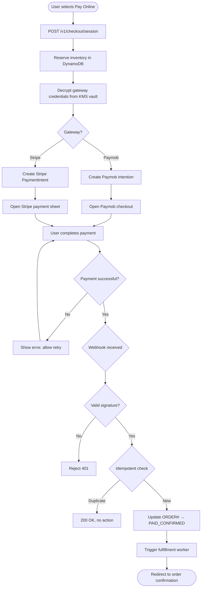

# US-4.1.1: Full Prepaid Online Payment (Paymob & Stripe)

> **Spec Kit Specification**: [Specification Lifecycle Active (.specify/)](../../../.specify/memory/constitution.md)  
> **Domain Feature**: `order-processing-and-commerce`  
> **Domain Module**: `payments-and-cod`  
> **Autonomous Behaviour**: `prepaid-card-payment`  
> **Client Framework Path**: `apps/storefront/src/features/order-processing-and-commerce/modules/payments-and-cod/behaviours/prepaid-card-payment`  
> **Backend Framework Path**: `backend/src/features/order-processing-and-commerce/modules/payments-and-cod/behaviours/prepaid-card-payment`  
> **Execution Sprint**: [Sprint 1.2](../../sprints/README.md)  
> **Slicing Standard**: [10-PR Vertical Slicing Framework](../../sprints/README.md#the-10-pr-vertical-slicing-standard-aligned-with-10-pillar-system-architecture)  
> **Security Gateway**: [ASVS Level 2 Verification Gate (security-audit)](#5-security-gateway-powered-by-security-audit)

---

## 1. Spec Kit Specification: User Story & Domain Scope

### 1.1 User Story Narrative

**As a** B2C Customer,  
**I want to** pay 100% online via Paymob (Egypt/MENA) or Stripe (international),  
**So that** my order is fully paid and ships immediately without courier cash collection.

### 1.2 Acceptance Criteria (Gherkin Scenarios)

```gherkin
Feature: Full Prepaid Online Payment
  Scenario: [AC-US-4.1.1-01] Paymob card payment (Egypt)
    Given the user selects "Pay Online" at checkout with address in Egypt
    When the user clicks "Pay Now"
    Then a Paymob payment intention is created for the full order amount
    And the Paymob checkout iframe/SDK opens
    When the user completes the card payment
    Then the Paymob HMAC-SHA512 webhook confirms the payment
    And the order status transitions to PAID_CONFIRMED
    And inventory is permanently reserved
  Scenario: [AC-US-4.1.1-02] Stripe payment (international)
    Given the user selects "Pay Online" with an international address
    When the user clicks "Pay Now"
    Then a Stripe PaymentIntent is created for the full amount
    And the Stripe payment sheet opens
    When the user completes payment
    Then the Stripe-Signature webhook confirms the payment
    And the order status transitions to PAID_CONFIRMED
  Scenario: [AC-US-4.1.1-03] Payment failure
    Given the user's card is declined
    Then the payment modal shows "Payment declined. Try another card."
    And the order remains in PENDING_PAYMENT status
    And inventory reservation is held for 30 minutes
  Scenario: [AC-US-4.1.1-04] Webhook replay attack
    Given a valid webhook has already been processed
    When a duplicate webhook arrives with the same event ID
    Then the system rejects it with 200 OK (idempotent)
    And no duplicate order state change occurs
  Scenario: [AC-US-4.1.1-05] KMS vault decryption for gateway credentials
    Given the admin has stored Paymob API credentials
    When a payment intent is created
    Then the system decrypts the credentials from KMS vault with encryption context
    And uses a 5-minute in-memory cache (ArcSwap) to avoid repeated KMS calls
  Scenario: [AC-US-4.1.1-LAW] Global e-commerce legal compliance and electronic payment regulations
    Given a consumer initiating an online prepaid card payment via Stripe or Paymob
    When processing the credit or debit card transaction
    Then cardholder data must be tokenized directly at the PCI-DSS compliant gateway iframe with zero raw PAN/CVV touching servers
    And Strong Customer Authentication (3D Secure 2.x) must be enforced for all applicable European and SCA-mandated card payments
    And payment surcharges on consumer debit and credit cards are strictly prohibited pursuant to EU PSD2 Art 62(4)
```

### 1.3 Test Cases & Traceability Matrix

| # | Test Case | Type | Expected Result |
|:--|:----------|:-----|:----------------|
| TC-4.1.1-01 | Paymob card payment success | Happy Path | PAID_CONFIRMED |
| TC-4.1.1-02 | Stripe payment success | Happy Path | PAID_CONFIRMED |
| TC-4.1.1-03 | Paymob mobile wallet (Vodafone Cash) | Happy Path | Payment confirmed |
| TC-4.1.1-04 | Card declined | Error | Error shown, retry available |
| TC-4.1.1-05 | 3D Secure challenge | Happy Path | Challenge completed, paid |
| TC-4.1.1-06 | Webhook HMAC invalid | Security | Webhook rejected 401 |
| TC-4.1.1-07 | Duplicate webhook | Idempotency | 200 OK, no state change |
| TC-4.1.1-08 | KMS decryption failure | Error | Graceful error, retry |
| TC-4.1.1-09 | Payment timeout (30 min) | Edge Case | Inventory released |
| TC-4.1.1-10 | Concurrent payment for same order | Concurrency | Only one succeeds |
| TC-4.1.1-11 | Zero-amount order (free item) | Edge Case | No payment, direct confirm |
| TC-4.1.1-12 | Currency mismatch | Validation | Error before payment |
| TC-4.1.1-LAW | Global legal & regulatory compliance (PCI-DSS v4.0 SAQ-A tokenization, EU PSD2/PSD3 SCA 3DS2, card surcharge prohibition) | Legal / Regulatory | Statutory compliance verified with zero legal or regulatory violations |

---

## 2. Behavior-Centric Architecture & Folder Blueprint

This user story is implemented directly inside the respective **Expo client** and **Cargo Lambda Axum backend** frameworks according to the **Locality of Behavior (LoB)** architectural law. Private services, designs, logic, types, and constants are strictly colocated within their framework behaviour directory.

### 2.1 Colocated Behaviour Directory Tree

#### Client Architecture (Universal Expo SDK 58):
```
apps/storefront/src/features/order-processing-and-commerce/modules/payments-and-cod/behaviours/prepaid-card-payment/
├── services/
│   │   ├── paymob_adapter.rs
│   │   ├── stripe_adapter.rs
│   │   ├── payment_webhook_handler.rs
├── designs/
│   │   ├── CardPaymentModal.tsx
│   │   ├── 3dsChallengeIframe.tsx
│   │   ├── PaymentSuccessCelebration.tsx
├── logic/
│   │   ├── useCardPayment.ts
│   │   ├── hmac_signature_verifier.rs
│   │   ├── payment_status_poller.ts
├── types/
│   │   ├── PaymentIntention.ts
│   │   ├── WebhookNotificationPayload.ts
│   │   ├── PaymentTransactionRecord.ts
└── constants/
│   │   ├── PaymentEndpoints.ts
│   │   ├── GatewayProviders.ts
│   │   ├── PaymentErrorCodes.ts
```

#### Backend Architecture (Cargo Lambda + Axum 0.8):
```
backend/src/features/order-processing-and-commerce/modules/payments-and-cod/behaviours/prepaid-card-payment/
├── services/
│   │   ├── paymob_adapter.rs
│   │   ├── stripe_adapter.rs
│   │   ├── payment_webhook_handler.rs
├── logic/
│   │   ├── useCardPayment.ts
│   │   ├── hmac_signature_verifier.rs
│   │   ├── payment_status_poller.ts
├── types/
│   │   ├── PaymentIntention.ts
│   │   ├── WebhookNotificationPayload.ts
│   │   ├── PaymentTransactionRecord.ts
└── constants/
│   │   ├── PaymentEndpoints.ts
│   │   ├── GatewayProviders.ts
│   │   ├── PaymentErrorCodes.ts
```

### 2.2 Scoping & Promotion Blueprint

| Layer / Tier | Client Path (Expo) | Backend Path (Cargo Lambda / Axum) | Purpose & Promotion Rules |
| :--- | :--- | :--- | :--- |
| **Behaviour-Local** | `.../behaviours/prepaid-card-payment/` | `.../behaviours/prepaid-card-payment/` | **Default Private Scope**: Colocated services, designs, logic, types, and constants private to this story. |
| **Module-Shared** | `.../modules/payments-and-cod/_shared/` | `.../modules/payments-and-cod/_shared/` | Shared domain primitives and UI elements used by $\ge 2$ behaviours in `payments-and-cod`. |
| **Feature-Shared** | `.../features/order-processing-and-commerce/_shared/` | `.../features/order-processing-and-commerce/_shared/` | Feature-level contracts, ports, and cross-module bridges across `order-processing-and-commerce`. |
| **Framework-Shared** | `apps/storefront/src/shared/` | `backend/crates/kernel-core/` | System-wide microkernel traits, `Money` arithmetic, RFC 9110 ETag middleware, and database adapters. |

---

## 3. Technical Implementation Plan (Spec Kit Plan)

### 3.1 Domain Invariants & Storage Schema
- **State Machine**: Enforces valid state transitions and rejects unauthorized or out-of-order mutations.
- **Data Persistence**: Single-table Amazon DynamoDB partitioning (`PK = TENANT#<id>`, `SK = ENTITY#<id>`) paired with reactive local-first WatermelonDB sync.
- **Freshness & Caching**: Multi-tier caching (L1 Moka in-memory + L2 ElastiCache Redis) with RFC 9110 `ETag` conditional `304 Not Modified` short-circuiting.

### 3.2 Activity & Interaction Diagram



---

## 4. Granular Implementation Tasks (Spec Kit Tasks)

### Phase 1: Core Domain Logic, Types & Constants
- [ ] **Task 1.1 (Types)**: Define strongly typed models and DTO schemas in `types/`.
- [ ] **Task 1.2 (Constants)**: Define routes, action codes, and validation limits in `constants/`.
- [ ] **Task 1.3 (Logic)**: Implement pure business logic, calculations, and state machines in `logic/`.
- [ ] **Task 1.4 (Unit Tests)**: Write pure property-based and unit tests verifying domain invariants.

### Phase 2: Services & Infrastructure Adapters
- [ ] **Task 2.1 (API / Gateway)**: Implement client adapters and backend handlers in `services/`.
- [ ] **Task 2.2 (ETag & Cache)**: Integrate RFC 9110 ETag headers and multi-tier caching (Moka L1 / Redis L2).
- [ ] **Task 2.3 (Storage & Sync)**: Implement DynamoDB storage operations and WatermelonDB delta sync.
- [ ] **Task 2.4 (Integration Tests)**: Verify service contract tests and real database conditional writes.

### Phase 3: Platform-Adaptive Designs & UI
- [ ] **Task 3.1 (UI Presentation)**: Build platform-adaptive screens and SDUI components in `designs/`.
- [ ] **Task 3.2 (Headless Hooks)**: Bind headless domain hooks from `logic/` into the UI presentation.
- [ ] **Task 3.3 (i18n & RTL)**: Implement bidirectional RTL/LTR layout mirroring and localized font switching.
- [ ] **Task 3.4 (Component Tests)**: Test empty, loading, offline, and error states across web and mobile.

### Phase 4: Security Gateway Verification & Release Readiness
- [ ] **Task 4.1 (Abuse Testing)**: Execute automated adversarial penetration tests against the threat matrix.
- [ ] **Task 4.2 (Zero-Trust Audit)**: Verify strict tenant isolation and object-level authorization (IDOR).
- [ ] **Task 4.3 (SAST & Audit)**: Run static analysis, dependency audit, and secret scanning.
- [ ] **Task 4.4 (Gate Sign-Off)**: Obtain independent security sign-off for the G2 Security Gateway.

---

## 5. Security Gateway (Powered by security-audit)

### 5.1 Trust Boundaries & Security Actors
- **Trust Boundaries**:
  - `Untrusted Zone`: Mobile client app, public web browser, and external network callers.
  - `Gateway Edge`: AWS CloudFront, API Gateway, and Cognito JWT authentication guard.
  - `Secure Application Boundary`: Axum Tower route extractors enforcing tenant and RBAC/ABAC isolation.
  - `Encrypted Storage & Secret Vault`: Amazon DynamoDB KMS-encrypted tables and AWS KMS vault.
- **Authorized Principals**:
  - Identified Actors: `AuthenticatedCustomer`, `B2bBuyer`, `Vendor`, `StoreAdmin`, or `AnonymousShopper` (read-only).
  - Multi-Tenancy Invariant: Every request must extract `tenant_id` from verified JWT claims. Injections via query params or payload body are rejected with `403 Forbidden`.

### 5.2 Threat Modeling & Abuse Matrix (STRIDE / ASVS)

| Threat Vector | Severity | Vulnerability Mechanism | Mitigating Control & Security Invariant |
| :--- | :--- | :--- | :--- |
| **Spoofing & Impersonation** | Critical | Forged `sub` or `tenant_id` identity claims | Server-side RS256 JWKS signature verification; strict claims extraction in Axum. |
| **Tampering & Invariant Bypass** | High | Manipulating payload parameters or prices | Authoritative server recalculation; strict schema validation; BLAKE3 ETag integrity checks. |
| **Information Disclosure (IDOR)** | Critical | Cross-tenant or cross-user data scraping | Explicit `PK = TENANT#<id>` partition filtering on every database and cache operation. |
| **Denial of Service / Abuse** | High | HMAC webhook forgery, 3DS authentication bypass, transaction replay, and currency denomination tampering | Token-bucket rate limiting per IP and account; strict input length validation. |
| **Elevation of Privilege** | Critical | Bypassing role-based permission checks | Tower extractors (`RequireStoreAdmin`, `RequireVendor`) guard sensitive endpoints. |

### 5.3 Cryptographic & Data Protection Controls
- **Encryption in Transit**: TLS 1.3 enforced on all external and internal endpoints; HSTS active.
- **Encryption at Rest**: DynamoDB AWS KMS customer-managed keys; AES-256-GCM for sensitive client tokens in `expo-secure-store`.
- **PII & Secret Redaction**: Passwords, OTPs, auth tokens, and credit card numbers are stripped from logs and traces via `tracing` redaction filters.

### 5.4 Automated Security Verification Checklist
- [ ] **SAST Analysis**: Clean report from static code analyzers; 0 high or critical vulnerabilities.
- [ ] **Dependency Audit**: `cargo deny` and `bun audit` pass with 0 unreviewed security advisories.
- [ ] **Abuse & IDOR Fuzzing**: Test suite confirms that requests with modified `tenant_id` or `user_id` fail with `401 Unauthorized` or `403 Forbidden`.
- [ ] **Secret Scanning**: Gitleaks scanner confirms zero hardcoded credentials, API keys, or private keys.

### 5.5 Security Gateway (G2) Sign-Off Checklist
- [ ] Threat boundary and entry points verified against OWASP ASVS Level 2 requirements.
- [ ] Multi-tenant isolation verified with automated cross-tenant penetration test.
- [ ] Anti-abuse and rate limiting confirmed active on all public interfaces.
- [ ] Audit log redaction verified — zero plaintext secrets in output logs.
- [ ] Independent reviewer sign-off obtained; zero open Critical or High findings.

---

## 6. Validation Gates & Acceptance Sign-Off

**Status: Pending — specification only; no implementation evidence.** All [G0–G4 quality gates + G-Review + G-Law](../../QUALITY_GATES.md) apply to this story. The following checks add to its acceptance criteria and test cases; they do not replace them.

### G1 — Test coverage
- [ ] **US-4.1.1-G1:** Automated test suite maps 100% of acceptance criteria and test cases with >=90% line and >=85% branch coverage in affected packages.

### G2 — Security audit
- [ ] **US-4.1.1-G2:** Verify zero-trust tenant isolation, object-level authorization (IDOR), and defense against HMAC webhook forgery, 3DS authentication bypass, transaction replay, and currency denomination tampering. No unresolved critical or high findings.

### G3 — Architecture and maintainability
- [ ] **US-4.1.1-G3:** Strict compliance with framework colocation (`apps/storefront/src/features/` or `backend/src/features/`), zero-clone borrowing discipline in Rust, and clean domain boundaries.

### G-Review — Code review
- [ ] **US-4.1.1-G-Review:** Independent senior code review signed off by the Code Reviewer; verification across Correctness, Security, Maintainability, Performance, and Testing using the Agency-Agents code review standard; zero open Blocker or unresolved Suggestion findings.

### G-Law — Law validation
- [ ] **US-4.1.1-G-Law:** Independent verification against global e-commerce legal and statutory requirements: PCI-DSS v4.0 SAQ-A compliance, EU PSD2/PSD3 Strong Customer Authentication (SCA), and prohibition of consumer payment surcharges; certified by compliance reviewer (`agency-legal-compliance-checker`).

### G4 — Integrated acceptance
- [ ] **US-4.1.1-G4:** End-to-end user journey validation across supported platforms (Web, iOS, Android) and verified sandbox integration.

---

[← Back to Module payments-and-cod Catalog (README.md)](README.md) | [Master User Stories Index](../README.md)
