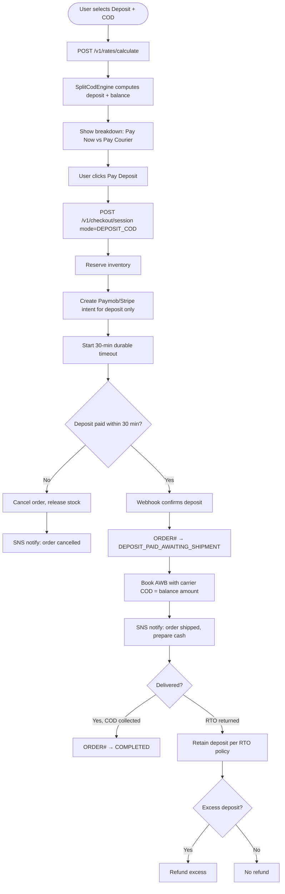

# US-4.1.3: Upfront Deposit + Split Cash on Delivery (DEPOSIT_COD)

> **Spec Kit Specification**: [Specification Lifecycle Active (.specify/)](../../../.specify/memory/constitution.md)  
> **Domain Feature**: `order-processing-and-commerce`  
> **Domain Module**: `payments-and-cod`  
> **Autonomous Behaviour**: `split-deposit-cod`  
> **Client Framework Path**: `apps/storefront/src/features/order-processing-and-commerce/modules/payments-and-cod/behaviours/split-deposit-cod`  
> **Backend Framework Path**: `backend/src/features/order-processing-and-commerce/modules/payments-and-cod/behaviours/split-deposit-cod`  
> **Execution Sprint**: [Sprint 1.2](../../sprints/README.md)  
> **Slicing Standard**: [7-PR Vertical Slicing Framework](../../sprints/README.md#the-7-pr-vertical-slicing-standard)  
> **Security Gateway**: [ASVS Level 2 Verification Gate (security-audit)](#5-security-gateway-powered-by-security-audit)

---

## 1. Spec Kit Specification: User Story & Domain Scope

### 1.1 User Story Narrative

**As a** B2C Customer in Egypt/MENA,  
**I want to** pay a small deposit online (e.g., shipping fee only) and the remaining product balance in cash to the courier,  
**So that** I can shop with COD confidence while the merchant is protected against fake orders.

### 1.2 Acceptance Criteria (Gherkin Scenarios)

```gherkin
Feature: Split Cash on Delivery (DEPOSIT_COD)
  Scenario: [AC-US-4.1.3-01] Shipping-fee-only deposit
    Given the zone rule is cod_deposit_rule=SHIPPING_FEE_ONLY
    And shipping fee is 100 EGP, product total is 2000 EGP
    When the user selects "Deposit + Cash on Delivery"
    Then the breakdown shows: Pay Now: 100 EGP, Pay Courier: 2000 EGP
    And the online payment creates a Paymob intention for 100 EGP
    When the deposit is paid online
    Then the order transitions to DEPOSIT_PAID_AWAITING_SHIPMENT
  Scenario: [AC-US-4.1.3-02] Percentage-based deposit
    Given the zone rule is cod_deposit_rule=PERCENTAGE with value=20%
    And order total is 5000 EGP
    Then deposit = 1000 EGP, COD balance = 4000 EGP
  Scenario: [AC-US-4.1.3-03] Fixed-amount deposit
    Given the zone rule is cod_deposit_rule=FIXED_AMOUNT with value=200 EGP
    Then deposit = 200 EGP, COD balance = total - 200
  Scenario: [AC-US-4.1.3-04] Deposit payment timeout
    Given the user selected DEPOSIT_COD but hasn't paid within 30 minutes
    Then the durable orchestrator cancels the order
    And inventory reservation is released
    And the user receives an SNS notification
  Scenario: [AC-US-4.1.3-05] RTO — customer refuses delivery
    Given the order is out for delivery
    When the customer refuses the package
    Then the carrier returns it (RTO)
    And the merchant retains the deposit to cover return shipping costs
    And the RTO policy auto-calculates any excess deposit for refund
```

### 1.3 Test Cases & Traceability Matrix

| # | Test Case | Type | Expected Result |
|:--|:----------|:-----|:----------------|
| TC-4.1.3-01 | Shipping-fee deposit | Happy Path | Deposit = shipping fee |
| TC-4.1.3-02 | 20% deposit | Happy Path | Correct math |
| TC-4.1.3-03 | Fixed 200 EGP deposit | Happy Path | Deposit = 200 |
| TC-4.1.3-04 | Deposit timeout 30 min | Edge Case | Order cancelled, stock released |
| TC-4.1.3-05 | RTO retention | Edge Case | Deposit retained |
| TC-4.1.3-06 | Deposit > order total | Edge Case | Capped to order total |
| TC-4.1.3-07 | Deposit for multi-vendor | Concurrency | Proportional per vendor |
| TC-4.1.3-08 | Deposit webhook replay | Idempotency | Duplicate ignored |
| TC-4.1.3-09 | Deposit + carrier COD amount | Integration | Carrier gets correct COD |
| TC-4.1.3-10 | RTO excess refund | Edge Case | Excess deposited refunded |

---

## 2. Behavior-Centric Architecture & Folder Blueprint

This user story is implemented directly inside the respective **Expo client** and **Cargo Lambda Axum backend** frameworks according to the **Locality of Behavior (LoB)** architectural law. Private services, designs, logic, types, and constants are strictly colocated within their framework behaviour directory.

### 2.1 Colocated Behaviour Directory Tree

#### Client Architecture (Universal Expo SDK 58):
```
apps/storefront/src/features/order-processing-and-commerce/modules/payments-and-cod/behaviours/split-deposit-cod/
├── services/
│   │   ├── split_cod_calculator.rs
│   │   ├── deposit_payment_service.rs
│   │   ├── split_cod_api.ts
├── designs/
│   │   ├── SplitBreakdownDisplay.tsx
│   │   ├── DepositPaymentSheet.tsx
│   │   ├── CourierBalanceBadge.tsx
├── logic/
│   │   ├── useSplitCodCheckout.ts
│   │   ├── deposit_math_engine.rs
│   │   ├── rto_deposit_allocator.rs
├── types/
│   │   ├── SplitCodCalculation.ts
│   │   ├── DepositRuleConfig.ts
│   │   ├── RtoPolicyOutcome.ts
└── constants/
│   │   ├── SplitCodEndpoints.ts
│   │   ├── DepositRuleTypes.ts
│   │   ├── SplitCodErrorCodes.ts
```

#### Backend Architecture (Cargo Lambda + Axum 0.8):
```
backend/src/features/order-processing-and-commerce/modules/payments-and-cod/behaviours/split-deposit-cod/
├── services/
│   │   ├── split_cod_calculator.rs
│   │   ├── deposit_payment_service.rs
│   │   ├── split_cod_api.ts
├── logic/
│   │   ├── useSplitCodCheckout.ts
│   │   ├── deposit_math_engine.rs
│   │   ├── rto_deposit_allocator.rs
├── types/
│   │   ├── SplitCodCalculation.ts
│   │   ├── DepositRuleConfig.ts
│   │   ├── RtoPolicyOutcome.ts
└── constants/
│   │   ├── SplitCodEndpoints.ts
│   │   ├── DepositRuleTypes.ts
│   │   ├── SplitCodErrorCodes.ts
```

### 2.2 Scoping & Promotion Blueprint

| Layer / Tier | Client Path (Expo) | Backend Path (Cargo Lambda / Axum) | Purpose & Promotion Rules |
| :--- | :--- | :--- | :--- |
| **Behaviour-Local** | `.../behaviours/split-deposit-cod/` | `.../behaviours/split-deposit-cod/` | **Default Private Scope**: Colocated services, designs, logic, types, and constants private to this story. |
| **Module-Shared** | `.../modules/payments-and-cod/_shared/` | `.../modules/payments-and-cod/_shared/` | Shared domain primitives and UI elements used by $\ge 2$ behaviours in `payments-and-cod`. |
| **Feature-Shared** | `.../features/order-processing-and-commerce/_shared/` | `.../features/order-processing-and-commerce/_shared/` | Feature-level contracts, ports, and cross-module bridges across `order-processing-and-commerce`. |
| **Framework-Shared** | `apps/storefront/src/shared/` | `backend/crates/kernel-core/` | System-wide microkernel traits, `Money` arithmetic, RFC 9110 ETag middleware, and database adapters. |

---

## 3. Technical Implementation Plan (Spec Kit Plan)

### 3.1 Domain Invariants & Storage Schema
- **State Machine**: Enforces valid state transitions and rejects unauthorized or out-of-order mutations.
- **Data Persistence**: Single-table Amazon DynamoDB partitioning (`PK = TENANT#<id>`, `SK = ENTITY#<id>`) paired with reactive local-first WatermelonDB sync.
- **Freshness & Caching**: Multi-tier caching (L1 Moka in-memory + L2 ElastiCache Redis) with RFC 9110 `ETag` conditional `304 Not Modified` short-circuiting.

### 3.2 Activity & Interaction Diagram



---

## 4. Granular Implementation Tasks (Spec Kit Tasks)

### Phase 1: Core Domain Logic, Types & Constants
- [ ] **Task 1.1 (Types)**: Define strongly typed models and DTO schemas in `types/`.
- [ ] **Task 1.2 (Constants)**: Define routes, action codes, and validation limits in `constants/`.
- [ ] **Task 1.3 (Logic)**: Implement pure business logic, calculations, and state machines in `logic/`.
- [ ] **Task 1.4 (Unit Tests)**: Write pure property-based and unit tests verifying domain invariants.

### Phase 2: Services & Infrastructure Adapters
- [ ] **Task 2.1 (API / Gateway)**: Implement client adapters and backend handlers in `services/`.
- [ ] **Task 2.2 (ETag & Cache)**: Integrate RFC 9110 ETag headers and multi-tier caching (Moka L1 / Redis L2).
- [ ] **Task 2.3 (Storage & Sync)**: Implement DynamoDB storage operations and WatermelonDB delta sync.
- [ ] **Task 2.4 (Integration Tests)**: Verify service contract tests and real database conditional writes.

### Phase 3: Platform-Adaptive Designs & UI
- [ ] **Task 3.1 (UI Presentation)**: Build platform-adaptive screens and SDUI components in `designs/`.
- [ ] **Task 3.2 (Headless Hooks)**: Bind headless domain hooks from `logic/` into the UI presentation.
- [ ] **Task 3.3 (i18n & RTL)**: Implement bidirectional RTL/LTR layout mirroring and localized font switching.
- [ ] **Task 3.4 (Component Tests)**: Test empty, loading, offline, and error states across web and mobile.

### Phase 4: Security Gateway Verification & Release Readiness
- [ ] **Task 4.1 (Abuse Testing)**: Execute automated adversarial penetration tests against the threat matrix.
- [ ] **Task 4.2 (Zero-Trust Audit)**: Verify strict tenant isolation and object-level authorization (IDOR).
- [ ] **Task 4.3 (SAST & Audit)**: Run static analysis, dependency audit, and secret scanning.
- [ ] **Task 4.4 (Gate Sign-Off)**: Obtain independent security sign-off for the G2 Security Gateway.

---

## 5. Security Gateway (Powered by security-audit)

### 5.1 Trust Boundaries & Security Actors
- **Trust Boundaries**:
  - `Untrusted Zone`: Mobile client app, public web browser, and external network callers.
  - `Gateway Edge`: AWS CloudFront, API Gateway, and Cognito JWT authentication guard.
  - `Secure Application Boundary`: Axum Tower route extractors enforcing tenant and RBAC/ABAC isolation.
  - `Encrypted Storage & Secret Vault`: Amazon DynamoDB KMS-encrypted tables and AWS KMS vault.
- **Authorized Principals**:
  - Identified Actors: `AuthenticatedCustomer`, `B2bBuyer`, `Vendor`, `StoreAdmin`, or `AnonymousShopper` (read-only).
  - Multi-Tenancy Invariant: Every request must extract `tenant_id` from verified JWT claims. Injections via query params or payload body are rejected with `403 Forbidden`.

### 5.2 Threat Modeling & Abuse Matrix (STRIDE / ASVS)

| Threat Vector | Severity | Vulnerability Mechanism | Mitigating Control & Security Invariant |
| :--- | :--- | :--- | :--- |
| **Spoofing & Impersonation** | Critical | Forged `sub` or `tenant_id` identity claims | Server-side RS256 JWKS signature verification; strict claims extraction in Axum. |
| **Tampering & Invariant Bypass** | High | Manipulating payload parameters or prices | Authoritative server recalculation; strict schema validation; BLAKE3 ETag integrity checks. |
| **Information Disclosure (IDOR)** | Critical | Cross-tenant or cross-user data scraping | Explicit `PK = TENANT#<id>` partition filtering on every database and cache operation. |
| **Denial of Service / Abuse** | High | Deposit rule tampering, refunding more than settled deposit, and mathematical rounding theft | Token-bucket rate limiting per IP and account; strict input length validation. |
| **Elevation of Privilege** | Critical | Bypassing role-based permission checks | Tower extractors (`RequireStoreAdmin`, `RequireVendor`) guard sensitive endpoints. |

### 5.3 Cryptographic & Data Protection Controls
- **Encryption in Transit**: TLS 1.3 enforced on all external and internal endpoints; HSTS active.
- **Encryption at Rest**: DynamoDB AWS KMS customer-managed keys; AES-256-GCM for sensitive client tokens in `expo-secure-store`.
- **PII & Secret Redaction**: Passwords, OTPs, auth tokens, and credit card numbers are stripped from logs and traces via `tracing` redaction filters.

### 5.4 Automated Security Verification Checklist
- [ ] **SAST Analysis**: Clean report from static code analyzers; 0 high or critical vulnerabilities.
- [ ] **Dependency Audit**: `cargo deny` and `bun audit` pass with 0 unreviewed security advisories.
- [ ] **Abuse & IDOR Fuzzing**: Test suite confirms that requests with modified `tenant_id` or `user_id` fail with `401 Unauthorized` or `403 Forbidden`.
- [ ] **Secret Scanning**: Gitleaks scanner confirms zero hardcoded credentials, API keys, or private keys.

### 5.5 Security Gateway (G2) Sign-Off Checklist
- [ ] Threat boundary and entry points verified against OWASP ASVS Level 2 requirements.
- [ ] Multi-tenant isolation verified with automated cross-tenant penetration test.
- [ ] Anti-abuse and rate limiting confirmed active on all public interfaces.
- [ ] Audit log redaction verified — zero plaintext secrets in output logs.
- [ ] Independent reviewer sign-off obtained; zero open Critical or High findings.

---

## 6. Validation Gates & Acceptance Sign-Off

**Status: Pending — specification only; no implementation evidence.** All [G0–G4 quality gates](../../QUALITY_GATES.md) apply to this story. The following checks add to its acceptance criteria and test cases; they do not replace them.

### G1 — Test coverage
- [ ] **US-4.1.3-G1:** Automated test suite maps 100% of acceptance criteria and test cases with >=90% line and >=85% branch coverage in affected packages.

### G2 — Security audit
- [ ] **US-4.1.3-G2:** Verify zero-trust tenant isolation, object-level authorization (IDOR), and defense against Deposit rule tampering, refunding more than settled deposit, and mathematical rounding theft. No unresolved critical or high findings.

### G3 — Architecture and maintainability
- [ ] **US-4.1.3-G3:** Strict compliance with framework colocation (`apps/storefront/src/features/` or `backend/src/features/`), zero-clone borrowing discipline in Rust, and clean domain boundaries.

### G4 — Integrated acceptance
- [ ] **US-4.1.3-G4:** End-to-end user journey validation across supported platforms (Web, iOS, Android) and verified sandbox integration.

---

[← Back to Module payments-and-cod Catalog (README.md)](README.md) | [Master User Stories Index](../README.md)
