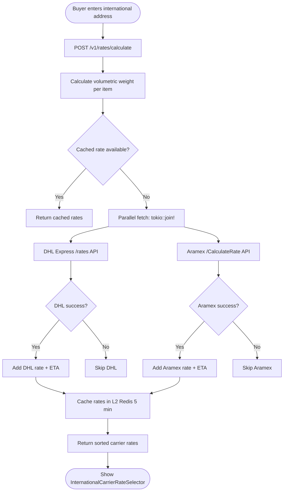
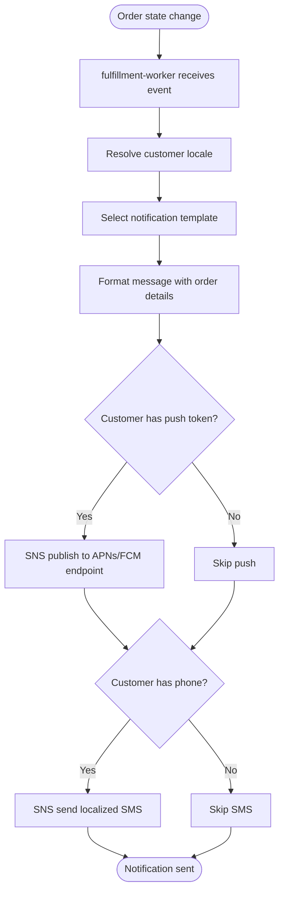

# Module 05: Fulfillment & Shipping

> **Slice**: v1.0 / v3.0 / v4.0 · **Sprints**: 1.2, 3.1, 4.1 · **Stories**: US-5.1.1 – US-5.1.4

## Overview

Covers domestic shipping (Bosta), cross-border express (Aramex/DHL), global multi-carrier aggregation (Shippo/EasyPost), and localized SNS push/SMS notifications at every fulfillment milestone.

## Pages

| Page Route | Access | Primary Hook |
|:-----------|:-------|:-------------|
| `/[locale]/orders/[order_id]/confirmation` | Auth | `useOrderLiveTracker` |
| `/[locale]/vendor/dashboard` | VENDOR | `useVendorPortal` |
| `/[locale]/checkout` | Auth | `useSplitCodCheckout` |

## API Endpoints

| Method | Endpoint | Lambda | Description |
|:-------|:---------|:-------|:------------|
| POST | `/v1/rates/calculate` | `checkout-webhooks-api` | Multi-carrier rate shopping |
| POST | `/v1/webhooks/bosta` | `checkout-webhooks-api` | Bosta delivery status webhook |
| POST | `/v1/webhooks/aramex` | `checkout-webhooks-api` | Aramex tracking webhook |
| POST | `/v1/webhooks/dhl` | `checkout-webhooks-api` | DHL Express webhook |
| — | DynamoDB Stream → EventBridge | `fulfillment-worker` | AWB booking + SNS dispatch |

---

## US-5.1.1: Domestic Shipping via Bosta with COD Collection

**As a** Customer ordering within Egypt/KSA and the Store Operations Manager,  
**I want** confirmed orders to automatically book a Bosta AWB carrying the exact COD collection amount,  
**So that** the courier collects the correct cash balance and I can track shipment status in real time.

### Acceptance Criteria

```gherkin
Feature: Bosta Domestic Fulfillment

  Scenario: AWB booking for DEPOSIT_COD order
    Given an order with DEPOSIT_PAID status and COD balance = 2000 EGP
    When the fulfillment-worker processes the order
    Then a Bosta AWB is created via POST /api/v2/deliveries
    And the COD collection amount is set to 2000 EGP
    And the AWB PDF label is stored in S3
    And the order status updates to AWB_CREATED

  Scenario: Bosta delivery confirmed
    When the Bosta webhook reports state=DELIVERED (state 45)
    Then the order status transitions to COMPLETED
    And the COD collected amount is verified against expected
    And an SNS push/SMS confirms delivery to the customer

  Scenario: Bosta RTO (Return to Origin)
    When the Bosta webhook reports state=RETURNED
    Then the order status transitions to RTO_RETURNED
    And the RTO policy calculates deposit retention vs. refund
    And an SNS notification informs the customer

  Scenario: Localized tracking notifications
    Given the customer's locale is ar-EG
    Then all SNS push/SMS notifications are sent in Arabic
    And include the tracking URL and COD amount to prepare

  Scenario: AWB label download by vendor
    Given the vendor opens their dashboard
    When they click "Print AWB Label" for a sub-order
    Then the pre-generated Bosta AWB PDF downloads from S3
```

### Test Cases

| # | Test Case | Type | Expected Result |
|:--|:----------|:-----|:----------------|
| TC-5.1.1-01 | AWB creation for COD order | Happy Path | AWB created, label in S3 |
| TC-5.1.1-02 | Full COD AWB (no deposit) | Happy Path | Full amount as COD |
| TC-5.1.1-03 | Delivery confirmed webhook | Happy Path | Order COMPLETED |
| TC-5.1.1-04 | RTO returned | Edge Case | Deposit retention logic |
| TC-5.1.1-05 | Arabic SMS notification | i18n | Arabic template sent |
| TC-5.1.1-06 | Bosta API timeout | Error | Retry with backoff |
| TC-5.1.1-07 | Duplicate Bosta webhook | Idempotency | No duplicate state change |
| TC-5.1.1-08 | COD amount mismatch | Error | Alert admin, flag order |
| TC-5.1.1-09 | Vendor AWB PDF download | Happy Path | PDF downloads from S3 |
| TC-5.1.1-10 | Multi-vendor order, separate AWBs | Happy Path | One AWB per sub-order |

### Activity Diagram

```mermaid
flowchart TD
    A([Order confirmed / deposit paid]) --> B[DynamoDB Stream → EventBridge]
    B --> C[fulfillment-worker triggered]
    C --> D[Decrypt Bosta credentials from KMS]
    D --> E[POST Bosta /api/v2/deliveries]
    E --> F{AWB created?}
    F -->|No| G[Retry with exponential backoff]
    G --> E
    F -->|Yes| H[Store AWB PDF label in S3]
    H --> I[Update ORDER# with awb_number]
    I --> J[SNS: Localized shipment notification]
    J --> K{Bosta webhooks over time}
    K -->|In Transit| L[Update status + SNS notify]
    K -->|Out for Delivery| M[SNS: "Prepare cash for delivery"]
    K -->|Delivered| N[ORDER# → COMPLETED]
    K -->|Returned| O[ORDER# → RTO_RETURNED]
    O --> P[Apply RTO deposit retention policy]
```

---

## US-5.1.2: Cross-Border Express Shipping (Aramex & DHL)

**As a** Cross-Border Merchant and International Buyer,  
**I want** checkout to show live air-express rates from Aramex and DHL Express with volumetric weight and automated customs declarations,  
**So that** cross-border shipments clear customs without manual paperwork.

### Acceptance Criteria

```gherkin
Feature: Cross-Border Express Shipping

  Scenario: Live rate comparison at checkout
    Given the buyer enters a UAE delivery address
    When the system calls POST /v1/rates/calculate
    Then Aramex and DHL Express rates are fetched in parallel (tokio::join!)
    And both rates with ETAs are shown in the carrier selector
    And volumetric weight = max(actual_kg, L×W×H/5000) is calculated

  Scenario: Automated customs commercial invoice
    When the buyer completes payment for a cross-border order
    Then a bilingual (Arabic + English) commercial invoice PDF is generated
    And line-item HS codes and country of origin are included
    And the PDF is uploaded via DHL Paperless Trade API

  Scenario: DHL rate unavailable
    Given DHL Express returns an error for the destination
    Then only the Aramex rate is shown
    And a "Limited carrier options" note appears
```

### Test Cases

| # | Test Case | Type | Expected Result |
|:--|:----------|:-----|:----------------|
| TC-5.1.2-01 | Parallel Aramex + DHL rate fetch | Happy Path | Both rates shown |
| TC-5.1.2-02 | Volumetric weight calculation | Happy Path | Correct max(dead, vol) |
| TC-5.1.2-03 | Bilingual commercial invoice | Happy Path | PDF generated |
| TC-5.1.2-04 | DHL unavailable, Aramex only | Fallback | Single rate shown |
| TC-5.1.2-05 | Both carriers unavailable | Error | "No shipping available" |
| TC-5.1.2-06 | HS code lookup | Happy Path | Correct codes on invoice |
| TC-5.1.2-07 | Incoterms DDP vs DDU | Happy Path | Correct badge shown |
| TC-5.1.2-08 | Rate caching (5 min TTL) | Performance | Cached rate reused |

### Activity Diagram



---

## US-5.1.3: Global Multi-Carrier Aggregation (Shippo & EasyPost)

**As a** Global Marketplace Operator,  
**I want** to aggregate live rates from 40+ carriers (USPS, FedEx, UPS, Royal Mail, etc.) via Shippo and EasyPost at checkout,  
**So that** customers worldwide get the best shipping options.

### Acceptance Criteria

```gherkin
Feature: Global Multi-Carrier Aggregation

  Scenario: US domestic shipment
    Given the buyer has a US delivery address
    When rates are calculated
    Then USPS, FedEx, and UPS rates appear via Shippo/EasyPost
    And rates are sorted by price (cheapest first)

  Scenario: Generate return label (RMA)
    When a customer requests a return
    Then a prepaid return label is generated via Shippo/EasyPost
    And the label is emailed and shown in the order detail page
```

### Test Cases

| # | Test Case | Type | Expected Result |
|:--|:----------|:-----|:----------------|
| TC-5.1.3-01 | US domestic rates | Happy Path | 3+ carrier options |
| TC-5.1.3-02 | EU domestic rates | Happy Path | Royal Mail, DPD, etc. |
| TC-5.1.3-03 | Return label generation | Happy Path | Label PDF generated |
| TC-5.1.3-04 | Shippo API timeout | Error | Fallback to EasyPost |
| TC-5.1.3-05 | No carriers available | Error | "No shipping options" |

---

## US-5.1.4: Localized SNS Push & SMS Notifications at Every Milestone

**As a** Customer,  
**I want to** receive push notifications (APNs/FCM) and SMS at every order milestone in my preferred language,  
**So that** I stay informed about my order without checking the app.

### Acceptance Criteria

```gherkin
Feature: Localized Order Notifications

  Scenario: Order confirmed notification
    When an order is created
    Then an SNS push + SMS is sent in the customer's locale
    And the message includes the order ID and expected delivery date

  Scenario: Shipment booked notification (COD)
    When the AWB is created for a COD order
    Then the notification says "Prepare [amount] cash for delivery"

  Scenario: Delivered notification
    When the carrier confirms delivery
    Then a "Your order has been delivered" notification is sent
    And includes a link to rate the experience
```

### Test Cases

| # | Test Case | Type | Expected Result |
|:--|:----------|:-----|:----------------|
| TC-5.1.4-01 | Arabic push notification | i18n | Arabic template |
| TC-5.1.4-02 | English SMS | i18n | English template |
| TC-5.1.4-03 | Customer has push disabled | Edge Case | SMS only |
| TC-5.1.4-04 | Invalid phone number | Error | SMS fails gracefully |
| TC-5.1.4-05 | All milestones covered | Happy Path | 5+ notification types |

### Activity Diagram


