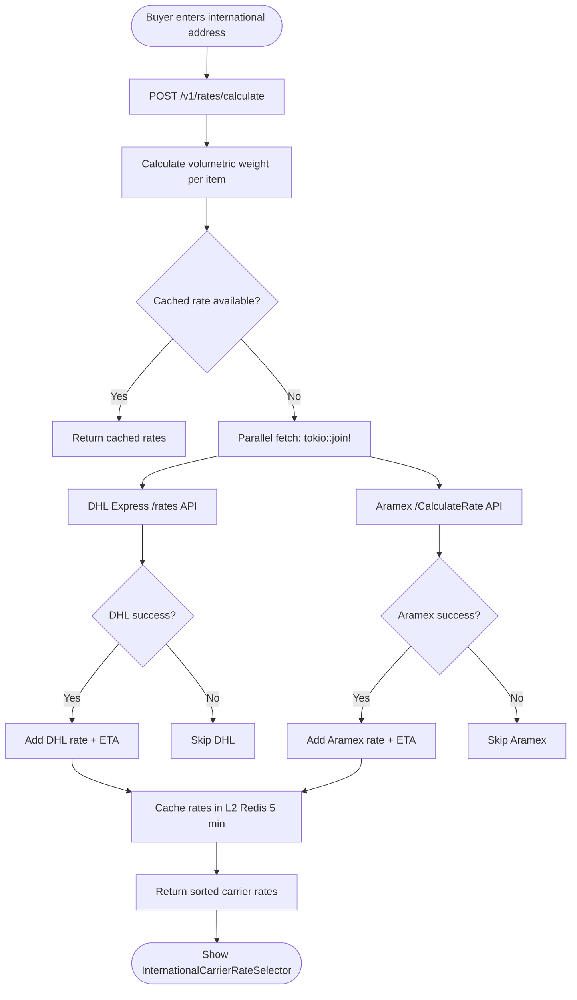

# US-5.1.2: Cross-Border Express Shipping (Aramex & DHL)

> **Spec Kit Specification**: [Specification Lifecycle Active (.specify/)](../../../.specify/memory/constitution.md)  
> **Domain Feature**: `logistics-and-fulfillment`  
> **Domain Module**: `fulfillment-and-shipping`  
> **Autonomous Behaviour**: `cross-border-shipping`  
> **Client Framework Path**: `apps/storefront/src/features/logistics-and-fulfillment/modules/fulfillment-and-shipping/behaviours/cross-border-shipping`  
> **Backend Framework Path**: `backend/src/features/logistics-and-fulfillment/modules/fulfillment-and-shipping/behaviours/cross-border-shipping`  
> **Execution Sprint**: [Sprint 3.1](../../sprints/README.md)  
> **Slicing Standard**: [7-PR Vertical Slicing Framework](../../sprints/README.md#the-7-pr-vertical-slicing-standard)  
> **Security Gateway**: [ASVS Level 2 Verification Gate (security-audit)](#5-security-gateway-powered-by-security-audit)

---

## 1. Spec Kit Specification: User Story & Domain Scope

### 1.1 User Story Narrative

**As a** Cross-Border Merchant and International Buyer,  
**I want** checkout to show live air-express rates from Aramex and DHL Express with volumetric weight and automated customs declarations,  
**So that** cross-border shipments clear customs without manual paperwork.

### 1.2 Acceptance Criteria (Gherkin Scenarios)

```gherkin
Feature: Cross-Border Express Shipping
  Scenario: [AC-US-5.1.2-01] Live rate comparison at checkout
    Given the buyer enters a UAE delivery address
    When the system calls POST /v1/rates/calculate
    Then Aramex and DHL Express rates are fetched in parallel (tokio::join!)
    And both rates with ETAs are shown in the carrier selector
    And volumetric weight = max(actual_kg, L×W×H/5000) is calculated
  Scenario: [AC-US-5.1.2-02] Automated customs commercial invoice
    When the buyer completes payment for a cross-border order
    Then a bilingual (Arabic + English) commercial invoice PDF is generated
    And line-item HS codes and country of origin are included
    And the PDF is uploaded via DHL Paperless Trade API
  Scenario: [AC-US-5.1.2-03] DHL rate unavailable
    Given DHL Express returns an error for the destination
    Then only the Aramex rate is shown
    And a "Limited carrier options" note appears
```

### 1.3 Test Cases & Traceability Matrix

| # | Test Case | Type | Expected Result |
|:--|:----------|:-----|:----------------|
| TC-5.1.2-01 | Parallel Aramex + DHL rate fetch | Happy Path | Both rates shown |
| TC-5.1.2-02 | Volumetric weight calculation | Happy Path | Correct max(dead, vol) |
| TC-5.1.2-03 | Bilingual commercial invoice | Happy Path | PDF generated |
| TC-5.1.2-04 | DHL unavailable, Aramex only | Fallback | Single rate shown |
| TC-5.1.2-05 | Both carriers unavailable | Error | "No shipping available" |
| TC-5.1.2-06 | HS code lookup | Happy Path | Correct codes on invoice |
| TC-5.1.2-07 | Incoterms DDP vs DDU | Happy Path | Correct badge shown |
| TC-5.1.2-08 | Rate caching (5 min TTL) | Performance | Cached rate reused |

---

## 2. Behavior-Centric Architecture & Folder Blueprint

This user story is implemented directly inside the respective **Expo client** and **Cargo Lambda Axum backend** frameworks according to the **Locality of Behavior (LoB)** architectural law. Private services, designs, logic, types, and constants are strictly colocated within their framework behaviour directory.

### 2.1 Colocated Behaviour Directory Tree

#### Client Architecture (Universal Expo SDK 58):
```
apps/storefront/src/features/logistics-and-fulfillment/modules/fulfillment-and-shipping/behaviours/cross-border-shipping/
├── services/
│   │   ├── aramex_client.rs
│   │   ├── dhl_express_client.rs
│   │   ├── customs_duty_service.rs
├── designs/
│   │   ├── CustomsDeclarationSheet.tsx
│   │   ├── InternationalRateMatrix.tsx
│   │   ├── DutyTaxBreakdown.tsx
├── logic/
│   │   ├── useCrossBorderShipping.ts
│   │   ├── hs_code_duty_calculator.rs
│   │   ├── carrier_rate_comparer.ts
├── types/
│   │   ├── CustomsDeclaration.ts
│   │   ├── InternationalRateQuote.ts
│   │   ├── CrossBorderWaybill.ts
└── constants/
│   │   ├── CrossBorderEndpoints.ts
│   │   ├── HsCodeRegistry.ts
│   │   ├── CrossBorderErrors.ts
```

#### Backend Architecture (Cargo Lambda + Axum 0.8):
```
backend/src/features/logistics-and-fulfillment/modules/fulfillment-and-shipping/behaviours/cross-border-shipping/
├── services/
│   │   ├── aramex_client.rs
│   │   ├── dhl_express_client.rs
│   │   ├── customs_duty_service.rs
├── logic/
│   │   ├── useCrossBorderShipping.ts
│   │   ├── hs_code_duty_calculator.rs
│   │   ├── carrier_rate_comparer.ts
├── types/
│   │   ├── CustomsDeclaration.ts
│   │   ├── InternationalRateQuote.ts
│   │   ├── CrossBorderWaybill.ts
└── constants/
│   │   ├── CrossBorderEndpoints.ts
│   │   ├── HsCodeRegistry.ts
│   │   ├── CrossBorderErrors.ts
```

### 2.2 Scoping & Promotion Blueprint

| Layer / Tier | Client Path (Expo) | Backend Path (Cargo Lambda / Axum) | Purpose & Promotion Rules |
| :--- | :--- | :--- | :--- |
| **Behaviour-Local** | `.../behaviours/cross-border-shipping/` | `.../behaviours/cross-border-shipping/` | **Default Private Scope**: Colocated services, designs, logic, types, and constants private to this story. |
| **Module-Shared** | `.../modules/fulfillment-and-shipping/_shared/` | `.../modules/fulfillment-and-shipping/_shared/` | Shared domain primitives and UI elements used by $\ge 2$ behaviours in `fulfillment-and-shipping`. |
| **Feature-Shared** | `.../features/logistics-and-fulfillment/_shared/` | `.../features/logistics-and-fulfillment/_shared/` | Feature-level contracts, ports, and cross-module bridges across `logistics-and-fulfillment`. |
| **Framework-Shared** | `apps/storefront/src/shared/` | `backend/crates/kernel-core/` | System-wide microkernel traits, `Money` arithmetic, RFC 9110 ETag middleware, and database adapters. |

---

## 3. Technical Implementation Plan (Spec Kit Plan)

### 3.1 Domain Invariants & Storage Schema
- **State Machine**: Enforces valid state transitions and rejects unauthorized or out-of-order mutations.
- **Data Persistence**: Single-table Amazon DynamoDB partitioning (`PK = TENANT#<id>`, `SK = ENTITY#<id>`) paired with reactive local-first WatermelonDB sync.
- **Freshness & Caching**: Multi-tier caching (L1 Moka in-memory + L2 ElastiCache Redis) with RFC 9110 `ETag` conditional `304 Not Modified` short-circuiting.

### 3.2 Activity & Interaction Diagram



---

## 4. Granular Implementation Tasks (Spec Kit Tasks)

### Phase 1: Core Domain Logic, Types & Constants
- [ ] **Task 1.1 (Types)**: Define strongly typed models and DTO schemas in `types/`.
- [ ] **Task 1.2 (Constants)**: Define routes, action codes, and validation limits in `constants/`.
- [ ] **Task 1.3 (Logic)**: Implement pure business logic, calculations, and state machines in `logic/`.
- [ ] **Task 1.4 (Unit Tests)**: Write pure property-based and unit tests verifying domain invariants.

### Phase 2: Services & Infrastructure Adapters
- [ ] **Task 2.1 (API / Gateway)**: Implement client adapters and backend handlers in `services/`.
- [ ] **Task 2.2 (ETag & Cache)**: Integrate RFC 9110 ETag headers and multi-tier caching (Moka L1 / Redis L2).
- [ ] **Task 2.3 (Storage & Sync)**: Implement DynamoDB storage operations and WatermelonDB delta sync.
- [ ] **Task 2.4 (Integration Tests)**: Verify service contract tests and real database conditional writes.

### Phase 3: Platform-Adaptive Designs & UI
- [ ] **Task 3.1 (UI Presentation)**: Build platform-adaptive screens and SDUI components in `designs/`.
- [ ] **Task 3.2 (Headless Hooks)**: Bind headless domain hooks from `logic/` into the UI presentation.
- [ ] **Task 3.3 (i18n & RTL)**: Implement bidirectional RTL/LTR layout mirroring and localized font switching.
- [ ] **Task 3.4 (Component Tests)**: Test empty, loading, offline, and error states across web and mobile.

### Phase 4: Security Gateway Verification & Release Readiness
- [ ] **Task 4.1 (Abuse Testing)**: Execute automated adversarial penetration tests against the threat matrix.
- [ ] **Task 4.2 (Zero-Trust Audit)**: Verify strict tenant isolation and object-level authorization (IDOR).
- [ ] **Task 4.3 (SAST & Audit)**: Run static analysis, dependency audit, and secret scanning.
- [ ] **Task 4.4 (Gate Sign-Off)**: Obtain independent security sign-off for the G2 Security Gateway.

---

## 5. Security Gateway (Powered by security-audit)

### 5.1 Trust Boundaries & Security Actors
- **Trust Boundaries**:
  - `Untrusted Zone`: Mobile client app, public web browser, and external network callers.
  - `Gateway Edge`: AWS CloudFront, API Gateway, and Cognito JWT authentication guard.
  - `Secure Application Boundary`: Axum Tower route extractors enforcing tenant and RBAC/ABAC isolation.
  - `Encrypted Storage & Secret Vault`: Amazon DynamoDB KMS-encrypted tables and AWS KMS vault.
- **Authorized Principals**:
  - Identified Actors: `AuthenticatedCustomer`, `B2bBuyer`, `Vendor`, `StoreAdmin`, or `AnonymousShopper` (read-only).
  - Multi-Tenancy Invariant: Every request must extract `tenant_id` from verified JWT claims. Injections via query params or payload body are rejected with `403 Forbidden`.

### 5.2 Threat Modeling & Abuse Matrix (STRIDE / ASVS)

| Threat Vector | Severity | Vulnerability Mechanism | Mitigating Control & Security Invariant |
| :--- | :--- | :--- | :--- |
| **Spoofing & Impersonation** | Critical | Forged `sub` or `tenant_id` identity claims | Server-side RS256 JWKS signature verification; strict claims extraction in Axum. |
| **Tampering & Invariant Bypass** | High | Manipulating payload parameters or prices | Authoritative server recalculation; strict schema validation; BLAKE3 ETag integrity checks. |
| **Information Disclosure (IDOR)** | Critical | Cross-tenant or cross-user data scraping | Explicit `PK = TENANT#<id>` partition filtering on every database and cache operation. |
| **Denial of Service / Abuse** | High | Customs undervaluation fraud, restricted country export violations, and unauthorized carrier account billing | Token-bucket rate limiting per IP and account; strict input length validation. |
| **Elevation of Privilege** | Critical | Bypassing role-based permission checks | Tower extractors (`RequireStoreAdmin`, `RequireVendor`) guard sensitive endpoints. |

### 5.3 Cryptographic & Data Protection Controls
- **Encryption in Transit**: TLS 1.3 enforced on all external and internal endpoints; HSTS active.
- **Encryption at Rest**: DynamoDB AWS KMS customer-managed keys; AES-256-GCM for sensitive client tokens in `expo-secure-store`.
- **PII & Secret Redaction**: Passwords, OTPs, auth tokens, and credit card numbers are stripped from logs and traces via `tracing` redaction filters.

### 5.4 Automated Security Verification Checklist
- [ ] **SAST Analysis**: Clean report from static code analyzers; 0 high or critical vulnerabilities.
- [ ] **Dependency Audit**: `cargo deny` and `bun audit` pass with 0 unreviewed security advisories.
- [ ] **Abuse & IDOR Fuzzing**: Test suite confirms that requests with modified `tenant_id` or `user_id` fail with `401 Unauthorized` or `403 Forbidden`.
- [ ] **Secret Scanning**: Gitleaks scanner confirms zero hardcoded credentials, API keys, or private keys.

### 5.5 Security Gateway (G2) Sign-Off Checklist
- [ ] Threat boundary and entry points verified against OWASP ASVS Level 2 requirements.
- [ ] Multi-tenant isolation verified with automated cross-tenant penetration test.
- [ ] Anti-abuse and rate limiting confirmed active on all public interfaces.
- [ ] Audit log redaction verified — zero plaintext secrets in output logs.
- [ ] Independent reviewer sign-off obtained; zero open Critical or High findings.

---

## 6. Validation Gates & Acceptance Sign-Off

**Status: Pending — specification only; no implementation evidence.** All [G0–G4 quality gates](../../QUALITY_GATES.md) apply to this story. The following checks add to its acceptance criteria and test cases; they do not replace them.

### G1 — Test coverage
- [ ] **US-5.1.2-G1:** Automated test suite maps 100% of acceptance criteria and test cases with >=90% line and >=85% branch coverage in affected packages.

### G2 — Security audit
- [ ] **US-5.1.2-G2:** Verify zero-trust tenant isolation, object-level authorization (IDOR), and defense against Customs undervaluation fraud, restricted country export violations, and unauthorized carrier account billing. No unresolved critical or high findings.

### G3 — Architecture and maintainability
- [ ] **US-5.1.2-G3:** Strict compliance with framework colocation (`apps/storefront/src/features/` or `backend/src/features/`), zero-clone borrowing discipline in Rust, and clean domain boundaries.

### G4 — Integrated acceptance
- [ ] **US-5.1.2-G4:** End-to-end user journey validation across supported platforms (Web, iOS, Android) and verified sandbox integration.

---

[← Back to Module fulfillment-and-shipping Catalog (README.md)](README.md) | [Master User Stories Index](../README.md)
