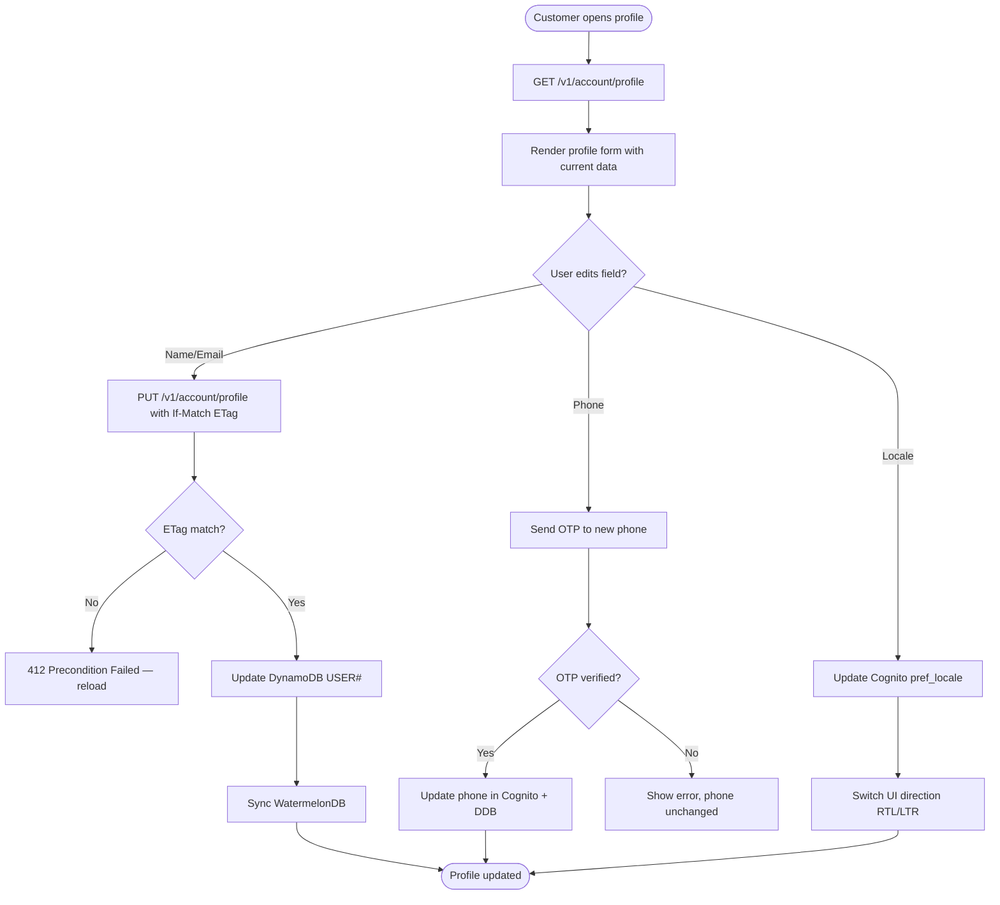
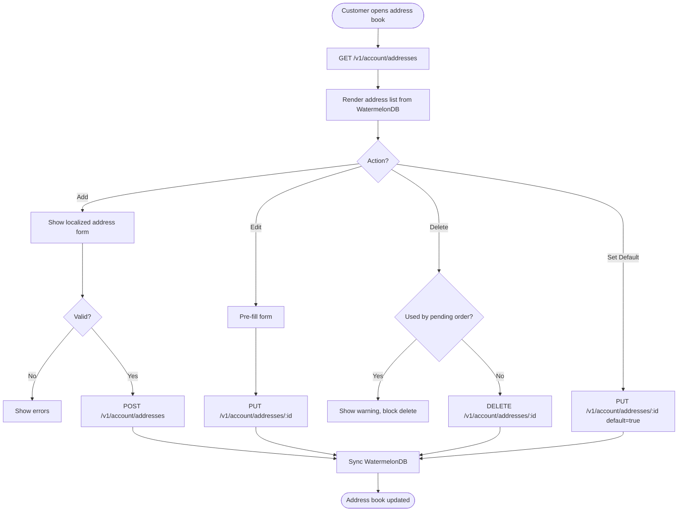
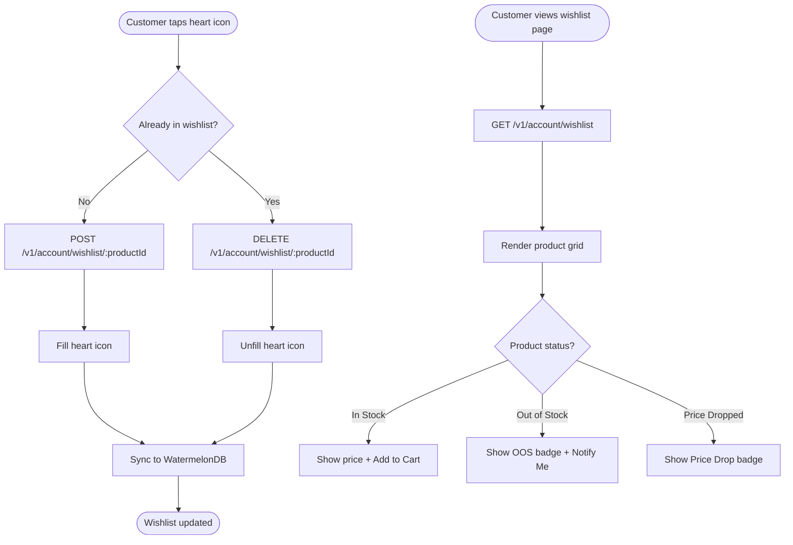

# Module 07: Customer Account

> **Slice**: v1.0 · **Sprint**: 1.1 · **Stories**: US-7.1.1 – US-7.1.4

## Overview

Covers customer profile management, address book, notification preferences, and wishlist functionality.

## Pages

| Page Route | Access | Primary Hook |
|:-----------|:-------|:-------------|
| `/[locale]/account/profile` | Auth | `useCustomerAccount` |
| `/[locale]/account/wishlist` | Auth | `useWishlist` |

## API Endpoints

| Method | Endpoint | Lambda | Description |
|:-------|:---------|:-------|:------------|
| GET | `/v1/account/profile` | `storefront-sdui-api` | Get profile |
| PUT | `/v1/account/profile` | `storefront-sdui-api` | Update profile |
| GET | `/v1/account/addresses` | `storefront-sdui-api` | List addresses |
| POST | `/v1/account/addresses` | `storefront-sdui-api` | Add address |
| PUT | `/v1/account/addresses/:id` | `storefront-sdui-api` | Update address |
| DELETE | `/v1/account/addresses/:id` | `storefront-sdui-api` | Delete address |
| GET | `/v1/account/wishlist` | `storefront-sdui-api` | Get wishlist |
| POST | `/v1/account/wishlist/:productId` | `storefront-sdui-api` | Add to wishlist |
| DELETE | `/v1/account/wishlist/:productId` | `storefront-sdui-api` | Remove from wishlist |
| PUT | `/v1/account/notifications` | `storefront-sdui-api` | Update notification prefs |

---

## US-7.1.1: Customer Profile Management

**As a** registered Customer,  
**I want to** view and edit my profile including name, email, phone, preferred locale, and connected sign-in methods,  
**So that** my account details are accurate and I can manage security settings.

### Acceptance Criteria

```gherkin
Feature: Profile Management

  Scenario: View profile
    Given the customer navigates to "/[locale]/account/profile"
    Then the profile page shows: full name, email, phone, preferred locale, connected passkeys, role badge

  Scenario: Update preferred locale
    When the customer changes locale from en-US to ar-EG
    Then the Cognito custom:pref_locale attribute is updated
    And the WatermelonDB user record syncs
    And the UI immediately flips to RTL with Cairo font

  Scenario: Update phone number
    When the customer changes their phone number
    Then a verification OTP is sent to the new number
    And the phone is only updated after OTP verification

  Scenario: View connected sessions
    Then the profile shows active sessions (device, last active time)
    And the customer can revoke any session
```

### Test Cases

| # | Test Case | Type | Expected Result |
|:--|:----------|:-----|:----------------|
| TC-7.1.1-01 | View profile details | Happy Path | All fields displayed |
| TC-7.1.1-02 | Update name | Happy Path | Name saved, synced |
| TC-7.1.1-03 | Change locale en→ar | Happy Path | RTL switch, Cognito updated |
| TC-7.1.1-04 | Change phone with OTP | Happy Path | Verified and updated |
| TC-7.1.1-05 | Change phone — OTP fails | Negative | Phone not changed |
| TC-7.1.1-06 | Empty name | Validation | Error shown |
| TC-7.1.1-07 | XSS in name field | Security | Input sanitized |
| TC-7.1.1-08 | Revoke session | Happy Path | Session terminated |
| TC-7.1.1-09 | Concurrent profile edits | Concurrency | ETag If-Match → 412 |
| TC-7.1.1-10 | Unauthenticated access | Security | Redirect to sign-in |

### Activity Diagram



---

## US-7.1.2: Address Book Management

**As a** Customer,  
**I want to** manage multiple delivery addresses with a default address for quicker checkout,  
**So that** I can ship to different locations without re-entering address details.

### Acceptance Criteria

```gherkin
Feature: Address Book

  Scenario: Add new address
    When the customer adds a new address with all required fields
    Then the address is saved in the USER# addresses array in DynamoDB
    And synced to WatermelonDB for offline access

  Scenario: Set default address
    When the customer marks an address as default
    Then that address is pre-selected during checkout

  Scenario: Delete address used in pending order
    Given an address is referenced by a pending order
    When the customer tries to delete it
    Then a warning "This address is used by a pending order" is shown
    And deletion is blocked until the order is fulfilled

  Scenario: Max address limit
    Given the customer has 10 addresses (maximum)
    When they try to add an 11th
    Then an error "Maximum 10 addresses allowed. Remove one first." is shown
```

### Test Cases

| # | Test Case | Type | Expected Result |
|:--|:----------|:-----|:----------------|
| TC-7.1.2-01 | Add valid address | Happy Path | Saved and synced |
| TC-7.1.2-02 | Set default address | Happy Path | Default used in checkout |
| TC-7.1.2-03 | Edit existing address | Happy Path | Updated |
| TC-7.1.2-04 | Delete unused address | Happy Path | Removed |
| TC-7.1.2-05 | Delete address used by order | Validation | Blocked |
| TC-7.1.2-06 | 11th address | Validation | Limit error |
| TC-7.1.2-07 | Offline address add | Edge Case | Synced on reconnect |
| TC-7.1.2-08 | Arabic address labels | i18n | RTL labels |

### Activity Diagram



---

## US-7.1.3: Notification Preferences

**As a** Customer,  
**I want to** control which notifications I receive (push, SMS, email) and for which events,  
**So that** I only get notifications I find useful.

### Acceptance Criteria

```gherkin
Feature: Notification Preferences

  Scenario: View notification settings
    Given the customer opens the profile page
    Then a notification preferences section shows toggles for:
      - Order updates (push, SMS, email)
      - Promotional offers (push, email)
      - Price drop alerts (push, email)
      - Back-in-stock alerts (push)

  Scenario: Disable SMS notifications
    When the customer toggles off SMS for order updates
    Then the preference is saved in DynamoDB USER#
    And future order updates skip SMS delivery

  Scenario: Unsubscribe from promotions
    When the customer disables all promotional channels
    Then no promotional messages are sent
    And the preference is respected across all notification triggers
```

### Test Cases

| # | Test Case | Type | Expected Result |
|:--|:----------|:-----|:----------------|
| TC-7.1.3-01 | View preferences | Happy Path | All toggles shown |
| TC-7.1.3-02 | Disable SMS | Happy Path | SMS skipped |
| TC-7.1.3-03 | Disable all promos | Happy Path | No promos sent |
| TC-7.1.3-04 | Re-enable push | Happy Path | Push resumes |
| TC-7.1.3-05 | Critical notifications (security) | Edge Case | Cannot disable |

---

## US-7.1.4: Wishlist

**As a** Customer,  
**I want to** save products to a wishlist for later consideration,  
**So that** I can quickly find and purchase items I'm interested in.

### Acceptance Criteria

```gherkin
Feature: Wishlist

  Scenario: Add product to wishlist
    When the customer clicks the heart icon on a product card
    Then the product is added to their wishlist
    And the heart icon fills (visual feedback)
    And the wishlist syncs across devices via WatermelonDB

  Scenario: View wishlist
    Given the customer navigates to "/[locale]/account/wishlist"
    Then all wishlisted products are shown in a grid
    And each card shows current price, stock status, and "Add to Cart" button

  Scenario: Add wishlisted item to cart
    When the customer clicks "Add to Cart" from the wishlist
    Then the item is added to the cart
    And optionally removed from the wishlist (configurable)

  Scenario: Product in wishlist goes out of stock
    Given a wishlisted product goes out of stock
    Then the wishlist card shows "Out of Stock" badge
    And a "Notify when available" button appears

  Scenario: Price drop on wishlisted item
    Given a wishlisted product's price drops by ≥10%
    Then an SNS push notification "Price dropped!" is sent
    And the wishlist card shows a "Price Drop" badge with old vs new price
```

### Test Cases

| # | Test Case | Type | Expected Result |
|:--|:----------|:-----|:----------------|
| TC-7.1.4-01 | Add to wishlist | Happy Path | Heart filled, saved |
| TC-7.1.4-02 | Remove from wishlist | Happy Path | Heart unfilled, removed |
| TC-7.1.4-03 | View wishlist page | Happy Path | Grid with cards |
| TC-7.1.4-04 | Add to cart from wishlist | Happy Path | Item in cart |
| TC-7.1.4-05 | Out of stock in wishlist | Edge Case | Badge + notify button |
| TC-7.1.4-06 | Price drop notification | Happy Path | Push sent with prices |
| TC-7.1.4-07 | 100 items in wishlist | Performance | Page loads <300ms |
| TC-7.1.4-08 | Duplicate add | Edge Case | Item not duplicated |
| TC-7.1.4-09 | Offline wishlist add | Edge Case | Synced on reconnect |
| TC-7.1.4-10 | Deleted product in wishlist | Edge Case | "Product unavailable" shown |

### Activity Diagram


