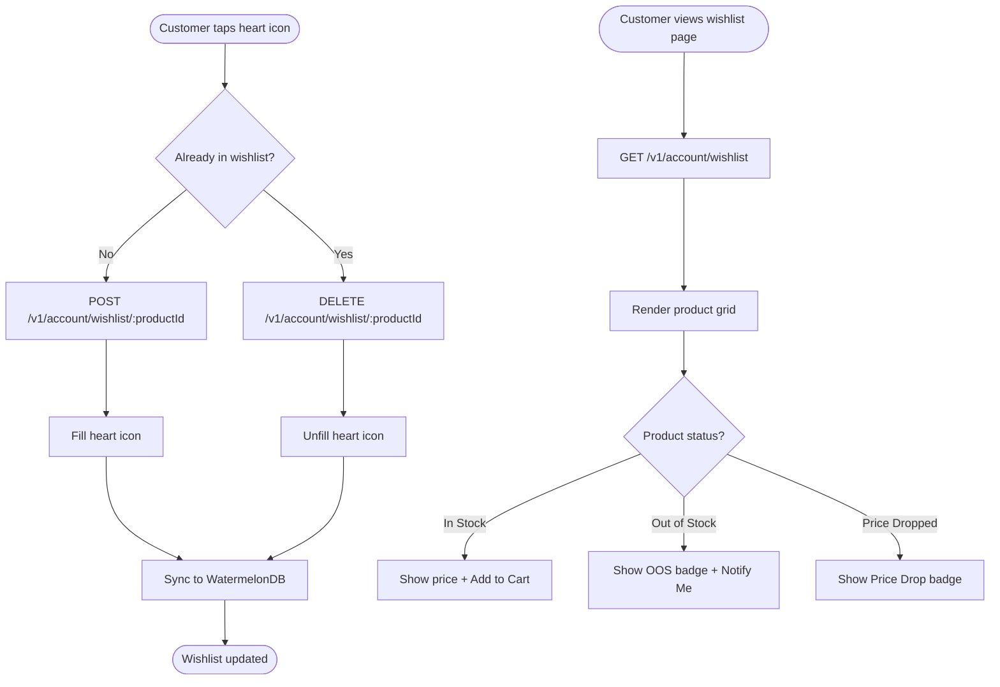

# US-7.1.4: Wishlist

> **Spec Kit Specification**: [Specification Lifecycle Active (.specify/)](../../../.specify/memory/constitution.md)  
> **Domain Feature**: `identity-and-access`  
> **Domain Module**: `customer-account`  
> **Autonomous Behaviour**: `customer-wishlist`  
> **Client Framework Path**: `apps/storefront/src/features/identity-and-access/modules/customer-account/behaviours/customer-wishlist`  
> **Backend Framework Path**: `backend/src/features/identity-and-access/modules/customer-account/behaviours/customer-wishlist`  
> **Execution Sprint**: [Sprint 1.1](../../sprints/README.md)  
> **Slicing Standard**: [10-PR Vertical Slicing Framework](../../sprints/README.md#the-10-pr-vertical-slicing-standard-aligned-with-10-pillar-system-architecture)  
> **Security Gateway**: [ASVS Level 2 Verification Gate (security-audit)](#5-security-gateway-powered-by-security-audit)

---

## 1. Spec Kit Specification: User Story & Domain Scope

### 1.1 User Story Narrative

**As a** Customer,  
**I want to** save products to a wishlist for later consideration,  
**So that** I can quickly find and purchase items I'm interested in.

### 1.2 Acceptance Criteria (Gherkin Scenarios)

```gherkin
Feature: Wishlist
  Scenario: [AC-US-7.1.4-01] Add product to wishlist
    When the customer clicks the heart icon on a product card
    Then the product is added to their wishlist
    And the heart icon fills (visual feedback)
    And the wishlist syncs across devices via WatermelonDB
  Scenario: [AC-US-7.1.4-02] View wishlist
    Given the customer navigates to "/[locale]/account/wishlist"
    Then all wishlisted products are shown in a grid
    And each card shows current price, stock status, and "Add to Cart" button
  Scenario: [AC-US-7.1.4-03] Add wishlisted item to cart
    When the customer clicks "Add to Cart" from the wishlist
    Then the item is added to the cart
    And optionally removed from the wishlist (configurable)
  Scenario: [AC-US-7.1.4-04] Product in wishlist goes out of stock
    Given a wishlisted product goes out of stock
    Then the wishlist card shows "Out of Stock" badge
    And a "Notify when available" button appears
  Scenario: [AC-US-7.1.4-05] Price drop on wishlisted item
    Given a wishlisted product's price drops by ≥10%
    Then an SNS push notification "Price dropped!" is sent
    And the wishlist card shows a "Price Drop" badge with old vs new price
  Scenario: [AC-US-7.1.4-LAW] Global e-commerce legal compliance and promotional price alert regulations
    Given a customer saving catalog items to a personal wishlist and enabling price drop notifications
    When generating price drop alerts or saving product preferences
    Then price drop alert notifications must reflect genuine price reductions calculated against the prior 30-day lowest price baseline
    And consumer wishlist preferences must not be shared with third-party advertisers without explicit affirmative consent
    And wishlist items must accurately reflect current stock availability without fabricated urgency warnings
```

### 1.3 Test Cases & Traceability Matrix

| # | Test Case | Type | Expected Result |
|:--|:----------|:-----|:----------------|
| TC-7.1.4-01 | Add to wishlist | Happy Path | Heart filled, saved |
| TC-7.1.4-02 | Remove from wishlist | Happy Path | Heart unfilled, removed |
| TC-7.1.4-03 | View wishlist page | Happy Path | Grid with cards |
| TC-7.1.4-04 | Add to cart from wishlist | Happy Path | Item in cart |
| TC-7.1.4-05 | Out of stock in wishlist | Edge Case | Badge + notify button |
| TC-7.1.4-06 | Price drop notification | Happy Path | Push sent with prices |
| TC-7.1.4-07 | 100 items in wishlist | Performance | Page loads <300ms |
| TC-7.1.4-08 | Duplicate add | Edge Case | Item not duplicated |
| TC-7.1.4-09 | Offline wishlist add | Edge Case | Synced on reconnect |
| TC-7.1.4-10 | Deleted product in wishlist | Edge Case | "Product unavailable" shown |
| TC-7.1.4-LAW | Global legal & regulatory compliance (EU Omnibus Directive Art 6a price drop baseline, ePrivacy tracking consent, anti-dark patterns) | Legal / Regulatory | Statutory compliance verified with zero legal or regulatory violations |

---

## 2. Behavior-Centric Architecture & Folder Blueprint

This user story is implemented directly inside the respective **Expo client** and **Cargo Lambda Axum backend** frameworks according to the **Locality of Behavior (LoB)** architectural law. Private services, designs, logic, types, and constants are strictly colocated within their framework behaviour directory.

### 2.1 Colocated Behaviour Directory Tree

#### Client Architecture (Universal Expo SDK 58):
```
apps/storefront/src/features/identity-and-access/modules/customer-account/behaviours/customer-wishlist/
├── services/
│   │   ├── wishlist_repository.rs
│   │   ├── price_drop_notifier.rs
│   │   ├── wishlist_api.ts
├── designs/
│   │   ├── WishlistGridScreen.tsx
│   │   ├── WishlistItemCard.tsx
│   │   ├── MoveToCartButton.tsx
├── logic/
│   │   ├── useWishlist.ts
│   │   ├── wishlist_deduplicator.ts
│   │   ├── back_in_stock_listener.ts
├── types/
│   │   ├── WishlistItem.ts
│   │   ├── WishlistSyncPayload.ts
│   │   ├── PriceDropAlert.ts
└── constants/
│   │   ├── WishlistEndpoints.ts
│   │   ├── MaxWishlistCapacity.ts
│   │   ├── WishlistErrorCodes.ts
```

#### Backend Architecture (Cargo Lambda + Axum 0.8):
```
backend/src/features/identity-and-access/modules/customer-account/behaviours/customer-wishlist/
├── services/
│   │   ├── wishlist_repository.rs
│   │   ├── price_drop_notifier.rs
│   │   ├── wishlist_api.ts
├── logic/
│   │   ├── useWishlist.ts
│   │   ├── wishlist_deduplicator.ts
│   │   ├── back_in_stock_listener.ts
├── types/
│   │   ├── WishlistItem.ts
│   │   ├── WishlistSyncPayload.ts
│   │   ├── PriceDropAlert.ts
└── constants/
│   │   ├── WishlistEndpoints.ts
│   │   ├── MaxWishlistCapacity.ts
│   │   ├── WishlistErrorCodes.ts
```

### 2.2 Scoping & Promotion Blueprint

| Layer / Tier | Client Path (Expo) | Backend Path (Cargo Lambda / Axum) | Purpose & Promotion Rules |
| :--- | :--- | :--- | :--- |
| **Behaviour-Local** | `.../behaviours/customer-wishlist/` | `.../behaviours/customer-wishlist/` | **Default Private Scope**: Colocated services, designs, logic, types, and constants private to this story. |
| **Module-Shared** | `.../modules/customer-account/_shared/` | `.../modules/customer-account/_shared/` | Shared domain primitives and UI elements used by $\ge 2$ behaviours in `customer-account`. |
| **Feature-Shared** | `.../features/identity-and-access/_shared/` | `.../features/identity-and-access/_shared/` | Feature-level contracts, ports, and cross-module bridges across `identity-and-access`. |
| **Framework-Shared** | `apps/storefront/src/shared/` | `backend/crates/kernel-core/` | System-wide microkernel traits, `Money` arithmetic, RFC 9110 ETag middleware, and database adapters. |

---

## 3. Technical Implementation Plan (Spec Kit Plan)

### 3.1 Domain Invariants & Storage Schema
- **State Machine**: Enforces valid state transitions and rejects unauthorized or out-of-order mutations.
- **Data Persistence**: Single-table Amazon DynamoDB partitioning (`PK = TENANT#<id>`, `SK = ENTITY#<id>`) paired with reactive local-first WatermelonDB sync.
- **Freshness & Caching**: Multi-tier caching (L1 Moka in-memory + L2 ElastiCache Redis) with RFC 9110 `ETag` conditional `304 Not Modified` short-circuiting.

### 3.2 Activity & Interaction Diagram



---

## 4. Granular Implementation Tasks (Spec Kit Tasks)

### Phase 1: Core Domain Logic, Types & Constants
- [ ] **Task 1.1 (Types)**: Define strongly typed models and DTO schemas in `types/`.
- [ ] **Task 1.2 (Constants)**: Define routes, action codes, and validation limits in `constants/`.
- [ ] **Task 1.3 (Logic)**: Implement pure business logic, calculations, and state machines in `logic/`.
- [ ] **Task 1.4 (Unit Tests)**: Write pure property-based and unit tests verifying domain invariants.

### Phase 2: Services & Infrastructure Adapters
- [ ] **Task 2.1 (API / Gateway)**: Implement client adapters and backend handlers in `services/`.
- [ ] **Task 2.2 (ETag & Cache)**: Integrate RFC 9110 ETag headers and multi-tier caching (Moka L1 / Redis L2).
- [ ] **Task 2.3 (Storage & Sync)**: Implement DynamoDB storage operations and WatermelonDB delta sync.
- [ ] **Task 2.4 (Integration Tests)**: Verify service contract tests and real database conditional writes.

### Phase 3: Platform-Adaptive Designs & UI
- [ ] **Task 3.1 (UI Presentation)**: Build platform-adaptive screens and SDUI components in `designs/`.
- [ ] **Task 3.2 (Headless Hooks)**: Bind headless domain hooks from `logic/` into the UI presentation.
- [ ] **Task 3.3 (i18n & RTL)**: Implement bidirectional RTL/LTR layout mirroring and localized font switching.
- [ ] **Task 3.4 (Component Tests)**: Test empty, loading, offline, and error states across web and mobile.

### Phase 4: Security Gateway Verification & Release Readiness
- [ ] **Task 4.1 (Abuse Testing)**: Execute automated adversarial penetration tests against the threat matrix.
- [ ] **Task 4.2 (Zero-Trust Audit)**: Verify strict tenant isolation and object-level authorization (IDOR).
- [ ] **Task 4.3 (SAST & Audit)**: Run static analysis, dependency audit, and secret scanning.
- [ ] **Task 4.4 (Gate Sign-Off)**: Obtain independent security sign-off for the G2 Security Gateway.

---

## 5. Security Gateway (Powered by security-audit)

### 5.1 Trust Boundaries & Security Actors
- **Trust Boundaries**:
  - `Untrusted Zone`: Mobile client app, public web browser, and external network callers.
  - `Gateway Edge`: AWS CloudFront, API Gateway, and Cognito JWT authentication guard.
  - `Secure Application Boundary`: Axum Tower route extractors enforcing tenant and RBAC/ABAC isolation.
  - `Encrypted Storage & Secret Vault`: Amazon DynamoDB KMS-encrypted tables and AWS KMS vault.
- **Authorized Principals**:
  - Identified Actors: `AuthenticatedCustomer`, `B2bBuyer`, `Vendor`, `StoreAdmin`, or `AnonymousShopper` (read-only).
  - Multi-Tenancy Invariant: Every request must extract `tenant_id` from verified JWT claims. Injections via query params or payload body are rejected with `403 Forbidden`.

### 5.2 Threat Modeling & Abuse Matrix (STRIDE / ASVS)

| Threat Vector | Severity | Vulnerability Mechanism | Mitigating Control & Security Invariant |
| :--- | :--- | :--- | :--- |
| **Spoofing & Impersonation** | Critical | Forged `sub` or `tenant_id` identity claims | Server-side RS256 JWKS signature verification; strict claims extraction in Axum. |
| **Tampering & Invariant Bypass** | High | Manipulating payload parameters or prices | Authoritative server recalculation; strict schema validation; BLAKE3 ETag integrity checks. |
| **Information Disclosure (IDOR)** | Critical | Cross-tenant or cross-user data scraping | Explicit `PK = TENANT#<id>` partition filtering on every database and cache operation. |
| **Denial of Service / Abuse** | High | Price-drop alert manipulation, scraping competitor product pricing through wishlist watchers | Token-bucket rate limiting per IP and account; strict input length validation. |
| **Elevation of Privilege** | Critical | Bypassing role-based permission checks | Tower extractors (`RequireStoreAdmin`, `RequireVendor`) guard sensitive endpoints. |

### 5.3 Cryptographic & Data Protection Controls
- **Encryption in Transit**: TLS 1.3 enforced on all external and internal endpoints; HSTS active.
- **Encryption at Rest**: DynamoDB AWS KMS customer-managed keys; AES-256-GCM for sensitive client tokens in `expo-secure-store`.
- **PII & Secret Redaction**: Passwords, OTPs, auth tokens, and credit card numbers are stripped from logs and traces via `tracing` redaction filters.

### 5.4 Automated Security Verification Checklist
- [ ] **SAST Analysis**: Clean report from static code analyzers; 0 high or critical vulnerabilities.
- [ ] **Dependency Audit**: `cargo deny` and `bun audit` pass with 0 unreviewed security advisories.
- [ ] **Abuse & IDOR Fuzzing**: Test suite confirms that requests with modified `tenant_id` or `user_id` fail with `401 Unauthorized` or `403 Forbidden`.
- [ ] **Secret Scanning**: Gitleaks scanner confirms zero hardcoded credentials, API keys, or private keys.

### 5.5 Security Gateway (G2) Sign-Off Checklist
- [ ] Threat boundary and entry points verified against OWASP ASVS Level 2 requirements.
- [ ] Multi-tenant isolation verified with automated cross-tenant penetration test.
- [ ] Anti-abuse and rate limiting confirmed active on all public interfaces.
- [ ] Audit log redaction verified — zero plaintext secrets in output logs.
- [ ] Independent reviewer sign-off obtained; zero open Critical or High findings.

---

## 6. Validation Gates & Acceptance Sign-Off

**Status: Pending — specification only; no implementation evidence.** All [G0–G4 quality gates + G-Review + G-Law](../../QUALITY_GATES.md) apply to this story. The following checks add to its acceptance criteria and test cases; they do not replace them.

### G1 — Test coverage
- [ ] **US-7.1.4-G1:** Automated test suite maps 100% of acceptance criteria and test cases with >=90% line and >=85% branch coverage in affected packages.

### G2 — Security audit
- [ ] **US-7.1.4-G2:** Verify zero-trust tenant isolation, object-level authorization (IDOR), and defense against Price-drop alert manipulation, scraping competitor product pricing through wishlist watchers. No unresolved critical or high findings.

### G3 — Architecture and maintainability
- [ ] **US-7.1.4-G3:** Strict compliance with framework colocation (`apps/storefront/src/features/` or `backend/src/features/`), zero-clone borrowing discipline in Rust, and clean domain boundaries.

### G-Review — Code review
- [ ] **US-7.1.4-G-Review:** Independent senior code review signed off by the Code Reviewer; verification across Correctness, Security, Maintainability, Performance, and Testing using the Agency-Agents code review standard; zero open Blocker or unresolved Suggestion findings.

### G-Law — Law validation
- [ ] **US-7.1.4-G-Law:** Independent verification against global e-commerce legal and statutory requirements: EU Omnibus Directive (Art 6a 30-day baseline for price drop alerts), ePrivacy behavioral tracking consent, and truth-in-advertising stock disclosures; certified by compliance reviewer (`agency-legal-compliance-checker`).

### G4 — Integrated acceptance
- [ ] **US-7.1.4-G4:** End-to-end user journey validation across supported platforms (Web, iOS, Android) and verified sandbox integration.

---

[← Back to Module customer-account Catalog (README.md)](README.md) | [Master User Stories Index](../README.md)
