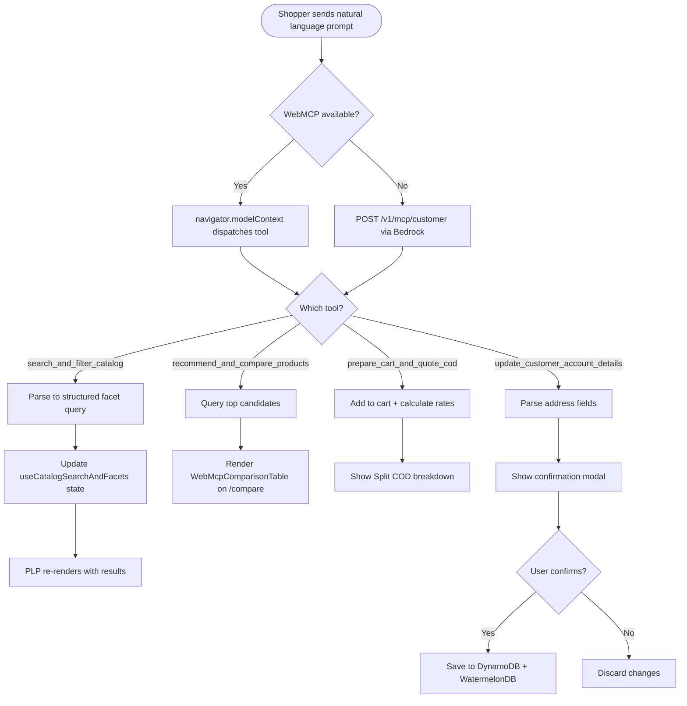
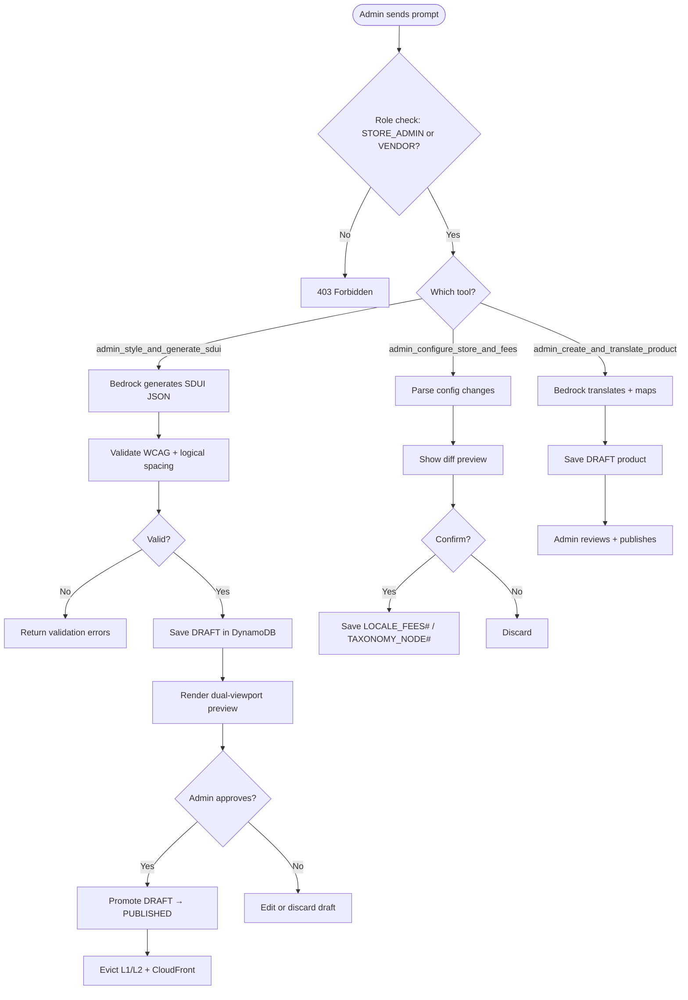

# Module 08: WebMCP & AI Assistant

> **Slice**: v1.0 · **Sprint**: 1.1 · **Stories**: US-8.1.1 – US-8.1.3

## Overview

Covers the WebMCP (`navigator.modelContext`) and Amazon Bedrock AI integration for customer shopping assistant tools, admin copilot tools, and the shared MCP engine.

## Pages

| Page Route | Access | Primary Hook |
|:-----------|:-------|:-------------|
| `/[locale]/c/[...category_slug]` | Public | `useWebMcpBridge` + `useCatalogSearchAndFacets` |
| `/[locale]/compare` | Public | `useWebMcpComparison` |
| `/[locale]/account/profile` | Auth | `useCustomerAccount` |
| `/[locale]/admin/sdui-studio` | STORE_ADMIN | `useAdminSduiStudio` |
| `/[locale]/admin/catalog-taxonomy` | STORE_ADMIN | `useAdminTaxonomyBuilder` |
| `/[locale]/vendor/products/new` | VENDOR | `useVendorProductEditor` |

## API Endpoints

| Method | Endpoint | Lambda | Description |
|:-------|:---------|:-------|:------------|
| POST | `/v1/mcp/customer` | `storefront-sdui-api` | Customer MCP tool execution |
| POST | `/v1/mcp/admin` | `admin-vendor-api` | Admin MCP tool execution |

---

## US-8.1.1: Customer WebMCP Shopping Assistant

**As a** Shopper browsing on a WebMCP-capable browser or using the in-app AI assistant,  
**I want to** search the catalog in natural language, compare products, quote COD fees, and update my profile from a single sentence,  
**So that** I can discover products and complete checkout preparation in seconds.

### Acceptance Criteria

```gherkin
Feature: Customer WebMCP Shopping Assistant

  Scenario: Natural language catalog search
    Given the shopper types "Find ASUS laptops >=16GB RAM under 45k EGP with COD"
    When the WebMCP bridge invokes search_and_filter_catalog
    Then the catalog filters are populated: Brand=ASUS, RAM≥16GB, Price≤45000, COD=true
    And the product listing page updates live with matching results

  Scenario: Product comparison
    Given the shopper says "Compare the top 2 gaming laptops"
    When recommend_and_compare_products is invoked
    Then the /compare page renders with a side-by-side comparison table
    And a "Best Value" recommendation badge highlights the winner

  Scenario: COD quote from natural language
    Given the shopper says "Add #1 to cart and quote COD for Mansoura"
    When prepare_cart_and_quote_cod is invoked
    Then the item is added to the cart
    And the Split COD breakdown (deposit + cash balance) is displayed

  Scenario: Address update with confirmation
    Given the shopper says "Save my address: 14 El-Gomhoria St, Mansoura"
    When update_customer_account_details is invoked
    Then a confirmation modal previews the parsed address
    And only after the user clicks "Confirm" is the address saved

  Scenario: Non-WebMCP browser fallback
    Given the browser does not support navigator.modelContext
    Then the in-app AI drawer uses POST /v1/mcp/customer via Bedrock Converse
    And all the same tools are available via the chat interface
```

### Test Cases

| # | Test Case | Type | Expected Result |
|:--|:----------|:-----|:----------------|
| TC-8.1.1-01 | NL search with filters | Happy Path | Filters populated, results shown |
| TC-8.1.1-02 | Compare 2 products | Happy Path | Comparison table rendered |
| TC-8.1.1-03 | COD quote for zone | Happy Path | Breakdown calculated |
| TC-8.1.1-04 | Address save with confirm | Happy Path | Confirmed, saved |
| TC-8.1.1-05 | Address save — user cancels | Happy Path | Not saved |
| TC-8.1.1-06 | Non-WebMCP browser | Fallback | Chat interface works |
| TC-8.1.1-07 | Arabic NL query | i18n | Arabic parsing works |
| TC-8.1.1-08 | Ambiguous query | Edge Case | Clarification requested |
| TC-8.1.1-09 | Injection attack in query | Security | Input sanitized |
| TC-8.1.1-10 | Unauthenticated profile update | Security | Requires auth |

### Activity Diagram



---

## US-8.1.2: Admin WebMCP Store Copilot

**As a** Store Administrator or Vendor,  
**I want to** use AI copilot tools to style SDUI pages, configure store settings, and generate multilingual products from raw spec notes,  
**So that** I can manage the store 10x faster with strict draft-preview guardrails.

### Acceptance Criteria

```gherkin
Feature: Admin WebMCP Copilot

  Scenario: Generate SDUI page layout
    Given the admin prompts "Design a dark-emerald Ramadan hero banner for /index"
    When admin_style_and_generate_sdui is invoked with publish_immediately=false
    Then a DRAFT SDUI layout is saved in DynamoDB
    And a dual-viewport preview (ar-EG RTL + en-US LTR) renders in the studio
    And the admin must click "Approve & Publish" to go live

  Scenario: Configure regional COD rules
    Given the admin prompts "Set shipping fee to 50 EGP for Cairo with 10% deposit"
    When admin_configure_store_and_fees is invoked
    Then a diff preview shows the proposed LOCALE_FEES# changes
    And the admin confirms before the changes are saved

  Scenario: Generate multilingual product
    Given the vendor pastes raw specs "ASUS ROG Strix G16, i9, 32GB, RTX 4070"
    When admin_create_and_translate_product is invoked
    Then Arabic and English titles/descriptions are generated
    And properties (RAM, GPU, CPU) are auto-mapped
    And SKU variants are suggested for Color × Size
    And the product is saved as DRAFT until approved

  Scenario: Admin tool access control
    Given a B2C_CUSTOMER attempts to call admin_style_and_generate_sdui
    Then a 403 Forbidden error is returned
    And the tool is not registered for non-admin users
```

### Test Cases

| # | Test Case | Type | Expected Result |
|:--|:----------|:-----|:----------------|
| TC-8.1.2-01 | Generate SDUI draft | Happy Path | Draft saved, preview rendered |
| TC-8.1.2-02 | Publish approved SDUI | Happy Path | Live, caches evicted |
| TC-8.1.2-03 | Configure COD rules | Happy Path | Fees updated |
| TC-8.1.2-04 | Generate multilingual product | Happy Path | Draft product created |
| TC-8.1.2-05 | WCAG contrast validation | Validation | Warning on low contrast |
| TC-8.1.2-06 | Non-admin access | Security | 403 Forbidden |
| TC-8.1.2-07 | Invalid layout JSON | Validation | Error with details |
| TC-8.1.2-08 | Concurrent SDUI publishes | Concurrency | ETag prevents conflict |

### Activity Diagram



---

## US-8.1.3: Shared MCP Engine & Bedrock Integration

**As a** Developer,  
**I want** a shared MCP tool registry that serves both WebMCP (`navigator.modelContext`) on Web and Amazon Bedrock Converse on Mobile/in-app chat,  
**So that** all AI tools are defined once and available across all platforms.

### Acceptance Criteria

```gherkin
Feature: Shared MCP Engine

  Scenario: Tool registration on Web
    When the Expo Web app loads
    Then all customer tools are registered on navigator.modelContext
    And admin tools are only registered if cognito:groups contains STORE_ADMIN

  Scenario: Tool execution on Mobile via Bedrock
    When a mobile user sends a chat message
    Then POST /v1/mcp/customer invokes Bedrock Converse with tool schemas
    And Bedrock selects the appropriate tool and returns structured output

  Scenario: Schema code generation
    When a developer runs the codegen pipeline
    Then Rust structs in crates/mcp-tools auto-export to TypeScript + JSON Schema
    And the WebMCP and Bedrock schemas stay in sync
```

### Test Cases

| # | Test Case | Type | Expected Result |
|:--|:----------|:-----|:----------------|
| TC-8.1.3-01 | Web tool registration | Happy Path | Tools on navigator.modelContext |
| TC-8.1.3-02 | Mobile Bedrock execution | Happy Path | Correct tool invoked |
| TC-8.1.3-03 | Schema codegen sync | DevOps | TS + JSON match Rust |
| TC-8.1.3-04 | Bedrock timeout | Error | Graceful error |
| TC-8.1.3-05 | Unknown tool name | Validation | Error returned |
