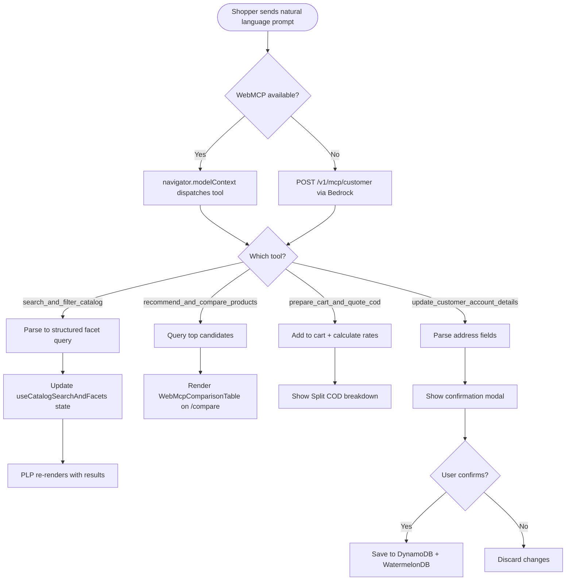

# US-8.1.1: Customer WebMCP Shopping Assistant

> **Spec Kit Specification**: [Specification Lifecycle Active (.specify/)](../../../.specify/memory/constitution.md)  
> **Domain Feature**: `catalog-and-discovery`  
> **Domain Module**: `webmcp-and-ai`  
> **Autonomous Behaviour**: `customer-shopping-assistant`  
> **Client Framework Path**: `apps/storefront/src/features/catalog-and-discovery/modules/webmcp-and-ai/behaviours/customer-shopping-assistant`  
> **Backend Framework Path**: `backend/src/features/catalog-and-discovery/modules/webmcp-and-ai/behaviours/customer-shopping-assistant`  
> **Execution Sprint**: [Sprint 1.1](../../sprints/README.md)  
> **Slicing Standard**: [10-PR Vertical Slicing Framework](../../sprints/README.md#the-10-pr-vertical-slicing-standard-aligned-with-10-pillar-system-architecture)  
> **Security Gateway**: [ASVS Level 2 Verification Gate (security-audit)](#5-security-gateway-powered-by-security-audit)

---

## 1. Spec Kit Specification: User Story & Domain Scope

### 1.1 User Story Narrative

**As a** Shopper browsing on a WebMCP-capable browser or using the in-app AI assistant,  
**I want to** search the catalog in natural language, compare products, quote COD fees, and update my profile from a single sentence,  
**So that** I can discover products and complete checkout preparation in seconds.

### 1.2 Acceptance Criteria (Gherkin Scenarios)

```gherkin
Feature: Customer WebMCP Shopping Assistant
  Scenario: [AC-US-8.1.1-01] Natural language catalog search
    Given the shopper types "Find ASUS laptops >=16GB RAM under 45k EGP with COD"
    When the WebMCP bridge invokes search_and_filter_catalog
    Then the catalog filters are populated: Brand=ASUS, RAM≥16GB, Price≤45000, COD=true
    And the product listing page updates live with matching results
  Scenario: [AC-US-8.1.1-02] Product comparison
    Given the shopper says "Compare the top 2 gaming laptops"
    When recommend_and_compare_products is invoked
    Then the /compare page renders with a side-by-side comparison table
    And a "Best Value" recommendation badge highlights the winner
  Scenario: [AC-US-8.1.1-03] COD quote from natural language
    Given the shopper says "Add #1 to cart and quote COD for Mansoura"
    When prepare_cart_and_quote_cod is invoked
    Then the item is added to the cart
    And the Split COD breakdown (deposit + cash balance) is displayed
  Scenario: [AC-US-8.1.1-04] Address update with confirmation
    Given the shopper says "Save my address: 14 El-Gomhoria St, Mansoura"
    When update_customer_account_details is invoked
    Then a confirmation modal previews the parsed address
    And only after the user clicks "Confirm" is the address saved
  Scenario: [AC-US-8.1.1-05] Non-WebMCP browser fallback
    Given the browser does not support navigator.modelContext
    Then the in-app AI drawer uses POST /v1/mcp/customer via Bedrock Converse
    And all the same tools are available via the chat interface
  Scenario: [AC-US-8.1.1-LAW] Global e-commerce legal compliance and consumer AI interaction regulations
    Given a customer interacting with the WebMCP shopping AI agent
    When the AI assistant recommends products, summarizes reviews, or assists in checkout
    Then the user must be informed clearly and unambiguously that they are interacting with an artificial intelligence system (EU AI Act Art 50)
    And AI recommendations must not manipulate consumer purchasing decisions through deceptive dark patterns or concealed sponsored bias
    And personal conversational prompts must be handled under strict data privacy safeguards without training external models on customer PII
```

### 1.3 Test Cases & Traceability Matrix

| # | Test Case | Type | Expected Result |
|:--|:----------|:-----|:----------------|
| TC-8.1.1-01 | NL search with filters | Happy Path | Filters populated, results shown |
| TC-8.1.1-02 | Compare 2 products | Happy Path | Comparison table rendered |
| TC-8.1.1-03 | COD quote for zone | Happy Path | Breakdown calculated |
| TC-8.1.1-04 | Address save with confirm | Happy Path | Confirmed, saved |
| TC-8.1.1-05 | Address save — user cancels | Happy Path | Not saved |
| TC-8.1.1-06 | Non-WebMCP browser | Fallback | Chat interface works |
| TC-8.1.1-07 | Arabic NL query | i18n | Arabic parsing works |
| TC-8.1.1-08 | Ambiguous query | Edge Case | Clarification requested |
| TC-8.1.1-09 | Injection attack in query | Security | Input sanitized |
| TC-8.1.1-10 | Unauthenticated profile update | Security | Requires auth |
| TC-8.1.1-LAW | Global legal & regulatory compliance (EU AI Act Regulation 2024/1689 Art 50 AI transparency, GDPR Art 22 automated decisions, FTC truth in AI) | Legal / Regulatory | Statutory compliance verified with zero legal or regulatory violations |

---

## 2. Behavior-Centric Architecture & Folder Blueprint

This user story is implemented directly inside the respective **Expo client** and **Cargo Lambda Axum backend** frameworks according to the **Locality of Behavior (LoB)** architectural law. Private services, designs, logic, types, and constants are strictly colocated within their framework behaviour directory.

### 2.1 Colocated Behaviour Directory Tree

#### Client Architecture (Universal Expo SDK 58):
```
apps/storefront/src/features/catalog-and-discovery/modules/webmcp-and-ai/behaviours/customer-shopping-assistant/
├── services/
│   │   ├── webmcp_tool_provider.rs
│   │   ├── bedrock_agent_runtime.rs
│   │   ├── shopping_copilot_api.ts
├── designs/
│   │   ├── AiShoppingDrawer.tsx
│   │   ├── AgentChatMessageBubble.tsx
│   │   ├── ToolExecutionCard.tsx
├── logic/
│   │   ├── useShoppingAssistant.ts
│   │   ├── tool_call_sanitizer.rs
│   │   ├── prompt_injection_guard.rs
├── types/
│   │   ├── WebMcpToolDefinition.ts
│   │   ├── AssistantChatMessage.ts
│   │   ├── ToolCallInvocation.ts
└── constants/
│   │   ├── WebMcpToolNames.ts
│   │   ├── MaxChatTurns.ts
│   │   ├── AssistantErrorCodes.ts
```

#### Backend Architecture (Cargo Lambda + Axum 0.8):
```
backend/src/features/catalog-and-discovery/modules/webmcp-and-ai/behaviours/customer-shopping-assistant/
├── services/
│   │   ├── webmcp_tool_provider.rs
│   │   ├── bedrock_agent_runtime.rs
│   │   ├── shopping_copilot_api.ts
├── logic/
│   │   ├── useShoppingAssistant.ts
│   │   ├── tool_call_sanitizer.rs
│   │   ├── prompt_injection_guard.rs
├── types/
│   │   ├── WebMcpToolDefinition.ts
│   │   ├── AssistantChatMessage.ts
│   │   ├── ToolCallInvocation.ts
└── constants/
│   │   ├── WebMcpToolNames.ts
│   │   ├── MaxChatTurns.ts
│   │   ├── AssistantErrorCodes.ts
```

### 2.2 Scoping & Promotion Blueprint

| Layer / Tier | Client Path (Expo) | Backend Path (Cargo Lambda / Axum) | Purpose & Promotion Rules |
| :--- | :--- | :--- | :--- |
| **Behaviour-Local** | `.../behaviours/customer-shopping-assistant/` | `.../behaviours/customer-shopping-assistant/` | **Default Private Scope**: Colocated services, designs, logic, types, and constants private to this story. |
| **Module-Shared** | `.../modules/webmcp-and-ai/_shared/` | `.../modules/webmcp-and-ai/_shared/` | Shared domain primitives and UI elements used by $\ge 2$ behaviours in `webmcp-and-ai`. |
| **Feature-Shared** | `.../features/catalog-and-discovery/_shared/` | `.../features/catalog-and-discovery/_shared/` | Feature-level contracts, ports, and cross-module bridges across `catalog-and-discovery`. |
| **Framework-Shared** | `apps/storefront/src/shared/` | `backend/crates/kernel-core/` | System-wide microkernel traits, `Money` arithmetic, RFC 9110 ETag middleware, and database adapters. |

---

## 3. Technical Implementation Plan (Spec Kit Plan)

### 3.1 Domain Invariants & Storage Schema
- **State Machine**: Enforces valid state transitions and rejects unauthorized or out-of-order mutations.
- **Data Persistence**: Single-table Amazon DynamoDB partitioning (`PK = TENANT#<id>`, `SK = ENTITY#<id>`) paired with reactive local-first WatermelonDB sync.
- **Freshness & Caching**: Multi-tier caching (L1 Moka in-memory + L2 ElastiCache Redis) with RFC 9110 `ETag` conditional `304 Not Modified` short-circuiting.

### 3.2 Activity & Interaction Diagram



---

## 4. Granular Implementation Tasks (Spec Kit Tasks)

### Phase 1: Core Domain Logic, Types & Constants
- [ ] **Task 1.1 (Types)**: Define strongly typed models and DTO schemas in `types/`.
- [ ] **Task 1.2 (Constants)**: Define routes, action codes, and validation limits in `constants/`.
- [ ] **Task 1.3 (Logic)**: Implement pure business logic, calculations, and state machines in `logic/`.
- [ ] **Task 1.4 (Unit Tests)**: Write pure property-based and unit tests verifying domain invariants.

### Phase 2: Services & Infrastructure Adapters
- [ ] **Task 2.1 (API / Gateway)**: Implement client adapters and backend handlers in `services/`.
- [ ] **Task 2.2 (ETag & Cache)**: Integrate RFC 9110 ETag headers and multi-tier caching (Moka L1 / Redis L2).
- [ ] **Task 2.3 (Storage & Sync)**: Implement DynamoDB storage operations and WatermelonDB delta sync.
- [ ] **Task 2.4 (Integration Tests)**: Verify service contract tests and real database conditional writes.

### Phase 3: Platform-Adaptive Designs & UI
- [ ] **Task 3.1 (UI Presentation)**: Build platform-adaptive screens and SDUI components in `designs/`.
- [ ] **Task 3.2 (Headless Hooks)**: Bind headless domain hooks from `logic/` into the UI presentation.
- [ ] **Task 3.3 (i18n & RTL)**: Implement bidirectional RTL/LTR layout mirroring and localized font switching.
- [ ] **Task 3.4 (Component Tests)**: Test empty, loading, offline, and error states across web and mobile.

### Phase 4: Security Gateway Verification & Release Readiness
- [ ] **Task 4.1 (Abuse Testing)**: Execute automated adversarial penetration tests against the threat matrix.
- [ ] **Task 4.2 (Zero-Trust Audit)**: Verify strict tenant isolation and object-level authorization (IDOR).
- [ ] **Task 4.3 (SAST & Audit)**: Run static analysis, dependency audit, and secret scanning.
- [ ] **Task 4.4 (Gate Sign-Off)**: Obtain independent security sign-off for the G2 Security Gateway.

---

## 5. Security Gateway (Powered by security-audit)

### 5.1 Trust Boundaries & Security Actors
- **Trust Boundaries**:
  - `Untrusted Zone`: Mobile client app, public web browser, and external network callers.
  - `Gateway Edge`: AWS CloudFront, API Gateway, and Cognito JWT authentication guard.
  - `Secure Application Boundary`: Axum Tower route extractors enforcing tenant and RBAC/ABAC isolation.
  - `Encrypted Storage & Secret Vault`: Amazon DynamoDB KMS-encrypted tables and AWS KMS vault.
- **Authorized Principals**:
  - Identified Actors: `AuthenticatedCustomer`, `B2bBuyer`, `Vendor`, `StoreAdmin`, or `AnonymousShopper` (read-only).
  - Multi-Tenancy Invariant: Every request must extract `tenant_id` from verified JWT claims. Injections via query params or payload body are rejected with `403 Forbidden`.

### 5.2 Threat Modeling & Abuse Matrix (STRIDE / ASVS)

| Threat Vector | Severity | Vulnerability Mechanism | Mitigating Control & Security Invariant |
| :--- | :--- | :--- | :--- |
| **Spoofing & Impersonation** | Critical | Forged `sub` or `tenant_id` identity claims | Server-side RS256 JWKS signature verification; strict claims extraction in Axum. |
| **Tampering & Invariant Bypass** | High | Manipulating payload parameters or prices | Authoritative server recalculation; strict schema validation; BLAKE3 ETag integrity checks. |
| **Information Disclosure (IDOR)** | Critical | Cross-tenant or cross-user data scraping | Explicit `PK = TENANT#<id>` partition filtering on every database and cache operation. |
| **Denial of Service / Abuse** | High | Indirect prompt injection via product descriptions, unauthorized tool invocation to purchase items | Token-bucket rate limiting per IP and account; strict input length validation. |
| **Elevation of Privilege** | Critical | Bypassing role-based permission checks | Tower extractors (`RequireStoreAdmin`, `RequireVendor`) guard sensitive endpoints. |

### 5.3 Cryptographic & Data Protection Controls
- **Encryption in Transit**: TLS 1.3 enforced on all external and internal endpoints; HSTS active.
- **Encryption at Rest**: DynamoDB AWS KMS customer-managed keys; AES-256-GCM for sensitive client tokens in `expo-secure-store`.
- **PII & Secret Redaction**: Passwords, OTPs, auth tokens, and credit card numbers are stripped from logs and traces via `tracing` redaction filters.

### 5.4 Automated Security Verification Checklist
- [ ] **SAST Analysis**: Clean report from static code analyzers; 0 high or critical vulnerabilities.
- [ ] **Dependency Audit**: `cargo deny` and `bun audit` pass with 0 unreviewed security advisories.
- [ ] **Abuse & IDOR Fuzzing**: Test suite confirms that requests with modified `tenant_id` or `user_id` fail with `401 Unauthorized` or `403 Forbidden`.
- [ ] **Secret Scanning**: Gitleaks scanner confirms zero hardcoded credentials, API keys, or private keys.

### 5.5 Security Gateway (G2) Sign-Off Checklist
- [ ] Threat boundary and entry points verified against OWASP ASVS Level 2 requirements.
- [ ] Multi-tenant isolation verified with automated cross-tenant penetration test.
- [ ] Anti-abuse and rate limiting confirmed active on all public interfaces.
- [ ] Audit log redaction verified — zero plaintext secrets in output logs.
- [ ] Independent reviewer sign-off obtained; zero open Critical or High findings.

---

## 6. Validation Gates & Acceptance Sign-Off

**Status: Pending — specification only; no implementation evidence.** All [G0–G4 quality gates + G-Review + G-Borrow + G-UI + G-Law](../../QUALITY_GATES.md) apply to this story. The following checks add to its acceptance criteria and test cases; they do not replace them.

### G1 — Test coverage
- [ ] **US-8.1.1-G1:** Automated test suite maps 100% of acceptance criteria and test cases with >=90% line and >=85% branch coverage in affected packages.

### G2 — Security audit
- [ ] **US-8.1.1-G2:** Verify zero-trust tenant isolation, object-level authorization (IDOR), and defense against Indirect prompt injection via product descriptions, unauthorized tool invocation to purchase items. No unresolved critical or high findings.

### G3 — Architecture and maintainability
- [ ] **US-8.1.1-G3:** Strict compliance with framework colocation (`apps/storefront/src/features/` or `backend/src/features/`), zero-clone borrowing discipline in Rust, and clean domain boundaries.

### G-Review — Code review
- [ ] **US-8.1.1-G-Review:** Independent senior code review signed off by the Code Reviewer; verification across Correctness, Security, Maintainability, Performance, and Testing using the Agency-Agents code review standard; zero open Blocker or unresolved Suggestion findings.

### G-Borrow — Rust zero-clone borrowing validation
- [ ] **US-8.1.1-G-Borrow:** Backend code relies strictly on borrowing (&T, &mut T), explicit lifetimes, zero-copy byte buffers (bytes::Bytes), and zero unauthorized deep .clone() calls on domain entities and models (Arc::clone and Rc::clone pointer copies permitted only); certified by systems reviewer.

### G-UI — UI/UX validation
- [ ] **US-8.1.1-G-UI:** Pure separation of presentation (designs/, owned by ui-ux-designer) and headless hooks (logic/, owned by client-engineer); mobile components use @expo/ui primitives and native modules; web components use semantic HTML5 styled with Tailwind CSS; WCAG 2.1 AA and Arabic RTL layout parity verified; certified by UI/UX designer.

### G-Law — Law validation
- [ ] **US-8.1.1-G-Law:** Independent verification against global e-commerce legal and statutory requirements: EU Artificial Intelligence Act (Regulation 2024/1689 Art 50 transparency), GDPR Art 22 automated decision disclosures, and FTC anti-deceptive AI guidance; certified by compliance reviewer (`agency-legal-compliance-checker`).

### G4 — Integrated acceptance
- [ ] **US-8.1.1-G4:** End-to-end user journey validation across supported platforms (Web, iOS, Android) and verified sandbox integration.

---

[← Back to Module webmcp-and-ai Catalog (README.md)](README.md) | [Master User Stories Index](../README.md)
