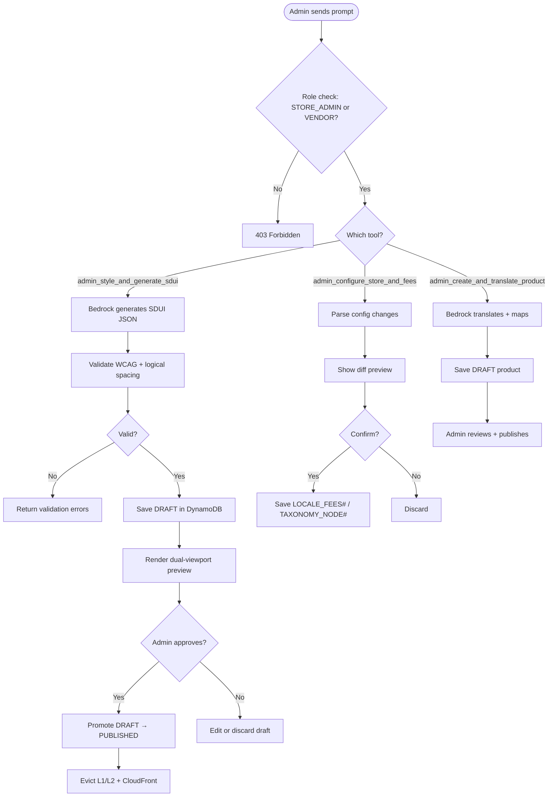

# US-8.1.2: Admin WebMCP Store Copilot

> **Spec Kit Specification**: [Specification Lifecycle Active (.specify/)](../../../.specify/memory/constitution.md)  
> **Domain Feature**: `catalog-and-discovery`  
> **Domain Module**: `webmcp-and-ai`  
> **Autonomous Behaviour**: `admin-store-copilot`  
> **Client Framework Path**: `apps/storefront/src/features/catalog-and-discovery/modules/webmcp-and-ai/behaviours/admin-store-copilot`  
> **Backend Framework Path**: `backend/src/features/catalog-and-discovery/modules/webmcp-and-ai/behaviours/admin-store-copilot`  
> **Execution Sprint**: [Sprint 1.1](../../sprints/README.md)  
> **Slicing Standard**: [10-PR Vertical Slicing Framework](../../sprints/README.md#the-10-pr-vertical-slicing-standard-aligned-with-10-pillar-system-architecture)  
> **Security Gateway**: [ASVS Level 2 Verification Gate (security-audit)](#5-security-gateway-powered-by-security-audit)

---

## 1. Spec Kit Specification: User Story & Domain Scope

### 1.1 User Story Narrative

**As a** Store Administrator or Vendor,  
**I want to** use AI copilot tools to style SDUI pages, configure store settings, and generate multilingual products from raw spec notes,  
**So that** I can manage the store 10x faster with strict draft-preview guardrails.

### 1.2 Acceptance Criteria (Gherkin Scenarios)

```gherkin
Feature: Admin WebMCP Copilot
  Scenario: [AC-US-8.1.2-01] Generate SDUI page layout
    Given the admin prompts "Design a dark-emerald Ramadan hero banner for /index"
    When admin_style_and_generate_sdui is invoked with publish_immediately=false
    Then a DRAFT SDUI layout is saved in DynamoDB
    And a dual-viewport preview (ar-EG RTL + en-US LTR) renders in the studio
    And the admin must click "Approve & Publish" to go live
  Scenario: [AC-US-8.1.2-02] Configure regional COD rules
    Given the admin prompts "Set shipping fee to 50 EGP for Cairo with 10% deposit"
    When admin_configure_store_and_fees is invoked
    Then a diff preview shows the proposed LOCALE_FEES# changes
    And the admin confirms before the changes are saved
  Scenario: [AC-US-8.1.2-03] Generate multilingual product
    Given the vendor pastes raw specs "ASUS ROG Strix G16, i9, 32GB, RTX 4070"
    When admin_create_and_translate_product is invoked
    Then Arabic and English titles/descriptions are generated
    And properties (RAM, GPU, CPU) are auto-mapped
    And SKU variants are suggested for Color × Size
    And the product is saved as DRAFT until approved
  Scenario: [AC-US-8.1.2-04] Admin tool access control
    Given a B2C_CUSTOMER attempts to call admin_style_and_generate_sdui
    Then a 403 Forbidden error is returned
    And the tool is not registered for non-admin users
  Scenario: [AC-US-8.1.2-LAW] Global e-commerce legal compliance and administrative AI copilot governance
    Given a store administrator utilizing the WebMCP copilot for catalog edits, pricing adjustments, or bulk actions
    When the AI assistant executes store management operations
    Then human oversight mechanisms must require explicit human confirmation for high-impact actions (price changes, inventory write-offs)
    And algorithmic pricing suggestions must comply with anti-collusion competition laws prohibiting automated price-fixing
    And an audit record linking the human administrator to every AI-suggested catalog mutation must be maintained
```

### 1.3 Test Cases & Traceability Matrix

| # | Test Case | Type | Expected Result |
|:--|:----------|:-----|:----------------|
| TC-8.1.2-01 | Generate SDUI draft | Happy Path | Draft saved, preview rendered |
| TC-8.1.2-02 | Publish approved SDUI | Happy Path | Live, caches evicted |
| TC-8.1.2-03 | Configure COD rules | Happy Path | Fees updated |
| TC-8.1.2-04 | Generate multilingual product | Happy Path | Draft product created |
| TC-8.1.2-05 | WCAG contrast validation | Validation | Warning on low contrast |
| TC-8.1.2-06 | Non-admin access | Security | 403 Forbidden |
| TC-8.1.2-07 | Invalid layout JSON | Validation | Error with details |
| TC-8.1.2-08 | Concurrent SDUI publishes | Concurrency | ETag prevents conflict |
| TC-8.1.2-LAW | Global legal & regulatory compliance (EU AI Act Art 14 human oversight mandate, competition law pricing rules, admin audit trails) | Legal / Regulatory | Statutory compliance verified with zero legal or regulatory violations |

---

## 2. Behavior-Centric Architecture & Folder Blueprint

This user story is implemented directly inside the respective **Expo client** and **Cargo Lambda Axum backend** frameworks according to the **Locality of Behavior (LoB)** architectural law. Private services, designs, logic, types, and constants are strictly colocated within their framework behaviour directory.

### 2.1 Colocated Behaviour Directory Tree

#### Client Architecture (Universal Expo SDK 58):
```
apps/storefront/src/features/catalog-and-discovery/modules/webmcp-and-ai/behaviours/admin-store-copilot/
├── services/
│   │   ├── admin_tool_registry.rs
│   │   ├── analytics_query_tool.rs
│   │   ├── admin_copilot_api.ts
├── designs/
│   │   ├── AdminCopilotSidecar.tsx
│   │   ├── SchemaVisualizerWidget.tsx
│   │   ├── ExecutionApprovalPrompt.tsx
├── logic/
│   │   ├── useAdminStoreCopilot.ts
│   │   ├── admin_privilege_checker.rs
│   │   ├── destructive_action_guard.rs
├── types/
│   │   ├── AdminToolSchema.ts
│   │   ├── AnalyticsReportInsight.ts
│   │   ├── ActionConfirmationToken.ts
└── constants/
│   │   ├── AdminToolNames.ts
│   │   ├── HighRiskToolList.ts
│   │   ├── AdminCopilotErrors.ts
```

#### Backend Architecture (Cargo Lambda + Axum 0.8):
```
backend/src/features/catalog-and-discovery/modules/webmcp-and-ai/behaviours/admin-store-copilot/
├── services/
│   │   ├── admin_tool_registry.rs
│   │   ├── analytics_query_tool.rs
│   │   ├── admin_copilot_api.ts
├── logic/
│   │   ├── useAdminStoreCopilot.ts
│   │   ├── admin_privilege_checker.rs
│   │   ├── destructive_action_guard.rs
├── types/
│   │   ├── AdminToolSchema.ts
│   │   ├── AnalyticsReportInsight.ts
│   │   ├── ActionConfirmationToken.ts
└── constants/
│   │   ├── AdminToolNames.ts
│   │   ├── HighRiskToolList.ts
│   │   ├── AdminCopilotErrors.ts
```

### 2.2 Scoping & Promotion Blueprint

| Layer / Tier | Client Path (Expo) | Backend Path (Cargo Lambda / Axum) | Purpose & Promotion Rules |
| :--- | :--- | :--- | :--- |
| **Behaviour-Local** | `.../behaviours/admin-store-copilot/` | `.../behaviours/admin-store-copilot/` | **Default Private Scope**: Colocated services, designs, logic, types, and constants private to this story. |
| **Module-Shared** | `.../modules/webmcp-and-ai/_shared/` | `.../modules/webmcp-and-ai/_shared/` | Shared domain primitives and UI elements used by $\ge 2$ behaviours in `webmcp-and-ai`. |
| **Feature-Shared** | `.../features/catalog-and-discovery/_shared/` | `.../features/catalog-and-discovery/_shared/` | Feature-level contracts, ports, and cross-module bridges across `catalog-and-discovery`. |
| **Framework-Shared** | `apps/storefront/src/shared/` | `backend/crates/kernel-core/` | System-wide microkernel traits, `Money` arithmetic, RFC 9110 ETag middleware, and database adapters. |

---

## 3. Technical Implementation Plan (Spec Kit Plan)

### 3.1 Domain Invariants & Storage Schema
- **State Machine**: Enforces valid state transitions and rejects unauthorized or out-of-order mutations.
- **Data Persistence**: Single-table Amazon DynamoDB partitioning (`PK = TENANT#<id>`, `SK = ENTITY#<id>`) paired with reactive local-first WatermelonDB sync.
- **Freshness & Caching**: Multi-tier caching (L1 Moka in-memory + L2 ElastiCache Redis) with RFC 9110 `ETag` conditional `304 Not Modified` short-circuiting.

### 3.2 Activity & Interaction Diagram



---

## 4. Granular Implementation Tasks (Spec Kit Tasks)

### Phase 1: Core Domain Logic, Types & Constants
- [ ] **Task 1.1 (Types)**: Define strongly typed models and DTO schemas in `types/`.
- [ ] **Task 1.2 (Constants)**: Define routes, action codes, and validation limits in `constants/`.
- [ ] **Task 1.3 (Logic)**: Implement pure business logic, calculations, and state machines in `logic/`.
- [ ] **Task 1.4 (Unit Tests)**: Write pure property-based and unit tests verifying domain invariants.

### Phase 2: Services & Infrastructure Adapters
- [ ] **Task 2.1 (API / Gateway)**: Implement client adapters and backend handlers in `services/`.
- [ ] **Task 2.2 (ETag & Cache)**: Integrate RFC 9110 ETag headers and multi-tier caching (Moka L1 / Redis L2).
- [ ] **Task 2.3 (Storage & Sync)**: Implement DynamoDB storage operations and WatermelonDB delta sync.
- [ ] **Task 2.4 (Integration Tests)**: Verify service contract tests and real database conditional writes.

### Phase 3: Platform-Adaptive Designs & UI
- [ ] **Task 3.1 (UI Presentation)**: Build platform-adaptive screens and SDUI components in `designs/`.
- [ ] **Task 3.2 (Headless Hooks)**: Bind headless domain hooks from `logic/` into the UI presentation.
- [ ] **Task 3.3 (i18n & RTL)**: Implement bidirectional RTL/LTR layout mirroring and localized font switching.
- [ ] **Task 3.4 (Component Tests)**: Test empty, loading, offline, and error states across web and mobile.

### Phase 4: Security Gateway Verification & Release Readiness
- [ ] **Task 4.1 (Abuse Testing)**: Execute automated adversarial penetration tests against the threat matrix.
- [ ] **Task 4.2 (Zero-Trust Audit)**: Verify strict tenant isolation and object-level authorization (IDOR).
- [ ] **Task 4.3 (SAST & Audit)**: Run static analysis, dependency audit, and secret scanning.
- [ ] **Task 4.4 (Gate Sign-Off)**: Obtain independent security sign-off for the G2 Security Gateway.

---

## 5. Security Gateway (Powered by security-audit)

### 5.1 Trust Boundaries & Security Actors
- **Trust Boundaries**:
  - `Untrusted Zone`: Mobile client app, public web browser, and external network callers.
  - `Gateway Edge`: AWS CloudFront, API Gateway, and Cognito JWT authentication guard.
  - `Secure Application Boundary`: Axum Tower route extractors enforcing tenant and RBAC/ABAC isolation.
  - `Encrypted Storage & Secret Vault`: Amazon DynamoDB KMS-encrypted tables and AWS KMS vault.
- **Authorized Principals**:
  - Identified Actors: `AuthenticatedCustomer`, `B2bBuyer`, `Vendor`, `StoreAdmin`, or `AnonymousShopper` (read-only).
  - Multi-Tenancy Invariant: Every request must extract `tenant_id` from verified JWT claims. Injections via query params or payload body are rejected with `403 Forbidden`.

### 5.2 Threat Modeling & Abuse Matrix (STRIDE / ASVS)

| Threat Vector | Severity | Vulnerability Mechanism | Mitigating Control & Security Invariant |
| :--- | :--- | :--- | :--- |
| **Spoofing & Impersonation** | Critical | Forged `sub` or `tenant_id` identity claims | Server-side RS256 JWKS signature verification; strict claims extraction in Axum. |
| **Tampering & Invariant Bypass** | High | Manipulating payload parameters or prices | Authoritative server recalculation; strict schema validation; BLAKE3 ETag integrity checks. |
| **Information Disclosure (IDOR)** | Critical | Cross-tenant or cross-user data scraping | Explicit `PK = TENANT#<id>` partition filtering on every database and cache operation. |
| **Denial of Service / Abuse** | High | Privilege escalation via LLM tool misuse, unauthorized bulk data exfiltration or catalog deletion | Token-bucket rate limiting per IP and account; strict input length validation. |
| **Elevation of Privilege** | Critical | Bypassing role-based permission checks | Tower extractors (`RequireStoreAdmin`, `RequireVendor`) guard sensitive endpoints. |

### 5.3 Cryptographic & Data Protection Controls
- **Encryption in Transit**: TLS 1.3 enforced on all external and internal endpoints; HSTS active.
- **Encryption at Rest**: DynamoDB AWS KMS customer-managed keys; AES-256-GCM for sensitive client tokens in `expo-secure-store`.
- **PII & Secret Redaction**: Passwords, OTPs, auth tokens, and credit card numbers are stripped from logs and traces via `tracing` redaction filters.

### 5.4 Automated Security Verification Checklist
- [ ] **SAST Analysis**: Clean report from static code analyzers; 0 high or critical vulnerabilities.
- [ ] **Dependency Audit**: `cargo deny` and `bun audit` pass with 0 unreviewed security advisories.
- [ ] **Abuse & IDOR Fuzzing**: Test suite confirms that requests with modified `tenant_id` or `user_id` fail with `401 Unauthorized` or `403 Forbidden`.
- [ ] **Secret Scanning**: Gitleaks scanner confirms zero hardcoded credentials, API keys, or private keys.

### 5.5 Security Gateway (G2) Sign-Off Checklist
- [ ] Threat boundary and entry points verified against OWASP ASVS Level 2 requirements.
- [ ] Multi-tenant isolation verified with automated cross-tenant penetration test.
- [ ] Anti-abuse and rate limiting confirmed active on all public interfaces.
- [ ] Audit log redaction verified — zero plaintext secrets in output logs.
- [ ] Independent reviewer sign-off obtained; zero open Critical or High findings.

---

## 6. Validation Gates & Acceptance Sign-Off

**Status: Pending — specification only; no implementation evidence.** All [G0–G4 quality gates + G-Review + G-Borrow + G-UI + G-Law](../../QUALITY_GATES.md) apply to this story. The following checks add to its acceptance criteria and test cases; they do not replace them.

### G1 — Test coverage
- [ ] **US-8.1.2-G1:** Automated test suite maps 100% of acceptance criteria and test cases with >=90% line and >=85% branch coverage in affected packages.

### G2 — Security audit
- [ ] **US-8.1.2-G2:** Verify zero-trust tenant isolation, object-level authorization (IDOR), and defense against Privilege escalation via LLM tool misuse, unauthorized bulk data exfiltration or catalog deletion. No unresolved critical or high findings.

### G3 — Architecture and maintainability
- [ ] **US-8.1.2-G3:** Strict compliance with framework colocation (`apps/storefront/src/features/` or `backend/src/features/`), zero-clone borrowing discipline in Rust, and clean domain boundaries.

### G-Review — Code review
- [ ] **US-8.1.2-G-Review:** Independent senior code review signed off by the Code Reviewer; verification across Correctness, Security, Maintainability, Performance, and Testing using the Agency-Agents code review standard; zero open Blocker or unresolved Suggestion findings.

### G-Borrow — Rust zero-clone borrowing validation
- [ ] **US-8.1.2-G-Borrow:** Backend code relies strictly on borrowing (&T, &mut T), explicit lifetimes, zero-copy byte buffers (bytes::Bytes), and zero unauthorized deep .clone() calls on domain entities and models (Arc::clone and Rc::clone pointer copies permitted only); certified by systems reviewer.

### G-UI — UI/UX validation
- [ ] **US-8.1.2-G-UI:** Pure separation of presentation (designs/, owned by ui-ux-designer) and headless hooks (logic/, owned by client-engineer); mobile components use @expo/ui primitives and native modules; web components use semantic HTML5 styled with Tailwind CSS; WCAG 2.1 AA and Arabic RTL layout parity verified; certified by UI/UX designer.

### G-Law — Law validation
- [ ] **US-8.1.2-G-Law:** Independent verification against global e-commerce legal and statutory requirements: EU AI Act Art 14 human oversight requirements, antitrust and algorithmic pricing fairness laws, and operator accountability logging; certified by compliance reviewer (`agency-legal-compliance-checker`).

### G4 — Integrated acceptance
- [ ] **US-8.1.2-G4:** End-to-end user journey validation across supported platforms (Web, iOS, Android) and verified sandbox integration.

---

[← Back to Module webmcp-and-ai Catalog (README.md)](README.md) | [Master User Stories Index](../README.md)
