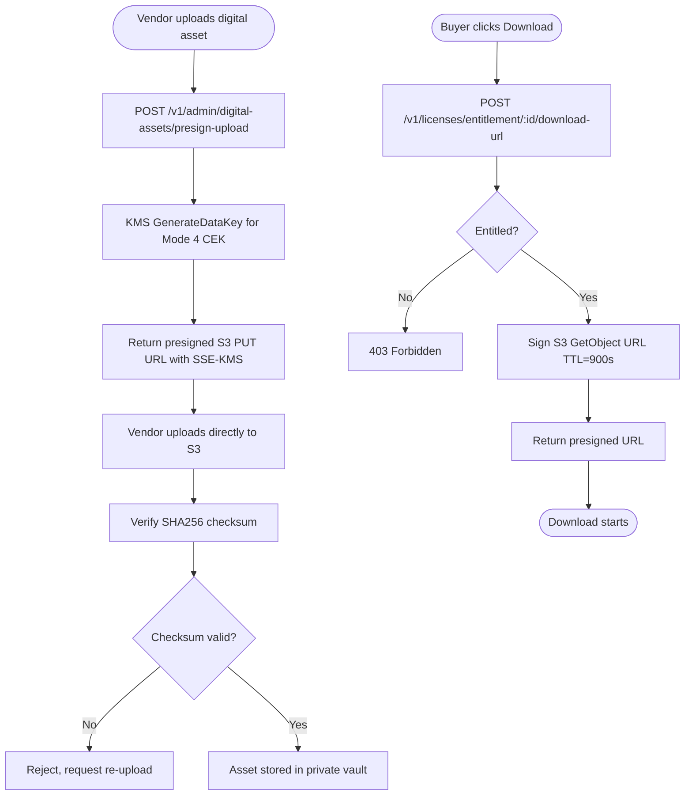
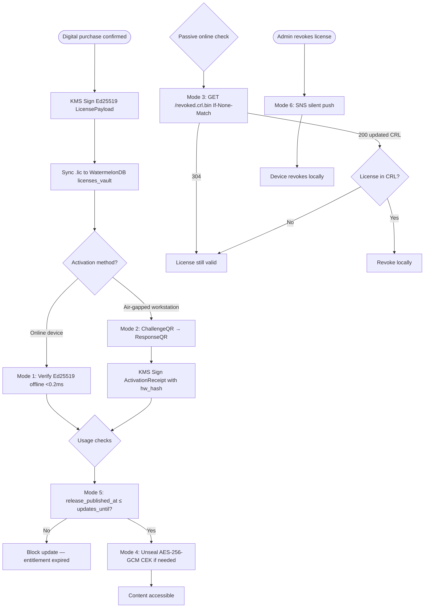

# Module 09: Digital Products & Licensing

> **Slice**: v2.0 · **Sprints**: 2.1, 2.2 · **Stories**: US-9.1.1 – US-9.1.4

## Overview

Covers digital asset ingestion, presigned S3 delivery, the 6-mode non-heartbeat licensing engine (Ed25519, QR, CRL, CEK, Release Gating, Push Revocation), and client verification SDKs.

## Pages

| Page Route | Access | Primary Hook |
|:-----------|:-------|:-------------|
| `/[locale]/vendor/products/new` | VENDOR | `useVendorProductEditor` |
| `/[locale]/account/licenses` | Auth | `useDigitalLicenseVault` |
| `/[locale]/admin/settings-gateways` | STORE_ADMIN | `useAdminGatewayConfig` |

## API Endpoints

| Method | Endpoint | Lambda | Description |
|:-------|:---------|:-------|:------------|
| POST | `/v1/admin/digital-assets/presign-upload` | `admin-vendor-api` | Presigned S3 PUT for upload |
| POST | `/v1/licenses/entitlement/:id/download-url` | `storefront-sdui-api` | Presigned S3 GET download |
| POST | `/v1/licenses/challenge-activate` | `storefront-sdui-api` | Air-gapped QR activation (Mode 2) |
| POST | `/v1/licenses/unseal-cek` | `storefront-sdui-api` | Content Key unsealing (Mode 4) |
| GET | `/licenses/revoked.crl.bin` | CloudFront (S3) | Edge-cached CRL (Mode 3) |
| POST | `/v1/licenses/revoke` | `admin-vendor-api` | Revoke a license |

---

## US-9.1.1: Digital Asset Ingestion & Presigned S3 Delivery

**As a** Digital Creator or Software Vendor,  
**I want to** upload encrypted digital assets and deliver them to verified buyers via time-limited presigned S3 URLs,  
**So that** my intellectual property is protected against hotlinking and piracy.

### Acceptance Criteria

```gherkin
Feature: Digital Asset Ingestion

  Scenario: Upload digital asset
    Given the vendor is on "/[locale]/vendor/products/new" with product_type=DIGITAL
    When the vendor selects a binary file (v2.1.0.zip, 500MB)
    Then a presigned S3 PUT URL with SSE-KMS is generated
    And the file uploads directly to the private S3 vault
    And a SHA256 checksum is verified post-upload

  Scenario: Buyer downloads digital asset
    Given the buyer has a confirmed purchase and navigates to "/[locale]/account/licenses"
    When they click "Download"
    Then a 15-minute presigned S3 GET URL is generated
    And the download starts immediately
    And the URL expires after 15 minutes

  Scenario: COD disabled for digital products
    Given the cart contains a digital product
    Then the SplitCodEngine disables all COD payment options
    And only prepaid online and crypto options are available

  Scenario: Jurisdiction VAT for digital goods
    Given the buyer is in Germany (DE)
    Then 19% digital VAT is automatically applied
    And the VAT amount is shown on the invoice
```

### Test Cases

| # | Test Case | Type | Expected Result |
|:--|:----------|:-----|:----------------|
| TC-9.1.1-01 | Upload digital binary | Happy Path | File in S3 with SSE-KMS |
| TC-9.1.1-02 | SHA256 checksum verify | Happy Path | Checksum matches |
| TC-9.1.1-03 | Presigned download URL | Happy Path | 15-min URL generated |
| TC-9.1.1-04 | Download after URL expiry | Security | 403 Forbidden |
| TC-9.1.1-05 | COD disabled for digital | Validation | COD option hidden |
| TC-9.1.1-06 | Digital VAT for DE | Happy Path | 19% VAT applied |
| TC-9.1.1-07 | Upload > 5GB file | Edge Case | Multipart upload used |
| TC-9.1.1-08 | Unauthorized download attempt | Security | 403 |
| TC-9.1.1-09 | Hybrid bundle (physical + digital) | Edge Case | COD for physical portion only |
| TC-9.1.1-10 | Corrupted upload | Error | Checksum mismatch, retry |

### Activity Diagram



---

## US-9.1.2: 6-Mode Non-Heartbeat Licensing Engine

**As a** Software Vendor or Digital Product Buyer,  
**I want** licenses that verify authenticity without constant online heartbeats,  
**So that** legitimate customers can run software completely offline.

### Acceptance Criteria

```gherkin
Feature: 6-Mode Licensing Engine

  Scenario: Mode 1 — Offline Ed25519 certificate
    Given a buyer purchases a digital product
    Then an Ed25519-signed .lic certificate is issued via KMS
    And the certificate is synced to the buyer's WatermelonDB licenses_vault
    And the client SDK verifies the signature offline in <0.2ms

  Scenario: Mode 2 — Air-gapped QR activation
    Given the buyer has an offline workstation without internet
    When they scan the workstation's ChallengeQR from the Expo mobile app
    Then the backend signs an ActivationReceipt bound to the hardware fingerprint
    And displays a ResponseQR for the workstation to scan
    And the workstation runs offline forever with the activation

  Scenario: Mode 3 — CloudFront CRL revocation check
    Given a license is revoked due to a refund
    Then the revoked.crl.bin file is updated in S3
    And CloudFront serves it at the edge with near-zero Lambda cost
    And clients check If-None-Match passively (no heartbeat)

  Scenario: Mode 4 — CEK unsealing
    Given premium content is encrypted with AES-256-GCM
    When the activated client requests the Content Encryption Key
    Then the CEK is wrapped to the client's X25519 public key
    And without the key, the content cannot be decrypted (anti-crack)

  Scenario: Mode 5 — Release timestamp gating
    Given the license has updates_entitled_until = 2027-06-01
    And the software release_published_at = 2027-03-15
    Then the release is allowed (published before entitlement expires)
    But a release with release_published_at = 2027-08-01 is blocked

  Scenario: Mode 6 — Push revocation via SNS
    When an admin revokes a license
    Then an SNS silent push is sent to the buyer's device
    And the device immediately marks the license as revoked locally
```

### Test Cases

| # | Test Case | Type | Expected Result |
|:--|:----------|:-----|:----------------|
| TC-9.1.2-01 | Ed25519 certificate issuance | Happy Path | Signed .lic created |
| TC-9.1.2-02 | Offline Ed25519 verification | Happy Path | <0.2ms, valid |
| TC-9.1.2-03 | Tampered .lic file | Security | Signature invalid |
| TC-9.1.2-04 | Air-gapped QR challenge-response | Happy Path | Activation successful |
| TC-9.1.2-05 | QR with wrong hardware hash | Security | Activation denied |
| TC-9.1.2-06 | CRL check — not revoked | Happy Path | 304, license valid |
| TC-9.1.2-07 | CRL check — revoked | Happy Path | License invalidated |
| TC-9.1.2-08 | CEK unsealing | Happy Path | Content decrypts |
| TC-9.1.2-09 | Release before entitlement | Happy Path | Allowed |
| TC-9.1.2-10 | Release after entitlement | Validation | Blocked |
| TC-9.1.2-11 | Push revocation | Happy Path | Device revokes locally |
| TC-9.1.2-12 | Max machines exceeded | Validation | Activation denied |

### Activity Diagram



---

## US-9.1.3: Client Verification SDKs

**As a** third-party Software Developer integrating with some-commerce licensing,  
**I want** published Rust and TypeScript verification SDKs,  
**So that** I can embed license checking in my software without implementing crypto from scratch.

### Acceptance Criteria

```gherkin
Feature: Client Verification SDKs

  Scenario: Rust SDK verification
    Given a developer installs some-commerce-license-rs
    Then they can verify an Ed25519 .lic file with a single function call
    And the SDK handles all 6 verification modes

  Scenario: TypeScript SDK verification
    Given a developer installs @some-commerce/license-sdk
    Then they can verify licenses in Electron/Node.js apps
```

### Test Cases

| # | Test Case | Type | Expected Result |
|:--|:----------|:-----|:----------------|
| TC-9.1.3-01 | Rust SDK verify valid .lic | Happy Path | Returns Valid |
| TC-9.1.3-02 | Rust SDK verify tampered | Security | Returns Invalid |
| TC-9.1.3-03 | TS SDK verify valid | Happy Path | Returns Valid |
| TC-9.1.3-04 | TS SDK CRL check | Happy Path | Checks revocation |

---

## US-9.1.4: Digital License Vault UI

**As a** Buyer of digital products,  
**I want** a dedicated license vault page showing all my purchased licenses, download buttons, and activation tools,  
**So that** I can manage all my digital purchases in one place.

### Acceptance Criteria

```gherkin
Feature: Digital License Vault

  Scenario: View purchased licenses
    Given the buyer navigates to "/[locale]/account/licenses"
    Then all purchased digital entitlements are listed
    And each card shows: product name, license status, verification mode, expiry

  Scenario: Download .lic certificate
    When the buyer clicks "Download Certificate"
    Then the Ed25519 .lic file downloads from WatermelonDB/Secure Enclave

  Scenario: Air-gapped QR scanner
    When the buyer clicks "Activate Offline Device"
    Then the native camera QR scanner opens (expo-crypto-license)
    And scans the ChallengeQR from the offline workstation
```

### Test Cases

| # | Test Case | Type | Expected Result |
|:--|:----------|:-----|:----------------|
| TC-9.1.4-01 | View license list | Happy Path | Cards with details |
| TC-9.1.4-02 | Download .lic file | Happy Path | File downloads |
| TC-9.1.4-03 | QR scanner opens | Happy Path | Camera activates |
| TC-9.1.4-04 | Expired license | Edge Case | "Expired" badge |
| TC-9.1.4-05 | Revoked license | Edge Case | "Revoked" badge |
| TC-9.1.4-06 | Empty vault | Edge Case | "No licenses" message |
