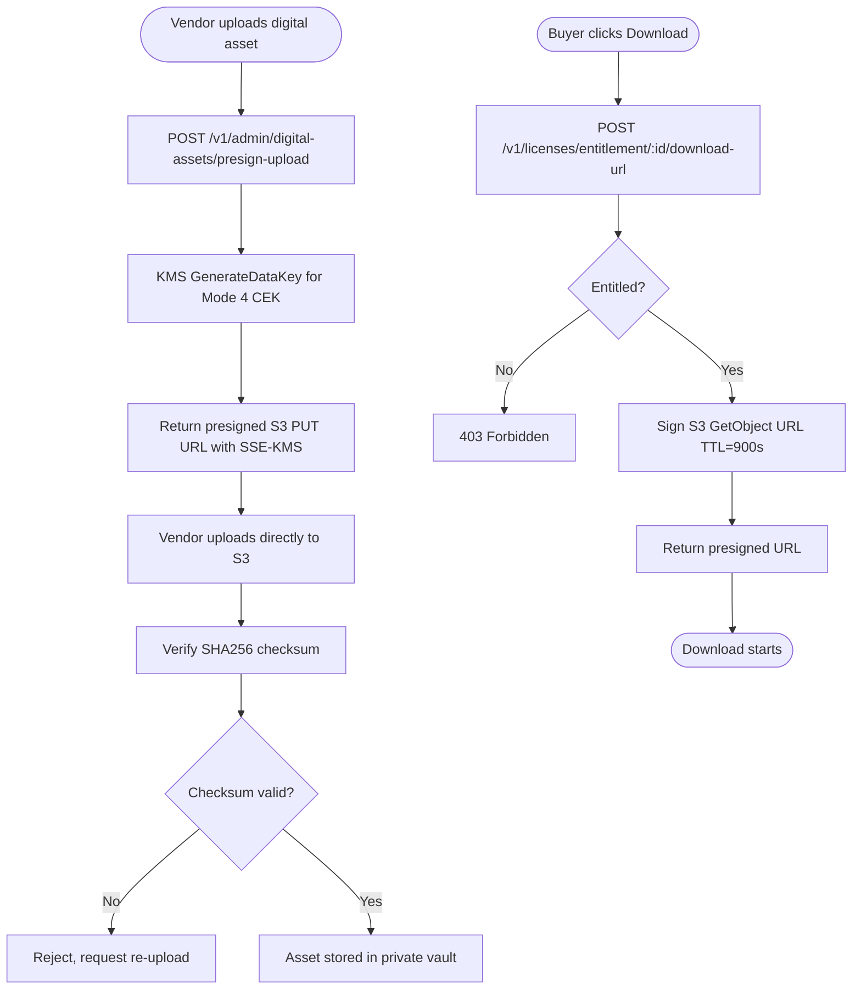

# US-9.1.1: Digital Asset Ingestion & Presigned S3 Delivery

> **Spec Kit Specification**: [Specification Lifecycle Active (.specify/)](../../../.specify/memory/constitution.md)  
> **Domain Feature**: `commercial-models`  
> **Domain Module**: `digital-products-and-licensing`  
> **Autonomous Behaviour**: `digital-asset-delivery`  
> **Client Framework Path**: `apps/storefront/src/features/commercial-models/modules/digital-products-and-licensing/behaviours/digital-asset-delivery`  
> **Backend Framework Path**: `backend/src/features/commercial-models/modules/digital-products-and-licensing/behaviours/digital-asset-delivery`  
> **Execution Sprint**: [Sprint 2.1](../../sprints/README.md)  
> **Slicing Standard**: [10-PR Vertical Slicing Framework](../../sprints/README.md#the-10-pr-vertical-slicing-standard-aligned-with-10-pillar-system-architecture)  
> **Security Gateway**: [ASVS Level 2 Verification Gate (security-audit)](#5-security-gateway-powered-by-security-audit)

---

## 1. Spec Kit Specification: User Story & Domain Scope

### 1.1 User Story Narrative

**As a** Digital Creator or Software Vendor,  
**I want to** upload encrypted digital assets and deliver them to verified buyers via time-limited presigned S3 URLs,  
**So that** my intellectual property is protected against hotlinking and piracy.

### 1.2 Acceptance Criteria (Gherkin Scenarios)

```gherkin
Feature: Digital Asset Ingestion
  Scenario: [AC-US-9.1.1-01] Upload digital asset
    Given the vendor is on "/[locale]/vendor/products/new" with product_type=DIGITAL
    When the vendor selects a binary file (v2.1.0.zip, 500MB)
    Then a presigned S3 PUT URL with SSE-KMS is generated
    And the file uploads directly to the private S3 vault
    And a SHA256 checksum is verified post-upload
  Scenario: [AC-US-9.1.1-02] Buyer downloads digital asset
    Given the buyer has a confirmed purchase and navigates to "/[locale]/account/licenses"
    When they click "Download"
    Then a 15-minute presigned S3 GET URL is generated
    And the download starts immediately
    And the URL expires after 15 minutes
  Scenario: [AC-US-9.1.1-03] COD disabled for digital products
    Given the cart contains a digital product
    Then the SplitCodEngine disables all COD payment options
    And only prepaid online and crypto options are available
  Scenario: [AC-US-9.1.1-04] Jurisdiction VAT for digital goods
    Given the buyer is in Germany (DE)
    Then 19% digital VAT is automatically applied
    And the VAT amount is shown on the invoice
  Scenario: [AC-US-9.1.1-LAW] Global e-commerce legal compliance and digital content delivery regulations
    Given a customer purchasing and downloading digital software, media, or licenses
    When generating presigned secure download links
    Then the consumer must provide express prior consent acknowledging that immediate download waives the 14-day statutory right of withdrawal
    And presigned download URLs must be cryptographically signed, time-limited, and bound to the authenticated purchaser
    And digital content delivery must incorporate intellectual property safeguards preventing unauthorized redistribution
```

### 1.3 Test Cases & Traceability Matrix

| # | Test Case | Type | Expected Result |
|:--|:----------|:-----|:----------------|
| TC-9.1.1-01 | Upload digital binary | Happy Path | File in S3 with SSE-KMS |
| TC-9.1.1-02 | SHA256 checksum verify | Happy Path | Checksum matches |
| TC-9.1.1-03 | Presigned download URL | Happy Path | 15-min URL generated |
| TC-9.1.1-04 | Download after URL expiry | Security | 403 Forbidden |
| TC-9.1.1-05 | COD disabled for digital | Validation | COD option hidden |
| TC-9.1.1-06 | Digital VAT for DE | Happy Path | 19% VAT applied |
| TC-9.1.1-07 | Upload > 5GB file | Edge Case | Multipart upload used |
| TC-9.1.1-08 | Unauthorized download attempt | Security | 403 |
| TC-9.1.1-09 | Hybrid bundle (physical + digital) | Edge Case | COD for physical portion only |
| TC-9.1.1-10 | Corrupted upload | Error | Checksum mismatch, retry |
| TC-9.1.1-LAW | Global legal & regulatory compliance (EU Consumer Rights Directive Art 16(m) digital withdrawal waiver, DMCA copyright safeguards) | Legal / Regulatory | Statutory compliance verified with zero legal or regulatory violations |

---

## 2. Behavior-Centric Architecture & Folder Blueprint

This user story is implemented directly inside the respective **Expo client** and **Cargo Lambda Axum backend** frameworks according to the **Locality of Behavior (LoB)** architectural law. Private services, designs, logic, types, and constants are strictly colocated within their framework behaviour directory.

### 2.1 Colocated Behaviour Directory Tree

#### Client Architecture (Universal Expo SDK 58):
```
apps/storefront/src/features/commercial-models/modules/digital-products-and-licensing/behaviours/digital-asset-delivery/
├── services/
│   │   ├── s3_presigned_url_signer.rs
│   │   ├── asset_integrity_verifier.rs
│   │   ├── download_api.ts
├── designs/
│   │   ├── DigitalAssetVaultView.tsx
│   │   ├── DownloadProgressBar.tsx
│   │   ├── AssetChecksumBadge.tsx
├── logic/
│   │   ├── useDigitalAssetDownload.ts
│   │   ├── download_token_validator.rs
│   │   ├── rate_limited_streamer.ts
├── types/
│   │   ├── DigitalAssetTicket.ts
│   │   ├── PresignedDownloadUrl.ts
│   │   ├── AssetChecksum.ts
└── constants/
│   │   ├── DigitalAssetEndpoints.ts
│   │   ├── PresignedUrlTtlSeconds.ts
│   │   ├── AssetErrorCodes.ts
```

#### Backend Architecture (Cargo Lambda + Axum 0.8):
```
backend/src/features/commercial-models/modules/digital-products-and-licensing/behaviours/digital-asset-delivery/
├── services/
│   │   ├── s3_presigned_url_signer.rs
│   │   ├── asset_integrity_verifier.rs
│   │   ├── download_api.ts
├── logic/
│   │   ├── useDigitalAssetDownload.ts
│   │   ├── download_token_validator.rs
│   │   ├── rate_limited_streamer.ts
├── types/
│   │   ├── DigitalAssetTicket.ts
│   │   ├── PresignedDownloadUrl.ts
│   │   ├── AssetChecksum.ts
└── constants/
│   │   ├── DigitalAssetEndpoints.ts
│   │   ├── PresignedUrlTtlSeconds.ts
│   │   ├── AssetErrorCodes.ts
```

### 2.2 Scoping & Promotion Blueprint

| Layer / Tier | Client Path (Expo) | Backend Path (Cargo Lambda / Axum) | Purpose & Promotion Rules |
| :--- | :--- | :--- | :--- |
| **Behaviour-Local** | `.../behaviours/digital-asset-delivery/` | `.../behaviours/digital-asset-delivery/` | **Default Private Scope**: Colocated services, designs, logic, types, and constants private to this story. |
| **Module-Shared** | `.../modules/digital-products-and-licensing/_shared/` | `.../modules/digital-products-and-licensing/_shared/` | Shared domain primitives and UI elements used by $\ge 2$ behaviours in `digital-products-and-licensing`. |
| **Feature-Shared** | `.../features/commercial-models/_shared/` | `.../features/commercial-models/_shared/` | Feature-level contracts, ports, and cross-module bridges across `commercial-models`. |
| **Framework-Shared** | `apps/storefront/src/shared/` | `backend/crates/kernel-core/` | System-wide microkernel traits, `Money` arithmetic, RFC 9110 ETag middleware, and database adapters. |

---

## 3. Technical Implementation Plan (Spec Kit Plan)

### 3.1 Domain Invariants & Storage Schema
- **State Machine**: Enforces valid state transitions and rejects unauthorized or out-of-order mutations.
- **Data Persistence**: Single-table Amazon DynamoDB partitioning (`PK = TENANT#<id>`, `SK = ENTITY#<id>`) paired with reactive local-first WatermelonDB sync.
- **Freshness & Caching**: Multi-tier caching (L1 Moka in-memory + L2 ElastiCache Redis) with RFC 9110 `ETag` conditional `304 Not Modified` short-circuiting.

### 3.2 Activity & Interaction Diagram



---

## 4. Granular Implementation Tasks (Spec Kit Tasks)

### Phase 1: Core Domain Logic, Types & Constants
- [ ] **Task 1.1 (Types)**: Define strongly typed models and DTO schemas in `types/`.
- [ ] **Task 1.2 (Constants)**: Define routes, action codes, and validation limits in `constants/`.
- [ ] **Task 1.3 (Logic)**: Implement pure business logic, calculations, and state machines in `logic/`.
- [ ] **Task 1.4 (Unit Tests)**: Write pure property-based and unit tests verifying domain invariants.

### Phase 2: Services & Infrastructure Adapters
- [ ] **Task 2.1 (API / Gateway)**: Implement client adapters and backend handlers in `services/`.
- [ ] **Task 2.2 (ETag & Cache)**: Integrate RFC 9110 ETag headers and multi-tier caching (Moka L1 / Redis L2).
- [ ] **Task 2.3 (Storage & Sync)**: Implement DynamoDB storage operations and WatermelonDB delta sync.
- [ ] **Task 2.4 (Integration Tests)**: Verify service contract tests and real database conditional writes.

### Phase 3: Platform-Adaptive Designs & UI
- [ ] **Task 3.1 (UI Presentation)**: Build platform-adaptive screens and SDUI components in `designs/`.
- [ ] **Task 3.2 (Headless Hooks)**: Bind headless domain hooks from `logic/` into the UI presentation.
- [ ] **Task 3.3 (i18n & RTL)**: Implement bidirectional RTL/LTR layout mirroring and localized font switching.
- [ ] **Task 3.4 (Component Tests)**: Test empty, loading, offline, and error states across web and mobile.

### Phase 4: Security Gateway Verification & Release Readiness
- [ ] **Task 4.1 (Abuse Testing)**: Execute automated adversarial penetration tests against the threat matrix.
- [ ] **Task 4.2 (Zero-Trust Audit)**: Verify strict tenant isolation and object-level authorization (IDOR).
- [ ] **Task 4.3 (SAST & Audit)**: Run static analysis, dependency audit, and secret scanning.
- [ ] **Task 4.4 (Gate Sign-Off)**: Obtain independent security sign-off for the G2 Security Gateway.

---

## 5. Security Gateway (Powered by security-audit)

### 5.1 Trust Boundaries & Security Actors
- **Trust Boundaries**:
  - `Untrusted Zone`: Mobile client app, public web browser, and external network callers.
  - `Gateway Edge`: AWS CloudFront, API Gateway, and Cognito JWT authentication guard.
  - `Secure Application Boundary`: Axum Tower route extractors enforcing tenant and RBAC/ABAC isolation.
  - `Encrypted Storage & Secret Vault`: Amazon DynamoDB KMS-encrypted tables and AWS KMS vault.
- **Authorized Principals**:
  - Identified Actors: `AuthenticatedCustomer`, `B2bBuyer`, `Vendor`, `StoreAdmin`, or `AnonymousShopper` (read-only).
  - Multi-Tenancy Invariant: Every request must extract `tenant_id` from verified JWT claims. Injections via query params or payload body are rejected with `403 Forbidden`.

### 5.2 Threat Modeling & Abuse Matrix (STRIDE / ASVS)

| Threat Vector | Severity | Vulnerability Mechanism | Mitigating Control & Security Invariant |
| :--- | :--- | :--- | :--- |
| **Spoofing & Impersonation** | Critical | Forged `sub` or `tenant_id` identity claims | Server-side RS256 JWKS signature verification; strict claims extraction in Axum. |
| **Tampering & Invariant Bypass** | High | Manipulating payload parameters or prices | Authoritative server recalculation; strict schema validation; BLAKE3 ETag integrity checks. |
| **Information Disclosure (IDOR)** | Critical | Cross-tenant or cross-user data scraping | Explicit `PK = TENANT#<id>` partition filtering on every database and cache operation. |
| **Denial of Service / Abuse** | High | Presigned URL URL-sharing/hotlinking, IP address bypass, and unauthenticated digital binary downloads | Token-bucket rate limiting per IP and account; strict input length validation. |
| **Elevation of Privilege** | Critical | Bypassing role-based permission checks | Tower extractors (`RequireStoreAdmin`, `RequireVendor`) guard sensitive endpoints. |

### 5.3 Cryptographic & Data Protection Controls
- **Encryption in Transit**: TLS 1.3 enforced on all external and internal endpoints; HSTS active.
- **Encryption at Rest**: DynamoDB AWS KMS customer-managed keys; AES-256-GCM for sensitive client tokens in `expo-secure-store`.
- **PII & Secret Redaction**: Passwords, OTPs, auth tokens, and credit card numbers are stripped from logs and traces via `tracing` redaction filters.

### 5.4 Automated Security Verification Checklist
- [ ] **SAST Analysis**: Clean report from static code analyzers; 0 high or critical vulnerabilities.
- [ ] **Dependency Audit**: `cargo deny` and `bun audit` pass with 0 unreviewed security advisories.
- [ ] **Abuse & IDOR Fuzzing**: Test suite confirms that requests with modified `tenant_id` or `user_id` fail with `401 Unauthorized` or `403 Forbidden`.
- [ ] **Secret Scanning**: Gitleaks scanner confirms zero hardcoded credentials, API keys, or private keys.

### 5.5 Security Gateway (G2) Sign-Off Checklist
- [ ] Threat boundary and entry points verified against OWASP ASVS Level 2 requirements.
- [ ] Multi-tenant isolation verified with automated cross-tenant penetration test.
- [ ] Anti-abuse and rate limiting confirmed active on all public interfaces.
- [ ] Audit log redaction verified — zero plaintext secrets in output logs.
- [ ] Independent reviewer sign-off obtained; zero open Critical or High findings.

---

## 6. Validation Gates & Acceptance Sign-Off

**Status: Pending — specification only; no implementation evidence.** All [G0–G4 quality gates + G-Review + G-Borrow + G-UI + G-Law](../../QUALITY_GATES.md) apply to this story. The following checks add to its acceptance criteria and test cases; they do not replace them.

### G1 — Test coverage
- [ ] **US-9.1.1-G1:** Automated test suite maps 100% of acceptance criteria and test cases with >=90% line and >=85% branch coverage in affected packages.

### G2 — Security audit
- [ ] **US-9.1.1-G2:** Verify zero-trust tenant isolation, object-level authorization (IDOR), and defense against Presigned URL URL-sharing/hotlinking, IP address bypass, and unauthenticated digital binary downloads. No unresolved critical or high findings.

### G3 — Architecture and maintainability
- [ ] **US-9.1.1-G3:** Strict compliance with framework colocation (`apps/storefront/src/features/` or `backend/src/features/`), zero-clone borrowing discipline in Rust, and clean domain boundaries.

### G-Review — Code review
- [ ] **US-9.1.1-G-Review:** Independent senior code review signed off by the Code Reviewer; verification across Correctness, Security, Maintainability, Performance, and Testing using the Agency-Agents code review standard; zero open Blocker or unresolved Suggestion findings.

### G-Borrow — Rust zero-clone borrowing validation
- [ ] **US-9.1.1-G-Borrow:** Backend code relies strictly on borrowing (&T, &mut T), explicit lifetimes, zero-copy byte buffers (bytes::Bytes), and zero unauthorized deep .clone() calls on domain entities and models (Arc::clone and Rc::clone pointer copies permitted only); certified by systems reviewer.

### G-UI — UI/UX validation
- [ ] **US-9.1.1-G-UI:** Pure separation of presentation (designs/, owned by ui-ux-designer) and headless hooks (logic/, owned by client-engineer); mobile components use @expo/ui primitives and native modules; web components use semantic HTML5 styled with Tailwind CSS; WCAG 2.1 AA and Arabic RTL layout parity verified; certified by UI/UX designer.

### G-Law — Law validation
- [ ] **US-9.1.1-G-Law:** Independent verification against global e-commerce legal and statutory requirements: EU Consumer Rights Directive Art 16(m) express withdrawal waiver on digital execution, time-limited presigned URLs, and DMCA copyright protection; certified by compliance reviewer (`agency-legal-compliance-checker`).

### G4 — Integrated acceptance
- [ ] **US-9.1.1-G4:** End-to-end user journey validation across supported platforms (Web, iOS, Android) and verified sandbox integration.

---

[← Back to Module digital-products-and-licensing Catalog (README.md)](README.md) | [Master User Stories Index](../README.md)
