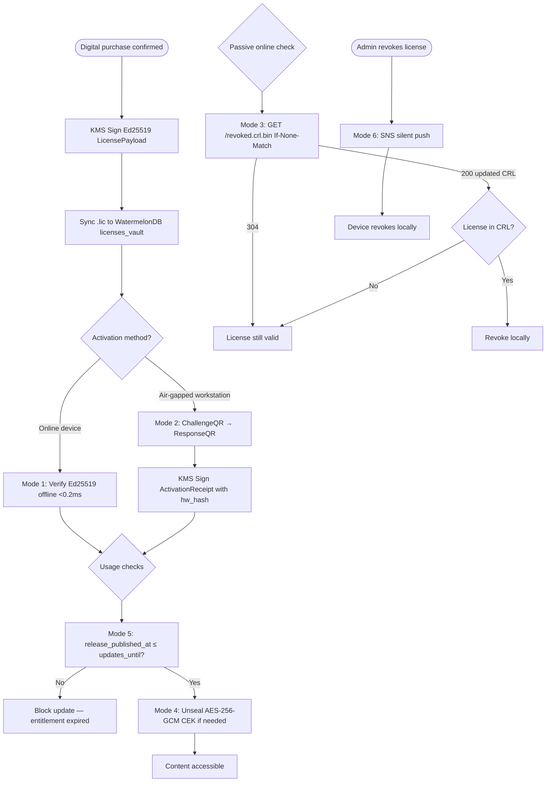

# US-9.1.2: 6-Mode Non-Heartbeat Licensing Engine

> **Spec Kit Specification**: [Specification Lifecycle Active (.specify/)](../../../.specify/memory/constitution.md)  
> **Domain Feature**: `commercial-models`  
> **Domain Module**: `digital-products-and-licensing`  
> **Autonomous Behaviour**: `six-mode-licensing-engine`  
> **Client Framework Path**: `apps/storefront/src/features/commercial-models/modules/digital-products-and-licensing/behaviours/six-mode-licensing-engine`  
> **Backend Framework Path**: `backend/src/features/commercial-models/modules/digital-products-and-licensing/behaviours/six-mode-licensing-engine`  
> **Execution Sprint**: [Sprint 2.1 / 2.2](../../sprints/README.md)  
> **Slicing Standard**: [7-PR Vertical Slicing Framework](../../sprints/README.md#the-7-pr-vertical-slicing-standard)  
> **Security Gateway**: [ASVS Level 2 Verification Gate (security-audit)](#5-security-gateway-powered-by-security-audit)

---

## 1. Spec Kit Specification: User Story & Domain Scope

### 1.1 User Story Narrative

**As a** Software Vendor or Digital Product Buyer,  
**I want** licenses that verify authenticity without constant online heartbeats,  
**So that** legitimate customers can run software completely offline.

### 1.2 Acceptance Criteria (Gherkin Scenarios)

```gherkin
Feature: 6-Mode Licensing Engine
  Scenario: [AC-US-9.1.2-01] Mode 1 — Offline Ed25519 certificate
    Given a buyer purchases a digital product
    Then an Ed25519-signed .lic certificate is issued via KMS
    And the certificate is synced to the buyer's WatermelonDB licenses_vault
    And the client SDK verifies the signature offline in <0.2ms
  Scenario: [AC-US-9.1.2-02] Mode 2 — Air-gapped QR activation
    Given the buyer has an offline workstation without internet
    When they scan the workstation's ChallengeQR from the Expo mobile app
    Then the backend signs an ActivationReceipt bound to the hardware fingerprint
    And displays a ResponseQR for the workstation to scan
    And the workstation runs offline forever with the activation
  Scenario: [AC-US-9.1.2-03] Mode 3 — CloudFront CRL revocation check
    Given a license is revoked due to a refund
    Then the revoked.crl.bin file is updated in S3
    And CloudFront serves it at the edge with near-zero Lambda cost
    And clients check If-None-Match passively (no heartbeat)
  Scenario: [AC-US-9.1.2-04] Mode 4 — CEK unsealing
    Given premium content is encrypted with AES-256-GCM
    When the activated client requests the Content Encryption Key
    Then the CEK is wrapped to the client's X25519 public key
    And without the key, the content cannot be decrypted (anti-crack)
  Scenario: [AC-US-9.1.2-05] Mode 5 — Release timestamp gating
    Given the license has updates_entitled_until = 2027-06-01
    And the software release_published_at = 2027-03-15
    Then the release is allowed (published before entitlement expires)
    But a release with release_published_at = 2027-08-01 is blocked
  Scenario: [AC-US-9.1.2-06] Mode 6 — Push revocation via SNS
    When an admin revokes a license
    Then an SNS silent push is sent to the buyer's device
    And the device immediately marks the license as revoked locally
```

### 1.3 Test Cases & Traceability Matrix

| # | Test Case | Type | Expected Result |
|:--|:----------|:-----|:----------------|
| TC-9.1.2-01 | Ed25519 certificate issuance | Happy Path | Signed .lic created |
| TC-9.1.2-02 | Offline Ed25519 verification | Happy Path | <0.2ms, valid |
| TC-9.1.2-03 | Tampered .lic file | Security | Signature invalid |
| TC-9.1.2-04 | Air-gapped QR challenge-response | Happy Path | Activation successful |
| TC-9.1.2-05 | QR with wrong hardware hash | Security | Activation denied |
| TC-9.1.2-06 | CRL check — not revoked | Happy Path | 304, license valid |
| TC-9.1.2-07 | CRL check — revoked | Happy Path | License invalidated |
| TC-9.1.2-08 | CEK unsealing | Happy Path | Content decrypts |
| TC-9.1.2-09 | Release before entitlement | Happy Path | Allowed |
| TC-9.1.2-10 | Release after entitlement | Validation | Blocked |
| TC-9.1.2-11 | Push revocation | Happy Path | Device revokes locally |
| TC-9.1.2-12 | Max machines exceeded | Validation | Activation denied |

---

## 2. Behavior-Centric Architecture & Folder Blueprint

This user story is implemented directly inside the respective **Expo client** and **Cargo Lambda Axum backend** frameworks according to the **Locality of Behavior (LoB)** architectural law. Private services, designs, logic, types, and constants are strictly colocated within their framework behaviour directory.

### 2.1 Colocated Behaviour Directory Tree

#### Client Architecture (Universal Expo SDK 58):
```
apps/storefront/src/features/commercial-models/modules/digital-products-and-licensing/behaviours/six-mode-licensing-engine/
├── services/
│   │   ├── ed25519_license_signer.rs
│   │   ├── crl_revocation_service.rs
│   │   ├── license_verification_api.ts
├── designs/
│   │   ├── LicenseModeSelector.tsx
│   │   ├── AirGappedQrCodeViewer.tsx
│   │   ├── CertificateInspectorCard.tsx
├── logic/
│   │   ├── useLicensingEngine.ts
│   │   ├── aes_cek_unsealer.rs
│   │   ├── license_mode_evaluator.rs
├── types/
│   │   ├── CryptographicLicense.ts
│   │   ├── LicenseModeEnum.ts
│   │   ├── RevocationCrlEntry.ts
└── constants/
│   │   ├── LicensingModes.ts
│   │   ├── KmsKeyAliases.ts
│   │   ├── LicenseErrorCodes.ts
```

#### Backend Architecture (Cargo Lambda + Axum 0.8):
```
backend/src/features/commercial-models/modules/digital-products-and-licensing/behaviours/six-mode-licensing-engine/
├── services/
│   │   ├── ed25519_license_signer.rs
│   │   ├── crl_revocation_service.rs
│   │   ├── license_verification_api.ts
├── logic/
│   │   ├── useLicensingEngine.ts
│   │   ├── aes_cek_unsealer.rs
│   │   ├── license_mode_evaluator.rs
├── types/
│   │   ├── CryptographicLicense.ts
│   │   ├── LicenseModeEnum.ts
│   │   ├── RevocationCrlEntry.ts
└── constants/
│   │   ├── LicensingModes.ts
│   │   ├── KmsKeyAliases.ts
│   │   ├── LicenseErrorCodes.ts
```

### 2.2 Scoping & Promotion Blueprint

| Layer / Tier | Client Path (Expo) | Backend Path (Cargo Lambda / Axum) | Purpose & Promotion Rules |
| :--- | :--- | :--- | :--- |
| **Behaviour-Local** | `.../behaviours/six-mode-licensing-engine/` | `.../behaviours/six-mode-licensing-engine/` | **Default Private Scope**: Colocated services, designs, logic, types, and constants private to this story. |
| **Module-Shared** | `.../modules/digital-products-and-licensing/_shared/` | `.../modules/digital-products-and-licensing/_shared/` | Shared domain primitives and UI elements used by $\ge 2$ behaviours in `digital-products-and-licensing`. |
| **Feature-Shared** | `.../features/commercial-models/_shared/` | `.../features/commercial-models/_shared/` | Feature-level contracts, ports, and cross-module bridges across `commercial-models`. |
| **Framework-Shared** | `apps/storefront/src/shared/` | `backend/crates/kernel-core/` | System-wide microkernel traits, `Money` arithmetic, RFC 9110 ETag middleware, and database adapters. |

---

## 3. Technical Implementation Plan (Spec Kit Plan)

### 3.1 Domain Invariants & Storage Schema
- **State Machine**: Enforces valid state transitions and rejects unauthorized or out-of-order mutations.
- **Data Persistence**: Single-table Amazon DynamoDB partitioning (`PK = TENANT#<id>`, `SK = ENTITY#<id>`) paired with reactive local-first WatermelonDB sync.
- **Freshness & Caching**: Multi-tier caching (L1 Moka in-memory + L2 ElastiCache Redis) with RFC 9110 `ETag` conditional `304 Not Modified` short-circuiting.

### 3.2 Activity & Interaction Diagram



---

## 4. Granular Implementation Tasks (Spec Kit Tasks)

### Phase 1: Core Domain Logic, Types & Constants
- [ ] **Task 1.1 (Types)**: Define strongly typed models and DTO schemas in `types/`.
- [ ] **Task 1.2 (Constants)**: Define routes, action codes, and validation limits in `constants/`.
- [ ] **Task 1.3 (Logic)**: Implement pure business logic, calculations, and state machines in `logic/`.
- [ ] **Task 1.4 (Unit Tests)**: Write pure property-based and unit tests verifying domain invariants.

### Phase 2: Services & Infrastructure Adapters
- [ ] **Task 2.1 (API / Gateway)**: Implement client adapters and backend handlers in `services/`.
- [ ] **Task 2.2 (ETag & Cache)**: Integrate RFC 9110 ETag headers and multi-tier caching (Moka L1 / Redis L2).
- [ ] **Task 2.3 (Storage & Sync)**: Implement DynamoDB storage operations and WatermelonDB delta sync.
- [ ] **Task 2.4 (Integration Tests)**: Verify service contract tests and real database conditional writes.

### Phase 3: Platform-Adaptive Designs & UI
- [ ] **Task 3.1 (UI Presentation)**: Build platform-adaptive screens and SDUI components in `designs/`.
- [ ] **Task 3.2 (Headless Hooks)**: Bind headless domain hooks from `logic/` into the UI presentation.
- [ ] **Task 3.3 (i18n & RTL)**: Implement bidirectional RTL/LTR layout mirroring and localized font switching.
- [ ] **Task 3.4 (Component Tests)**: Test empty, loading, offline, and error states across web and mobile.

### Phase 4: Security Gateway Verification & Release Readiness
- [ ] **Task 4.1 (Abuse Testing)**: Execute automated adversarial penetration tests against the threat matrix.
- [ ] **Task 4.2 (Zero-Trust Audit)**: Verify strict tenant isolation and object-level authorization (IDOR).
- [ ] **Task 4.3 (SAST & Audit)**: Run static analysis, dependency audit, and secret scanning.
- [ ] **Task 4.4 (Gate Sign-Off)**: Obtain independent security sign-off for the G2 Security Gateway.

---

## 5. Security Gateway (Powered by security-audit)

### 5.1 Trust Boundaries & Security Actors
- **Trust Boundaries**:
  - `Untrusted Zone`: Mobile client app, public web browser, and external network callers.
  - `Gateway Edge`: AWS CloudFront, API Gateway, and Cognito JWT authentication guard.
  - `Secure Application Boundary`: Axum Tower route extractors enforcing tenant and RBAC/ABAC isolation.
  - `Encrypted Storage & Secret Vault`: Amazon DynamoDB KMS-encrypted tables and AWS KMS vault.
- **Authorized Principals**:
  - Identified Actors: `AuthenticatedCustomer`, `B2bBuyer`, `Vendor`, `StoreAdmin`, or `AnonymousShopper` (read-only).
  - Multi-Tenancy Invariant: Every request must extract `tenant_id` from verified JWT claims. Injections via query params or payload body are rejected with `403 Forbidden`.

### 5.2 Threat Modeling & Abuse Matrix (STRIDE / ASVS)

| Threat Vector | Severity | Vulnerability Mechanism | Mitigating Control & Security Invariant |
| :--- | :--- | :--- | :--- |
| **Spoofing & Impersonation** | Critical | Forged `sub` or `tenant_id` identity claims | Server-side RS256 JWKS signature verification; strict claims extraction in Axum. |
| **Tampering & Invariant Bypass** | High | Manipulating payload parameters or prices | Authoritative server recalculation; strict schema validation; BLAKE3 ETag integrity checks. |
| **Information Disclosure (IDOR)** | Critical | Cross-tenant or cross-user data scraping | Explicit `PK = TENANT#<id>` partition filtering on every database and cache operation. |
| **Denial of Service / Abuse** | High | Signature forgery on offline license files, CRL cache bypass, and clock roll-back tamper attacks | Token-bucket rate limiting per IP and account; strict input length validation. |
| **Elevation of Privilege** | Critical | Bypassing role-based permission checks | Tower extractors (`RequireStoreAdmin`, `RequireVendor`) guard sensitive endpoints. |

### 5.3 Cryptographic & Data Protection Controls
- **Encryption in Transit**: TLS 1.3 enforced on all external and internal endpoints; HSTS active.
- **Encryption at Rest**: DynamoDB AWS KMS customer-managed keys; AES-256-GCM for sensitive client tokens in `expo-secure-store`.
- **PII & Secret Redaction**: Passwords, OTPs, auth tokens, and credit card numbers are stripped from logs and traces via `tracing` redaction filters.

### 5.4 Automated Security Verification Checklist
- [ ] **SAST Analysis**: Clean report from static code analyzers; 0 high or critical vulnerabilities.
- [ ] **Dependency Audit**: `cargo deny` and `bun audit` pass with 0 unreviewed security advisories.
- [ ] **Abuse & IDOR Fuzzing**: Test suite confirms that requests with modified `tenant_id` or `user_id` fail with `401 Unauthorized` or `403 Forbidden`.
- [ ] **Secret Scanning**: Gitleaks scanner confirms zero hardcoded credentials, API keys, or private keys.

### 5.5 Security Gateway (G2) Sign-Off Checklist
- [ ] Threat boundary and entry points verified against OWASP ASVS Level 2 requirements.
- [ ] Multi-tenant isolation verified with automated cross-tenant penetration test.
- [ ] Anti-abuse and rate limiting confirmed active on all public interfaces.
- [ ] Audit log redaction verified — zero plaintext secrets in output logs.
- [ ] Independent reviewer sign-off obtained; zero open Critical or High findings.

---

## 6. Validation Gates & Acceptance Sign-Off

**Status: Pending — specification only; no implementation evidence.** All [G0–G4 quality gates](../../QUALITY_GATES.md) apply to this story. The following checks add to its acceptance criteria and test cases; they do not replace them.

### G1 — Test coverage
- [ ] **US-9.1.2-G1:** Automated test suite maps 100% of acceptance criteria and test cases with >=90% line and >=85% branch coverage in affected packages.

### G2 — Security audit
- [ ] **US-9.1.2-G2:** Verify zero-trust tenant isolation, object-level authorization (IDOR), and defense against Signature forgery on offline license files, CRL cache bypass, and clock roll-back tamper attacks. No unresolved critical or high findings.

### G3 — Architecture and maintainability
- [ ] **US-9.1.2-G3:** Strict compliance with framework colocation (`apps/storefront/src/features/` or `backend/src/features/`), zero-clone borrowing discipline in Rust, and clean domain boundaries.

### G4 — Integrated acceptance
- [ ] **US-9.1.2-G4:** End-to-end user journey validation across supported platforms (Web, iOS, Android) and verified sandbox integration.

---

[← Back to Module digital-products-and-licensing Catalog (README.md)](README.md) | [Master User Stories Index](../README.md)
