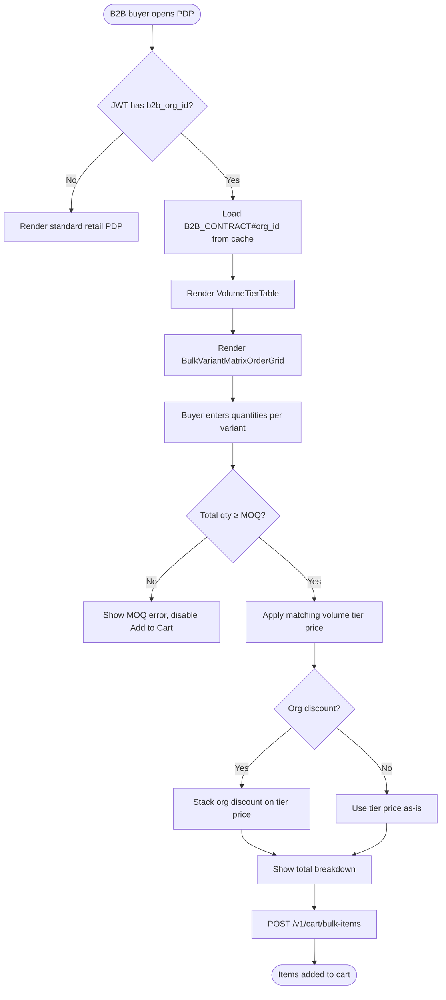
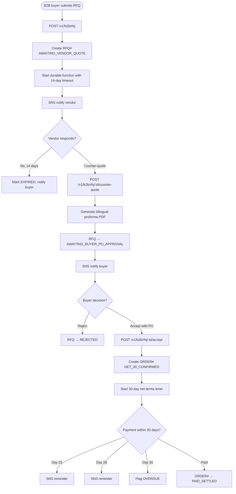
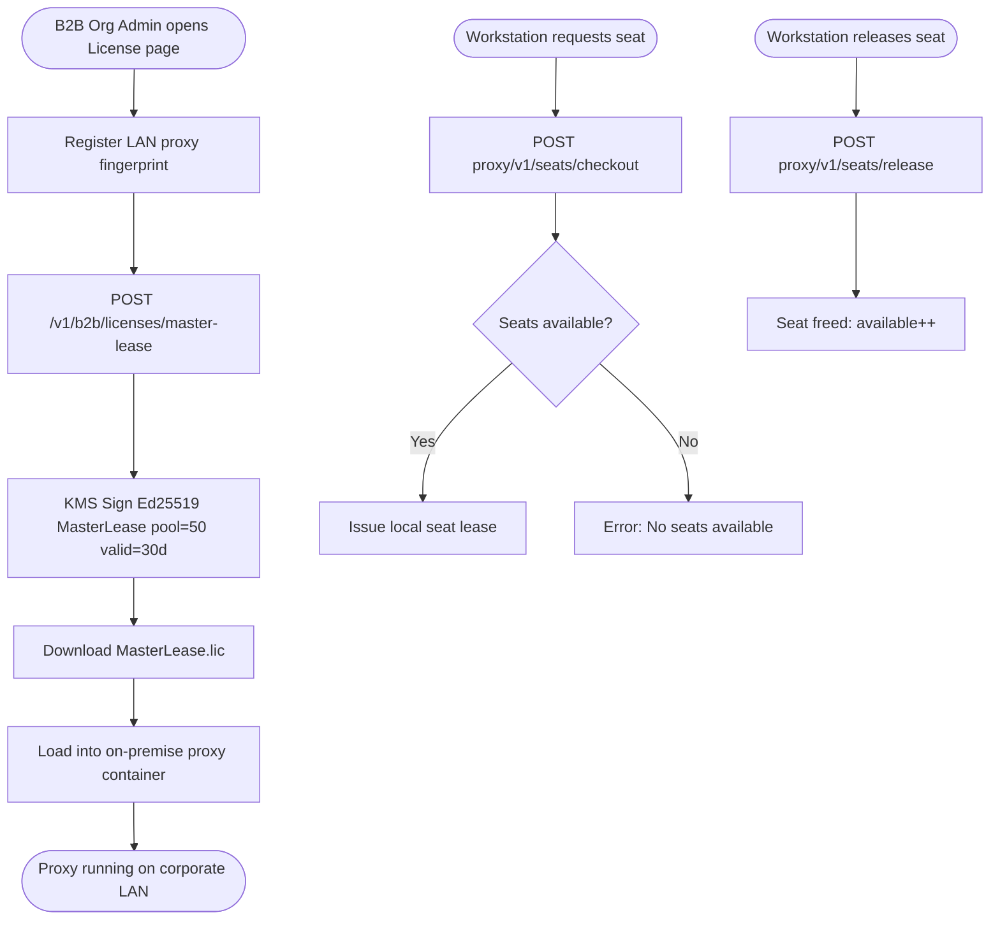

# Module 10: B2B Wholesale

> **Slice**: v3.0 · **Sprints**: 3.1, 3.2 · **Stories**: US-10.1.1 – US-10.1.4

## Overview

Covers B2B organization onboarding, tiered volume pricing, MOQ enforcement, RFQ negotiation with durable state machines, net-terms invoicing, and B2B on-premise LAN license proxy.

## Pages

| Page Route | Access | Primary Hook |
|:-----------|:-------|:-------------|
| `/[locale]/(auth)/b2b-register` | Public | `useB2BOnboarding` |
| `/[locale]/c/[...category_slug]` | B2B_BUYER | `useCatalogSearchAndFacets` |
| `/[locale]/products/[slug]` | B2B_BUYER | `useProductConfigurator` |
| `/[locale]/b2b/rfq` | B2B_BUYER / B2B_ORG_ADMIN | `useB2BRfqNegotiation` |
| `/[locale]/account/licenses` | B2B_ORG_ADMIN | `useDigitalLicenseVault` |

## API Endpoints

| Method | Endpoint | Lambda | Description |
|:-------|:---------|:-------|:------------|
| POST | `/v1/b2b/rfq` | `durable-orchestrator` | Submit RFQ |
| POST | `/v1/b2b/rfq/:id/counter-quote` | `durable-orchestrator` | Vendor counter-quote |
| POST | `/v1/b2b/rfq/:id/accept` | `durable-orchestrator` | Buyer accept + PO |
| POST | `/v1/b2b/licenses/master-lease` | `storefront-sdui-api` | Generate master lease cert |
| POST | `/v1/cart/bulk-items` | `checkout-webhooks-api` | Bulk variant matrix add |

---

## US-10.1.1: B2B Tiered Volume Pricing & MOQ Enforcement

**As a** B2B Wholesale Buyer,  
**I want** the PDP to show volume-tier pricing (10–49 units, 50–199 units, 200+ units) and enforce MOQ,  
**So that** my procurement team gets the correct contract pricing for bulk orders.

### Acceptance Criteria

```gherkin
Feature: B2B Tiered Pricing & MOQ

  Scenario: B2B buyer views tiered pricing
    Given a B2B buyer with org_id="org_99" opens a product page
    Then a VolumeTierTable shows: 25+ units=$42, 100+ units=$36, 200+ units=$30
    And a BulkVariantMatrixOrderGrid allows entering quantities per variant

  Scenario: MOQ enforcement
    Given the product has MOQ=25
    When the B2B buyer enters 10 units total across all variants
    Then a validation error "Minimum order quantity is 25 units" is shown
    And the Add to Cart button is disabled

  Scenario: Volume tier auto-selection
    Given the buyer enters 120 units
    Then the 100+ tier price ($36) is automatically applied
    And the total shows 120 × $36 = $4,320

  Scenario: Org-specific discount
    Given org_99 has a 5% additional contract discount
    Then the displayed price includes both tier pricing and org discount
    And the breakdown shows: Tier $36 - 5% = $34.20/unit

  Scenario: B2C buyer sees no B2B pricing
    Given a B2C customer views the same product
    Then no volume tier table or MOQ is shown
    And only the standard retail price appears
```

### Test Cases

| # | Test Case | Type | Expected Result |
|:--|:----------|:-----|:----------------|
| TC-10.1.1-01 | View tier table | Happy Path | Tiers displayed |
| TC-10.1.1-02 | Qty below MOQ | Validation | Error, button disabled |
| TC-10.1.1-03 | Qty in 100+ tier | Happy Path | Correct price applied |
| TC-10.1.1-04 | Org discount stacked | Happy Path | Tier + org discount |
| TC-10.1.1-05 | B2C sees no B2B | Persona | Retail price only |
| TC-10.1.1-06 | Qty exactly at MOQ | Edge Case | Accepted |
| TC-10.1.1-07 | Qty = 0 | Validation | Error |
| TC-10.1.1-08 | B2B-specific facets | Happy Path | MOQ Range, Lead Time shown |

### Activity Diagram



---

## US-10.1.2: Durable RFQ Negotiation & Net-Terms Invoicing

**As a** B2B Buyer and Vendor,  
**I want to** submit RFQs, negotiate custom pricing and Net-30/Net-60 terms, and generate bilingual proforma invoices,  
**So that** large wholesale deals can be negotiated and converted to orders.

### Acceptance Criteria

```gherkin
Feature: RFQ Negotiation

  Scenario: Submit RFQ
    When the buyer submits an RFQ for 500 units with target price $32 and Net-30
    Then RFQ#rfq_101 is created with status AWAITING_VENDOR_QUOTE
    And a durable function checkpoints the RFQ with zero idle cost

  Scenario: Vendor counter-quote
    When the vendor submits a counter-quote at $34.50/unit valid 7 days
    Then the RFQ status updates to AWAITING_BUYER_PO_APPROVAL
    And a bilingual proforma PDF is generated

  Scenario: Buyer approves with PO
    When the B2B_ORG_ADMIN clicks "Approve with PO #PO-8841"
    Then ORDER#ord_901 is created with status NET_30_CONFIRMED
    And a 30-day durable timer starts for Net-30 payment

  Scenario: RFQ expired
    Given the vendor doesn't respond within 14 days
    Then the durable function marks RFQ as EXPIRED
    And the buyer is notified

  Scenario: Net-30 payment overdue
    Given the Net-30 term expires without payment
    Then SNS reminders are sent at day 25, 28, and 30
    And after day 30, the order is flagged as OVERDUE
```

### Test Cases

| # | Test Case | Type | Expected Result |
|:--|:----------|:-----|:----------------|
| TC-10.1.2-01 | Submit RFQ | Happy Path | RFQ created, vendor notified |
| TC-10.1.2-02 | Counter-quote | Happy Path | Status updated, PDF generated |
| TC-10.1.2-03 | Approve with PO | Happy Path | Order created |
| TC-10.1.2-04 | RFQ timeout 14 days | Edge Case | EXPIRED status |
| TC-10.1.2-05 | Net-30 SNS reminders | Happy Path | 3 reminders sent |
| TC-10.1.2-06 | Multiple counter-quotes | Happy Path | Latest offer applies |
| TC-10.1.2-07 | Buyer rejects counter | Happy Path | RFQ → REJECTED |
| TC-10.1.2-08 | Bilingual PDF content | i18n | Arabic + English |
| TC-10.1.2-09 | Concurrent PO approvals | Concurrency | Only one succeeds |
| TC-10.1.2-10 | B2B milestone deposit (30% upfront) | Happy Path | Deposit required |

### Activity Diagram



---

## US-10.1.3: B2B Custom Elasticsearch Facets

**As a** B2B Buyer,  
**I want** B2B-specific facet filters (MOQ Range, Lead Time Days, Pallet Weight, HS Code) in the catalog,  
**So that** I can filter products by procurement-relevant criteria.

### Acceptance Criteria

```gherkin
Feature: B2B Facet Filters

  Scenario: B2B facets appear for B2B persona
    Given a B2B buyer browses the category page
    Then additional B2B facets appear: MOQ Range, Lead Time, Pallet Weight
    And standard B2C facets (Color, Size, etc.) are also available

  Scenario: B2C buyer sees no B2B facets
    Given a B2C customer browses the same page
    Then B2B-specific facets are hidden
```

### Test Cases

| # | Test Case | Type | Expected Result |
|:--|:----------|:-----|:----------------|
| TC-10.1.3-01 | B2B facets visible for B2B | Happy Path | B2B facets shown |
| TC-10.1.3-02 | B2B facets hidden for B2C | Persona | B2B facets hidden |
| TC-10.1.3-03 | Filter by MOQ Range | Happy Path | Correct results |
| TC-10.1.3-04 | Combined B2B + standard facets | Happy Path | Both work together |

---

## US-10.1.4: B2B On-Premise LAN License Proxy

**As a** B2B Organization Admin,  
**I want to** deploy a lightweight LAN license proxy container in my corporate network with a KMS-signed master lease,  
**So that** internal workstations can check out floating seats without individual internet access.

### Acceptance Criteria

```gherkin
Feature: LAN License Proxy

  Scenario: Generate master lease
    Given the B2B_ORG_ADMIN registers a LAN proxy fingerprint
    When they click "Generate 50-Seat Master Lease"
    Then a 30-day Ed25519-signed MasterLease.lic is generated via KMS
    And downloaded for loading into the proxy container

  Scenario: Seat checkout over LAN
    Given the proxy is running with a valid MasterLease.lic
    When a workstation sends POST /v1/seats/checkout
    Then a local seat lease is issued (e.g., Seats Used: 1/50)
    And no internet connection is required

  Scenario: Seat release
    When the workstation sends POST /v1/seats/release
    Then the seat is freed for another workstation

  Scenario: All seats consumed
    Given 50/50 seats are checked out
    When another workstation requests checkout
    Then "No seats available" error is returned

  Scenario: Master lease expired
    Given the MasterLease.lic has expired after 30 days
    Then all new checkouts are denied
    And existing checked-out seats continue until their sub-lease expires
```

### Test Cases

| # | Test Case | Type | Expected Result |
|:--|:----------|:-----|:----------------|
| TC-10.1.4-01 | Generate master lease | Happy Path | 30-day .lic created |
| TC-10.1.4-02 | Seat checkout | Happy Path | Seat issued |
| TC-10.1.4-03 | Seat release | Happy Path | Seat freed |
| TC-10.1.4-04 | 50/50 seats consumed | Edge Case | Checkout denied |
| TC-10.1.4-05 | Expired master lease | Edge Case | New checkouts denied |
| TC-10.1.4-06 | Tampered MasterLease | Security | Signature invalid |
| TC-10.1.4-07 | Proxy offline for 48h | Edge Case | Existing leases valid |

### Activity Diagram


