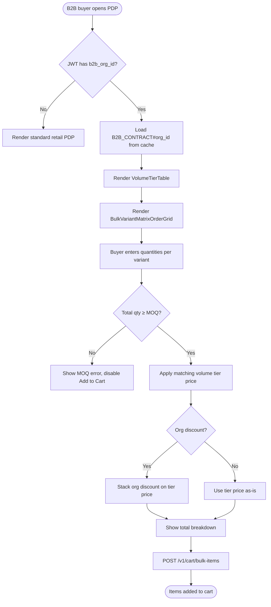

# US-10.1.1: B2B Tiered Volume Pricing & MOQ Enforcement

> **Spec Kit Specification**: [Specification Lifecycle Active (.specify/)](../../../.specify/memory/constitution.md)  
> **Domain Feature**: `commercial-models`  
> **Domain Module**: `b2b-wholesale`  
> **Autonomous Behaviour**: `b2b-tiered-pricing-moq`  
> **Client Framework Path**: `apps/storefront/src/features/commercial-models/modules/b2b-wholesale/behaviours/b2b-tiered-pricing-moq`  
> **Backend Framework Path**: `backend/src/features/commercial-models/modules/b2b-wholesale/behaviours/b2b-tiered-pricing-moq`  
> **Execution Sprint**: [Sprint 3.1](../../sprints/README.md)  
> **Slicing Standard**: [10-PR Vertical Slicing Framework](../../sprints/README.md#the-10-pr-vertical-slicing-standard-aligned-with-10-pillar-system-architecture)  
> **Security Gateway**: [ASVS Level 2 Verification Gate (security-audit)](#5-security-gateway-powered-by-security-audit)

---

## 1. Spec Kit Specification: User Story & Domain Scope

### 1.1 User Story Narrative

**As a** B2B Wholesale Buyer,  
**I want** the PDP to show volume-tier pricing (10–49 units, 50–199 units, 200+ units) and enforce MOQ,  
**So that** my procurement team gets the correct contract pricing for bulk orders.

### 1.2 Acceptance Criteria (Gherkin Scenarios)

```gherkin
Feature: B2B Tiered Pricing & MOQ
  Scenario: [AC-US-10.1.1-01] B2B buyer views tiered pricing
    Given a B2B buyer with org_id="org_99" opens a product page
    Then a VolumeTierTable shows: 25+ units=$42, 100+ units=$36, 200+ units=$30
    And a BulkVariantMatrixOrderGrid allows entering quantities per variant
  Scenario: [AC-US-10.1.1-02] MOQ enforcement
    Given the product has MOQ=25
    When the B2B buyer enters 10 units total across all variants
    Then a validation error "Minimum order quantity is 25 units" is shown
    And the Add to Cart button is disabled
  Scenario: [AC-US-10.1.1-03] Volume tier auto-selection
    Given the buyer enters 120 units
    Then the 100+ tier price ($36) is automatically applied
    And the total shows 120 × $36 = $4,320
  Scenario: [AC-US-10.1.1-04] Org-specific discount
    Given org_99 has a 5% additional contract discount
    Then the displayed price includes both tier pricing and org discount
    And the breakdown shows: Tier $36 - 5% = $34.20/unit
  Scenario: [AC-US-10.1.1-05] B2C buyer sees no B2B pricing
    Given a B2C customer views the same product
    Then no volume tier table or MOQ is shown
    And only the standard retail price appears
  Scenario: [AC-US-10.1.1-LAW] Global e-commerce legal compliance and B2B wholesale pricing regulations
    Given a wholesale buyer purchasing merchandise under tiered volume pricing and minimum order quantities (MOQ)
    When applying volume discounts and enforcing MOQ rules
    Then volume price tiers must be established on objective, economically justifiable cost-of-sale criteria per Robinson-Patman Act
    And wholesale terms, freight thresholds, and minimum order quantities must be published transparently to all verified commercial buyers
    And tiered pricing calculation must properly distinguish between tax-exclusive wholesale net prices and statutory applicable VAT
```

### 1.3 Test Cases & Traceability Matrix

| # | Test Case | Type | Expected Result |
|:--|:----------|:-----|:----------------|
| TC-10.1.1-01 | View tier table | Happy Path | Tiers displayed |
| TC-10.1.1-02 | Qty below MOQ | Validation | Error, button disabled |
| TC-10.1.1-03 | Qty in 100+ tier | Happy Path | Correct price applied |
| TC-10.1.1-04 | Org discount stacked | Happy Path | Tier + org discount |
| TC-10.1.1-05 | B2C sees no B2B | Persona | Retail price only |
| TC-10.1.1-06 | Qty exactly at MOQ | Edge Case | Accepted |
| TC-10.1.1-07 | Qty = 0 | Validation | Error |
| TC-10.1.1-08 | B2B-specific facets | Happy Path | MOQ Range, Lead Time shown |
| TC-10.1.1-LAW | Global legal & regulatory compliance (US Robinson-Patman Act 15 U.S.C. § 13, EU Competition Law non-discrimination, B2B VAT rules) | Legal / Regulatory | Statutory compliance verified with zero legal or regulatory violations |

---

## 2. Behavior-Centric Architecture & Folder Blueprint

This user story is implemented directly inside the respective **Expo client** and **Cargo Lambda Axum backend** frameworks according to the **Locality of Behavior (LoB)** architectural law. Private services, designs, logic, types, and constants are strictly colocated within their framework behaviour directory.

### 2.1 Colocated Behaviour Directory Tree

#### Client Architecture (Universal Expo SDK 58):
```
apps/storefront/src/features/commercial-models/modules/b2b-wholesale/behaviours/b2b-tiered-pricing-moq/
├── services/
│   │   ├── b2b_price_list_engine.rs
│   │   ├── moq_enforcer_service.rs
│   │   ├── b2b_pricing_api.ts
├── designs/
│   │   ├── TieredPricingTable.tsx
│   │   ├── MoqWarningAlert.tsx
│   │   ├── VolumeDiscountBadge.tsx
├── logic/
│   │   ├── useB2bTieredPricing.ts
│   │   ├── tier_threshold_matcher.rs
│   │   ├── minimum_order_evaluator.rs
├── types/
│   │   ├── VolumePriceTier.ts
│   │   ├── MoqRequirement.ts
│   │   ├── B2bPriceQuote.ts
└── constants/
│   │   ├── B2bPricingEndpoints.ts
│   │   ├── DefaultTierThresholds.ts
│   │   ├── PricingErrorCodes.ts
```

#### Backend Architecture (Cargo Lambda + Axum 0.8):
```
backend/src/features/commercial-models/modules/b2b-wholesale/behaviours/b2b-tiered-pricing-moq/
├── services/
│   │   ├── b2b_price_list_engine.rs
│   │   ├── moq_enforcer_service.rs
│   │   ├── b2b_pricing_api.ts
├── logic/
│   │   ├── useB2bTieredPricing.ts
│   │   ├── tier_threshold_matcher.rs
│   │   ├── minimum_order_evaluator.rs
├── types/
│   │   ├── VolumePriceTier.ts
│   │   ├── MoqRequirement.ts
│   │   ├── B2bPriceQuote.ts
└── constants/
│   │   ├── B2bPricingEndpoints.ts
│   │   ├── DefaultTierThresholds.ts
│   │   ├── PricingErrorCodes.ts
```

### 2.2 Scoping & Promotion Blueprint

| Layer / Tier | Client Path (Expo) | Backend Path (Cargo Lambda / Axum) | Purpose & Promotion Rules |
| :--- | :--- | :--- | :--- |
| **Behaviour-Local** | `.../behaviours/b2b-tiered-pricing-moq/` | `.../behaviours/b2b-tiered-pricing-moq/` | **Default Private Scope**: Colocated services, designs, logic, types, and constants private to this story. |
| **Module-Shared** | `.../modules/b2b-wholesale/_shared/` | `.../modules/b2b-wholesale/_shared/` | Shared domain primitives and UI elements used by $\ge 2$ behaviours in `b2b-wholesale`. |
| **Feature-Shared** | `.../features/commercial-models/_shared/` | `.../features/commercial-models/_shared/` | Feature-level contracts, ports, and cross-module bridges across `commercial-models`. |
| **Framework-Shared** | `apps/storefront/src/shared/` | `backend/crates/kernel-core/` | System-wide microkernel traits, `Money` arithmetic, RFC 9110 ETag middleware, and database adapters. |

---

## 3. Technical Implementation Plan (Spec Kit Plan)

### 3.1 Domain Invariants & Storage Schema
- **State Machine**: Enforces valid state transitions and rejects unauthorized or out-of-order mutations.
- **Data Persistence**: Single-table Amazon DynamoDB partitioning (`PK = TENANT#<id>`, `SK = ENTITY#<id>`) paired with reactive local-first WatermelonDB sync.
- **Freshness & Caching**: Multi-tier caching (L1 Moka in-memory + L2 ElastiCache Redis) with RFC 9110 `ETag` conditional `304 Not Modified` short-circuiting.

### 3.2 Activity & Interaction Diagram



---

## 4. Granular Implementation Tasks (Spec Kit Tasks)

### Phase 1: Core Domain Logic, Types & Constants
- [ ] **Task 1.1 (Types)**: Define strongly typed models and DTO schemas in `types/`.
- [ ] **Task 1.2 (Constants)**: Define routes, action codes, and validation limits in `constants/`.
- [ ] **Task 1.3 (Logic)**: Implement pure business logic, calculations, and state machines in `logic/`.
- [ ] **Task 1.4 (Unit Tests)**: Write pure property-based and unit tests verifying domain invariants.

### Phase 2: Services & Infrastructure Adapters
- [ ] **Task 2.1 (API / Gateway)**: Implement client adapters and backend handlers in `services/`.
- [ ] **Task 2.2 (ETag & Cache)**: Integrate RFC 9110 ETag headers and multi-tier caching (Moka L1 / Redis L2).
- [ ] **Task 2.3 (Storage & Sync)**: Implement DynamoDB storage operations and WatermelonDB delta sync.
- [ ] **Task 2.4 (Integration Tests)**: Verify service contract tests and real database conditional writes.

### Phase 3: Platform-Adaptive Designs & UI
- [ ] **Task 3.1 (UI Presentation)**: Build platform-adaptive screens and SDUI components in `designs/`.
- [ ] **Task 3.2 (Headless Hooks)**: Bind headless domain hooks from `logic/` into the UI presentation.
- [ ] **Task 3.3 (i18n & RTL)**: Implement bidirectional RTL/LTR layout mirroring and localized font switching.
- [ ] **Task 3.4 (Component Tests)**: Test empty, loading, offline, and error states across web and mobile.

### Phase 4: Security Gateway Verification & Release Readiness
- [ ] **Task 4.1 (Abuse Testing)**: Execute automated adversarial penetration tests against the threat matrix.
- [ ] **Task 4.2 (Zero-Trust Audit)**: Verify strict tenant isolation and object-level authorization (IDOR).
- [ ] **Task 4.3 (SAST & Audit)**: Run static analysis, dependency audit, and secret scanning.
- [ ] **Task 4.4 (Gate Sign-Off)**: Obtain independent security sign-off for the G2 Security Gateway.

---

## 5. Security Gateway (Powered by security-audit)

### 5.1 Trust Boundaries & Security Actors
- **Trust Boundaries**:
  - `Untrusted Zone`: Mobile client app, public web browser, and external network callers.
  - `Gateway Edge`: AWS CloudFront, API Gateway, and Cognito JWT authentication guard.
  - `Secure Application Boundary`: Axum Tower route extractors enforcing tenant and RBAC/ABAC isolation.
  - `Encrypted Storage & Secret Vault`: Amazon DynamoDB KMS-encrypted tables and AWS KMS vault.
- **Authorized Principals**:
  - Identified Actors: `AuthenticatedCustomer`, `B2bBuyer`, `Vendor`, `StoreAdmin`, or `AnonymousShopper` (read-only).
  - Multi-Tenancy Invariant: Every request must extract `tenant_id` from verified JWT claims. Injections via query params or payload body are rejected with `403 Forbidden`.

### 5.2 Threat Modeling & Abuse Matrix (STRIDE / ASVS)

| Threat Vector | Severity | Vulnerability Mechanism | Mitigating Control & Security Invariant |
| :--- | :--- | :--- | :--- |
| **Spoofing & Impersonation** | Critical | Forged `sub` or `tenant_id` identity claims | Server-side RS256 JWKS signature verification; strict claims extraction in Axum. |
| **Tampering & Invariant Bypass** | High | Manipulating payload parameters or prices | Authoritative server recalculation; strict schema validation; BLAKE3 ETag integrity checks. |
| **Information Disclosure (IDOR)** | Critical | Cross-tenant or cross-user data scraping | Explicit `PK = TENANT#<id>` partition filtering on every database and cache operation. |
| **Denial of Service / Abuse** | High | Manipulating quantity in order cart to unlock wholesale price and then cancelling split items | Token-bucket rate limiting per IP and account; strict input length validation. |
| **Elevation of Privilege** | Critical | Bypassing role-based permission checks | Tower extractors (`RequireStoreAdmin`, `RequireVendor`) guard sensitive endpoints. |

### 5.3 Cryptographic & Data Protection Controls
- **Encryption in Transit**: TLS 1.3 enforced on all external and internal endpoints; HSTS active.
- **Encryption at Rest**: DynamoDB AWS KMS customer-managed keys; AES-256-GCM for sensitive client tokens in `expo-secure-store`.
- **PII & Secret Redaction**: Passwords, OTPs, auth tokens, and credit card numbers are stripped from logs and traces via `tracing` redaction filters.

### 5.4 Automated Security Verification Checklist
- [ ] **SAST Analysis**: Clean report from static code analyzers; 0 high or critical vulnerabilities.
- [ ] **Dependency Audit**: `cargo deny` and `bun audit` pass with 0 unreviewed security advisories.
- [ ] **Abuse & IDOR Fuzzing**: Test suite confirms that requests with modified `tenant_id` or `user_id` fail with `401 Unauthorized` or `403 Forbidden`.
- [ ] **Secret Scanning**: Gitleaks scanner confirms zero hardcoded credentials, API keys, or private keys.

### 5.5 Security Gateway (G2) Sign-Off Checklist
- [ ] Threat boundary and entry points verified against OWASP ASVS Level 2 requirements.
- [ ] Multi-tenant isolation verified with automated cross-tenant penetration test.
- [ ] Anti-abuse and rate limiting confirmed active on all public interfaces.
- [ ] Audit log redaction verified — zero plaintext secrets in output logs.
- [ ] Independent reviewer sign-off obtained; zero open Critical or High findings.

---

## 6. Validation Gates & Acceptance Sign-Off

**Status: Pending — specification only; no implementation evidence.** All [G0–G4 quality gates + G-Review + G-Borrow + G-UI + G-Law](../../QUALITY_GATES.md) apply to this story. The following checks add to its acceptance criteria and test cases; they do not replace them.

### G1 — Test coverage
- [ ] **US-10.1.1-G1:** Automated test suite maps 100% of acceptance criteria and test cases with >=90% line and >=85% branch coverage in affected packages.

### G2 — Security audit
- [ ] **US-10.1.1-G2:** Verify zero-trust tenant isolation, object-level authorization (IDOR), and defense against Manipulating quantity in order cart to unlock wholesale price and then cancelling split items. No unresolved critical or high findings.

### G3 — Architecture and maintainability
- [ ] **US-10.1.1-G3:** Strict compliance with framework colocation (`apps/storefront/src/features/` or `backend/src/features/`), zero-clone borrowing discipline in Rust, and clean domain boundaries.

### G-Review — Code review
- [ ] **US-10.1.1-G-Review:** Independent senior code review signed off by the Code Reviewer; verification across Correctness, Security, Maintainability, Performance, and Testing using the Agency-Agents code review standard; zero open Blocker or unresolved Suggestion findings.

### G-Borrow — Rust zero-clone borrowing validation
- [ ] **US-10.1.1-G-Borrow:** Backend code relies strictly on borrowing (&T, &mut T), explicit lifetimes, zero-copy byte buffers (bytes::Bytes), and zero unauthorized deep .clone() calls on domain entities and models (Arc::clone and Rc::clone pointer copies permitted only); certified by systems reviewer.

### G-UI — UI/UX validation
- [ ] **US-10.1.1-G-UI:** Pure separation of presentation (designs/, owned by ui-ux-designer) and headless hooks (logic/, owned by client-engineer); mobile components use @expo/ui primitives and native modules; web components use semantic HTML5 styled with Tailwind CSS; WCAG 2.1 AA and Arabic RTL layout parity verified; certified by UI/UX designer.

### G-Law — Law validation
- [ ] **US-10.1.1-G-Law:** Independent verification against global e-commerce legal and statutory requirements: US Robinson-Patman Act commercial pricing justification, EU antitrust non-discrimination principles, and B2B VAT calculation rules; certified by compliance reviewer (`agency-legal-compliance-checker`).

### G4 — Integrated acceptance
- [ ] **US-10.1.1-G4:** End-to-end user journey validation across supported platforms (Web, iOS, Android) and verified sandbox integration.

---

[← Back to Module b2b-wholesale Catalog (README.md)](README.md) | [Master User Stories Index](../README.md)
