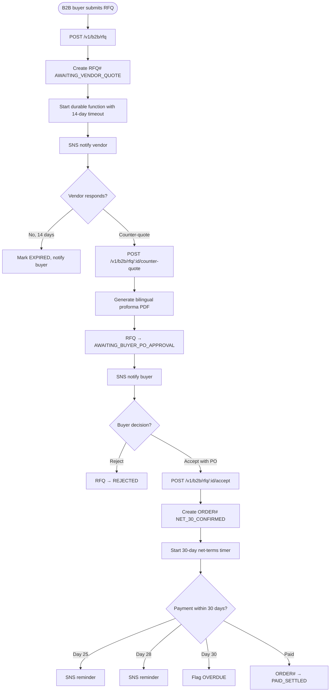

# US-10.1.2: Durable RFQ Negotiation & Net-Terms Invoicing

> **Spec Kit Specification**: [Specification Lifecycle Active (.specify/)](../../../.specify/memory/constitution.md)  
> **Domain Feature**: `commercial-models`  
> **Domain Module**: `b2b-wholesale`  
> **Autonomous Behaviour**: `durable-rfq-negotiation-net-terms-invoicing`  
> **Client Framework Path**: `apps/storefront/src/features/commercial-models/modules/b2b-wholesale/behaviours/durable-rfq-negotiation-net-terms-invoicing`  
> **Backend Framework Path**: `backend/src/features/commercial-models/modules/b2b-wholesale/behaviours/durable-rfq-negotiation-net-terms-invoicing`  
> **Execution Sprint**: [Sprint 3.2](../../sprints/README.md)  
> **Slicing Standard**: [10-PR Vertical Slicing Framework](../../sprints/README.md#the-10-pr-vertical-slicing-standard-aligned-with-10-pillar-system-architecture)  
> **Security Gateway**: [ASVS Level 2 Verification Gate (security-audit)](#5-security-gateway-powered-by-security-audit)

---

## 1. Spec Kit Specification: User Story & Domain Scope

### 1.1 User Story Narrative

**As a** B2B Buyer and Vendor,  
**I want to** submit RFQs, negotiate custom pricing and Net-30/Net-60 terms, and generate bilingual proforma invoices,  
**So that** large wholesale deals can be negotiated and converted to orders.

### 1.2 Acceptance Criteria (Gherkin Scenarios)

```gherkin
Feature: RFQ Negotiation
  Scenario: [AC-US-10.1.2-01] Submit RFQ
    When the buyer submits an RFQ for 500 units with target price $32 and Net-30
    Then RFQ#rfq_101 is created with status AWAITING_VENDOR_QUOTE
    And a durable function checkpoints the RFQ with zero idle cost
  Scenario: [AC-US-10.1.2-02] Vendor counter-quote
    When the vendor submits a counter-quote at $34.50/unit valid 7 days
    Then the RFQ status updates to AWAITING_BUYER_PO_APPROVAL
    And a bilingual proforma PDF is generated
  Scenario: [AC-US-10.1.2-03] Buyer approves with PO
    When the B2B_ORG_ADMIN clicks "Approve with PO #PO-8841"
    Then ORDER#ord_901 is created with status NET_30_CONFIRMED
    And a 30-day durable timer starts for Net-30 payment
  Scenario: [AC-US-10.1.2-04] RFQ expired
    Given the vendor doesn't respond within 14 days
    Then the durable function marks RFQ as EXPIRED
    And the buyer is notified
  Scenario: [AC-US-10.1.2-05] Net-30 payment overdue
    Given the Net-30 term expires without payment
    Then SNS reminders are sent at day 25, 28, and 30
    And after day 30, the order is flagged as OVERDUE
  Scenario: [AC-US-10.1.2-LAW] Global e-commerce legal compliance and B2B commercial invoicing regulations
    Given a B2B buyer and vendor negotiating customized quotes (RFQ) and agreeing to net-30/net-60 payment terms
    When generating the finalized purchase contract and issuing commercial net-terms invoices
    Then agreed quotes must constitute legally binding commercial contracts with explicit cryptographic acceptance timestamps
    And net-terms invoices must state statutory late payment interest rates and recovery costs mandated under the EU Late Payment Directive
    And commercial tax invoices must include complete seller and buyer corporate tax IDs, sequential numbering, and reverse-charge notices
```

### 1.3 Test Cases & Traceability Matrix

| # | Test Case | Type | Expected Result |
|:--|:----------|:-----|:----------------|
| TC-10.1.2-01 | Submit RFQ | Happy Path | RFQ created, vendor notified |
| TC-10.1.2-02 | Counter-quote | Happy Path | Status updated, PDF generated |
| TC-10.1.2-03 | Approve with PO | Happy Path | Order created |
| TC-10.1.2-04 | RFQ timeout 14 days | Edge Case | EXPIRED status |
| TC-10.1.2-05 | Net-30 SNS reminders | Happy Path | 3 reminders sent |
| TC-10.1.2-06 | Multiple counter-quotes | Happy Path | Latest offer applies |
| TC-10.1.2-07 | Buyer rejects counter | Happy Path | RFQ → REJECTED |
| TC-10.1.2-08 | Bilingual PDF content | i18n | Arabic + English |
| TC-10.1.2-09 | Concurrent PO approvals | Concurrency | Only one succeeds |
| TC-10.1.2-10 | B2B milestone deposit (30% upfront) | Happy Path | Deposit required |
| TC-10.1.2-LAW | Global legal & regulatory compliance (EU Late Payment Directive 2011/7/EU statutory interest, UN CISG binding contracts, VAT e-invoicing) | Legal / Regulatory | Statutory compliance verified with zero legal or regulatory violations |

---

## 2. Behavior-Centric Architecture & Folder Blueprint

This user story is implemented directly inside the respective **Expo client** and **Cargo Lambda Axum backend** frameworks according to the **Locality of Behavior (LoB)** architectural law. Private services, designs, logic, types, and constants are strictly colocated within their framework behaviour directory.

### 2.1 Colocated Behaviour Directory Tree

#### Client Architecture (Universal Expo SDK 58):
```
apps/storefront/src/features/commercial-models/modules/b2b-wholesale/behaviours/durable-rfq-negotiation-net-terms-invoicing/
├── services/
│   │   ├── rfq_negotiation_service.rs
│   │   ├── net_terms_invoice_generator.rs
│   │   ├── rfq_api.ts
├── designs/
│   │   ├── RfqCreationScreen.tsx
│   │   ├── BidNegotiationThread.tsx
│   │   ├── NetTermsInvoiceView.tsx
├── logic/
│   │   ├── useB2bRfq.ts
│   │   ├── credit_limit_verifier.rs
│   │   ├── payment_terms_state_machine.rs
├── types/
│   │   ├── RfqProposal.ts
│   │   ├── QuoteCounterOffer.ts
│   │   ├── NetTermsInvoice.ts
└── constants/
│   │   ├── RfqEndpoints.ts
│   │   ├── AllowedPaymentTerms.ts
│   │   ├── RfqErrorCodes.ts
```

#### Backend Architecture (Cargo Lambda + Axum 0.8):
```
backend/src/features/commercial-models/modules/b2b-wholesale/behaviours/durable-rfq-negotiation-net-terms-invoicing/
├── services/
│   │   ├── rfq_negotiation_service.rs
│   │   ├── net_terms_invoice_generator.rs
│   │   ├── rfq_api.ts
├── logic/
│   │   ├── useB2bRfq.ts
│   │   ├── credit_limit_verifier.rs
│   │   ├── payment_terms_state_machine.rs
├── types/
│   │   ├── RfqProposal.ts
│   │   ├── QuoteCounterOffer.ts
│   │   ├── NetTermsInvoice.ts
└── constants/
│   │   ├── RfqEndpoints.ts
│   │   ├── AllowedPaymentTerms.ts
│   │   ├── RfqErrorCodes.ts
```

### 2.2 Scoping & Promotion Blueprint

| Layer / Tier | Client Path (Expo) | Backend Path (Cargo Lambda / Axum) | Purpose & Promotion Rules |
| :--- | :--- | :--- | :--- |
| **Behaviour-Local** | `.../behaviours/durable-rfq-negotiation-net-terms-invoicing/` | `.../behaviours/durable-rfq-negotiation-net-terms-invoicing/` | **Default Private Scope**: Colocated services, designs, logic, types, and constants private to this story. |
| **Module-Shared** | `.../modules/b2b-wholesale/_shared/` | `.../modules/b2b-wholesale/_shared/` | Shared domain primitives and UI elements used by $\ge 2$ behaviours in `b2b-wholesale`. |
| **Feature-Shared** | `.../features/commercial-models/_shared/` | `.../features/commercial-models/_shared/` | Feature-level contracts, ports, and cross-module bridges across `commercial-models`. |
| **Framework-Shared** | `apps/storefront/src/shared/` | `backend/crates/kernel-core/` | System-wide microkernel traits, `Money` arithmetic, RFC 9110 ETag middleware, and database adapters. |

---

## 3. Technical Implementation Plan (Spec Kit Plan)

### 3.1 Domain Invariants & Storage Schema
- **State Machine**: Enforces valid state transitions and rejects unauthorized or out-of-order mutations.
- **Data Persistence**: Single-table Amazon DynamoDB partitioning (`PK = TENANT#<id>`, `SK = ENTITY#<id>`) paired with reactive local-first WatermelonDB sync.
- **Freshness & Caching**: Multi-tier caching (L1 Moka in-memory + L2 ElastiCache Redis) with RFC 9110 `ETag` conditional `304 Not Modified` short-circuiting.

### 3.2 Activity & Interaction Diagram



---

## 4. Granular Implementation Tasks (Spec Kit Tasks)

### Phase 1: Core Domain Logic, Types & Constants
- [ ] **Task 1.1 (Types)**: Define strongly typed models and DTO schemas in `types/`.
- [ ] **Task 1.2 (Constants)**: Define routes, action codes, and validation limits in `constants/`.
- [ ] **Task 1.3 (Logic)**: Implement pure business logic, calculations, and state machines in `logic/`.
- [ ] **Task 1.4 (Unit Tests)**: Write pure property-based and unit tests verifying domain invariants.

### Phase 2: Services & Infrastructure Adapters
- [ ] **Task 2.1 (API / Gateway)**: Implement client adapters and backend handlers in `services/`.
- [ ] **Task 2.2 (ETag & Cache)**: Integrate RFC 9110 ETag headers and multi-tier caching (Moka L1 / Redis L2).
- [ ] **Task 2.3 (Storage & Sync)**: Implement DynamoDB storage operations and WatermelonDB delta sync.
- [ ] **Task 2.4 (Integration Tests)**: Verify service contract tests and real database conditional writes.

### Phase 3: Platform-Adaptive Designs & UI
- [ ] **Task 3.1 (UI Presentation)**: Build platform-adaptive screens and SDUI components in `designs/`.
- [ ] **Task 3.2 (Headless Hooks)**: Bind headless domain hooks from `logic/` into the UI presentation.
- [ ] **Task 3.3 (i18n & RTL)**: Implement bidirectional RTL/LTR layout mirroring and localized font switching.
- [ ] **Task 3.4 (Component Tests)**: Test empty, loading, offline, and error states across web and mobile.

### Phase 4: Security Gateway Verification & Release Readiness
- [ ] **Task 4.1 (Abuse Testing)**: Execute automated adversarial penetration tests against the threat matrix.
- [ ] **Task 4.2 (Zero-Trust Audit)**: Verify strict tenant isolation and object-level authorization (IDOR).
- [ ] **Task 4.3 (SAST & Audit)**: Run static analysis, dependency audit, and secret scanning.
- [ ] **Task 4.4 (Gate Sign-Off)**: Obtain independent security sign-off for the G2 Security Gateway.

---

## 5. Security Gateway (Powered by security-audit)

### 5.1 Trust Boundaries & Security Actors
- **Trust Boundaries**:
  - `Untrusted Zone`: Mobile client app, public web browser, and external network callers.
  - `Gateway Edge`: AWS CloudFront, API Gateway, and Cognito JWT authentication guard.
  - `Secure Application Boundary`: Axum Tower route extractors enforcing tenant and RBAC/ABAC isolation.
  - `Encrypted Storage & Secret Vault`: Amazon DynamoDB KMS-encrypted tables and AWS KMS vault.
- **Authorized Principals**:
  - Identified Actors: `AuthenticatedCustomer`, `B2bBuyer`, `Vendor`, `StoreAdmin`, or `AnonymousShopper` (read-only).
  - Multi-Tenancy Invariant: Every request must extract `tenant_id` from verified JWT claims. Injections via query params or payload body are rejected with `403 Forbidden`.

### 5.2 Threat Modeling & Abuse Matrix (STRIDE / ASVS)

| Threat Vector | Severity | Vulnerability Mechanism | Mitigating Control & Security Invariant |
| :--- | :--- | :--- | :--- |
| **Spoofing & Impersonation** | Critical | Forged `sub` or `tenant_id` identity claims | Server-side RS256 JWKS signature verification; strict claims extraction in Axum. |
| **Tampering & Invariant Bypass** | High | Manipulating payload parameters or prices | Authoritative server recalculation; strict schema validation; BLAKE3 ETag integrity checks. |
| **Information Disclosure (IDOR)** | Critical | Cross-tenant or cross-user data scraping | Explicit `PK = TENANT#<id>` partition filtering on every database and cache operation. |
| **Denial of Service / Abuse** | High | Exceeding approved corporate credit limit, unauthorized quotation approval by non-procurement officers | Token-bucket rate limiting per IP and account; strict input length validation. |
| **Elevation of Privilege** | Critical | Bypassing role-based permission checks | Tower extractors (`RequireStoreAdmin`, `RequireVendor`) guard sensitive endpoints. |

### 5.3 Cryptographic & Data Protection Controls
- **Encryption in Transit**: TLS 1.3 enforced on all external and internal endpoints; HSTS active.
- **Encryption at Rest**: DynamoDB AWS KMS customer-managed keys; AES-256-GCM for sensitive client tokens in `expo-secure-store`.
- **PII & Secret Redaction**: Passwords, OTPs, auth tokens, and credit card numbers are stripped from logs and traces via `tracing` redaction filters.

### 5.4 Automated Security Verification Checklist
- [ ] **SAST Analysis**: Clean report from static code analyzers; 0 high or critical vulnerabilities.
- [ ] **Dependency Audit**: `cargo deny` and `bun audit` pass with 0 unreviewed security advisories.
- [ ] **Abuse & IDOR Fuzzing**: Test suite confirms that requests with modified `tenant_id` or `user_id` fail with `401 Unauthorized` or `403 Forbidden`.
- [ ] **Secret Scanning**: Gitleaks scanner confirms zero hardcoded credentials, API keys, or private keys.

### 5.5 Security Gateway (G2) Sign-Off Checklist
- [ ] Threat boundary and entry points verified against OWASP ASVS Level 2 requirements.
- [ ] Multi-tenant isolation verified with automated cross-tenant penetration test.
- [ ] Anti-abuse and rate limiting confirmed active on all public interfaces.
- [ ] Audit log redaction verified — zero plaintext secrets in output logs.
- [ ] Independent reviewer sign-off obtained; zero open Critical or High findings.

---

## 6. Validation Gates & Acceptance Sign-Off

**Status: Pending — specification only; no implementation evidence.** All [G0–G4 quality gates + G-Review + G-Borrow + G-UI + G-Law](../../QUALITY_GATES.md) apply to this story. The following checks add to its acceptance criteria and test cases; they do not replace them.

### G1 — Test coverage
- [ ] **US-10.1.2-G1:** Automated test suite maps 100% of acceptance criteria and test cases with >=90% line and >=85% branch coverage in affected packages.

### G2 — Security audit
- [ ] **US-10.1.2-G2:** Verify zero-trust tenant isolation, object-level authorization (IDOR), and defense against Exceeding approved corporate credit limit, unauthorized quotation approval by non-procurement officers. No unresolved critical or high findings.

### G3 — Architecture and maintainability
- [ ] **US-10.1.2-G3:** Strict compliance with framework colocation (`apps/storefront/src/features/` or `backend/src/features/`), zero-clone borrowing discipline in Rust, and clean domain boundaries.

### G-Review — Code review
- [ ] **US-10.1.2-G-Review:** Independent senior code review signed off by the Code Reviewer; verification across Correctness, Security, Maintainability, Performance, and Testing using the Agency-Agents code review standard; zero open Blocker or unresolved Suggestion findings.

### G-Borrow — Rust zero-clone borrowing validation
- [ ] **US-10.1.2-G-Borrow:** Backend code relies strictly on borrowing (&T, &mut T), explicit lifetimes, zero-copy byte buffers (bytes::Bytes), and zero unauthorized deep .clone() calls on domain entities and models (Arc::clone and Rc::clone pointer copies permitted only); certified by systems reviewer.

### G-UI — UI/UX validation
- [ ] **US-10.1.2-G-UI:** Pure separation of presentation (designs/, owned by ui-ux-designer) and headless hooks (logic/, owned by client-engineer); mobile components use @expo/ui primitives and native modules; web components use semantic HTML5 styled with Tailwind CSS; WCAG 2.1 AA and Arabic RTL layout parity verified; certified by UI/UX designer.

### G-Law — Law validation
- [ ] **US-10.1.2-G-Law:** Independent verification against global e-commerce legal and statutory requirements: EU Late Payment Directive (Directive 2011/7/EU), commercial contract formation rules (UN CISG), and statutory reverse-charge VAT invoicing; certified by compliance reviewer (`agency-legal-compliance-checker`).

### G4 — Integrated acceptance
- [ ] **US-10.1.2-G4:** End-to-end user journey validation across supported platforms (Web, iOS, Android) and verified sandbox integration.

---

[← Back to Module b2b-wholesale Catalog (README.md)](README.md) | [Master User Stories Index](../README.md)
