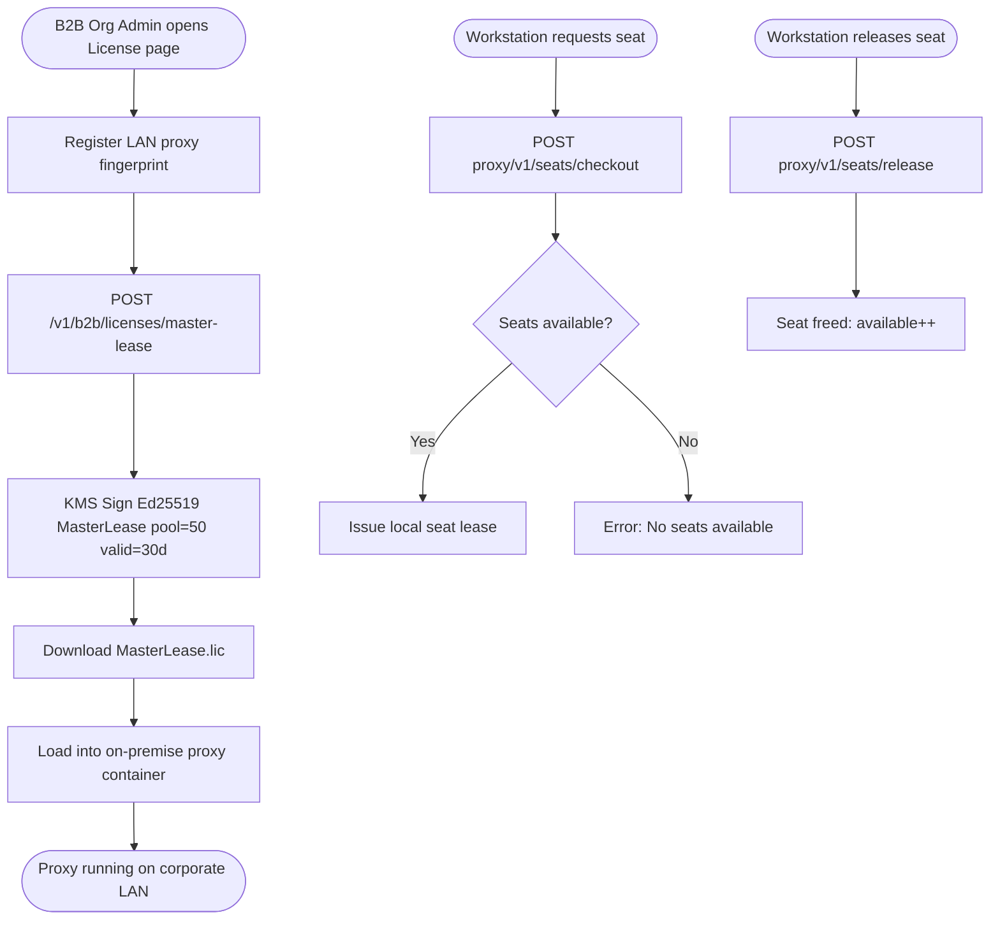

# US-10.1.4: B2B On-Premise LAN License Proxy

> **Spec Kit Specification**: [Specification Lifecycle Active (.specify/)](../../../.specify/memory/constitution.md)  
> **Domain Feature**: `commercial-models`  
> **Domain Module**: `b2b-wholesale`  
> **Autonomous Behaviour**: `b2b-on-premise-lan-license-proxy`  
> **Client Framework Path**: `apps/storefront/src/features/commercial-models/modules/b2b-wholesale/behaviours/b2b-on-premise-lan-license-proxy`  
> **Backend Framework Path**: `backend/src/features/commercial-models/modules/b2b-wholesale/behaviours/b2b-on-premise-lan-license-proxy`  
> **Execution Sprint**: [Sprint 3.2](../../sprints/README.md)  
> **Slicing Standard**: [10-PR Vertical Slicing Framework](../../sprints/README.md#the-10-pr-vertical-slicing-standard-aligned-with-10-pillar-system-architecture)  
> **Security Gateway**: [ASVS Level 2 Verification Gate (security-audit)](#5-security-gateway-powered-by-security-audit)

---

## 1. Spec Kit Specification: User Story & Domain Scope

### 1.1 User Story Narrative

**As a** B2B Organization Admin,  
**I want to** deploy a lightweight LAN license proxy container in my corporate network with a KMS-signed master lease,  
**So that** internal workstations can check out floating seats without individual internet access.

### 1.2 Acceptance Criteria (Gherkin Scenarios)

```gherkin
Feature: LAN License Proxy
  Scenario: [AC-US-10.1.4-01] Generate master lease
    Given the B2B_ORG_ADMIN registers a LAN proxy fingerprint
    When they click "Generate 50-Seat Master Lease"
    Then a 30-day Ed25519-signed MasterLease.lic is generated via KMS
    And downloaded for loading into the proxy container
  Scenario: [AC-US-10.1.4-02] Seat checkout over LAN
    Given the proxy is running with a valid MasterLease.lic
    When a workstation sends POST /v1/seats/checkout
    Then a local seat lease is issued (e.g., Seats Used: 1/50)
    And no internet connection is required
  Scenario: [AC-US-10.1.4-03] Seat release
    When the workstation sends POST /v1/seats/release
    Then the seat is freed for another workstation
  Scenario: [AC-US-10.1.4-04] All seats consumed
    Given 50/50 seats are checked out
    When another workstation requests checkout
    Then "No seats available" error is returned
  Scenario: [AC-US-10.1.4-05] Master lease expired
    Given the MasterLease.lic has expired after 30 days
    Then all new checkouts are denied
    And existing checked-out seats continue until their sub-lease expires
  Scenario: [AC-US-10.1.4-LAW] Global e-commerce legal compliance and dual-use technology export regulations
    Given an enterprise deploying an on-premise LAN license proxy for internal floating license management
    When distributing and leasing cryptographic license tokens within the corporate intranet
    Then cryptographic software distribution must comply with international export controls and dual-use technology regulations (EAR)
    And internal license proxy telemetry must remain strictly within the enterprise security perimeter to ensure corporate data sovereignty
    And offline leasing mechanisms must adhere to contracted license seat maximums without unauthorized remote key disablement
```

### 1.3 Test Cases & Traceability Matrix

| # | Test Case | Type | Expected Result |
|:--|:----------|:-----|:----------------|
| TC-10.1.4-01 | Generate master lease | Happy Path | 30-day .lic created |
| TC-10.1.4-02 | Seat checkout | Happy Path | Seat issued |
| TC-10.1.4-03 | Seat release | Happy Path | Seat freed |
| TC-10.1.4-04 | 50/50 seats consumed | Edge Case | Checkout denied |
| TC-10.1.4-05 | Expired master lease | Edge Case | New checkouts denied |
| TC-10.1.4-06 | Tampered MasterLease | Security | Signature invalid |
| TC-10.1.4-07 | Proxy offline for 48h | Edge Case | Existing leases valid |
| TC-10.1.4-LAW | Global legal & regulatory compliance (US Export Administration Regulations EAR, Wassenaar cryptographic controls, enterprise data sovereignty) | Legal / Regulatory | Statutory compliance verified with zero legal or regulatory violations |

---

## 2. Behavior-Centric Architecture & Folder Blueprint

This user story is implemented directly inside the respective **Expo client** and **Cargo Lambda Axum backend** frameworks according to the **Locality of Behavior (LoB)** architectural law. Private services, designs, logic, types, and constants are strictly colocated within their framework behaviour directory.

### 2.1 Colocated Behaviour Directory Tree

#### Client Architecture (Universal Expo SDK 58):
```
apps/storefront/src/features/commercial-models/modules/b2b-wholesale/behaviours/b2b-on-premise-lan-license-proxy/
├── services/
│   │   ├── lan_proxy_server.rs
│   │   ├── air_gapped_heartbeat_sync.rs
│   │   ├── lan_proxy_api.ts
├── designs/
│   │   ├── LanProxyConfigScreen.tsx
│   │   ├── ConnectedClientsTable.tsx
│   │   ├── LeaseExpirationMeter.tsx
├── logic/
│   │   ├── useB2bLanProxy.ts
│   │   ├── local_lease_allocator.rs
│   │   ├── tamper_proof_token_issuer.rs
├── types/
│   │   ├── LanProxyLease.ts
│   │   ├── ConnectedClientRecord.ts
│   │   ├── AirGappedAuditLog.ts
└── constants/
│   │   ├── LanProxyPorts.ts
│   │   ├── MaxLeaseDurationMinutes.ts
│   │   ├── LanProxyErrors.ts
```

#### Backend Architecture (Cargo Lambda + Axum 0.8):
```
backend/src/features/commercial-models/modules/b2b-wholesale/behaviours/b2b-on-premise-lan-license-proxy/
├── services/
│   │   ├── lan_proxy_server.rs
│   │   ├── air_gapped_heartbeat_sync.rs
│   │   ├── lan_proxy_api.ts
├── logic/
│   │   ├── useB2bLanProxy.ts
│   │   ├── local_lease_allocator.rs
│   │   ├── tamper_proof_token_issuer.rs
├── types/
│   │   ├── LanProxyLease.ts
│   │   ├── ConnectedClientRecord.ts
│   │   ├── AirGappedAuditLog.ts
└── constants/
│   │   ├── LanProxyPorts.ts
│   │   ├── MaxLeaseDurationMinutes.ts
│   │   ├── LanProxyErrors.ts
```

### 2.2 Scoping & Promotion Blueprint

| Layer / Tier | Client Path (Expo) | Backend Path (Cargo Lambda / Axum) | Purpose & Promotion Rules |
| :--- | :--- | :--- | :--- |
| **Behaviour-Local** | `.../behaviours/b2b-on-premise-lan-license-proxy/` | `.../behaviours/b2b-on-premise-lan-license-proxy/` | **Default Private Scope**: Colocated services, designs, logic, types, and constants private to this story. |
| **Module-Shared** | `.../modules/b2b-wholesale/_shared/` | `.../modules/b2b-wholesale/_shared/` | Shared domain primitives and UI elements used by $\ge 2$ behaviours in `b2b-wholesale`. |
| **Feature-Shared** | `.../features/commercial-models/_shared/` | `.../features/commercial-models/_shared/` | Feature-level contracts, ports, and cross-module bridges across `commercial-models`. |
| **Framework-Shared** | `apps/storefront/src/shared/` | `backend/crates/kernel-core/` | System-wide microkernel traits, `Money` arithmetic, RFC 9110 ETag middleware, and database adapters. |

---

## 3. Technical Implementation Plan (Spec Kit Plan)

### 3.1 Domain Invariants & Storage Schema
- **State Machine**: Enforces valid state transitions and rejects unauthorized or out-of-order mutations.
- **Data Persistence**: Single-table Amazon DynamoDB partitioning (`PK = TENANT#<id>`, `SK = ENTITY#<id>`) paired with reactive local-first WatermelonDB sync.
- **Freshness & Caching**: Multi-tier caching (L1 Moka in-memory + L2 ElastiCache Redis) with RFC 9110 `ETag` conditional `304 Not Modified` short-circuiting.

### 3.2 Activity & Interaction Diagram



---

## 4. Granular Implementation Tasks (Spec Kit Tasks)

### Phase 1: Core Domain Logic, Types & Constants
- [ ] **Task 1.1 (Types)**: Define strongly typed models and DTO schemas in `types/`.
- [ ] **Task 1.2 (Constants)**: Define routes, action codes, and validation limits in `constants/`.
- [ ] **Task 1.3 (Logic)**: Implement pure business logic, calculations, and state machines in `logic/`.
- [ ] **Task 1.4 (Unit Tests)**: Write pure property-based and unit tests verifying domain invariants.

### Phase 2: Services & Infrastructure Adapters
- [ ] **Task 2.1 (API / Gateway)**: Implement client adapters and backend handlers in `services/`.
- [ ] **Task 2.2 (ETag & Cache)**: Integrate RFC 9110 ETag headers and multi-tier caching (Moka L1 / Redis L2).
- [ ] **Task 2.3 (Storage & Sync)**: Implement DynamoDB storage operations and WatermelonDB delta sync.
- [ ] **Task 2.4 (Integration Tests)**: Verify service contract tests and real database conditional writes.

### Phase 3: Platform-Adaptive Designs & UI
- [ ] **Task 3.1 (UI Presentation)**: Build platform-adaptive screens and SDUI components in `designs/`.
- [ ] **Task 3.2 (Headless Hooks)**: Bind headless domain hooks from `logic/` into the UI presentation.
- [ ] **Task 3.3 (i18n & RTL)**: Implement bidirectional RTL/LTR layout mirroring and localized font switching.
- [ ] **Task 3.4 (Component Tests)**: Test empty, loading, offline, and error states across web and mobile.

### Phase 4: Security Gateway Verification & Release Readiness
- [ ] **Task 4.1 (Abuse Testing)**: Execute automated adversarial penetration tests against the threat matrix.
- [ ] **Task 4.2 (Zero-Trust Audit)**: Verify strict tenant isolation and object-level authorization (IDOR).
- [ ] **Task 4.3 (SAST & Audit)**: Run static analysis, dependency audit, and secret scanning.
- [ ] **Task 4.4 (Gate Sign-Off)**: Obtain independent security sign-off for the G2 Security Gateway.

---

## 5. Security Gateway (Powered by security-audit)

### 5.1 Trust Boundaries & Security Actors
- **Trust Boundaries**:
  - `Untrusted Zone`: Mobile client app, public web browser, and external network callers.
  - `Gateway Edge`: AWS CloudFront, API Gateway, and Cognito JWT authentication guard.
  - `Secure Application Boundary`: Axum Tower route extractors enforcing tenant and RBAC/ABAC isolation.
  - `Encrypted Storage & Secret Vault`: Amazon DynamoDB KMS-encrypted tables and AWS KMS vault.
- **Authorized Principals**:
  - Identified Actors: `AuthenticatedCustomer`, `B2bBuyer`, `Vendor`, `StoreAdmin`, or `AnonymousShopper` (read-only).
  - Multi-Tenancy Invariant: Every request must extract `tenant_id` from verified JWT claims. Injections via query params or payload body are rejected with `403 Forbidden`.

### 5.2 Threat Modeling & Abuse Matrix (STRIDE / ASVS)

| Threat Vector | Severity | Vulnerability Mechanism | Mitigating Control & Security Invariant |
| :--- | :--- | :--- | :--- |
| **Spoofing & Impersonation** | Critical | Forged `sub` or `tenant_id` identity claims | Server-side RS256 JWKS signature verification; strict claims extraction in Axum. |
| **Tampering & Invariant Bypass** | High | Manipulating payload parameters or prices | Authoritative server recalculation; strict schema validation; BLAKE3 ETag integrity checks. |
| **Information Disclosure (IDOR)** | Critical | Cross-tenant or cross-user data scraping | Explicit `PK = TENANT#<id>` partition filtering on every database and cache operation. |
| **Denial of Service / Abuse** | High | LAN replay attacks, forged local lease tokens, and exceeding enterprise contract concurrency caps | Token-bucket rate limiting per IP and account; strict input length validation. |
| **Elevation of Privilege** | Critical | Bypassing role-based permission checks | Tower extractors (`RequireStoreAdmin`, `RequireVendor`) guard sensitive endpoints. |

### 5.3 Cryptographic & Data Protection Controls
- **Encryption in Transit**: TLS 1.3 enforced on all external and internal endpoints; HSTS active.
- **Encryption at Rest**: DynamoDB AWS KMS customer-managed keys; AES-256-GCM for sensitive client tokens in `expo-secure-store`.
- **PII & Secret Redaction**: Passwords, OTPs, auth tokens, and credit card numbers are stripped from logs and traces via `tracing` redaction filters.

### 5.4 Automated Security Verification Checklist
- [ ] **SAST Analysis**: Clean report from static code analyzers; 0 high or critical vulnerabilities.
- [ ] **Dependency Audit**: `cargo deny` and `bun audit` pass with 0 unreviewed security advisories.
- [ ] **Abuse & IDOR Fuzzing**: Test suite confirms that requests with modified `tenant_id` or `user_id` fail with `401 Unauthorized` or `403 Forbidden`.
- [ ] **Secret Scanning**: Gitleaks scanner confirms zero hardcoded credentials, API keys, or private keys.

### 5.5 Security Gateway (G2) Sign-Off Checklist
- [ ] Threat boundary and entry points verified against OWASP ASVS Level 2 requirements.
- [ ] Multi-tenant isolation verified with automated cross-tenant penetration test.
- [ ] Anti-abuse and rate limiting confirmed active on all public interfaces.
- [ ] Audit log redaction verified — zero plaintext secrets in output logs.
- [ ] Independent reviewer sign-off obtained; zero open Critical or High findings.

---

## 6. Validation Gates & Acceptance Sign-Off

**Status: Pending — specification only; no implementation evidence.** All [G0–G4 quality gates + G-Review + G-Law](../../QUALITY_GATES.md) apply to this story. The following checks add to its acceptance criteria and test cases; they do not replace them.

### G1 — Test coverage
- [ ] **US-10.1.4-G1:** Automated test suite maps 100% of acceptance criteria and test cases with >=90% line and >=85% branch coverage in affected packages.

### G2 — Security audit
- [ ] **US-10.1.4-G2:** Verify zero-trust tenant isolation, object-level authorization (IDOR), and defense against LAN replay attacks, forged local lease tokens, and exceeding enterprise contract concurrency caps. No unresolved critical or high findings.

### G3 — Architecture and maintainability
- [ ] **US-10.1.4-G3:** Strict compliance with framework colocation (`apps/storefront/src/features/` or `backend/src/features/`), zero-clone borrowing discipline in Rust, and clean domain boundaries.

### G-Review — Code review
- [ ] **US-10.1.4-G-Review:** Independent senior code review signed off by the Code Reviewer; verification across Correctness, Security, Maintainability, Performance, and Testing using the Agency-Agents code review standard; zero open Blocker or unresolved Suggestion findings.

### G-Law — Law validation
- [ ] **US-10.1.4-G-Law:** Independent verification against global e-commerce legal and statutory requirements: US Export Administration Regulations (EAR) dual-use controls, Wassenaar Arrangement cryptographic rules, and corporate data sovereignty standards; certified by compliance reviewer (`agency-legal-compliance-checker`).

### G4 — Integrated acceptance
- [ ] **US-10.1.4-G4:** End-to-end user journey validation across supported platforms (Web, iOS, Android) and verified sandbox integration.

---

[← Back to Module b2b-wholesale Catalog (README.md)](README.md) | [Master User Stories Index](../README.md)
