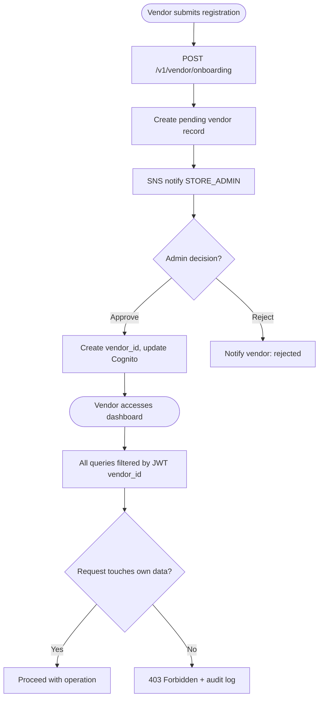
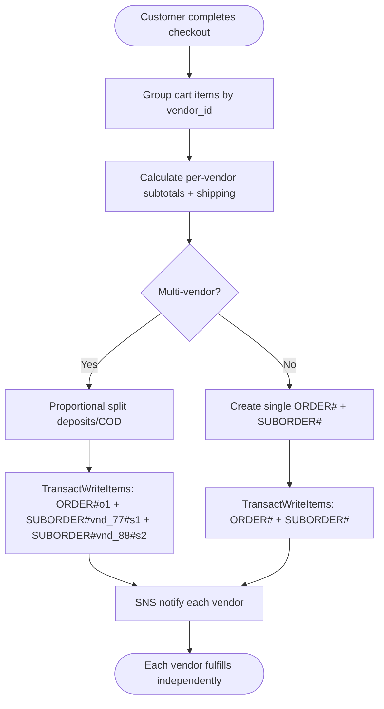
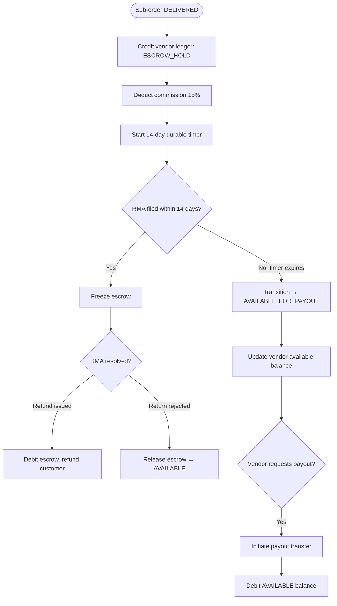

# Module 11: Multi-Vendor Marketplace

> **Slice**: v4.0 · **Sprints**: 4.1, 4.2 · **Stories**: US-11.1.1 – US-11.1.4

## Overview

Covers vendor onboarding, RBAC-scoped catalog management, automatic sub-order splitting, double-entry escrow ledger, and the vendor portal dashboard.

## Pages

| Page Route | Access | Primary Hook |
|:-----------|:-------|:-------------|
| `/[locale]/vendor/dashboard` | VENDOR | `useVendorPortal` |
| `/[locale]/vendor/products/new` | VENDOR | `useVendorProductEditor` |
| `/[locale]/cart` | Public / Auth | `useOfflineCart` |

## API Endpoints

| Method | Endpoint | Lambda | Description |
|:-------|:---------|:-------|:------------|
| POST | `/v1/vendor/onboarding` | `admin-vendor-api` | Vendor registration |
| GET | `/v1/vendor/sub-orders` | `admin-vendor-api` | Vendor's sub-orders |
| GET | `/v1/vendor/escrow` | `admin-vendor-api` | Escrow ledger balance |
| POST | `/v1/vendor/products` | `admin-vendor-api` | Vendor product CRUD |
| POST | `/v1/vendor/payout-request` | `admin-vendor-api` | Request payout |

---

## US-11.1.1: Vendor Onboarding & RBAC-Scoped Catalog

**As a** Marketplace Vendor,  
**I want to** register, manage only my own products, and have strict RBAC isolation,  
**So that** I cannot see or modify other vendors' data.

### Acceptance Criteria

```gherkin
Feature: Vendor Onboarding & RBAC

  Scenario: Vendor registration
    Given a new vendor submits registration with business details
    When the STORE_ADMIN approves the application
    Then a vendor_id is created and the user's Cognito group updates to VENDOR
    And the vendor can access /[locale]/vendor/dashboard

  Scenario: Vendor-scoped product listing
    Given Vendor A (vnd_77) opens the vendor dashboard
    Then only products with vendor_id=vnd_77 are shown
    And Vendor A cannot query or see Vendor B's products

  Scenario: Vendor creates product
    When Vendor A creates a new product
    Then the product is automatically tagged with vendor_id=vnd_77
    And is visible to shoppers in the storefront

  Scenario: Cross-vendor data access attempt
    Given Vendor A tries to access PRODUCT#p99 belonging to Vendor B
    Then a 403 Forbidden is returned
    And the attempt is logged for audit
```

### Test Cases

| # | Test Case | Type | Expected Result |
|:--|:----------|:-----|:----------------|
| TC-11.1.1-01 | Vendor registration | Happy Path | Vendor created |
| TC-11.1.1-02 | Scoped product list | Happy Path | Only own products |
| TC-11.1.1-03 | Create product | Happy Path | Tagged with vendor_id |
| TC-11.1.1-04 | Cross-vendor access | Security | 403 Forbidden |
| TC-11.1.1-05 | Admin sees all vendors | Happy Path | Full list |
| TC-11.1.1-06 | Vendor edits own product | Happy Path | Updated |
| TC-11.1.1-07 | Vendor deletes another's | Security | 403 |
| TC-11.1.1-08 | Vendor deactivation | Happy Path | Products hidden |

### Activity Diagram



---

## US-11.1.2: Automatic Sub-Order Splitting at Checkout

**As a** Shopper with items from multiple vendors,  
**I want** my order to automatically split into per-vendor sub-orders,  
**So that** each vendor fulfills independently without seeing other vendors' data.

### Acceptance Criteria

```gherkin
Feature: Sub-Order Splitting

  Scenario: Multi-vendor checkout
    Given the cart has items from Vendor A (vnd_77) and Vendor B (vnd_88)
    When the customer completes checkout
    Then a parent ORDER#o1 is created
    And SUBORDER#vnd_77#s1 and SUBORDER#vnd_88#s2 are created atomically
    And each sub-order has its own status, AWB, and escrow entry

  Scenario: Single-vendor order
    Given all cart items are from the same vendor
    Then only one sub-order is created (or the parent order serves directly)

  Scenario: Split COD allocation
    Given a DEPOSIT_COD multi-vendor order
    Then the deposit is proportionally split across sub-orders
    And each vendor's COD collection is calculated separately
```

### Test Cases

| # | Test Case | Type | Expected Result |
|:--|:----------|:-----|:----------------|
| TC-11.1.2-01 | 2-vendor cart split | Happy Path | 2 sub-orders |
| TC-11.1.2-02 | 5-vendor cart split | Happy Path | 5 sub-orders |
| TC-11.1.2-03 | Single vendor | Edge Case | 1 sub-order |
| TC-11.1.2-04 | COD proportional split | Happy Path | Correct amounts |
| TC-11.1.2-05 | Atomic transaction | Concurrency | All or nothing |
| TC-11.1.2-06 | Vendor A fulfills before B | Happy Path | Independent statuses |
| TC-11.1.2-07 | Sub-order cancellation | Happy Path | Only cancelled sub-order affected |

### Activity Diagram



---

## US-11.1.3: Double-Entry Escrow Ledger & Vendor Payouts

**As a** Marketplace Operator and Vendor,  
**I want** vendor payouts held in escrow until the delivery + return window completes,  
**So that** vendors are paid fairly and customers are protected during the return period.

### Acceptance Criteria

```gherkin
Feature: Escrow Ledger & Payouts

  Scenario: Escrow hold after delivery
    When a sub-order is marked DELIVERED
    Then the vendor's ledger is credited: ESCROW_HOLD (subtotal - 15% commission)
    And a 14-day durable timer starts

  Scenario: No RMA — escrow released
    Given no RMA is filed within 14 days
    Then the ledger transitions ESCROW_HOLD → AVAILABLE_FOR_PAYOUT
    And the vendor's available balance updates

  Scenario: RMA filed — escrow frozen
    Given an RMA is filed within 14 days
    Then the escrow remains frozen until the return is resolved
    And the vendor is notified

  Scenario: Vendor requests payout
    Given the vendor has AVAILABLE_FOR_PAYOUT balance of $5,000
    When the vendor clicks "Request Payout"
    Then a payout transfer is initiated
    And the balance is deducted

  Scenario: Commission breakdown visible
    Then the vendor dashboard shows per-sub-order: subtotal, commission %, commission amount, net payout
```

### Test Cases

| # | Test Case | Type | Expected Result |
|:--|:----------|:-----|:----------------|
| TC-11.1.3-01 | Escrow hold on delivery | Happy Path | ESCROW_HOLD credited |
| TC-11.1.3-02 | 14-day release | Happy Path | AVAILABLE_FOR_PAYOUT |
| TC-11.1.3-03 | RMA freezes escrow | Happy Path | Remains frozen |
| TC-11.1.3-04 | Request payout | Happy Path | Transfer initiated |
| TC-11.1.3-05 | Payout > available | Validation | Error |
| TC-11.1.3-06 | Commission math | Happy Path | 15% deducted |
| TC-11.1.3-07 | Multiple sub-orders settled | Happy Path | Sum correctly |
| TC-11.1.3-08 | Concurrent payout requests | Concurrency | Only one succeeds |

### Activity Diagram



---

## US-11.1.4: Vendor Portal Dashboard

**As a** Vendor,  
**I want** a comprehensive dashboard showing sub-orders, inventory, escrow balance, and fulfillment actions,  
**So that** I can manage my marketplace presence efficiently.

### Acceptance Criteria

```gherkin
Feature: Vendor Dashboard

  Scenario: View pending sub-orders
    Given the vendor opens "/[locale]/vendor/dashboard"
    Then a table shows all sub-orders with status, items, and ship-by deadline

  Scenario: Print AWB label
    When the vendor clicks "Print Label" on a sub-order
    Then the pre-generated Bosta/carrier AWB PDF downloads

  Scenario: Quick inventory edit
    When the vendor updates stock for a SKU
    Then the stock is updated in DynamoDB
    And Elasticsearch re-indexes the product

  Scenario: View escrow balance
    Then a card shows: ESCROW_HOLD, AVAILABLE_FOR_PAYOUT, and total settled
```

### Test Cases

| # | Test Case | Type | Expected Result |
|:--|:----------|:-----|:----------------|
| TC-11.1.4-01 | View sub-order queue | Happy Path | Table with statuses |
| TC-11.1.4-02 | Print AWB label | Happy Path | PDF downloads |
| TC-11.1.4-03 | Update inventory | Happy Path | Stock updated + ES reindex |
| TC-11.1.4-04 | View escrow balance | Happy Path | Card with balances |
| TC-11.1.4-05 | Empty queue | Edge Case | "No pending sub-orders" |
| TC-11.1.4-06 | Dashboard performance | Performance | Loads <500ms |
