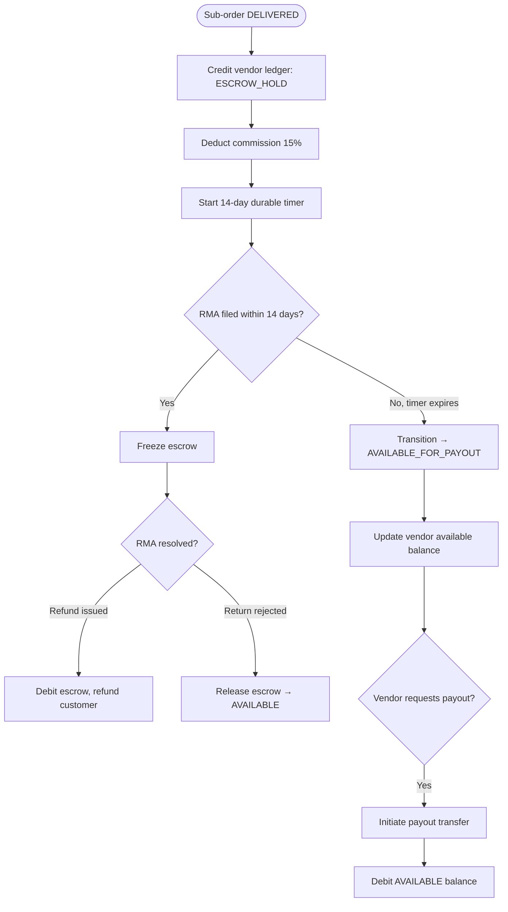

# US-11.1.3: Double-Entry Escrow Ledger & Vendor Payouts

> **Spec Kit Specification**: [Specification Lifecycle Active (.specify/)](../../../.specify/memory/constitution.md)  
> **Domain Feature**: `commercial-models`  
> **Domain Module**: `multi-vendor-marketplace`  
> **Autonomous Behaviour**: `escrow-ledger-payouts`  
> **Client Framework Path**: `apps/storefront/src/features/commercial-models/modules/multi-vendor-marketplace/behaviours/escrow-ledger-payouts`  
> **Backend Framework Path**: `backend/src/features/commercial-models/modules/multi-vendor-marketplace/behaviours/escrow-ledger-payouts`  
> **Execution Sprint**: [Sprint 4.2](../../sprints/README.md)  
> **Slicing Standard**: [10-PR Vertical Slicing Framework](../../sprints/README.md#the-10-pr-vertical-slicing-standard-aligned-with-10-pillar-system-architecture)  
> **Security Gateway**: [ASVS Level 2 Verification Gate (security-audit)](#5-security-gateway-powered-by-security-audit)

---

## 1. Spec Kit Specification: User Story & Domain Scope

### 1.1 User Story Narrative

**As a** Marketplace Operator and Vendor,  
**I want** vendor payouts held in escrow until the delivery + return window completes,  
**So that** vendors are paid fairly and customers are protected during the return period.

### 1.2 Acceptance Criteria (Gherkin Scenarios)

```gherkin
Feature: Escrow Ledger & Payouts
  Scenario: [AC-US-11.1.3-01] Escrow hold after delivery
    When a sub-order is marked DELIVERED
    Then the vendor's ledger is credited: ESCROW_HOLD (subtotal - 15% commission)
    And a 14-day durable timer starts
  Scenario: [AC-US-11.1.3-02] No RMA — escrow released
    Given no RMA is filed within 14 days
    Then the ledger transitions ESCROW_HOLD → AVAILABLE_FOR_PAYOUT
    And the vendor's available balance updates
  Scenario: [AC-US-11.1.3-03] RMA filed — escrow frozen
    Given an RMA is filed within 14 days
    Then the escrow remains frozen until the return is resolved
    And the vendor is notified
  Scenario: [AC-US-11.1.3-04] Vendor requests payout
    Given the vendor has AVAILABLE_FOR_PAYOUT balance of $5,000
    When the vendor clicks "Request Payout"
    Then a payout transfer is initiated
    And the balance is deducted
  Scenario: [AC-US-11.1.3-05] Commission breakdown visible
    Then the vendor dashboard shows per-sub-order: subtotal, commission %, commission amount, net payout
  Scenario: [AC-US-11.1.3-LAW] Global e-commerce legal compliance and marketplace tax reporting regulations
    Given marketplace customer payments held in double-entry escrow and disbursed to vendors
    When computing vendor commissions, withholding funds, and executing automated bank payouts
    Then vendor annual gross sales and transaction counts must be recorded for mandatory DAC7 and IRS Form 1099-K tax reporting
    And customer escrow funds must remain segregated from operational platform funds until fulfillment obligations are satisfied
    And vendor commission deductions must strictly mirror agreed contractual rates without unauthorized hidden withholding
```

### 1.3 Test Cases & Traceability Matrix

| # | Test Case | Type | Expected Result |
|:--|:----------|:-----|:----------------|
| TC-11.1.3-01 | Escrow hold on delivery | Happy Path | ESCROW_HOLD credited |
| TC-11.1.3-02 | 14-day release | Happy Path | AVAILABLE_FOR_PAYOUT |
| TC-11.1.3-03 | RMA freezes escrow | Happy Path | Remains frozen |
| TC-11.1.3-04 | Request payout | Happy Path | Transfer initiated |
| TC-11.1.3-05 | Payout > available | Validation | Error |
| TC-11.1.3-06 | Commission math | Happy Path | 15% deducted |
| TC-11.1.3-07 | Multiple sub-orders settled | Happy Path | Sum correctly |
| TC-11.1.3-08 | Concurrent payout requests | Concurrency | Only one succeeds |
| TC-11.1.3-LAW | Global legal & regulatory compliance (EU DAC7 Directive 2021/514 tax reporting, US IRS Form 1099-K, fiduciary escrow fund segregation) | Legal / Regulatory | Statutory compliance verified with zero legal or regulatory violations |

---

## 2. Behavior-Centric Architecture & Folder Blueprint

This user story is implemented directly inside the respective **Expo client** and **Cargo Lambda Axum backend** frameworks according to the **Locality of Behavior (LoB)** architectural law. Private services, designs, logic, types, and constants are strictly colocated within their framework behaviour directory.

### 2.1 Colocated Behaviour Directory Tree

#### Client Architecture (Universal Expo SDK 58):
```
apps/storefront/src/features/commercial-models/modules/multi-vendor-marketplace/behaviours/escrow-ledger-payouts/
├── services/
│   │   ├── double_entry_ledger.rs
│   │   ├── vendor_payout_service.rs
│   │   ├── escrow_api.ts
├── designs/
│   │   ├── VendorEarningsSummaryCard.tsx
│   │   ├── EscrowLedgerTable.tsx
│   │   ├── RequestPayoutButton.tsx
├── logic/
│   │   ├── useEscrowLedger.ts
│   │   ├── balance_sheet_calculator.rs
│   │   ├── payout_hold_enforcer.rs
├── types/
│   │   ├── LedgerJournalEntry.ts
│   │   ├── VendorPayoutRequest.ts
│   │   ├── EscrowBalanceSnapshot.ts
└── constants/
│   │   ├── EscrowEndpoints.ts
│   │   ├── PayoutHoldDays.ts
│   │   ├── EscrowErrorCodes.ts
```

#### Backend Architecture (Cargo Lambda + Axum 0.8):
```
backend/src/features/commercial-models/modules/multi-vendor-marketplace/behaviours/escrow-ledger-payouts/
├── services/
│   │   ├── double_entry_ledger.rs
│   │   ├── vendor_payout_service.rs
│   │   ├── escrow_api.ts
├── logic/
│   │   ├── useEscrowLedger.ts
│   │   ├── balance_sheet_calculator.rs
│   │   ├── payout_hold_enforcer.rs
├── types/
│   │   ├── LedgerJournalEntry.ts
│   │   ├── VendorPayoutRequest.ts
│   │   ├── EscrowBalanceSnapshot.ts
└── constants/
│   │   ├── EscrowEndpoints.ts
│   │   ├── PayoutHoldDays.ts
│   │   ├── EscrowErrorCodes.ts
```

### 2.2 Scoping & Promotion Blueprint

| Layer / Tier | Client Path (Expo) | Backend Path (Cargo Lambda / Axum) | Purpose & Promotion Rules |
| :--- | :--- | :--- | :--- |
| **Behaviour-Local** | `.../behaviours/escrow-ledger-payouts/` | `.../behaviours/escrow-ledger-payouts/` | **Default Private Scope**: Colocated services, designs, logic, types, and constants private to this story. |
| **Module-Shared** | `.../modules/multi-vendor-marketplace/_shared/` | `.../modules/multi-vendor-marketplace/_shared/` | Shared domain primitives and UI elements used by $\ge 2$ behaviours in `multi-vendor-marketplace`. |
| **Feature-Shared** | `.../features/commercial-models/_shared/` | `.../features/commercial-models/_shared/` | Feature-level contracts, ports, and cross-module bridges across `commercial-models`. |
| **Framework-Shared** | `apps/storefront/src/shared/` | `backend/crates/kernel-core/` | System-wide microkernel traits, `Money` arithmetic, RFC 9110 ETag middleware, and database adapters. |

---

## 3. Technical Implementation Plan (Spec Kit Plan)

### 3.1 Domain Invariants & Storage Schema
- **State Machine**: Enforces valid state transitions and rejects unauthorized or out-of-order mutations.
- **Data Persistence**: Single-table Amazon DynamoDB partitioning (`PK = TENANT#<id>`, `SK = ENTITY#<id>`) paired with reactive local-first WatermelonDB sync.
- **Freshness & Caching**: Multi-tier caching (L1 Moka in-memory + L2 ElastiCache Redis) with RFC 9110 `ETag` conditional `304 Not Modified` short-circuiting.

### 3.2 Activity & Interaction Diagram



---

## 4. Granular Implementation Tasks (Spec Kit Tasks)

### Phase 1: Core Domain Logic, Types & Constants
- [ ] **Task 1.1 (Types)**: Define strongly typed models and DTO schemas in `types/`.
- [ ] **Task 1.2 (Constants)**: Define routes, action codes, and validation limits in `constants/`.
- [ ] **Task 1.3 (Logic)**: Implement pure business logic, calculations, and state machines in `logic/`.
- [ ] **Task 1.4 (Unit Tests)**: Write pure property-based and unit tests verifying domain invariants.

### Phase 2: Services & Infrastructure Adapters
- [ ] **Task 2.1 (API / Gateway)**: Implement client adapters and backend handlers in `services/`.
- [ ] **Task 2.2 (ETag & Cache)**: Integrate RFC 9110 ETag headers and multi-tier caching (Moka L1 / Redis L2).
- [ ] **Task 2.3 (Storage & Sync)**: Implement DynamoDB storage operations and WatermelonDB delta sync.
- [ ] **Task 2.4 (Integration Tests)**: Verify service contract tests and real database conditional writes.

### Phase 3: Platform-Adaptive Designs & UI
- [ ] **Task 3.1 (UI Presentation)**: Build platform-adaptive screens and SDUI components in `designs/`.
- [ ] **Task 3.2 (Headless Hooks)**: Bind headless domain hooks from `logic/` into the UI presentation.
- [ ] **Task 3.3 (i18n & RTL)**: Implement bidirectional RTL/LTR layout mirroring and localized font switching.
- [ ] **Task 3.4 (Component Tests)**: Test empty, loading, offline, and error states across web and mobile.

### Phase 4: Security Gateway Verification & Release Readiness
- [ ] **Task 4.1 (Abuse Testing)**: Execute automated adversarial penetration tests against the threat matrix.
- [ ] **Task 4.2 (Zero-Trust Audit)**: Verify strict tenant isolation and object-level authorization (IDOR).
- [ ] **Task 4.3 (SAST & Audit)**: Run static analysis, dependency audit, and secret scanning.
- [ ] **Task 4.4 (Gate Sign-Off)**: Obtain independent security sign-off for the G2 Security Gateway.

---

## 5. Security Gateway (Powered by security-audit)

### 5.1 Trust Boundaries & Security Actors
- **Trust Boundaries**:
  - `Untrusted Zone`: Mobile client app, public web browser, and external network callers.
  - `Gateway Edge`: AWS CloudFront, API Gateway, and Cognito JWT authentication guard.
  - `Secure Application Boundary`: Axum Tower route extractors enforcing tenant and RBAC/ABAC isolation.
  - `Encrypted Storage & Secret Vault`: Amazon DynamoDB KMS-encrypted tables and AWS KMS vault.
- **Authorized Principals**:
  - Identified Actors: `AuthenticatedCustomer`, `B2bBuyer`, `Vendor`, `StoreAdmin`, or `AnonymousShopper` (read-only).
  - Multi-Tenancy Invariant: Every request must extract `tenant_id` from verified JWT claims. Injections via query params or payload body are rejected with `403 Forbidden`.

### 5.2 Threat Modeling & Abuse Matrix (STRIDE / ASVS)

| Threat Vector | Severity | Vulnerability Mechanism | Mitigating Control & Security Invariant |
| :--- | :--- | :--- | :--- |
| **Spoofing & Impersonation** | Critical | Forged `sub` or `tenant_id` identity claims | Server-side RS256 JWKS signature verification; strict claims extraction in Axum. |
| **Tampering & Invariant Bypass** | High | Manipulating payload parameters or prices | Authoritative server recalculation; strict schema validation; BLAKE3 ETag integrity checks. |
| **Information Disclosure (IDOR)** | Critical | Cross-tenant or cross-user data scraping | Explicit `PK = TENANT#<id>` partition filtering on every database and cache operation. |
| **Denial of Service / Abuse** | High | Double-spend payout requests, unauthorized ledger balance inflation, and payout to unverified bank accounts | Token-bucket rate limiting per IP and account; strict input length validation. |
| **Elevation of Privilege** | Critical | Bypassing role-based permission checks | Tower extractors (`RequireStoreAdmin`, `RequireVendor`) guard sensitive endpoints. |

### 5.3 Cryptographic & Data Protection Controls
- **Encryption in Transit**: TLS 1.3 enforced on all external and internal endpoints; HSTS active.
- **Encryption at Rest**: DynamoDB AWS KMS customer-managed keys; AES-256-GCM for sensitive client tokens in `expo-secure-store`.
- **PII & Secret Redaction**: Passwords, OTPs, auth tokens, and credit card numbers are stripped from logs and traces via `tracing` redaction filters.

### 5.4 Automated Security Verification Checklist
- [ ] **SAST Analysis**: Clean report from static code analyzers; 0 high or critical vulnerabilities.
- [ ] **Dependency Audit**: `cargo deny` and `bun audit` pass with 0 unreviewed security advisories.
- [ ] **Abuse & IDOR Fuzzing**: Test suite confirms that requests with modified `tenant_id` or `user_id` fail with `401 Unauthorized` or `403 Forbidden`.
- [ ] **Secret Scanning**: Gitleaks scanner confirms zero hardcoded credentials, API keys, or private keys.

### 5.5 Security Gateway (G2) Sign-Off Checklist
- [ ] Threat boundary and entry points verified against OWASP ASVS Level 2 requirements.
- [ ] Multi-tenant isolation verified with automated cross-tenant penetration test.
- [ ] Anti-abuse and rate limiting confirmed active on all public interfaces.
- [ ] Audit log redaction verified — zero plaintext secrets in output logs.
- [ ] Independent reviewer sign-off obtained; zero open Critical or High findings.

---

## 6. Validation Gates & Acceptance Sign-Off

**Status: Pending — specification only; no implementation evidence.** All [G0–G4 quality gates + G-Review + G-Law](../../QUALITY_GATES.md) apply to this story. The following checks add to its acceptance criteria and test cases; they do not replace them.

### G1 — Test coverage
- [ ] **US-11.1.3-G1:** Automated test suite maps 100% of acceptance criteria and test cases with >=90% line and >=85% branch coverage in affected packages.

### G2 — Security audit
- [ ] **US-11.1.3-G2:** Verify zero-trust tenant isolation, object-level authorization (IDOR), and defense against Double-spend payout requests, unauthorized ledger balance inflation, and payout to unverified bank accounts. No unresolved critical or high findings.

### G3 — Architecture and maintainability
- [ ] **US-11.1.3-G3:** Strict compliance with framework colocation (`apps/storefront/src/features/` or `backend/src/features/`), zero-clone borrowing discipline in Rust, and clean domain boundaries.

### G-Review — Code review
- [ ] **US-11.1.3-G-Review:** Independent senior code review signed off by the Code Reviewer; verification across Correctness, Security, Maintainability, Performance, and Testing using the Agency-Agents code review standard; zero open Blocker or unresolved Suggestion findings.

### G-Law — Law validation
- [ ] **US-11.1.3-G-Law:** Independent verification against global e-commerce legal and statutory requirements: EU DAC7 Directive (Directive 2021/514), US IRS Form 1099-K reporting, and fiduciary customer payment escrow segregation; certified by compliance reviewer (`agency-legal-compliance-checker`).

### G4 — Integrated acceptance
- [ ] **US-11.1.3-G4:** End-to-end user journey validation across supported platforms (Web, iOS, Android) and verified sandbox integration.

---

[← Back to Module multi-vendor-marketplace Catalog (README.md)](README.md) | [Master User Stories Index](../README.md)
