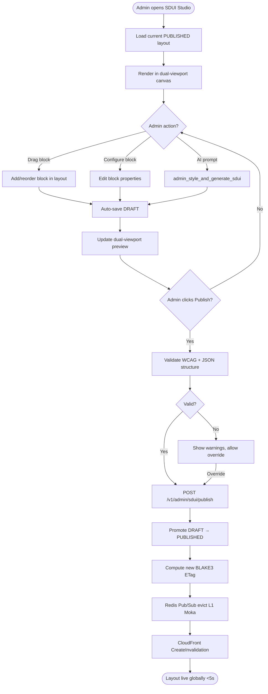

# Module 12: Admin & SDUI Studio

> **Slice**: v5.0 / v6.0 · **Sprints**: 5.1, 6.1, 6.2 · **Stories**: US-12.1.1 – US-12.1.3

## Overview

Covers the dual-edition deployment model (Standard vs. Managed Instances), the visual SDUI studio with drag-and-drop editing, AI styling, and the white-label mobile build pipeline.

## Pages

| Page Route | Access | Primary Hook |
|:-----------|:-------|:-------------|
| `/[locale]/admin/sdui-studio` | STORE_ADMIN | `useAdminSduiStudio` |
| `/[locale]/admin/sdui-studio/mobile-builds` | STORE_ADMIN | `useAdminSduiStudio` |
| `/[locale]/admin/settings-gateways` | STORE_ADMIN | `useAdminGatewayConfig` |

## API Endpoints

| Method | Endpoint | Lambda | Description |
|:-------|:---------|:-------|:------------|
| POST | `/v1/admin/sdui/publish` | `admin-vendor-api` | Publish SDUI layout |
| GET | `/v1/admin/sdui/drafts` | `admin-vendor-api` | List SDUI drafts |
| POST | `/v1/admin/sdui/preview` | `admin-vendor-api` | Generate draft preview |
| POST | `/v1/admin/mobile-builds/trigger` | `admin-vendor-api` | Trigger EAS build |
| GET | `/v1/admin/telemetry/cache` | `admin-vendor-api` | Cache hit ratio stats |

---

## US-12.1.1: Visual Drag-and-Drop SDUI Studio

**As a** Brand Designer or Store Administrator,  
**I want to** visually edit SDUI pages with drag-and-drop block reordering, dual-viewport RTL/LTR preview, and version history,  
**So that** I can launch campaigns and custom pages without frontend code deployments.

### Acceptance Criteria

```gherkin
Feature: Visual SDUI Studio

  Scenario: Drag-and-drop block editing
    Given the admin opens "/[locale]/admin/sdui-studio"
    When they drag a "CountdownTimerBlock" from the palette into the page layout
    Then the block appears in the preview canvas
    And the admin can configure its properties (end date, colors, text)

  Scenario: Dual-viewport RTL + LTR preview
    Then the studio shows side-by-side previews:
      - Left: ar-EG (RTL) with Cairo font
      - Right: en-US (LTR) with Inter font
    And changes update both previews in real-time

  Scenario: Draft save and publish flow
    When the admin edits a page layout
    Then changes auto-save as DRAFT in DynamoDB
    When the admin clicks "Validate & Publish"
    Then the DRAFT is promoted to PUBLISHED
    And a new BLAKE3 ETag is computed
    And Redis Pub/Sub evicts all L1 Moka caches
    And CloudFront invalidation is triggered

  Scenario: Version history rollback
    Given the admin published v15 but wants to revert
    When they open the version history drawer
    Then all previous versions are listed with timestamps
    And clicking "Rollback to v14" restores that version as v16

  Scenario: WCAG contrast validation
    Given the admin sets a light yellow text on white background
    Then a warning "Low contrast ratio (2.1:1). WCAG AA requires 4.5:1" appears
    And publishing is allowed but with a warning badge
```

### Test Cases

| # | Test Case | Type | Expected Result |
|:--|:----------|:-----|:----------------|
| TC-12.1.1-01 | Drag block into layout | Happy Path | Block added |
| TC-12.1.1-02 | Reorder blocks | Happy Path | Order updated |
| TC-12.1.1-03 | RTL + LTR dual preview | Happy Path | Both render correctly |
| TC-12.1.1-04 | Auto-save draft | Happy Path | DRAFT saved |
| TC-12.1.1-05 | Publish layout | Happy Path | PUBLISHED, caches evicted |
| TC-12.1.1-06 | Rollback to previous version | Happy Path | Old version restored |
| TC-12.1.1-07 | WCAG contrast warning | Validation | Warning shown |
| TC-12.1.1-08 | Delete block | Happy Path | Block removed |
| TC-12.1.1-09 | Concurrent editing by 2 admins | Concurrency | ETag conflict detected |
| TC-12.1.1-10 | Empty page publish | Validation | Warning: no blocks |

### Activity Diagram



---

## US-12.1.2: Dual-Edition Deployment (Standard vs. Managed Instances)

**As a** DevOps Engineer deploying some-commerce,  
**I want to** toggle a single CDK parameter to deploy on scale-to-zero Lambda or dedicated Managed Instances,  
**So that** indie merchants pay $0 idle and enterprises get zero cold starts.

### Acceptance Criteria

```gherkin
Feature: Dual-Edition Deployment

  Scenario: Deploy Standard On-Demand edition
    Given the CDK context is computeMode=ON_DEMAND
    Then all 5 Lambda binaries deploy as standard on-demand functions
    And DynamoDB Streams sync to Elasticsearch via fulfillment-worker
    And idle cost is $0

  Scenario: Deploy Enterprise Managed Instances edition
    Given the CDK context is computeMode=MANAGED_INSTANCES
    Then Lambda functions deploy with MaxConcurrency=64 on Graviton4
    And all 64 tasks share L1 Moka cache in RAM
    And DynamoDB Zero-ETL pipeline syncs to OpenSearch

  Scenario: 1-Click in-app upgrade from Standard to Managed Instances
    Given the admin opens "/admin/settings-infrastructure"
    And the current compute mode is "ON_DEMAND"
    When the admin toggles the compute engine to "Enterprise Managed Instances"
    And clicks "Confirm Upgrade"
    Then the system dispatches "POST /v1/admin/infrastructure/compute-mode" with target_mode="MANAGED_INSTANCES"
    And the CloudFormation stack initiates an in-place rolling update
    And the storefront experiences zero downtime (all requests routed via canary)
    And no database records or customer sessions are modified or lost
    And the admin banner updates to "Active Mode: Enterprise Managed Instances (MaxConcurrency=64)"

  Scenario: Runtime telemetry dashboard
    Given the admin opens "/admin/settings-infrastructure"
    Then a banner shows the active runtime edition
    And cache hit ratio cards display: L1 Moka hits %, L2 Redis hits %, 304 ETag %
```

### Test Cases

| # | Test Case | Type | Expected Result |
|:--|:----------|:-----|:----------------|
| TC-12.1.2-01 | Deploy ON_DEMAND | Happy Path | Scale-to-zero |
| TC-12.1.2-02 | Deploy MANAGED_INSTANCES | Happy Path | 64-concurrency |
| TC-12.1.2-03 | 1-Click in-app upgrade | Happy Path | CloudFormation updates without downtime |
| TC-12.1.2-04 | L1 Moka sharing | Performance | Cache shared across tasks |
| TC-12.1.2-05 | Zero-ETL pipeline | Integration | OpenSearch receives data |
| TC-12.1.2-06 | Telemetry dashboard | Happy Path | Metrics shown |
| TC-12.1.2-07 | Cold start on ON_DEMAND | Performance | <500ms |
| TC-12.1.2-08 | No cold start on MANAGED | Performance | <10ms warm |
| TC-12.1.2-09 | Downgrade back to ON_DEMAND | Happy Path | Reverts to scale-to-zero cleanly |

---

## US-12.1.3: White-Label Mobile Build Pipeline

**As a** Store Administrator or Agency Developer,  
**I want to** trigger white-label iOS/Android builds with custom branding from the SDUI Studio,  
**So that** I can launch branded mobile apps without engineering involvement.

### Acceptance Criteria

```gherkin
Feature: White-Label Mobile Pipeline

  Scenario: Configure white-label branding
    Given the admin opens "/admin/sdui-studio/mobile-builds"
    When they upload a custom app icon, splash screen, and set app name
    Then the branding config is saved for the next build

  Scenario: Trigger EAS build
    When the admin clicks "Build iOS & Android"
    Then a GitHub Actions / EAS Build workflow is dispatched
    And the build status is shown with progress indicators
    And the admin receives an SNS notification when builds complete

  Scenario: Download build artifacts
    When the builds complete
    Then .ipa (iOS) and .apk (Android) artifacts are available for download
    And TestFlight / Google Play internal track links are provided
```

### Test Cases

| # | Test Case | Type | Expected Result |
|:--|:----------|:-----|:----------------|
| TC-12.1.3-01 | Upload branding assets | Happy Path | Assets saved |
| TC-12.1.3-02 | Trigger EAS build | Happy Path | Workflow dispatched |
| TC-12.1.3-03 | Build completion notification | Happy Path | SNS sent |
| TC-12.1.3-04 | Download .ipa | Happy Path | File downloads |
| TC-12.1.3-05 | Invalid icon dimensions | Validation | Error shown |
| TC-12.1.3-06 | Build failure | Error | Error log shown |
